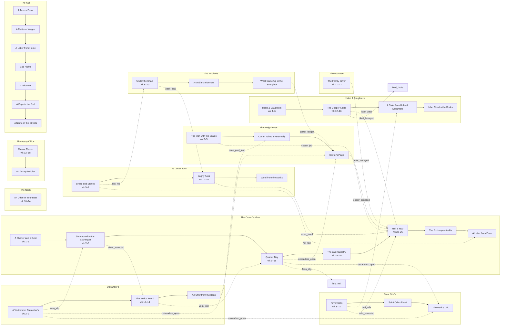

# Ledger & Blade: all game writing

_Generated by `npm run story-export` from the game source. Do not edit this file by hand: edit the Claude Doc, or the game data, and re-run the export._

49 scenes (72 conversation nodes, 202 choices), 296 content items (contracts, Codex, street talk, Dates, tutorial, starts, Legends, names), 293 lines from the rules and 327 interface lines. Expeditions: 142 sites, zones, monsters and other entries, 1391 log lines and 86 report lines.

**How to read it.** Text in quotes or block quotes is what the player sees. `{member}` and other words in curly braces are filled in by the game. `[IF riot_fed] … [ELSE] … [END]` marks text that changes with the story; every version is shown. Each item carries its ID and source file, so an edit can be traced back to the code.

**Facts** are the story's flags (`docs/STORY.md` §1, `data/facts.ts`). Under each scene, _Reads_ lists the facts it checks and who sets them, and _Leads to_ lists who reads the facts its choices set.

For how the owner's comments in the Claude Doc come back into the code, see `docs/story/README.md`.

## Thread map

The game has 17 Act I story beats across 11 character threads, plus 32 follow-ups, world events and road decisions. Acts II to IV are planned in the story bible but have no text yet.

| Thread | Who | Scenes in order |
|---|---|---|
| The Crown's silver | Lord Treasurer Fenn, the Exchequer | 1. A Charter and a Debt (wk 1–1) → 6. Summoned to the Exchequer (wk 7–9) → 13. Quarter Day (wk 9–18) → 15. The Last Tapestry (wk 15–20) → 17. Half a Year (wk 22–26) → The Exchequer Audits (follow-up) → A Letter from Fenn (follow-up) |
| Ostrander's | Factor Maelis Vorn | 2. A Visitor from Ostrander's (wk 2–3) → 10. The Notice Board (wk 10–14) → An Offer from the Bank (follow-up) |
| The Weighhouse | Alderman Piet Coster | 3. The Man with the Scales (wk 3–5) → Coster Takes It Personally (follow-up) → Coster's Page (follow-up) |
| Hobb & Daughters | Marta and Isbet Hobb | 4. Hobb & Daughters (wk 4–6) → 12. The Copper Kettle (wk 12–16) → A Cake from Hobb & Daughters (follow-up) → Isbet Checks the Books (follow-up) |
| The Lower Town | Dagny Fell, Porters' Fraternity | 5. Bread and Stones (wk 5–7) → 11. Dagny Asks (wk 11–15) → Word from the Docks (follow-up) |
| The Mudlarks | Wenna Pask | 7. Under the Chain (wk 6–10) → A Mudlark Informant (follow-up) → What Came Up in the Strongbox (follow-up) |
| Saint Oda's | Sister Agathe Brune | 8. Fever Salts (wk 8–11) → Saint Oda's Feast (follow-up) → The Bank's Gift (follow-up) |
| The Ninth | Captain Rufus Mayne | 9. An Offer for Your Best (wk 10–14) |
| The Assay Office | Master Assayer Corwin Plaice | 14. Clause Eleven (wk 12–18) → An Assay-Peddler (follow-up) |
| The Fourteen | Lady Honora Aske | 16. The Family Silver (wk 17–22) |
| The hall | Jory Abbot and the members | A Tavern Brawl (follow-up) → A Matter of Wages (follow-up) → A Letter from Home (follow-up) → Bad Nights (follow-up) → A Volunteer (follow-up) → A Page in the Roll (follow-up) → A Name in the Streets (queued) |
| Varrow at large | No fixed character | A Whisper in the Taverns (world) → A Petition at the Gate (world) |
| On the road | The squad in the yard | The Bridge Is Out (road) → A Deserter at the Door (road) → Watched (road) → A Local Guide (road) → A Wounded Carter (road) → Hobb's People Are Packing (road) → The Weather Turns (road) → Fresh Tracks (road) → The Crown's Wagons (road) → An Exchequer Writ (road) |

### Where threads cross

A choice in one thread sets a fact that a scene or contract in another thread reads.

| From thread | To thread | Through | Shared fact |
|---|---|---|---|
| The Fourteen | The Crown's silver | The Family Silver → Half a Year | `aske_betrayed` |
| The Fourteen | The Crown's silver | contract:aske_plate → Half a Year | `aske_plate_saved` |
| The Fourteen | The Crown's silver | contract:aske_plate → Half a Year | `aske_plate_lost` |
| Saint Oda's | Hobb & Daughters | Fever Salts → A Cake from Hobb & Daughters | `met_oda` |
| Saint Oda's | The Crown's silver | Fever Salts → Half a Year | `salts_accepted` |
| Saint Oda's | The Crown's silver | contract:fever_salts → Half a Year | `salts_delivered` |
| Saint Oda's | The Crown's silver | contract:fever_salts → Half a Year | `salts_failed` |
| The Weighhouse | The Crown's silver | The Man with the Scales → Half a Year | `coster_job` |
| The Weighhouse | The Crown's silver | The Man with the Scales → Half a Year | `coster_terms` |
| The Weighhouse | The Crown's silver | Coster's Page → Half a Year | `coster_exposed` |
| The Weighhouse | The Crown's silver | contract:false_weights → Half a Year | `weights_exposed` |
| The Weighhouse | The Crown's silver | contract:false_weights → Half a Year | `weights_failed` |
| The Lower Town | The Mudlarks | Bread and Stones → Under the Chain | `riot_fed` |
| The Lower Town | The Mudlarks | Bread and Stones → Under the Chain | `riot_broken` |
| The Lower Town | The Crown's silver | Bread and Stones → A Letter from Fenn | `riot_fed` |
| The Lower Town | The Crown's silver | Bread and Stones → A Letter from Fenn | `riot_held` |
| The Lower Town | The Crown's silver | Bread and Stones → A Letter from Fenn | `riot_broken` |
| The Lower Town | The Crown's silver | Dagny Asks → Half a Year | `ansel_freed` |
| The Lower Town | The Crown's silver | contract:ansel_chain → Half a Year | `ansel_freed` |
| The Lower Town | The Crown's silver | contract:ansel_chain → Half a Year | `ansel_lost` |
| Hobb & Daughters | On the road | The Copper Kettle → Hobb's People Are Packing | `isbet_betrayed` |
| Hobb & Daughters | The Crown's silver | The Copper Kettle → Half a Year | `isbet_pact` |
| Hobb & Daughters | The Crown's silver | The Copper Kettle → Half a Year | `isbet_betrayed` |
| The Mudlarks | The Weighhouse | What Came Up in the Strongbox → Coster's Page | `coster_ledger` |
| The Mudlarks | The Lower Town | Under the Chain → Dagny Asks | `pask_deal` |
| The Crown's silver | The Fourteen | contract:silver_convoy → The Family Silver | `silver_lost` |
| The Crown's silver | Saint Oda's | Quarter Day → The Bank's Gift | `ostranders_open` |
| The Crown's silver | The Weighhouse | Quarter Day → Coster's Page | `ostranders_open` |
| The Crown's silver | On the road | Quarter Day → An Exchequer Writ | `fenn_ally` |
| The Crown's silver | On the road | contract:silver_convoy → The Crown's Wagons | `silver_abandoned` |
| The Crown's silver | Ostrander's | Summoned to the Exchequer → The Notice Board | `silver_accepted` |
| The Crown's silver | Ostrander's | contract:silver_convoy → The Notice Board | `silver_delivered` |
| The Crown's silver | Ostrander's | contract:silver_convoy → The Notice Board | `silver_lost` |
| Ostrander's | Saint Oda's | A Visitor from Ostrander's → The Bank's Gift | `ostranders_open` |
| Ostrander's | The Weighhouse | A Visitor from Ostrander's → Coster's Page | `ostranders_open` |
| Ostrander's | The Weighhouse | An Offer from the Bank → Coster Takes It Personally | `bank_paid_loan` |
| Ostrander's | The Crown's silver | A Visitor from Ostrander's → Summoned to the Exchequer | `vorn_slip` |
| Ostrander's | The Crown's silver | The Notice Board → Quarter Day | `vorn_told` |
| Ostrander's | The Crown's silver | The Notice Board → Quarter Day | `vorn_honest` |

## Thread: The Crown's silver

Lord Treasurer Fenn, the Exchequer. The act's spine: the charter, the commission to carry the Crown's payment, Quarter Day and its aftermath.

### A Charter and a Debt

`charter` · Story beat 1 · data/events.ts:82

**When:** Week 1.

> The Exchequer's seal is still warm on your charter. As of this morning, Ledger & Blade may take paid work anywhere in the realm. It is also {loans[0].principal ?? 800} crowns in debt to the Weighhouse, which paid for the hall, the first wages and the sign over the door.
>
> [DEPENDS ON start.backer ?? 'merchant'] veterans: The money came from four old soldiers and their back pay. Two of them have already argued about where the weapon racks should go. [OR] merchant: The money came from a wool merchant on the Weighhouse, who has sent a list of his wagons and the dates they leave. [OR] coop: The money came from the porters and small trades of the Lower Town, in coins so small that it took Jory two days to count them. [OR] college: The money came from two Arcanists who left the college after the fire. One of them still smells faintly of smoke. [END]
>
> The hall came with a clerk, Jory Abbot, who has kept its books through three guildmasters and has already found the leak in the roof.
>
> The Exchequer man who brought the charter glances at the empty weapon racks. "Quarter-day's in a few weeks," he says, as everyone in Varrow does lately. "Good luck."
>
> You have a little coin left over. How do you start?

- **Arm the guild** · _Gain a Mail Hauberk and 2 Fire Oils_ · `charter/root/c1`
  “You visit the armorers on Anvil Row. Your people will at least look the part.”
  Sets `start_arms`.
- **Hire an Arcanist** · _A college-trained Arcanist joins for free_ · `charter/root/c2`
  “A young Arcanist from the college, short of fees, signs on for the work and the wage.”
- **Keep the coin** · _+80 crowns_ · `charter/root/c3`
  “You put it in the strongbox under the stairs. Eighty crowns is eighty crowns.”

**Leads to:**

- `start_arms` → rules in `src/engine/story/scenes.ts`

### Summoned to the Exchequer

`silver_summons` · Story beat 6 · data/events.ts:328

**When:** Weeks 7–9; after A Visitor from Ostrander's (`ostrander_agent`); needs alive: Lord Treasurer Aubrey Fenn; 50% a week inside the window.

**Reads:** `fenn_haggled` (set by this scene); `fenn_pay` (set by this scene); `fenn_route` (set by this scene); `fenn_stakes` (set by this scene); `silver_bonus` (set by this scene); `vorn_slip` (set by [A Visitor from Ostrander's](#a-visitor-from-ostranders) (`ostrander_agent`)).

_Speaker: Lord Treasurer Aubrey Fenn_

> Lord Treasurer Aubrey Fenn sees you in an office with pale squares on the walls where the tapestries used to hang. He apologizes for the cold.
>
> "The quarter payment is due, and for once we have it: three wagons of silver, most of what's left of the Crown plate. It has to reach Port Anselm and the bank's ships. I'd send my own guard, but half of them are owed back pay by the sort of people who'd like to see it stolen."

- **"Who knows the route?"** · `silver_summons/root/c1`
  Shown only if: not fenn_route.
  → goes to node `route`
  Sets `fenn_route`.
- **Tell him what Vorn let slip about the next treaty** · _Exchequer +4, Influence +2_ · `silver_summons/root/c2`
  Shown only if: vorn_slip and not fenn_stakes.
  → goes to node `stakes`
  Sets `fenn_stakes`.
- **"What does it pay?"** · `silver_summons/root/c3`
  Shown only if: not fenn_pay.
  → goes to node `pay`
  Sets `fenn_pay`.
- **Haggle** · _Guile check. Success: +60 crowns on the contract._ · (guile check, difficulty 14) · `silver_summons/root/c4`
  Shown only if: fenn_pay and not fenn_haggled and not silver_bonus.
  → goes to node `pay_ok`; on failure `pay_fail`
  Sets `silver_bonus`; on failure sets `fenn_haggled`.
- **Accept the commission** · _[IF fenn_route] Adds "The Crown's Last Silver". Fenn's tip reveals one of its dangers. [ELSE] Adds the story contract "The Crown's Last Silver". [END]_ · `silver_summons/root/c5`
  “"Thank you." He looks very tired. "Pick your people carefully. Somebody out there knows the route."”
  Sets `silver_accepted`.
  Adds story contract [The Crown's Last Silver](#contract-the-crowns-last-silver) (`silver_convoy`).
- **Decline** · _Exchequer −12. The Crown will find someone else, probably Hobb & Daughters._ · `silver_summons/root/c6`
  “Fenn nods. "I understand." By evening the commission has gone to Hobb & Daughters.”
  Sets `silver_declined`.

**Node `route`**, Lord Treasurer Fenn

> "My clerks know the route. So does the guard captain, and so does Vorn, because the bank insists on knowing everything." He rubs his eyes. "If I wanted to rob it, I'd try the ford at Wenmouth. You can't see that stretch of road from either side."

- **"Who knows the route?"** · `silver_summons/route/c1`
  Shown only if: not fenn_route.
  → goes to node `route`
  Sets `fenn_route`.
- **Tell him what Vorn let slip about the next treaty** · _Exchequer +4, Influence +2_ · `silver_summons/route/c2`
  Shown only if: vorn_slip and not fenn_stakes.
  → goes to node `stakes`
  Sets `fenn_stakes`.
- **"What does it pay?"** · `silver_summons/route/c3`
  Shown only if: not fenn_pay.
  → goes to node `pay`
  Sets `fenn_pay`.
- **Haggle** · _Guile check. Success: +60 crowns on the contract._ · (guile check, difficulty 14) · `silver_summons/route/c4`
  Shown only if: fenn_pay and not fenn_haggled and not silver_bonus.
  → goes to node `pay_ok`; on failure `pay_fail`
  Sets `silver_bonus`; on failure sets `fenn_haggled`.
- **Accept the commission** · _[IF fenn_route] Adds "The Crown's Last Silver". Fenn's tip reveals one of its dangers. [ELSE] Adds the story contract "The Crown's Last Silver". [END]_ · `silver_summons/route/c5`
  “"Thank you." He looks very tired. "Pick your people carefully. Somebody out there knows the route."”
  Sets `silver_accepted`.
  Adds story contract [The Crown's Last Silver](#contract-the-crowns-last-silver) (`silver_convoy`).
- **Decline** · _Exchequer −12. The Crown will find someone else, probably Hobb & Daughters._ · `silver_summons/route/c6`
  “Fenn nods. "I understand." By evening the commission has gone to Hobb & Daughters.”
  Sets `silver_declined`.

**Node `stakes`**, Lord Treasurer Fenn

> You tell him what Vorn said about the bank writing the next treaty. Fenn puts his pen down.
>
> "So they'd rather we missed it. That explains a few things." He looks at you properly for the first time. "Thank you. I won't forget that."

- **"Who knows the route?"** · `silver_summons/stakes/c1`
  Shown only if: not fenn_route.
  → goes to node `route`
  Sets `fenn_route`.
- **Tell him what Vorn let slip about the next treaty** · _Exchequer +4, Influence +2_ · `silver_summons/stakes/c2`
  Shown only if: vorn_slip and not fenn_stakes.
  → goes to node `stakes`
  Sets `fenn_stakes`.
- **"What does it pay?"** · `silver_summons/stakes/c3`
  Shown only if: not fenn_pay.
  → goes to node `pay`
  Sets `fenn_pay`.
- **Haggle** · _Guile check. Success: +60 crowns on the contract._ · (guile check, difficulty 14) · `silver_summons/stakes/c4`
  Shown only if: fenn_pay and not fenn_haggled and not silver_bonus.
  → goes to node `pay_ok`; on failure `pay_fail`
  Sets `silver_bonus`; on failure sets `fenn_haggled`.
- **Accept the commission** · _[IF fenn_route] Adds "The Crown's Last Silver". Fenn's tip reveals one of its dangers. [ELSE] Adds the story contract "The Crown's Last Silver". [END]_ · `silver_summons/stakes/c5`
  “"Thank you." He looks very tired. "Pick your people carefully. Somebody out there knows the route."”
  Sets `silver_accepted`.
  Adds story contract [The Crown's Last Silver](#contract-the-crowns-last-silver) (`silver_convoy`).
- **Decline** · _Exchequer −12. The Crown will find someone else, probably Hobb & Daughters._ · `silver_summons/stakes/c6`
  “Fenn nods. "I understand." By evening the commission has gone to Hobb & Daughters.”
  Sets `silver_declined`.

**Node `pay`**, Lord Treasurer Fenn

> "Two hundred and twenty crowns. It comes out of whatever's left after the payment, and I should warn you there isn't much left after the payment."

- **"Who knows the route?"** · `silver_summons/pay/c1`
  Shown only if: not fenn_route.
  → goes to node `route`
  Sets `fenn_route`.
- **Tell him what Vorn let slip about the next treaty** · _Exchequer +4, Influence +2_ · `silver_summons/pay/c2`
  Shown only if: vorn_slip and not fenn_stakes.
  → goes to node `stakes`
  Sets `fenn_stakes`.
- **"What does it pay?"** · `silver_summons/pay/c3`
  Shown only if: not fenn_pay.
  → goes to node `pay`
  Sets `fenn_pay`.
- **Haggle** · _Guile check. Success: +60 crowns on the contract._ · (guile check, difficulty 14) · `silver_summons/pay/c4`
  Shown only if: fenn_pay and not fenn_haggled and not silver_bonus.
  → goes to node `pay_ok`; on failure `pay_fail`
  Sets `silver_bonus`; on failure sets `fenn_haggled`.
- **Accept the commission** · _[IF fenn_route] Adds "The Crown's Last Silver". Fenn's tip reveals one of its dangers. [ELSE] Adds the story contract "The Crown's Last Silver". [END]_ · `silver_summons/pay/c5`
  “"Thank you." He looks very tired. "Pick your people carefully. Somebody out there knows the route."”
  Sets `silver_accepted`.
  Adds story contract [The Crown's Last Silver](#contract-the-crowns-last-silver) (`silver_convoy`).
- **Decline** · _Exchequer −12. The Crown will find someone else, probably Hobb & Daughters._ · `silver_summons/pay/c6`
  “Fenn nods. "I understand." By evening the commission has gone to Hobb & Daughters.”
  Sets `silver_declined`.

**Node `pay_ok`**, Lord Treasurer Fenn

> "All right, two hundred and eighty. Please don't mention it to the guard captain." He writes it down himself.

- **"Who knows the route?"** · `silver_summons/pay_ok/c1`
  Shown only if: not fenn_route.
  → goes to node `route`
  Sets `fenn_route`.
- **Tell him what Vorn let slip about the next treaty** · _Exchequer +4, Influence +2_ · `silver_summons/pay_ok/c2`
  Shown only if: vorn_slip and not fenn_stakes.
  → goes to node `stakes`
  Sets `fenn_stakes`.
- **"What does it pay?"** · `silver_summons/pay_ok/c3`
  Shown only if: not fenn_pay.
  → goes to node `pay`
  Sets `fenn_pay`.
- **Haggle** · _Guile check. Success: +60 crowns on the contract._ · (guile check, difficulty 14) · `silver_summons/pay_ok/c4`
  Shown only if: fenn_pay and not fenn_haggled and not silver_bonus.
  → goes to node `pay_ok`; on failure `pay_fail`
  Sets `silver_bonus`; on failure sets `fenn_haggled`.
- **Accept the commission** · _[IF fenn_route] Adds "The Crown's Last Silver". Fenn's tip reveals one of its dangers. [ELSE] Adds the story contract "The Crown's Last Silver". [END]_ · `silver_summons/pay_ok/c5`
  “"Thank you." He looks very tired. "Pick your people carefully. Somebody out there knows the route."”
  Sets `silver_accepted`.
  Adds story contract [The Crown's Last Silver](#contract-the-crowns-last-silver) (`silver_convoy`).
- **Decline** · _Exchequer −12. The Crown will find someone else, probably Hobb & Daughters._ · `silver_summons/pay_ok/c6`
  “Fenn nods. "I understand." By evening the commission has gone to Hobb & Daughters.”
  Sets `silver_declined`.

**Node `pay_fail`**, Lord Treasurer Fenn

> "Everyone is being squeezed this year, including me. Two hundred and twenty."

- **"Who knows the route?"** · `silver_summons/pay_fail/c1`
  Shown only if: not fenn_route.
  → goes to node `route`
  Sets `fenn_route`.
- **Tell him what Vorn let slip about the next treaty** · _Exchequer +4, Influence +2_ · `silver_summons/pay_fail/c2`
  Shown only if: vorn_slip and not fenn_stakes.
  → goes to node `stakes`
  Sets `fenn_stakes`.
- **"What does it pay?"** · `silver_summons/pay_fail/c3`
  Shown only if: not fenn_pay.
  → goes to node `pay`
  Sets `fenn_pay`.
- **Haggle** · _Guile check. Success: +60 crowns on the contract._ · (guile check, difficulty 14) · `silver_summons/pay_fail/c4`
  Shown only if: fenn_pay and not fenn_haggled and not silver_bonus.
  → goes to node `pay_ok`; on failure `pay_fail`
  Sets `silver_bonus`; on failure sets `fenn_haggled`.
- **Accept the commission** · _[IF fenn_route] Adds "The Crown's Last Silver". Fenn's tip reveals one of its dangers. [ELSE] Adds the story contract "The Crown's Last Silver". [END]_ · `silver_summons/pay_fail/c5`
  “"Thank you." He looks very tired. "Pick your people carefully. Somebody out there knows the route."”
  Sets `silver_accepted`.
  Adds story contract [The Crown's Last Silver](#contract-the-crowns-last-silver) (`silver_convoy`).
- **Decline** · _Exchequer −12. The Crown will find someone else, probably Hobb & Daughters._ · `silver_summons/pay_fail/c6`
  “Fenn nods. "I understand." By evening the commission has gone to Hobb & Daughters.”
  Sets `silver_declined`.

**Leads to:**

- `fenn_haggled` → _nothing reads it_
- `fenn_pay` → _nothing reads it_
- `fenn_route` → _nothing reads it_
- `fenn_stakes` → _nothing reads it_
- `silver_accepted` → [The Notice Board](#the-notice-board) (`vorn_board`)
- `silver_bonus` → rules in `src/engine/story/scenes.ts`
- `silver_declined` → [Quarter Day](#quarter-day) (`quarter_day`)

#### Story contract: The Crown's Last Silver

`contract:silver_convoy` · data/contracts.ts:878

- _type:_ “Story”
- _titles[1]:_ “The Crown's Last Silver”
- _description:_

  > The Exchequer has scraped together the realm's overdue payment: three wagons of silver bound for Port Anselm and Ostrander's ships. Someone does not want it to arrive. If it fails, the Crown defaults.

- _phases[1]:_ “Muster at the Vault: Sort the Exchequer's honest clerks from the bought ones.”
- _phases[2]:_ “The King's Road: Two weeks of road with a fortune in the wagons.”
- _phases[3]:_

  > Ambush at the Ford: Someone will be waiting. Fight them, or take the wagons the long way round.

- _phases[4]:_ “The Harbor: Hand the silver to the bank's factor, and count every coin twice.”
- _expire.title:_ “The escort never came”
- _expire.text:_

  > You accepted the commission, but no squad was ever sent. The Exchequer's own guard took the wagons as far as Wenmouth ford and waited there for you until the ships had sailed. The Crown has missed its payment.

- _Sets:_ `silver_delivered` → [The Notice Board](#the-notice-board) (`vorn_board`), [Quarter Day](#quarter-day) (`quarter_day`), [The Last Tapestry](#the-last-tapestry) (`fenn_tapestry`), [Half a Year](#half-a-year) (`act1_slice_end`), street talk "paid_talk" (`paid_talk`), Date "The Lord Treasurer Visits" (`treasurer_visit`); `silver_lost` → [The Notice Board](#the-notice-board) (`vorn_board`), [Quarter Day](#quarter-day) (`quarter_day`), [The Last Tapestry](#the-last-tapestry) (`fenn_tapestry`), [The Family Silver](#the-family-silver) (`aske_plate`), [Half a Year](#half-a-year) (`act1_slice_end`), codex "The Treaty of Cassel" (`the_treaty`), street talk "default_talk" (`default_talk`), rules in `src/engine/core/turn.ts`; `silver_abandoned` → [Half a Year](#half-a-year) (`act1_slice_end`), [The Crown's Wagons](#the-crowns-wagons) (`field_crown_wagons`)

### Quarter Day

`quarter_day` · Story beat 13 · data/events.ts:372

**When:** Weeks 9–18; after Summoned to the Exchequer (`silver_summons`); when (silver_delivered or silver_lost or silver_declined); 70% a week inside the window.

**Reads:** `silver_declined` (set by [Summoned to the Exchequer](#summoned-to-the-exchequer) (`silver_summons`)); `silver_delivered` (set by contract [The Crown's Last Silver](#contract-the-crowns-last-silver) (`silver_convoy`)); `silver_lost` (set by contract [The Crown's Last Silver](#contract-the-crowns-last-silver) (`silver_convoy`)); `vorn_honest` (set by [The Notice Board](#the-notice-board) (`vorn_board`)); `vorn_told` (set by [The Notice Board](#the-notice-board) (`vorn_board`)).

> [IF silver_delivered] At noon the cathedral bells ring to say the payment has been received at Port Anselm. The realm has paid its way for one more quarter.
>
> A royal courier brings you a letter from Fenn, written in his own hand. He wants to thank you, and he has something to offer. [ELSE IF silver_lost] Noon comes and the bells stay quiet. For the first time in twenty-two years, the Crown has missed a payment to Ostrander's.
>
> By evening the bank's clerks are going door to door with lists, and a note from Vorn asks whether you have a minute.[IF vorn_honest]  At the bottom she has written, "I did tell you which stretch of road to watch." [END][IF vorn_told]  You remember giving her the date the wagons would leave, and wonder who she gave it to. [END] [ELSE] At noon the bells ring. The payment reached Port Anselm, carried by Hobb & Daughters, and the criers are making a great deal of Marta's name.
>
> That night somebody slips a note under your door. The wagons reached the coast a good deal lighter than they were when they left. [END]

- **Accept a purse from the Crown** · _+100 crowns_ · `quarter_day/root/c1`
  Shown only if: silver_delivered.
  “Fenn has found it somewhere. You suspect it's his own money.”
- **Accept a Crown writ of good conduct** · _Heat −20, Exchequer +6_ · `quarter_day/root/c2`
  Shown only if: silver_delivered.
  “You hang the writ by the door, and the watch starts nodding to your people in the street.”
- **Ask for a seat at the Exchequer's table** · _Influence +4_ · `quarter_day/root/c3`
  Shown only if: silver_delivered.
  “"Done," Fenn writes back. "I'm afraid you'll find it's mostly arguing about money."”
  Sets `fenn_ally`.
- **Offer the bank your services** · _Ostrander's +8, Lower Town −6. Unlocks bank contracts._ · `quarter_day/root/c4`
  Shown only if: not (silver_delivered) and silver_lost.
  “Vorn doesn't seem surprised to see you. "Good. We're about to be very busy."”
  Sets `ostranders_open`.
- **Swear to the Lower Town** · _Lower Town +8, Ostrander's −8_ · `quarter_day/root/c5`
  Shown only if: not (silver_delivered) and silver_lost.
  “You send Vorn's note back unopened, with a loaf of bread. The Lower Town hears about it within the hour.”
- **Stay out of it** · `quarter_day/root/c6`
  Shown only if: not (silver_delivered) and silver_lost.
  “You stay in, like most of the city. Nobody sleeps much.”
- **Prove that Hobb skimmed the silver** · _Spend 3 Intel. Exchequer +10, Hobb & Daughters lose renown._ · (needs intel: 3) · `quarter_day/root/c7`
  Shown only if: not (silver_delivered) and not (silver_lost).
  “Your evidence goes to Fenn, and Marta Hobb pays back every coin with interest. She also sends you a cake, which nobody eats.”
- **Let it go** · `quarter_day/root/c8`
  Shown only if: not (silver_delivered) and not (silver_lost).
  “You let it go. There will be other fights.”

**Leads to:**

- `fenn_ally` → [Half a Year](#half-a-year) (`act1_slice_end`), [An Exchequer Writ](#an-exchequer-writ) (`field_writ`)
- `ostranders_open` → [Coster's Page](#costers-page) (`coster_page`), [The Bank's Gift](#the-banks-gift) (`brune_donation`), contract [How Deep It Goes](#contract-how-deep-it-goes) (`pellam_deep`), contract [A Matter of Arrears](#contract-a-matter-of-arrears) (`debt_collection`), contract [Deliver the Bank's Terms](#contract-deliver-the-banks-terms) (`deliver_terms`), contract [The Bank's Warrants](#contract-the-banks-warrants) (`kell_sump`), contract [The Insurers' Survey](#contract-the-insurers-survey) (`anselm_burrows`), Date "Ostrander's Reads the Books" (`vorn_books`), rules in `src/engine/actions.ts`

### The Last Tapestry

`fenn_tapestry` · Story beat 15 · data/cast.ts:468

**When:** Weeks 15–20; after Quarter Day (`quarter_day`); needs alive: Lord Treasurer Aubrey Fenn; 45% a week inside the window.

**Reads:** `silver_delivered` (set by contract [The Crown's Last Silver](#contract-the-crowns-last-silver) (`silver_convoy`)); `silver_lost` (set by contract [The Crown's Last Silver](#contract-the-crowns-last-silver) (`silver_convoy`)).

_Speaker: Lord Treasurer Fenn_

> Fenn comes to Tallow Street himself, on foot and without his clerks. He apologizes for that before anything else.
>
> [IF silver_delivered] "You did us a great service with the silver. I'm afraid I'm here to ask for another, which is poor manners." [ELSE IF silver_lost] "You'll know we missed the payment. The bank has frozen the Crown's accounts on Quay Street, so I can't pay my own clerks." [ELSE] "I know I gave the silver to Marta Hobb last time. I'm told it arrived lighter than it left, which is my own fault for asking her." [END]
>
> "There is one tapestry left in the Exchequer. It's the Siege of Carrow, and it has hung in the great hall for two hundred years. A wool merchant in Harrowmere will pay four hundred crowns for it, provided nobody learns that the Crown is selling its walls. I need someone to take it there without being noticed."

- **We'll take it.** · _Adds the story contract "The Exchequer's Last Tapestry". Success: Exchequer +8, Arrears −3._ · `fenn_tapestry/root/c1`
  “"Thank you." He looks at the floor. "Please don't let them fold it. It's very old."”
  Adds story contract [The Exchequer's Last Tapestry](#contract-the-exchequers-last-tapestry) (`last_tapestry`).
- **Lend the Crown the money and keep the tapestry here** · _−150 crowns. It hangs in your hall. Exchequer +6, Renown +2._ · (needs crowns: 150) · `fenn_tapestry/root/c2`
  “It takes four of your people to hang it. Fenn comes to see it the next week and stands in front of it for some time without saying anything.”
  Sets `tapestry_bought`.
- **We can't help this time.** · _Exchequer −3, Fenn −10_ · `fenn_tapestry/root/c3`
  “"No, of course." He thanks you for your time anyway, and walks home.”

**Leads to:**

- `tapestry_bought` → [Half a Year](#half-a-year) (`act1_slice_end`), Jory "j_tapestry" (`j_tapestry`)

#### Story contract: The Exchequer's Last Tapestry

`contract:last_tapestry` · data/contracts.ts:748

- _type:_ “Story”
- _titles[1]:_ “The Exchequer's Last Tapestry”
- _description:_

  > The last tapestry in the Exchequer, rolled in sacking, has to reach a buyer in Harrowmere without anyone learning the Crown is selling its walls. The money pays the Crown's clerks for another season.

- _phases[1]:_ “Out of the City: Get a cart out of the Exchequer yard without being remembered.”
- _phases[2]:_ “The Road: Somebody has heard what is in the sacking.”
- _phases[3]:_ “The Buyer: Get the agreed price, in coin that is not clipped.”
- _expire.title:_ “The tapestry stayed in the yard”
- _expire.text:_

  > The cart never left. Fenn sold the tapestry in Varrow in the end, for a third of its worth, and by the end of the week the whole city knew.

- _Sets:_ `tapestry_sold` → [Half a Year](#half-a-year) (`act1_slice_end`); `tapestry_lost` → [Half a Year](#half-a-year) (`act1_slice_end`)

### Half a Year

`act1_slice_end` · Story beat 17 · data/events.ts:423

**When:** Weeks 22–26; after Quarter Day (`quarter_day`), The Last Tapestry (`fenn_tapestry`), The Family Silver (`aske_plate`); 60% a week inside the window.

**Reads:** `ansel_freed` (set by [Dagny Asks](#dagny-asks) (`dagny_brother`), contract [Ansel Fell at the Chain](#contract-ansel-fell-at-the-chain) (`ansel_chain`)); `ansel_lost` (set by contract [Ansel Fell at the Chain](#contract-ansel-fell-at-the-chain) (`ansel_chain`)); `aske_betrayed` (set by [The Family Silver](#the-family-silver) (`aske_plate`)); `aske_plate_lost` (set by contract [The Aske Silver](#contract-the-aske-silver) (`aske_plate`)); `aske_plate_saved` (set by contract [The Aske Silver](#contract-the-aske-silver) (`aske_plate`)); `coster_exposed` (set by [Coster's Page](#costers-page) (`coster_page`)); `coster_job` (set by [The Man with the Scales](#the-man-with-the-scales) (`coster_interest`)); `coster_terms` (set by [The Man with the Scales](#the-man-with-the-scales) (`coster_interest`)); `fenn_ally` (set by [Quarter Day](#quarter-day) (`quarter_day`)); `isbet_betrayed` (set by [The Copper Kettle](#the-copper-kettle) (`isbet_kettle`)); `isbet_pact` (set by [The Copper Kettle](#the-copper-kettle) (`isbet_kettle`)); `salts_accepted` (set by [Fever Salts](#fever-salts) (`brune_salts`)); `salts_delivered` (set by contract [Salts for Saint Oda's](#contract-salts-for-saint-odas) (`fever_salts`)); `salts_failed` (set by contract [Salts for Saint Oda's](#contract-salts-for-saint-odas) (`fever_salts`)); `silver_abandoned` (set by contract [The Crown's Last Silver](#contract-the-crowns-last-silver) (`silver_convoy`)); `silver_delivered` (set by contract [The Crown's Last Silver](#contract-the-crowns-last-silver) (`silver_convoy`)); `silver_lost` (set by contract [The Crown's Last Silver](#contract-the-crowns-last-silver) (`silver_convoy`)); `tapestry_bought` (set by [The Last Tapestry](#the-last-tapestry) (`fenn_tapestry`)); `tapestry_lost` (set by contract [The Exchequer's Last Tapestry](#contract-the-exchequers-last-tapestry) (`last_tapestry`)); `tapestry_sold` (set by contract [The Exchequer's Last Tapestry](#contract-the-exchequers-last-tapestry) (`last_tapestry`)); `weights_exposed` (set by contract [Short Weight at Hesketh's](#contract-short-weight-at-heskeths) (`false_weights`)); `weights_failed` (set by contract [Short Weight at Hesketh's](#contract-short-weight-at-heskeths) (`false_weights`)).

> Half a year has passed since the Exchequer sealed your charter. [IF silver_delivered] The Crown's silver reached Port Anselm, and the realm has a few more months of grace. In the Exchequer, people know your guild's name now. [ELSE IF silver_lost] The Crown's silver never reached the coast. The realm has defaulted for the first time, and Ostrander's factors are walking the city with lists. [ELSE] The Crown's silver went to the coast without you. [END][IF people.length] 
>
> {people.join(' ')} [END]
>
> This is where the prototype's scripted story ends for now. Contracts, rivals, the Council and the Debt all carry on, and so does the guild.

- **Continue** · `act1_slice_end/root/c1`
  “Back to work.”

### The Exchequer Audits

`audit` · Follow-up · data/events.ts:635

**When:** when heat >= 30; random draw, weight 4; not again for 6 weeks.

> Two Exchequer clerks turn up with ledgers and a long list of questions about your recent "night work".

- **Pay the fine** · _−50 crowns, Heat −15_ · (needs crowns: 50) · `audit/root/c1`
  “The clerks take the money, give you a receipt and leave.”
- **Talk them round** · _Guile check. Success: Heat −10. Failure: Heat +10, Exchequer −6._ · (guile check, difficulty 14) · `audit/root/c2`
  On success: “By the end of the afternoon the clerks are apologizing for wasting your time.”
  On failure: “The clerks write down everything you say and ask to see the stores.”
- **Stonewall** · _Exchequer −8_ · `audit/root/c3`
  “They leave with nothing, and they make a note of that too.”

### A Letter from Fenn

`fenn_letter` · Follow-up · data/cast.ts:725

**When:** when scene bread_riot has happened and scene silver_summons has happened; needs alive: Lord Treasurer Aubrey Fenn; random draw, weight 2; fires once.

**Reads:** `riot_broken` (set by [Bread and Stones](#bread-and-stones) (`bread_riot`)); `riot_fed` (set by [Bread and Stones](#bread-and-stones) (`bread_riot`)); `riot_held` (set by [Bread and Stones](#bread-and-stones) (`bread_riot`)).

**Checks whether these happened:** [Bread and Stones](#bread-and-stones) (`bread_riot`), [Summoned to the Exchequer](#summoned-to-the-exchequer) (`silver_summons`).

> A short letter from Lord Treasurer Fenn, in his own hand:
>
> [IF riot_broken] "My clerk tells me you cleared the bread market for us. I'm grateful, and I'm sorry it had to be your people who did it. The Lower Town has a long memory, and so, I find, do I." [ELSE IF riot_held] "My clerk tells me you held the bread market without drawing blood. I have spent six years telling the Council this was possible. Thank you for the demonstration." [ELSE IF riot_fed] "I hear you fed the Lower Town when the levy came in, at your own expense. Officially, the Exchequer can't approve. Unofficially, thank you. I wish we had done it." [ELSE] "I hear you kept your doors shut during the bread riot. Very sensible. I wish I had been able to do the same." [END]
>
> It is signed "A. Fenn", with no title.

- **Write back** · _Fenn +5_ · `fenn_letter/root/c1`
  “You write a short reply. A week later he answers that too, mostly about the weather.”
- **File it** · `fenn_letter/root/c2`
  “Jory files it under F, with the others.”

## Thread: Ostrander's

Factor Maelis Vorn. The bank's office on Quay Street: work offers, the notice board and the loan.

### A Visitor from Ostrander's

`ostrander_agent` · Story beat 2 · data/events.ts:114

**When:** Weeks 2–3; needs alive: Factor Maelis Vorn; 60% a week inside the window.

**Reads:** `vorn_q_hobbs` (set by this scene); `vorn_q_people` (set by this scene); `vorn_q_want` (set by this scene); `vorn_slip` (set by this scene).

> There's a woman from Ostrander's in your front room. She got there before you were up, and she's been reading the notice board while she waited.
>
> "Maelis Vorn. I run the bank's office on Quay Street." She nods at the board. "You've spelled 'carriage' wrong."

- **Hear her out** · `ostrander_agent/root/c1`
  → goes to node `pitch`
- **Show her the door** · _Ostrander's −10, Lower Town +6_ · `ostrander_agent/root/c2`
  “She goes without arguing. By evening half the Lower Town has heard you threw the bank's woman out, and people you've never met are buying your crew drinks.”

**Node `pitch`**, Factor Vorn

> "We're owed money all over this city. Three hundred-odd debts at last count, and I've got four clerks and a dog to chase them." She doesn't smile, so it's hard to tell if the dog is a joke.
>
> "Most of it is knocking on doors and carrying things out. We pay when the job's done, and we pay better than the Exchequer. Which, to be fair, isn't hard."

- **What happens to the people you collect from?** · _Lower Town +2 (the porter outside hears you ask)_ · `ostrander_agent/pitch/c1`
  Shown only if: not vorn_q_people.
  → goes to node `people`
  Sets `vorn_q_people`.
- **Why not hire Hobb & Daughters? They do this already.** · _+1 Intel on your rival_ · `ostrander_agent/pitch/c2`
  Shown only if: not vorn_q_hobbs.
  → goes to node `hobbs`
  Sets `vorn_q_hobbs`.
- **What does the bank really want from Varrow?** · _Guile check: read between her lines_ · (guile check, difficulty 14) · `ostrander_agent/pitch/c3`
  Shown only if: not vorn_q_want and not vorn_slip.
  → goes to node `want`; on failure `want_fail`
  Sets `vorn_slip`; on failure sets `vorn_q_want`.
- **Let's talk terms.** · `ostrander_agent/pitch/c4`
  → goes to node `terms`

**Node `people`**, Factor Vorn

> "Nobody gets hurt, if I can help it. They lose whatever they put up against the loan. Sometimes that's a loom. Sometimes it's the house."
>
> "I know how it looks. But if the Crown stops paying, the treaty lets the bank close the river, and then everyone down there loses something. I'd rather it was looms."

_Same choices as node `pitch` (one shared menu)._

**Node `hobbs`**, Factor Vorn

> "We do use them. Marta charges whatever she likes, her girls are rough with people, and when a street riots, it's the bank's name on the stones." She picks a bit of lint off her sleeve. "I'd like someone else on the list."
>
> "She won't be happy about it, by the way. Better you hear that from me."

- **What happens to the people you collect from?** · _Lower Town +2 (the porter outside hears you ask)_ · `ostrander_agent/hobbs/c1`
  Shown only if: not vorn_q_people.
  → goes to node `people`
  Sets `vorn_q_people`.
- **Why not hire Hobb & Daughters? They do this already.** · _+1 Intel on your rival_ · `ostrander_agent/hobbs/c2`
  Shown only if: not vorn_q_hobbs.
  → goes to node `hobbs`
  Sets `vorn_q_hobbs`.
- **What does the bank really want from Varrow?** · _Guile check: read between her lines_ · (guile check, difficulty 14) · `ostrander_agent/hobbs/c3`
  Shown only if: not vorn_q_want and not vorn_slip.
  → goes to node `want`; on failure `want_fail`
  Sets `vorn_slip`; on failure sets `vorn_q_want`.
- **Let's talk terms.** · `ostrander_agent/hobbs/c4`
  → goes to node `terms`

**Node `want`**, Factor Vorn

> You don't answer straight away, and she's the kind of person who fills a gap. "Getting paid. And something to hold in case we aren't: the Anselm tolls, the Kell silver warrants."
>
> "And if the Crown does miss a payment, the treaty says we get to write the next one." She says it the way a clerk reads out a date, then moves straight on to rates.

_Same choices as node `pitch` (one shared menu)._

**Node `want_fail`**, Factor Vorn

> "To be repaid," she says. "It's a bank." She waits to see if you had a real question.

_Same choices as node `pitch` (one shared menu)._

**Node `terms`**, Factor Vorn

> "So. Do you want the work?"

- **We'll work for the bank.** · _Ostrander's +10, Lower Town −5. Unlocks bank contracts._ · `ostrander_agent/terms/c1`
  “"Good. You'll have something by the end of the week." On her way out she stops at the notice board and fixes your spelling with her own pen.”
  Sets `ostranders_open`, `vorn_fixed_board`.
- **We'll take your jobs case by case.** · _Ostrander's +3. Unlocks bank contracts._ · `ostrander_agent/terms/c2`
  “"That's what most people say at first." She writes something in a small book and leaves.”
  Sets `ostranders_open`.
- **Not today.** · _Ostrander's −2. You can court the bank later from the Realm screen._ · `ostrander_agent/terms/c3`
  “"Suit yourself. You know where Quay Street is."”

**Leads to:**

- `ostranders_open` → [Coster's Page](#costers-page) (`coster_page`), [The Bank's Gift](#the-banks-gift) (`brune_donation`), contract [How Deep It Goes](#contract-how-deep-it-goes) (`pellam_deep`), contract [A Matter of Arrears](#contract-a-matter-of-arrears) (`debt_collection`), contract [Deliver the Bank's Terms](#contract-deliver-the-banks-terms) (`deliver_terms`), contract [The Bank's Warrants](#contract-the-banks-warrants) (`kell_sump`), contract [The Insurers' Survey](#contract-the-insurers-survey) (`anselm_burrows`), Date "Ostrander's Reads the Books" (`vorn_books`), rules in `src/engine/actions.ts`
- `vorn_fixed_board` → [The Notice Board](#the-notice-board) (`vorn_board`)
- `vorn_q_hobbs` → _nothing reads it_
- `vorn_q_people` → codex "The Treaty of Cassel" (`the_treaty`)
- `vorn_q_want` → [The Notice Board](#the-notice-board) (`vorn_board`)
- `vorn_slip` → [Summoned to the Exchequer](#summoned-to-the-exchequer) (`silver_summons`), [The Notice Board](#the-notice-board) (`vorn_board`), codex "The Treaty of Cassel" (`the_treaty`)

### The Notice Board

`vorn_board` · Story beat 10 · data/cast.ts:306

**When:** Weeks 10–14; after A Visitor from Ostrander's (`ostrander_agent`), Summoned to the Exchequer (`silver_summons`); when silver_accepted and not silver_delivered and not silver_lost; needs alive: Factor Maelis Vorn; 50% a week inside the window.

**Reads:** `silver_accepted` (set by [Summoned to the Exchequer](#summoned-to-the-exchequer) (`silver_summons`)); `silver_delivered` (set by contract [The Crown's Last Silver](#contract-the-crowns-last-silver) (`silver_convoy`)); `silver_lost` (set by contract [The Crown's Last Silver](#contract-the-crowns-last-silver) (`silver_convoy`)); `vorn_fixed_board` (set by [A Visitor from Ostrander's](#a-visitor-from-ostranders) (`ostrander_agent`)); `vorn_q_want` (set by [A Visitor from Ostrander's](#a-visitor-from-ostranders) (`ostrander_agent`)); `vorn_slip` (set by [A Visitor from Ostrander's](#a-visitor-from-ostranders) (`ostrander_agent`)).

_Speaker: Factor Vorn_

> Vorn calls in on her way back from the river, with ink on her fingers and a ledger under her arm.[IF vorn_fixed_board]  She looks at your notice board first, sees that her correction has survived, and seems pleased. [ELSE]  She looks at your notice board first. 'Carriage' is still spelled wrong, so she takes out a pen and fixes it without asking. [END]
>
> "I hear you've taken the Crown's silver," she says. "I'd like to know when it leaves. The bank has a factor waiting at Anselm, and he hates waiting."

- **Tell her when the wagons leave** · _Ostrander's +6. The convoy will meet more trouble on the road._ · `vorn_board/root/c1`
  “She writes the date in her small book. "Thank you. That's very helpful." It occurs to you later that you have no idea who else reads that book.”
  Sets `vorn_told`.
- **Give her the wrong date** · _Guile check. Failure: Vorn −10._ · (guile check, difficulty 13) · `vorn_board/root/c2`
  On success: “You give her a date a week out. She writes it down and thanks you.”
  On failure: “She writes it down, then looks at you over the book. "That isn't true, is it?" She doesn't seem angry, only interested.”
- **Ask her straight out whether the bank wants the silver to fail** · _Vorn +5. Reveals a danger on the convoy._ · `vorn_board/root/c3`
  Shown only if: (vorn_slip or vorn_q_want).
  “"Some of the partners would prefer it," she says. "I wouldn't. A default makes a mess, and I'm the one who has to clean it up." Before she goes, she tells you which stretch of the road she would worry about.”
  Sets `vorn_honest`.
- **Tell her it's guild business** · _Vorn −3_ · `vorn_board/root/c4`
  “"Fair enough." She leaves without correcting anything else.”

**Leads to:**

- `vorn_honest` → [Quarter Day](#quarter-day) (`quarter_day`)
- `vorn_told` → [Quarter Day](#quarter-day) (`quarter_day`)

### An Offer from the Bank

`bank_offer` · Follow-up · data/events.ts:691

**When:** when ostranders standing >= 15 and loans.length > 0; needs alive: Factor Maelis Vorn; random draw, weight 1.5; not again for 12 weeks.

_Speaker: Factor Vorn_

> Vorn offers to buy part of your Weighhouse loan. The bank would pay off 200 crowns of it. In return, she says, the bank would expect "first refusal" on your time.

- **Accept** · _Loan −200, Ostrander's +5, Weighhouse −8, Lower Town −4_ · `bank_offer/root/c1`
  “Your debt is lighter, and you now owe some of it to the bank.”
  Sets `bank_paid_loan`.
- **Decline** · _Ostrander's −2_ · `bank_offer/root/c2`
  “"Fine," says Vorn, and writes something in her small book.”

**Leads to:**

- `bank_paid_loan` → [Coster Takes It Personally](#coster-takes-it-personally) (`coster_bank`), rules in `src/engine/story/scenes.ts`

## Thread: The Weighhouse

Alderman Piet Coster. The guild's lender, the short weights at Hesketh's and Coster's own page.

### The Man with the Scales

`coster_interest` · Story beat 3 · data/cast.ts:182

**When:** Weeks 3–5; needs alive: Alderman Piet Coster; 50% a week inside the window.

_Speaker: Alderman Piet Coster_

> Alderman Piet Coster of the Weighhouse arrives with a clerk carrying a small brass balance in a velvet box. He sets it on your table, levels it with a coin and only then sits down.
>
> "Your first payment on the note falls due in week six: {loans[0].paymentDue ?? 48} crowns. I mention it because most new guilds forget, and then I have to send men, and the men charge me by the hour."
>
> He taps the balance. "I also have a small job, if you want it."

- **What's the job?** · `coster_interest/root/c1`
  → goes to node `job`
- **You'll have your forty-eight.** · _Coster +2_ · `coster_interest/root/c2`
  “"Good." He packs the balance away himself and checks the clasp twice.”

**Node `job`**, Alderman Coster

> "Hesketh, on Fish Quay. He sells grain by the bushel, and I think his bushel is short by about a fifteenth. I can't prove it myself. He's Weighhouse and I'm Weighhouse, and if I'm seen sniffing round his store there will be a meeting about it. I hate meetings."
>
> "Buy a sack and weigh it on honest scales, then get a look at the measure he keeps under the counter. If I'm right, I'll take forty crowns off your note."

- **Who buys from Hesketh?** · _+1 Intel_ · `coster_interest/job/c1`
  → goes to node `who`
- **Take the job** · _Adds the story contract "Short Weight at Hesketh's". Success: Weighhouse +6, Lower Town +4, loan −40._ · `coster_interest/job/c2`
  “"Good. Keep the receipt. Hesketh will say you bought the sack somewhere else."”
  Sets `coster_job`.
  Adds story contract [Short Weight at Hesketh's](#contract-short-weight-at-heskeths) (`false_weights`).
- **Ask for something now as well** · _Guile check. Success: loan −20 today, and the job. Failure: Coster −5, and the job._ · (guile check, difficulty 13) · `coster_interest/job/c3`
  On success: “He sighs, does a sum on the back of his hand, and agrees to take twenty off the note today.”
  On failure: “"No," he says. It turns out that is all he has to say about it. The job is still yours if you want it.”
  Sets `coster_terms`, `coster_job`; on failure sets `coster_job`.
  Adds story contract [Short Weight at Hesketh's](#contract-short-weight-at-heskeths) (`false_weights`).
- **Decline** · _Coster −10, Weighhouse −2_ · `coster_interest/job/c4`
  “"As you like." He writes something on a card and puts it in his waistcoat pocket.”

**Node `who`**, Alderman Coster

> "Half the bakers in the Lower Town. That's why the loaves are small, and why your porters threw stones at my windows last spring." He doesn't seem to hold the stones against them.

- **Take the job** · _Adds the story contract "Short Weight at Hesketh's". Success: Weighhouse +6, Lower Town +4, loan −40._ · `coster_interest/who/c1`
  “"Good. Keep the receipt. Hesketh will say you bought the sack somewhere else."”
  Sets `coster_job`.
  Adds story contract [Short Weight at Hesketh's](#contract-short-weight-at-heskeths) (`false_weights`).
- **Ask for something now as well** · _Guile check. Success: loan −20 today, and the job. Failure: Coster −5, and the job._ · (guile check, difficulty 13) · `coster_interest/who/c2`
  On success: “He sighs, does a sum on the back of his hand, and agrees to take twenty off the note today.”
  On failure: “"No," he says. It turns out that is all he has to say about it. The job is still yours if you want it.”
  Sets `coster_terms`, `coster_job`; on failure sets `coster_job`.
  Adds story contract [Short Weight at Hesketh's](#contract-short-weight-at-heskeths) (`false_weights`).
- **Decline** · _Coster −10, Weighhouse −2_ · `coster_interest/who/c3`
  “"As you like." He writes something on a card and puts it in his waistcoat pocket.”

**Leads to:**

- `coster_job` → [Half a Year](#half-a-year) (`act1_slice_end`), [Coster Takes It Personally](#coster-takes-it-personally) (`coster_bank`)
- `coster_terms` → [Half a Year](#half-a-year) (`act1_slice_end`), [Coster Takes It Personally](#coster-takes-it-personally) (`coster_bank`)

#### Story contract: Short Weight at Hesketh's

`contract:false_weights` · data/contracts.ts:662

- _type:_ “Story”
- _titles[1]:_ “Short Weight at Hesketh's”
- _description:_

  > Alderman Coster believes Hesketh's grain store on Fish Quay sells by a doctored measure. He needs someone outside the Weighhouse to buy a sack, weigh it on honest scales, and get a look at the measure Hesketh actually uses.

- _phases[1]:_ “The Purchase: Buy a sack like any other customer, and keep the receipt.”
- _phases[2]:_ “The Back Room: Get a look at the measure he keeps under the counter.”
- _expire.title:_ “Nobody went to Hesketh's”
- _expire.text:_

  > Coster's job sat on the board until Hesketh heard someone was asking about his measures and replaced them. Coster has noted it, as he notes everything.

- _Sets:_ `weights_exposed` → [Half a Year](#half-a-year) (`act1_slice_end`); `weights_failed` → [Half a Year](#half-a-year) (`act1_slice_end`)

### Coster Takes It Personally

`coster_bank` · Follow-up · data/cast.ts:596

**When:** when bank_paid_loan; needs alive: Alderman Piet Coster; random draw, weight 2; fires once.

**Reads:** `bank_paid_loan` (set by [An Offer from the Bank](#an-offer-from-the-bank) (`bank_offer`)); `coster_job` (set by [The Man with the Scales](#the-man-with-the-scales) (`coster_interest`)); `coster_terms` (set by [The Man with the Scales](#the-man-with-the-scales) (`coster_interest`)).

_Speaker: Alderman Coster_

> Alderman Coster comes to the hall with his scales and doesn't take them out of the box.
>
> "I hear the bank holds part of your note now," he says. "I lent you that money when nobody else on the Weighhouse would.[IF coster_terms]  I took twenty off it for you without being asked twice. [ELSE IF coster_job]  I gave you work. [END] I'd like to know what I did wrong."

- **Apologize, and promise the Weighhouse first call on your work** · _Weighhouse +6, Coster +10_ · `coster_bank/root/c1`
  “"Well." He thinks about it. "First call. In writing." You put it in writing, and he takes the scales out after all, to check your coins.”
- **Tell him the bank offered a better rate** · _Weighhouse −3, Coster −15_ · `coster_bank/root/c2`
  “"It always is, at first," he says, and leaves the scales in the box.”

### Coster's Page

`coster_page` · Follow-up · data/cast.ts:660

**When:** when coster_ledger and not coster_exposed; needs alive: Alderman Piet Coster; random draw, weight 2; fires once.

**Reads:** `coster_exposed` (set by this scene); `coster_ledger` (set by [What Came Up in the Strongbox](#what-came-up-in-the-strongbox) (`pask_strongbox`)); `ostranders_open` (set by [A Visitor from Ostrander's](#a-visitor-from-ostranders) (`ostrander_agent`), [Quarter Day](#quarter-day) (`quarter_day`), rules in `src/engine/actions.ts`).

> Coster's page is in your strongbox. He has been very polite to you lately, which suggests that he knows.

- **Lean on him** · _Loan −150. Weighhouse −3, Heat +3. Coster will never forgive you._ · `coster_page/root/c1`
  “You show him the page across his own counting table. He goes very still, then takes out a pen and reduces your note by a hundred and fifty crowns. His signature is not as neat as usual.”
- **Hand it to the Weighhouse masters** · _Weighhouse +8, Renown +2. Coster is finished in Varrow._ · `coster_page/root/c2`
  “The masters meet behind closed doors for a day and a half. Coster leaves for the coast the following week, with his scales.”
  Sets `coster_exposed`.
- **Sell it to Vorn** · _+80 crowns, Ostrander's +6. The bank gains a hold over the Weighhouse (Leverage +3)._ · `coster_page/root/c3`
  Shown only if: ostranders_open.
  “Vorn reads it standing up and pays you exactly eighty crowns. "That's what it's worth to us," she says. "What it's worth to him is a different number."”

**Leads to:**

- `coster_exposed` → [Half a Year](#half-a-year) (`act1_slice_end`)

## Thread: Hobb & Daughters

Marta and Isbet Hobb. The rival debt collectors: a share offer, a split behind Marta's back, a cake and an audit.

### Hobb & Daughters

`hobbs_arrive` · Story beat 4 · data/events.ts:193

**When:** Weeks 4–6; after A Visitor from Ostrander's (`ostrander_agent`); needs alive: Marta Hobb, Isbet Hobb; 50% a week inside the window.

_Speaker: Marta Hobb_

> Marta Hobb lets herself in, leaning on a black umbrella she doesn't need, with two of her daughters behind her. Hobb & Daughters have been collecting debts in Varrow for thirty years, and Marta has done most of the talking for all of them.
>
> [IF ostranders standing >= 8] "Now, I hear you've been doing little jobs for the bank," she says, settling into your best chair. "Those used to be my little jobs. I thought we should have a chat before anybody gets upset."
>
>  [ELSE] "I like to call on the new guilds," she says, settling into your best chair. "Most of them don't last the year, and I like to have said hello."
>
>  [END]"So here's my offer. You pay me a quarter of what your contracts bring in, and my girls leave your work alone. Everybody stays friends."

- **What's in it for me, exactly?** · `hobbs_arrive/root/c1`
  → goes to node `details`
- **Refuse politely** · _Hobbs become more aggressive._ · `hobbs_arrive/root/c2`
  “"Suit yourself, dear." She takes her time getting up, and Isbet holds the door for her.”

**Node `details`**, Marta Hobb

> "Peace and quiet, dear. My girls stop bidding against you. And I play cards with two of the Weighhouse aldermen, who aren't very fond of you at the moment. I could fix that."
>
> Her eldest, Isbet, has wandered over to your weapon rack and is turning one of your swords over in her hands, checking the edge.

- **Sell her the share** · _+150 crowns now, Weighhouse +6. She takes 25% of all contract pay. Renown −3. The Hobbs compete far less._ · `hobbs_arrive/details/c1`
  “Marta counts out the coins herself, one at a time, and has Isbet write you a receipt. It's quiet at supper that night.”
  Sets `hobbs_share`.
- **Refuse politely** · _Hobbs become more aggressive._ · `hobbs_arrive/details/c2`
  “"Suit yourself, dear." She takes her time getting up, and Isbet holds the door for her.”
- **Humiliate her in front of her daughters** · _Guile check. Success: Renown +4. Failure: Renown −2. Either way, the Hobbs grow much more aggressive, and it becomes personal._ · (guile check, difficulty 13) · `hobbs_arrive/details/c3`
  On success: “You say something about the umbrella that makes her youngest daughter snort before she can stop herself. Marta doesn't laugh. By evening the line is being repeated in taverns all along the river.”
  On failure: “Marta laughs, leans over and pats your hand. That's the part people repeat for the rest of the week.”

**Leads to:**

- `hobbs_share` → [The Copper Kettle](#the-copper-kettle) (`isbet_kettle`), [Isbet Checks the Books](#isbet-checks-the-books) (`hobbs_audit`), rules in `src/engine/rivals/war.ts`

### The Copper Kettle

`isbet_kettle` · Story beat 12 · data/cast.ts:396

**When:** Weeks 12–16; after Hobb & Daughters (`hobbs_arrive`); needs alive: Isbet Hobb; 45% a week inside the window.

**Reads:** `hobbs_share` (set by [Hobb & Daughters](#hobb-daughters) (`hobbs_arrive`)).

_Speaker: Isbet Hobb_

> A note in very small handwriting asks you to the Copper Kettle at the fourth bell. It is signed I. H.
>
> Isbet Hobb is at the back with a pot of small beer and two cups. She pours for you before you sit down.
>
> "There are about thirty river jobs a season," she says. "Mostly escorts and collections. My mother wants all thirty. I would settle for eighteen, and you would have the other twelve."[IF hobbs_share] 
>
> "I know you already pay us a quarter. This is a separate arrangement, between you and me." [END]

- **Does your mother know you are here?** · `isbet_kettle/root/c1`
  → goes to node `mother`
- **Agreed** · _Hobb & Daughters contest far fewer of your contracts. Marta must not find out._ · `isbet_kettle/root/c2`
  “She writes the split on a beer mat, tears it in half and gives you one half. Then she pays for the beer.”
  Sets `isbet_pact`.
- **Tell Marta about this** · _Marta +20, Isbet −30. The Hobbs ease off a little._ · `isbet_kettle/root/c3`
  “You send Marta a short note. She replies with a cake and a card that says "Thank you, dear." Isbet stops drinking at the Copper Kettle.”
  Sets `isbet_betrayed`.
- **No arrangement** · _Isbet −5_ · `isbet_kettle/root/c4`
  “"All right." She finishes her cup. "It was a good offer. You'll work that out in about a year."”

**Node `mother`**, Isbet Hobb

> "She knows I drink here." Isbet turns her cup a quarter turn. "She's sixty-eight. In a few years I'll be running the firm, and I would rather start with an agreement than a feud. She would rather start with a feud. She always has."

- **Agreed** · _Hobb & Daughters contest far fewer of your contracts. Marta must not find out._ · `isbet_kettle/mother/c1`
  “She writes the split on a beer mat, tears it in half and gives you one half. Then she pays for the beer.”
  Sets `isbet_pact`.
- **Tell Marta about this** · _Marta +20, Isbet −30. The Hobbs ease off a little._ · `isbet_kettle/mother/c2`
  “You send Marta a short note. She replies with a cake and a card that says "Thank you, dear." Isbet stops drinking at the Copper Kettle.”
  Sets `isbet_betrayed`.
- **No arrangement** · _Isbet −5_ · `isbet_kettle/mother/c3`
  “"All right." She finishes her cup. "It was a good offer. You'll work that out in about a year."”

**Leads to:**

- `isbet_betrayed` → [Half a Year](#half-a-year) (`act1_slice_end`), [Hobb's People Are Packing](#hobbs-people-are-packing) (`field_rivals`)
- `isbet_pact` → [Half a Year](#half-a-year) (`act1_slice_end`), rules in `src/engine/economy/board.ts`

### A Cake from Hobb & Daughters

`marta_cake` · Follow-up · data/cast.ts:539

**When:** when scene hobbs_arrive has happened; picks a member where m.level >= 3 and m.status is not 'mission'; needs alive: Marta Hobb; random draw, weight 2; fires once.

**Reads:** `met_oda` (set by [Fever Salts](#fever-salts) (`brune_salts`)).

**Checks whether these happened:** [Hobb & Daughters](#hobb-daughters) (`hobbs_arrive`).

> A cake arrives from Hobb & Daughters, iced, with {member full name}'s name written on top in blue. The card says: [IF (marta attitude) >= 10] 'Congratulations on the promotion, dear. Your mother must be proud. M. H.' [ELSE IF (marta attitude) <= -20] 'I hear {member} is doing very well. Do tell them to be careful on the roads. M. H.' [ELSE] 'With compliments on {member}'s progress. M. H.' [END]
>
> {member} wants to know how Marta Hobb knew, and so do you.

- **Eat it** · _Everyone: morale +4_ · `marta_cake/root/c1`
  “It is an excellent cake. Jory tastes it first on principle and says it's safe.”
- **Send it back with a note** · _Renown +1, Marta −5_ · `marta_cake/root/c2`
  “Marta replies by return. She thanks you for your note and asks after {member}'s mother, by name.”
- **Give it to the almshouse** · _Saint Oda's +3_ · `marta_cake/root/c3`
  Shown only if: met_oda.
  “Sister Brune cuts it into forty pieces and says a short prayer for Marta Hobb, which seems to satisfy everyone.”

### Isbet Checks the Books

`hobbs_audit` · Follow-up · data/cast.ts:574

**When:** when hobbs_share and week >= 14; needs alive: Isbet Hobb; random draw, weight 2; fires once.

**Reads:** `hobbs_share` (set by [Hobb & Daughters](#hobb-daughters) (`hobbs_arrive`)).

_Speaker: Isbet Hobb_

> Isbet Hobb arrives with a ledger and spends the afternoon at your counting-room table, going through every contract you've taken since you sold her mother the share. She doesn't find anything wrong, and seems slightly disappointed.
>
> When she has finished, she closes the ledger. "My mother would sell the share back. Two hundred and fifty crowns. She thinks you'll say no."

- **Buy it back** · _−250 crowns. You keep all your contract pay again, and the Hobbs start competing in earnest._ · (needs crowns: 250) · `hobbs_audit/root/c1`
  “Isbet counts the money, writes a receipt and tears the old agreement in half in front of you. "She'll be annoyed," she says. "I'm not."”
  Clears `hobbs_share`.
- **Keep the arrangement** · `hobbs_audit/root/c2`
  “"I'll tell her," Isbet says. "She'll be pleased. She likes being right."”

## Thread: The Lower Town

Dagny Fell, Porters' Fraternity. The bread riot, the dock tips and Dagny's brother at the chain.

### Bread and Stones

`bread_riot` · Story beat 5 · data/events.ts:244

**When:** Weeks 5–7; when unrest clock >= 31 or week >= 7; needs alive: Dagny Fell; 45% a week inside the window.

> The grain levy came in at dawn. By noon the Lower Town had overturned two bakers' carts and broken most of the Weighhouse windows. Now there are porters at your door asking for help, and an Exchequer clerk behind them holding a purse.

- **Feed them from the guild stores** · _Give 8 Supplies. Lower Town +10, Unrest −5._ · (needs supplies: 8) · `bread_riot/root/c1`
  “Your people hand out loaves from the stores, and the crowd in the street thins out as word gets round.”
  → goes to node `dagny`
  Sets `riot_fed`.
- **Pay the bakers to open their ovens** · _−35 crowns. Lower Town +8, Unrest −4._ · (needs crowns: 35) · `bread_riot/root/c2`
  “You pay three bakeries to keep their ovens going all afternoon. It turns out to be hard to throw stones with your mouth full.”
  → goes to node `dagny`
  Sets `riot_fed`.
- **Take the Exchequer's purse and clear the square** · _+60 crowns, Exchequer +5, Lower Town −5. What happens next is up to you._ · `bread_riot/root/c3`
  “Your people pick up cudgels and shields and head for the bread market.”
  → goes to node `square`
- **Bar the doors** · _Unrest +4._ · `bread_riot/root/c4`
  “You lock up and wait. It's over by nightfall, the city is angrier than before, and your crew spent the day listening to it through the shutters.”

**Node `dagny`**, Dagny Fell, Porters' Fraternity

> One of the porters stays behind when the rest have gone, a big woman with a cargo hook hanging from her belt.
>
> "Dagny Fell. I carry for the Fraternity." She looks round your hall. "Nobody feeds us for free, so what do you want for it?"

- **"Your ears on the docks."** · _+2 Intel now. Dagny becomes a contact._ · `bread_riot/dagny/c1`
  “"All right. If something comes off a boat, I'll know about it, and then you will too."”
  Sets `dagny_contact`.
- **"Nothing. Eat."** · _Lower Town +4_ · `bread_riot/dagny/c2`
  “She looks at you as if you've said something stupid, then laughs. "You're mad. All right." By the end of the week she has told the story in every tavern on the river.”
  Sets `dagny_friend`.

**Node `square`**

> The bread market is packed. A stone bounces off somebody's shield, and the crowd pushes forward to see what you'll do about it.

- **Hold the line without drawing blood** · _Endurance check. Success: Unrest −2, Exchequer +3. Failure: someone is hurt, Unrest +2._ · (endurance check, difficulty 9) · `bread_riot/square/c1`
  On success: “Your people lock shields and stand there taking the shoving until the crowd gets bored and goes home. Nobody swings a cudgel. Even the porters admit it took some nerve.”
  On failure: “The line gives way. One of yours ends up on the ground under a lot of boots before you get things back in hand.”
  Sets `riot_held`; on failure sets `riot_broken`.
- **Break them up** · _Exchequer +5, Lower Town −6, Unrest +3, Heat +3_ · `bread_riot/square/c2`
  “It's over in a few minutes, and the Exchequer clerk is delighted. The Lower Town knows exactly whose cudgels they were.”
  Sets `riot_broken`.

**Leads to:**

- `dagny_contact` → [Dagny Asks](#dagny-asks) (`dagny_brother`), [Word from the Docks](#word-from-the-docks) (`dagny_tip`), codex "Dagny Fell" (`dagny`), Date "The Porters' Feast" (`porters_feast`)
- `dagny_friend` → [Dagny Asks](#dagny-asks) (`dagny_brother`), codex "Dagny Fell" (`dagny`), Date "The Porters' Feast" (`porters_feast`)
- `riot_broken` → [Under the Chain](#under-the-chain) (`pask_chain`), [A Letter from Fenn](#a-letter-from-fenn) (`fenn_letter`)
- `riot_fed` → [Under the Chain](#under-the-chain) (`pask_chain`), [A Letter from Fenn](#a-letter-from-fenn) (`fenn_letter`)
- `riot_held` → [A Letter from Fenn](#a-letter-from-fenn) (`fenn_letter`)

### Dagny Asks

`dagny_brother` · Story beat 11 · data/cast.ts:353

**When:** Weeks 11–15; after Bread and Stones (`bread_riot`); when (dagny_contact or dagny_friend); needs alive: Dagny Fell; 50% a week inside the window.

**Reads:** `dagny_contact` (set by [Bread and Stones](#bread-and-stones) (`bread_riot`)); `dagny_friend` (set by [Bread and Stones](#bread-and-stones) (`bread_riot`)); `pask_deal` (set by [Under the Chain](#under-the-chain) (`pask_chain`)).

_Speaker: Dagny Fell_

> Dagny comes in without knocking and doesn't sit down.
>
> "My brother Ansel got himself caught under the chain with a boat full of wool. The bank's toll-men have him in the chain-house, and in ten days he goes on a cart to the galleys at Anselm." She looks at the floor and then at you. "I don't ask people for things. I'm asking."[IF dagny_friend] 
>
> She doesn't mention the bread. She doesn't need to. [END]

- **We'll get him out.** · _Adds the story contract "Ansel Fell at the Chain". Success: Lower Town +10._ · `dagny_brother/root/c1`
  “"Right." She nods once and leaves before either of you has to say anything else.”
  Adds story contract [Ansel Fell at the Chain](#contract-ansel-fell-at-the-chain) (`ansel_chain`).
- **Get him out, and ask Wenna Pask about the chain-house** · _Adds the contract and reveals one of its dangers. Mudlarks +3._ · `dagny_brother/root/c2`
  Shown only if: pask_deal.
  “Pask knows the chain-house well, because two of her cousins have been in it. She draws you a plan on the back of a tide table.”
  Adds story contract [Ansel Fell at the Chain](#contract-ansel-fell-at-the-chain) (`ansel_chain`).
- **Pay his fine** · _−90 crowns. Ansel is freed. Lower Town +6._ · (needs crowns: 90) · `dagny_brother/root/c3`
  “The toll-captain counts the coins twice and lets Ansel out. He's thinner than Dagny and a lot less polite. She cuffs him round the ear in the street.”
  Sets `ansel_freed`.
- **We can't.** · _Dagny −25, Lower Town −3. She stops sending you dock gossip._ · `dagny_brother/root/c4`
  “"No. I didn't think so." She goes. No more scraps of sacking come to the door after that.”
  Clears `dagny_contact`.

**Leads to:**

- `ansel_freed` → [Half a Year](#half-a-year) (`act1_slice_end`)

#### Story contract: Ansel Fell at the Chain

`contract:ansel_chain` · data/contracts.ts:720

- _type:_ “Story”
- _titles[1]:_ “Ansel Fell at the Chain”
- _description:_

  > Dagny's brother Ansel was caught smuggling wool under the river chain, and the bank's toll-men are holding him in the chain-house. In ten days he goes to the galleys at Anselm. Talk him out, buy him out or break him out.

- _phases[1]:_ “The Chain-House: Find out who holds the keys and what they want.”
- _phases[2]:_ “Getting Him Out: Out the door, or out the window.”
- _expire.title:_ “Ansel Fell goes to the galleys”
- _expire.text:_

  > Nobody came for Ansel. The toll-men put him on a cart for Anselm with six others, and Dagny walked beside it as far as the city gate.

- _Sets:_ `ansel_freed` → [Half a Year](#half-a-year) (`act1_slice_end`); `ansel_lost` → [Half a Year](#half-a-year) (`act1_slice_end`)

### Word from the Docks

`dagny_tip` · Follow-up · data/events.ts:602

**When:** when dagny_contact; needs alive: Dagny Fell; random draw, weight 2; not again for 6 weeks.

**Reads:** `dagny_contact` (set by [Bread and Stones](#bread-and-stones) (`bread_riot`)).

_Speaker: Dagny Fell_

> A porter's boy brings round a scrap of sacking with a few words chalked on it, and Dagny's mark underneath.

- **Read it** · _+2 Intel_ · `dagny_tip/root/c1`
  “It's mostly dock gossip, but some of it is useful.”

## Thread: The Mudlarks

Wenna Pask. The low-tide market round the toll chain and the river strongbox.

### Under the Chain

`pask_chain` · Story beat 7 · data/cast.ts:218

**When:** Weeks 6–10; needs alive: Wenna Pask; 45% a week inside the window.

**Reads:** `riot_broken` (set by [Bread and Stones](#bread-and-stones) (`bread_riot`)); `riot_fed` (set by [Bread and Stones](#bread-and-stones) (`bread_riot`)).

**Checks whether these happened:** [A Mudlark Informant](#a-mudlark-informant) (`informant`).

> [IF scene informant has happened] The mudlark girl who sold you gossip comes back with a message.  [ELSE] A girl from the river, filthy to the knees, brings you a message.  [END]Somebody wants to meet you on the flats under Fish Quay at low tide, and you are to wear old boots.
>
> The somebody is a small woman in an oilskin coat, sitting on an upturned crate in the middle of the mud with a kettle on a brazier beside her. People around her are selling rope, nails, a ship's bell and most of a door.
>
> "Wenna Pask," she says. "Tea? It's river water, but I boil it."

- **Take the tea** · `pask_chain/root/c1`
  → goes to node `pitch`
- **Ask why she picked your guild** · `pask_chain/root/c2`
  → goes to node `why`

**Node `why`**, Wenna Pask

> [IF riot_fed] "You fed the Lower Town when the levy came in, and you didn't ask for anything." She shrugs. "Or you did, and Dagny's too proud to say. Either way, people down here like you." [ELSE IF riot_broken] "You broke heads in the bread market for the Exchequer, so you aren't squeamish. I find that useful in a friend." [ELSE] "You're new and you're short of money. Those are the two things I look for in a friend." [END]
>
> "The bank takes a toll on everything that comes under the chain, your supplies included." She points her cup at a gap in the river wall, where the water runs shallow over shingle. "Not everything comes under the chain."

- **We'll buy through you.** · _Mudlarks +22 (supplies cost 10% less at 20 or more). Heat +4, Ostrander's −3._ · `pask_chain/why/c1`
  “"Good." She spits in her palm and holds it out, and waits to see whether you'll shake it. You do. She seems a little disappointed.”
  Sets `met_mudlarks`, `pask_deal`.
- **Just this once. Sell us a cartload.** · _−25 crowns, +15 supplies, Mudlarks +6_ · (needs crowns: 25) · `pask_chain/why/c2`
  “Two boys bring the sacks up the river steps after dark. Nobody asks for a receipt.”
  Sets `met_mudlarks`.
- **Report her to the toll-men** · _Ostrander's +6, Mudlarks −30. At −25 or worse, things go missing from your stores._ · `pask_chain/why/c3`
  “The toll-men raid the flats the next morning and find a warm brazier and nothing else. A week later Pask's people start taking an interest in your back door.”
  Sets `met_mudlarks`, `pask_reported`.
- **Not for us** · _Mudlarks −2_ · `pask_chain/why/c4`
  “"Suit yourself." She goes back to haggling over the bell.”
  Sets `met_mudlarks`.

**Node `pitch`**, Wenna Pask

> "The bank takes a toll on everything that comes under the chain: grain, wool, salt, your supplies." She points her cup at a gap in the river wall, where the water runs shallow over shingle. "Not everything comes under the chain."
>
> "Buy through me and you'll pay what things are worth instead of what Ostrander's says they're worth. You'll also be breaking the treaty, but I don't think the treaty has ever done much for you."

_Same choices as node `why` (one shared menu)._

**Leads to:**

- `met_mudlarks` → [What Came Up in the Strongbox](#what-came-up-in-the-strongbox) (`pask_strongbox`), codex "Wenna Pask" (`pask`)
- `pask_deal` → [Dagny Asks](#dagny-asks) (`dagny_brother`)
- `pask_reported` → [What Came Up in the Strongbox](#what-came-up-in-the-strongbox) (`pask_strongbox`)

### A Mudlark Informant

`informant` · Follow-up · data/events.ts:613

**When:** random draw, weight 2; not again for 4 weeks.

> A girl from the river, maybe ten years old and filthy to the knees, says she'll tell you what she's heard on the docks if you make it worth her while.

- **Pay her** · _−15 crowns, +3 Intel_ · (needs crowns: 15) · `informant/root/c1`
  “She talks fast, and she knows things a ten-year-old shouldn't.”
- **Send her off** · `informant/root/c2`
  “She shrugs and goes off to find someone who will pay. Possibly Marta Hobb.”

### What Came Up in the Strongbox

`pask_strongbox` · Follow-up · data/cast.ts:624

**When:** when met_mudlarks and not pask_reported and week >= 13; needs alive: Wenna Pask; random draw, weight 2; fires once.

**Reads:** `met_mudlarks` (set by [Under the Chain](#under-the-chain) (`pask_chain`)); `pask_reported` (set by [Under the Chain](#under-the-chain) (`pask_chain`)).

_Speaker: Wenna Pask_

> [IF (crierSeen ?? []).includes('strongbox')] You heard about the strongbox the mudlarks pulled out of the river, the one that was empty.  [END]Wenna Pask sends for you at low tide. She has a wet strongbox open on her crate, and she isn't drinking tea.
>
> "It wasn't empty," she says. "Not quite. Somebody emptied it, threw it in and claimed the loss from the bank's insurers. But they left the lining in." She peels back the leather. Underneath is a folded page from a ledger, with a Weighhouse assay mark on every line and a signature at the bottom.
>
> "Piet Coster," she says. "Who'd have thought it."

- **Buy the page** · _−40 crowns. It gives you a hold over Alderman Coster._ · (needs crowns: 40) · `pask_strongbox/root/c1`
  “She folds it into a square of oilcloth for you. "Don't get it wet. It's the only thing in Varrow I'd call evidence."”
  Sets `coster_ledger`.
- **Trade gossip for it** · _−3 Intel. It gives you a hold over Alderman Coster._ · (needs intel: 3) · `pask_strongbox/root/c2`
  “She takes three pieces of gossip about the Weighhouse in exchange, and says two of them were new to her.”
  Sets `coster_ledger`.
- **Leave it** · _Mudlarks −1_ · `pask_strongbox/root/c3`
  “"Your loss." She sells it to somebody else before the tide comes in, and you never find out who.”

**Leads to:**

- `coster_ledger` → [Coster's Page](#costers-page) (`coster_page`)

## Thread: Saint Oda's

Sister Agathe Brune. Fever salts from the Saltfens and the bank's donation.

### Fever Salts

`brune_salts` · Story beat 8 · data/cast.ts:257

**When:** Weeks 8–11; needs alive: Sister Agathe Brune; 45% a week inside the window.

**Reads:** `brune_q_bank` (set by this scene).

_Speaker: Sister Agathe Brune_

> A Sister from Saint Oda's is in your counting-room with her sleeves rolled up. She has already moved two of your chairs to get at the fire.
>
> "I'm Agathe Brune, the almoner, and you'll have to forgive me. It's colder in the almshouse than it is out there, and I've forgotten what my hands feel like." She sits. "I'll be quick, because I've left Sister Joan with forty people and one pot.
>
> "The Sink fever is bad down the hill this year. It's the water, it always is. I need salts from the Saltfens to treat it, and the apothecaries want two crowns an ounce. God may forgive them for that, but I won't."

- **We'll fetch the salts.** · _Adds the story contract "Salts for Saint Oda's". It pays little. Success: Saint Oda's +12, Lower Town +4._ · `brune_salts/root/c1`
  “"Thank you. Bring dry sacks. The salt is no good once it's wet, and neither are the people carrying it."”
  Sets `met_oda`, `salts_accepted`.
  Adds story contract [Salts for Saint Oda's](#contract-salts-for-saint-odas) (`fever_salts`).
- **Ask how the almshouse pays for its firewood** · `brune_salts/root/c2`
  Shown only if: not brune_q_bank.
  → goes to node `bank`
  Sets `brune_q_bank`.
- **Give her the money instead** · _−40 crowns, Saint Oda's +8_ · (needs crowns: 40) · `brune_salts/root/c3`
  “She counts it, says a short prayer over it that is mostly about the apothecaries, and goes.”
  Sets `met_oda`.
- **We can't spare anyone.** · _Saint Oda's −4_ · `brune_salts/root/c4`
  “"No. Nobody can, this year." She puts your chairs back before she leaves.”
  Sets `met_oda`.

**Node `bank`**, Sister Brune

> "Some of it is the bank's money," she says. "Ostrander's gives to the almshouse every quarter. I preach against usury on Sunday, and on Monday I buy firewood with it."
>
> "If that bothers you, you could always give me something better to burn."

_Same choices as the opening (one shared menu)._

**Leads to:**

- `brune_q_bank` → [The Bank's Gift](#the-banks-gift) (`brune_donation`)
- `met_oda` → [A Cake from Hobb & Daughters](#a-cake-from-hobb-daughters) (`marta_cake`), [The Bank's Gift](#the-banks-gift) (`brune_donation`), codex "Sister Agathe Brune" (`brune`), Date "Saint Oda's Fair" (`oda_fair`)
- `salts_accepted` → [Half a Year](#half-a-year) (`act1_slice_end`)

#### Story contract: Salts for Saint Oda's

`contract:fever_salts` · data/contracts.ts:690

- _type:_ “Story”
- _titles[1]:_ “Salts for Saint Oda's”
- _description:_

  > The almshouse needs fen salts for the fever, and the apothecaries want more than the Sisters can pay. The salts grow along the reed paths past the last causeway in the Saltfens. Sister Brune will pay what she can, which is not much.

- _phases[1]:_ “The Causeway: Two days on planks across the marsh.”
- _phases[2]:_ “The Salt Pans: Scrape the good salt and leave the poisoned beds alone.”
- _phases[3]:_ “Home Again: Carry it back dry.”
- _expire.title:_ “The fever salts never came”
- _expire.text:_

  > Nobody went to the Saltfens. Sister Brune bought what she could from the apothecaries on credit, and the almshouse buried four people that week.

- _Sets:_ `salts_delivered` → [Half a Year](#half-a-year) (`act1_slice_end`); `salts_failed` → [Half a Year](#half-a-year) (`act1_slice_end`)

### Saint Oda's Feast

`festival` · Follow-up · data/events.ts:679

**When:** when seasonOf(week) is 'Summer'; random draw, weight 3; not again for 40 weeks.

> It's Saint Oda's feast, when the guilds of Varrow are expected to be generous in public.

- **Host a feast** · _−40 crowns, Renown +3, morale +10_ · (needs crowns: 40) · `festival/root/c1`
  “The hall is full until dawn, and somebody breaks a bench.”
- **Give your people the day off** · _morale +5_ · `festival/root/c2`
  “Most of them sleep until noon.”

### The Bank's Gift

`brune_donation` · Follow-up · data/cast.ts:690

**When:** when met_oda and ostranders_open and week >= 16; needs alive: Sister Agathe Brune; random draw, weight 2; fires once.

**Reads:** `brune_q_bank` (set by [Fever Salts](#fever-salts) (`brune_salts`)); `met_oda` (set by [Fever Salts](#fever-salts) (`brune_salts`)); `ostranders_open` (set by [A Visitor from Ostrander's](#a-visitor-from-ostranders) (`ostrander_agent`), [Quarter Day](#quarter-day) (`quarter_day`), rules in `src/engine/actions.ts`).

_Speaker: Sister Brune_

> Sister Brune catches you outside the bread market with a letter in her hand.
>
> "Ostrander's has offered the almshouse five hundred crowns. That's a year of firewood and a roof that doesn't let the snow in." She hands you the letter. The last paragraph asks, very politely, that the Sisters stop preaching about the Debt.
>
> [IF brune_q_bank] "You asked me once how I paid for the firewood. Now you know what it costs."  [END]"What would you do?"

- **Take the money** · _Saint Oda's +3, Ostrander's +4, Lower Town −4, Leverage +1_ · `brune_donation/root/c1`
  “She takes it. The sermon that Sunday is about the virtue of patience, and nobody in the Lower Town is fooled.”
- **Refuse it, and we'll help with the firewood** · _−50 crowns. Saint Oda's +10, Lower Town +3_ · (needs crowns: 50) · `brune_donation/root/c2`
  “She sends the letter back with one line written under the bank's signature. Your people spend a cold afternoon carrying wood up the almshouse stairs.”
- **Refuse it** · _Saint Oda's +4, Lower Town +2, Ostrander's −3_ · `brune_donation/root/c3`
  “"Good," she says. "I needed somebody to say it so I could stop arguing with myself." The almshouse is very cold that winter.”

## Thread: The Ninth

Captain Rufus Mayne. The disbanded regiment, recruiting from your roster.

### An Offer for Your Best

`mayne_offer` · Story beat 9 · data/cast.ts:280

**When:** Weeks 10–14; picks a member where m.status is 'idle' and (FIGHTERS.includes(m.profession) or m.level >= 2); needs alive: Captain Rufus Mayne; 45% a week inside the window.

**Reads:** `mayne_q_ford` (set by this scene).

_Speaker: Captain Rufus Mayne_

> There is a new company in Varrow. The Ninth have taken the whole upstairs of the Copper Kettle, and their captain has been buying drinks for half the city.
>
> At the moment he is buying them for {member full name}. You find the two of them at a corner table, and Captain Rufus Mayne gets up to shake your hand before you've said anything.
>
> "You'll be the guildmaster. I've been telling {member} what we pay. I won't lie to you: it's more than you do."[IF m.traits.includes('veteran')] 
>
> {member} was at Cassel Ford, and so was Mayne. They have been talking about it for two hours. [END]

- **Ask what happened to the Ninth after the war** · `mayne_offer/root/c1`
  Shown only if: not mayne_q_ford.
  → goes to node `ford`
  Sets `mayne_q_ford`.
- **Match his offer** · _{member}: wage +2, loyalty +15. The Ninth will remember being outbid._ · `mayne_offer/root/c2`
  “Mayne laughs and raises his cup to you. "Fair. I'd have done the same." He is already looking round the room for someone else.”
  Sets `ninth_active`.
- **Let {member} decide** · _If {member}'s loyalty is under 50 (it is {Math.round(m.loyalty ?? 0)}), they go with Mayne._ · `mayne_offer/root/c3`
  “[IF ((m.loyalty ?? 0) >= 50)] {member} thinks about it for a while, then thanks Mayne for the drink and says no. Mayne takes it well. He has had a lot of practice. [ELSE] {member} glances at Mayne and says they'll go. They come back for their things the next morning and can't quite look anyone in the eye. [END]”
  Sets `ninth_active`.
- **Remind them they are under contract** · _{member}: loyalty −15. Mayne −10._ · `mayne_offer/root/c4`
  “{member} goes quiet and finishes the drink. Mayne doesn't argue, but he writes your guild's name on the inside of his cuff.”
  Sets `ninth_active`.

**Node `ford`**, Captain Mayne

> "Disbanded," Mayne says. "Article nine of the treaty, which I've always thought was a bit much. They paid us off in Crown Pennies, and a year later the Pennies were worth half."
>
> "So we kept the name and went freelance. People will always pay soldiers. They just won't pay them on time."[IF m.traits.includes('veteran')]  {member} nods. They were paid off the same way. [END]

_Same choices as the opening (one shared menu)._

**Leads to:**

- `mayne_q_ford` → _nothing reads it_
- `ninth_active` → codex "Captain Rufus Mayne" (`mayne`), Jory "j_mayne" (`j_mayne`), rules in `src/engine/story/scenes.ts`

## Thread: The Assay Office

Master Assayer Corwin Plaice. Licensing the guild's magic.

### Clause Eleven

`plaice_inspection` · Story beat 14 · data/cast.ts:419

**When:** Weeks 12–18; needs alive: Master Assayer Corwin Plaice; 40% a week inside the window.

_Speaker: Master Assayer Corwin Plaice_

> [IF facilities.stillroom] A thin man with a leather satchel is standing in your stillroom when you come down in the morning. He has already taken the lids off three jars.
>
> "Corwin Plaice, Master Assayer. Your door was open, which under section four of the Reagents Charter counts as an invitation." He holds up a jar. "None of these are labelled to standard." [ELSE IF backer is college] A thin man with a leather satchel is waiting in your yard, reading the sign over your door.
>
> "Corwin Plaice, Master Assayer. I knew your founders at the college. I wrote the report on the fire." He looks over your hall. "I've kept your guild on my list since the day you were chartered." [ELSE] A thin man with a leather satchel is waiting in your yard, reading the sign over your door.
>
> "Corwin Plaice, Master Assayer. I'm making a list of the guilds in Varrow that use licensed magic." He looks over your hall. "You aren't on it yet. Everyone is, sooner or later." [END]
>
> "Under clause eleven, any guild that keeps reagents or keyed foci must hold a license from the Assay Office. The license is sixty crowns a year. The fine for not holding one is assessed at the time of inspection." He seems to enjoy saying "assessed".

- **Buy the license** · _−60 crowns. The Assay Office will not fine you._ · (needs crowns: 60) · `plaice_inspection/root/c1`
  “He writes it out in full, reads it back to you, and charges you another crown for the wax.”
  Sets `assay_active`, `assay_licensed`.
- **Slip him something to forget your name** · _−25 crowns. Guile check. Success: counts as licensed. Failure: the money comes back, with Heat +6, and Plaice takes it personally._ · (guile check, difficulty 15; needs crowns: 25) · `plaice_inspection/root/c2`
  On success: “He looks at the coins for a long time, then puts them in his satchel and writes "licensed" next to your name in pencil.”
  On failure: “He gives the coins back, writes down exactly how many there were, and thanks you for the evidence.”
  Sets `assay_active`, `assay_licensed`; on failure sets `assay_active`.
- **Have the Exchequer stay the matter** · _−3 Influence. No license, so Plaice will be back, and less patient._ · (needs influence: 3) · `plaice_inspection/root/c3`
  Shown only if: influence >= 3.
  “A letter from the Exchequer arrives the same afternoon. Plaice reads it twice, folds it into eighths and leaves without a word.”
  Sets `assay_active`.
- **We'll take our chances.** · _The Assay Office may inspect you and fine you._ · `plaice_inspection/root/c4`
  “"Most people do," he says, and adds your name to the list.”
  Sets `assay_active`.

**Leads to:**

- `assay_active` → codex "Master Assayer Corwin Plaice" (`plaice`), rules in `src/engine/story/scenes.ts`
- `assay_licensed` → rules in `src/engine/rivals/rival.ts`

### An Assay-Peddler

`peddler` · Follow-up · data/events.ts:656

**When:** random draw, weight 1.5; not again for 8 weeks.

> A peddler with an Assay Office license that expired last spring offers you a fire-keyed focus for well under the going price. He doesn't say where he got it, and you don't ask.

- **Buy it** · _−55 crowns, gain an Ember Focus, Heat +2_ · (needs crowns: 55) · `peddler/root/c1`
  “It works perfectly, which somehow makes it more suspicious.”
- **Decline** · `peddler/root/c2`
  “He tries the guild across the street.”

## Thread: The Fourteen

Lady Honora Aske. The family silver, before the bank's assessors arrive.

### The Family Silver

`aske_plate` · Story beat 16 · data/cast.ts:507

**When:** Weeks 17–22; after Quarter Day (`quarter_day`); needs alive: Lady Honora Aske; 45% a week inside the window.

**Reads:** `silver_lost` (set by contract [The Crown's Last Silver](#contract-the-crowns-last-silver) (`silver_convoy`)).

_Speaker: Lady Honora Aske_

> A carriage that has seen better decades stops outside the hall. A woman in a very good coat with a very bad hem climbs down without waiting for the step.
>
> "Honora Aske. Lady Aske, if you like, though nobody has said it with a straight face since the assessors came.[IF silver_lost]  Since the Crown missed its payment, the bank has started listing what it's owed. They reach Aske next week." [ELSE]  The bank is listing what it will take if the Crown ever misses a payment. They reach Aske next month." [END]
>
> "I would like my family's silver to be somewhere else when they arrive. There are two hundred years of it, and most of it has our name engraved on it. I'm told this is illegal. I'm also told you're short of money."

- **Why not sell it and pay the bank?** · `aske_plate/root/c1`
  → goes to node `why`
- **We'll do it.** · _Adds the story contract "The Aske Silver". It is illegal and well paid. Success: Fourteen +14, Ostrander's −6, Heat +6._ · `aske_plate/root/c2`
  “She shakes your hand with both of hers and forgets to mention how much she is paying. It turns out to be a lot.”
  Sets `met_fourteen`.
  Adds story contract [The Aske Silver](#contract-the-aske-silver) (`aske_plate`).
- **Tell the bank's assessors** · _Ostrander's +8, Fourteen −20_ · `aske_plate/root/c3`
  “The assessors reach Aske two days early and list every spoon. Lady Aske signs the inventory herself and sends you a copy, with your name underlined.”
  Sets `met_fourteen`, `aske_betrayed`.
- **Not our business** · _Fourteen −3_ · `aske_plate/root/c4`
  “"No, I suppose it isn't." She climbs back into the carriage, and it takes the driver three tries to get the horse moving.”
  Sets `met_fourteen`.

**Node `why`**, Lady Aske

> "Because then it's just silver." She seems to think that is a complete answer, then tries again. "The castle can go. It's damp, and the roof costs more than I have. But I would like my grandchildren to eat off the same plates I did, even if they eat in a rented house."

- **We'll do it.** · _Adds the story contract "The Aske Silver". It is illegal and well paid. Success: Fourteen +14, Ostrander's −6, Heat +6._ · `aske_plate/why/c1`
  “She shakes your hand with both of hers and forgets to mention how much she is paying. It turns out to be a lot.”
  Sets `met_fourteen`.
  Adds story contract [The Aske Silver](#contract-the-aske-silver) (`aske_plate`).
- **Tell the bank's assessors** · _Ostrander's +8, Fourteen −20_ · `aske_plate/why/c2`
  “The assessors reach Aske two days early and list every spoon. Lady Aske signs the inventory herself and sends you a copy, with your name underlined.”
  Sets `met_fourteen`, `aske_betrayed`.
- **Not our business** · _Fourteen −3_ · `aske_plate/why/c3`
  “"No, I suppose it isn't." She climbs back into the carriage, and it takes the driver three tries to get the horse moving.”
  Sets `met_fourteen`.

**Leads to:**

- `aske_betrayed` → [Half a Year](#half-a-year) (`act1_slice_end`)
- `met_fourteen` → codex "Lady Honora Aske" (`aske`)

#### Story contract: The Aske Silver

`contract:aske_plate` · data/contracts.ts:777

- _type:_ “Story”
- _titles[1]:_ “The Aske Silver”
- _description:_

  > Lady Aske wants her family's silver out of the castle before the bank's assessors list it. It is illegal, it is heavy, and the assessors could arrive any day.

- _phases[1]:_ “Packing: Wrap two hundred years of silver in straw, quietly.”
- _phases[2]:_ “The Back Road: The assessors have men on the main road.”
- _expire.title:_ “The assessors reached Aske first”
- _expire.text:_

  > Nobody went for the silver. The bank's assessors listed every spoon, and Lady Aske signed the inventory herself.

- _Sets:_ `aske_plate_saved` → [Half a Year](#half-a-year) (`act1_slice_end`); `aske_plate_lost` → [Half a Year](#half-a-year) (`act1_slice_end`)

## Thread: The hall

Jory Abbot and the members. The guild's own people: Jory, the dead, wages, Legends.

### A Tavern Brawl

`brawl` · Follow-up · data/events.ts:517

**When:** picks a member where m.status is 'idle'; random draw, weight 2; not again for 6 weeks.

> {member full name} has put a Weighhouse clerk through the front window of the Copper Kettle.[IF m.traits.includes('hotheaded')]  Nobody who knows them is surprised. [END] The clerk wants compensation, and the watch would like a word.

- **Pay the damages** · _−25 crowns_ · (needs crowns: 25) · `brawl/root/c1`
  “You pay the glazier and the clerk, and the watch loses interest.”
- **Dock {member}'s wages** · _{member}: loyalty −12. Weighhouse +2_ · `brawl/root/c2`
  “They take it without arguing, but they don't like it.”
- **Stand by {member}** · _Weighhouse −4, Heat +3. {member}: loyalty +10. Everyone: morale +4_ · `brawl/root/c3`
  “Your crew cheer. The Weighhouse sends a letter.”

### A Matter of Wages

`raise` · Follow-up · data/events.ts:531

**When:** picks a member where m.status is 'idle' and (m.traits.includes('greedy') or m.level >= 3); random draw, weight 1.5; not again for 10 weeks.

_Speaker: Your member_

> {member full name} catches you in the counting-room. "I've bled for this guild[IF m and m.missions > 0]  on {m.missions} contract[IF m.missions > 1] s [END] [END], and I hear Hobb's people get two crowns a week more than I do."

- **Grant the raise** · _{member}: wage +2/week, loyalty +15_ · `raise/root/c1`
  “They nod and go back to work, looking pleased with themselves.”
- **Bargain** · _Guile check. Success: +1 wage, loyalty +10. Failure: loyalty −10._ · (guile check, difficulty 12) · `raise/root/c2`
  On success: “You meet in the middle. Neither of you is entirely happy, which is probably fair.”
  On failure: “You push too hard, and they walk out halfway through your sentence.”
- **Refuse** · _{member}: loyalty −15_ · `raise/root/c3`
  “"Fine," they say, and leave without closing the door.”

### A Letter from Home

`homesick` · Follow-up · data/events.ts:554

**When:** picks a member where m.status is 'idle'; random draw, weight 1.2; not again for 12 weeks.

> A letter comes for {member full name}. Their mother is ill in Harrowmere, and the physician wants paying before he'll come out.

- **Pay the physician** · _−20 crowns. {member}: loyalty +20, morale +10_ · (needs crowns: 20) · `homesick/root/c1`
  “{member} doesn't say much about it, but they work twice as hard that week.”
- **Give them time off** · _{member}: fully rested, but the worry wears them down (health −20)_ · `homesick/root/c2`
  “They ride for Harrowmere and come back a week later, thin and grateful.”
- **The guild needs them here** · _{member}: loyalty −8, morale −12_ · `homesick/root/c3`
  “They stay, but you catch them reading the letter again at supper.”

### Bad Nights

`nightmares` · Follow-up · data/events.ts:567

**When:** when members.some((m) => m.status is 'dead' and (m.diedWeek ?? -99) >= week - 6); picks a member where m.status is 'idle' and m.missions > 0 and members.some((d) => d.status is 'dead' and (d.diedWeek ?? -99) >= week - 6); random draw, weight 3; not again for 8 weeks.

> {member full name} hasn't slept properly since {dead.name ?? 'the funeral'} died. You keep finding them in the hall after midnight, cleaning a blade that's already clean.

- **Send the Chaplain to talk with them** · _{member}: morale +18_ · `nightmares/root/c1`
  Shown only if: living(s).some((x) => x.profession is 'chaplain' and x.id is not m.id).
  “They talk until it gets light. The next morning {member} eats breakfast for the first time in a week.”
- **Drink with them** · _{member}: morale +10. Might pick up a habit._ · `nightmares/root/c2`
  “You drink to the dead until the candles go out, and neither of you is much use the next morning.”
- **Tell them to toughen up** · _{member}: morale −10, loyalty −5, but they might come out Brave_ · `nightmares/root/c3`
  “They take it badly. A few days later they're the first one up for drill.”

### A Volunteer

`volunteer` · Follow-up · data/events.ts:667

**When:** when lowertown standing >= 10; random draw, weight 1.2; not again for 10 weeks.

> A kid from the Lower Town, sixteen at most, has heard about your guild and wants in. They'll work for a bed and a small wage.

- **Take them in** · _A free recruit joins_ · `volunteer/root/c1`
  “They're green, but they turn up early every day.”
- **Send them home** · `volunteer/root/c2`
  “They leave disappointed, and try Hobb & Daughters next.”

### A Page in the Roll

`jory_page` · Follow-up · data/cast.ts:747

**When:** when members.some((m) => m.status is 'dead'); needs alive: Jory Abbot; random draw, weight 2; fires once.

_Speaker: Jory Abbot_

> Jory Abbot brings you the guild roll, open at {dead.name ?? 'the latest'}'s page. He has already written the date in the margin.
>
> "The guildmaster before last used to strike the dead through," he says. "The one after him kept their pages and hung their names in the hall. I'm only asking which you would like. I'll need more ink either way."

- **Hang their names in the hall** · _−15 crowns. Everyone: morale +8_ · (needs crowns: 15) · `jory_page/root/c1`
  “Jory paints the board himself, slowly, in good letters. People stop in front of it on their way out to a job.”
- **Strike them through** · _Everyone: morale −3_ · `jory_page/root/c2`
  “He does it with a ruler, so that the line is straight.”

### A Name in the Streets

`legend_named` · Queued scene · data/cast.ts:785

_Speaker: Jory Abbot_

> People have started calling {member full name} something. Jory has heard two versions in the Copper Kettle, and asks which one should go in the roll.
>
> "The other one will stick anyway," he says, "but it helps to have it written down."

- **"{name}"** · _The name the guild will use_ · `legend_named/root/c1`
  One choice per item of `epithetOptions(m)`.
  Shown only if: m.
  “Jory writes it in the roll in his best hand: {name}.”
  → goes to node `signature`

**Node `signature`**, Jory Abbot

> {member} has done this long enough to have a way of doing it. Jory wants to know what the rest of the guild will learn to count on.

- **{SIGNATURES[id].name}** · _{SIGNATURES[id].text}_ · `legend_named/signature/c1`
  One choice per item of `signatureOptions(m)`.
  Shown only if: m.
  “Within a month, the newer members are copying {member} without noticing.”

### In the hall: Jory's remarks

One line about one week in four, in the week report.

| ID | text | when |
|---|---|---|
| `jory:j_candles` | Jory has started weighing the candles before he lights them. | when crowns < 60 |
| `jory:j_loan` | Jory reminds you that the Weighhouse payment is due this week, and that he reminded you last week too. | when loans.some((l) => l.dueWeek - week <= 1) |
| `jory:j_watch` | Jory says a man from the watch has walked past the hall four times today, and he's starting to recognize the hat. | when heat >= 40 |
| `jory:j_renown` | Jory says people have started spelling the guild's name right in their letters. He thinks this is a good sign. | when renown >= 15 |
| `jory:j_candle` | Jory has left a candle burning in the hall. He doesn't say who it's for. | when members.some((m) => m.status is 'dead' and (m.diedWeek ?? -99) >= week - 1) |
| `jory:j_pegs` | Jory says the hall has run out of pegs for coats, and asks whether he should buy more pegs or hire fewer people. | when crew(s).length >= 8 |
| `jory:j_stores` | Jory says the stores are low, and that the rats noticed before you did. | when supplies < home(s).length * 2 |
| `jory:j_quiet` | Jory says supper was very quiet tonight, and asks whether somebody has died or is about to. | when crew(s).length > 0 and crew(s).reduce((a, m) => a + m.morale, 0) / crew(s).length < 35 |
| `jory:j_still` | Jory says the stillroom smells like a burned shoe, and wants to know whether that's normal. | when (facilities.stillroom ?? 0) >= 1 |
| `jory:j_letter` | Jory has pinned Fenn's letter to the wall above his desk, next to a recipe for eel pie. | when scene fenn_letter has happened |
| `jory:j_tapestry` | Jory dusts the tapestry every morning with a goose feather. He says it was like that when he found it. | when tapestry_bought |
| `jory:j_back_door` | Jory has put a second bolt on the back door of the stores, and a bell on the first one. | when (mudlarks standing ?? 0) <= -25 |
| `jory:j_lines` | Jory spent the morning re-ruling the ledger. He says the old lines were crooked, and that he drew them himself when he was young. |  |
| `jory:j_stove` | Jory says this is the coldest the hall has been since the second guildmaster, who sold the stove. | when (week - 1) % 48 >= 36 |
| `jory:j_hobbs` | Jory says one of the Hobb girls has been sitting in the window of the Copper Kettle all week, and that she's very good at not looking at the hall. | when hobbs aggression >= 0.6 |
| `jory:j_mayne` | Jory says Captain Mayne bought him a drink, and that he has never been recruited so pleasantly in his life. | when ninth_active |

## Thread: Varrow at large

No fixed character. Random world events that can fire any week.

### A Whisper in the Taverns

`lead` · World event · data/events.ts:586

**When:** when board.some((c) => c.hidden.some((h) => not h.revealed)); picks a member where m.status is 'idle' and ['envoy', 'infiltrator', 'scout'].includes(m.profession); random draw, weight 2; not again for 5 weeks.

> {member full name} comes back from the taverns smelling of cheap ale. "I heard something about that job, '{c.title}'. Want me to go back and dig?"

- **Dig** · _Reveals a hidden tag. {member}: fatigue +15_ · `lead/root/c1`
  “They go back out that night and come home with a name and a story.”
- **Not now** · `lead/root/c2`
  “They shrug and go back to the tavern anyway.”

### A Petition at the Gate

`petition` · World event · data/events.ts:624

**When:** random draw, weight 2; not again for 5 weeks.

> A widow from the Lower Town is waiting at your gate. The bank's collectors took her husband's tools last month, and she has three children to feed.

- **Give supplies** · _−6 Supplies, Lower Town +4, Renown +1_ · (needs supplies: 6) · `petition/root/c1`
  “She thanks you and goes. By the weekend half the street knows about it.”
- **Turn her away** · _Lower Town −1_ · `petition/root/c2`
  “She goes without arguing. Your gatekeeper watches her all the way down the street.”

## Thread: On the road

The squad in the yard. Door scenes: news brought to the yard on Tallow Street as a squad sets out for a distant site. The choice is the last order the squad gets before it leaves.

### The Bridge Is Out

`field_bridge` · Road decision · data/field.ts:35

**When:** picks a member where onRoad; random draw, weight 2.

> A coal carter comes into the yard with mud up to his knees. The river is up, he says, and the bridge on the way to {placeOf(s, m)} has gone. {member} has the squad packed and wants to know which way to go before they leave.

- **Send them by the marsh road** · _No delay, but the squad will face Swamp as well._ · `field_bridge/root/c1`
  “The carter says the reeds are only waist-deep for most of the way, and nobody believes him.”
- **Tell them to wait for the ferry** · _One week's delay. Costs {squadOf(s, ms).length} supplies, bought at the crossing._ · `field_bridge/root/c2`
  “They set out expecting to spend a week in a ferryman's barn.”
- **Tell them to ford the river** · _Endurance check ({pct(p)}). Failure: someone is swept off their feet and everyone arrives exhausted._ · (endurance check, difficulty 8 + (ms?.contract.threat ?? 3)) · `field_bridge/root/c3`
  On success: “At the river they rope themselves together and get across, soaked to the chest.”
  On failure: “At the river the current takes someone off their feet, and it takes the rest of them to drag the poor soul out.”

### A Deserter at the Door

`field_deserter` · Road decision · data/field.ts:59

**When:** picks a member where onRoad(s, m) and missionOf(s, m).contract.hidden.some((h) => not h.revealed); random draw, weight 2.

> A nervous man is waiting at the hall door as the squad gets ready for {placeOf(s, m)}. He says he ran from the people they're going there to deal with, and he'll tell them what he knows if they make it worth his while.

- **Pay him** · _−20 crowns. Reveals what the squad will face._ · (needs crowns: 20) · `field_deserter/root/c1`
  “He talks fast and keeps looking up and down Tallow Street.”
- **Talk it out of him** · _Guile check ({pct(p)}). Success reveals everything for free._ · (guile check, difficulty 11) · `field_deserter/root/c2`
  On success: “A couple of drinks later, he tells them everything he knows and a good deal he doesn't.”
  On failure: “He takes fright and bolts down Tallow Street.”
- **Send him on his way** · `field_deserter/root/c3`
  “He goes off down the street, and the squad sets out the other way.”

### Watched

`field_shadowed` · Road decision · data/field.ts:83

**When:** picks a member where onRoad; random draw, weight 2.

> The stable boy says a pair of riders have been watching the yard for two days from the corner of Tallow Street. They're there now, with their horses saddled. {member} thinks they mean to follow the squad out, because somebody wants to know when it arrives.

- **Ambush them on the road** · _Assault check ({pct(pa)}). Success makes the fights there easier. Failure: someone is hurt._ · (assault check, difficulty 14 + t * 1.5) · `field_shadowed/root/c1`
  On success: “The riders never report back to whoever sent them.”
  On failure: “The riders were expecting it.”
- **Lose them in the hills** · _Stealth check ({pct(ps)}). Success: the fights there are a little easier. Failure: the enemy is warned (the fights there will be harder)._ · (stealth check, difficulty 9 + t) · `field_shadowed/root/c2`
  On success: “By the second morning out, the riders are gone.”
  On failure: “The riders stay with them all the way.”
- **Let them follow** · _The enemy will be expecting them (the fights there will be harder)._ · `field_shadowed/root/c3`
  “The squad rides out, and the two riders fall in behind.”

### A Local Guide

`field_guide` · Road decision · data/field.ts:117

**When:** picks a member where onRoad; random draw, weight 1.5.

> An old drover is drinking in the hall after a sale. He hears where the squad is bound and offers to take them to {placeOf(s, m)} by the sheep tracks, which he swears are quicker and drier than the road.

- **Hire the guide** · _−25 crowns. The squad arrives fresher and better placed (the fights a little easier)._ · (needs crowns: 25) · `field_guide/root/c1`
  “He finishes his drink and whistles for his dog. He says he knows every sheep track in the hills.”
- **Decline** · `field_guide/root/c2`
  “He shrugs and orders another. The squad will keep to the road.”

### A Wounded Carter

`field_traveler` · Road decision · data/field.ts:128

**When:** picks a member where onRoad; random draw, weight 1.5.

> A carter limps into the yard on a broken leg while {member} is loading up. His wagon is on its side a mile out, on the road the squad is about to take. Bandits, he says, two days ago.

- **Help him** · _−3 supplies. Renown +1, the squad feels good about it (morale)._ · (needs supplies: 3) · `field_traveler/root/c1`
  “He promises to tell everyone at the market.”
- **Leave him** · `field_traveler/root/c2`
  “Somebody else will see to him, probably.”

### Hobb's People Are Packing

`field_rivals` · Road decision · data/field.ts:139

**When:** picks a member where onRoad(s, m) and missionOf(s, m).contract.contestedBy is 'hobbs' and isbet status is 'alive'; random draw, weight 3.

**Reads:** `isbet_betrayed` (set by [The Copper Kettle](#the-copper-kettle) (`isbet_kettle`)).

> The pot boy from the Copper Kettle runs in to say that Hobb & Daughters are loading packs in their yard for the same job you've given {member}: "{missionOf(s, m).contract.title}". Isbet Hobb is leading them, and they mean to leave today.[IF isbet_betrayed and marta status is 'alive'] 
>
> He says one more thing, looking at his feet. Isbet saw him coming this way and told him to give the guild her mother's regards, and nothing else. [END]

- **Race them there** · _Endurance check ({pct(pe)}). Success: the patron pays a bonus (+{bonus}). Failure: the squad arrives exhausted._ · (endurance check, difficulty 8 + t) · `field_rivals/root/c1`
  On success: “Your people get there first, and the patron notices.”
  On failure: “They lose the race and arrive with blistered feet anyway.”
- **Raid their camp on the road** · _Stealth check ({pct(ps)}). Success: Hobb & Daughters lose face (rival renown −3), Heat +2. Failure: Heat +5 and a fight._ · (stealth check, difficulty 10 + t) · `field_rivals/root/c2`
  On success: “Isbet Hobb's squad wakes up on the first morning to cut girths and scattered horses.”
  On failure: “Isbet was waiting for them.”
- **Let them go first** · _They will have stirred things up (the fights there will be harder)._ · `field_rivals/root/c3`
  “[IF isbet_betrayed] The Hobbs are out of town by noon. Isbet rides past the hall door and does not turn her head. [ELSE] The Hobbs are out of town by noon. [END]”

### The Weather Turns

`field_weather` · Road decision · data/field.ts:183

**When:** picks a member where onRoad(s, m) and ['Autumn', 'Winter'].includes(seasonOf(week)); random draw, weight 2.

> A drover just in from {placeOf(s, m)} says [IF seasonOf(week) is 'Winter'] snow [ELSE] freezing rain [END] has set in out there. {member} wants to know before they go whether to push on through it or find somewhere dry and wait.

- **Tell them to push on** · _Everyone arrives tired (fatigue +15)._ · `field_weather/root/c1`
  “They tie their hoods down and set off.”
- **Tell them to shelter and wait** · _One week's delay. Costs {squadOf(s, missionOf(s, m)).length} supplies._ · `field_weather/root/c2`
  “The drover tells them where to find a shepherd's hut on the way.”

### Fresh Tracks

`field_tracks` · Road decision · data/field.ts:194

**When:** picks a member where onRoad(s, m) and squadOf(s, missionOf(s, m)).some((x) => x.profession is 'scout' or x.profession is 'skirmisher') and missionOf(s, m).contract.hidden.some((h) => not h.revealed); random draw, weight 2.5.

> A tinker who came in from {placeOf(s, m)} saw fresh tracks a mile from the job. {first(sc)} wants leave to spend a day following them once the squad gets there.

- **Follow the tracks** · _Reveals what the squad will face, and the fights there are a little easier. Fatigue +10._ · `field_tracks/root/c1`
  “The tinker draws them a map on the back of a bill, which is better than most maps.”
- **Stay on schedule** · `field_tracks/root/c2`
  “They will go straight to the job.”

### The Crown's Wagons

`field_crown_wagons` · Road decision · data/field.ts:208

**When:** picks a member where onRoad(s, m) and silver_abandoned and missionOf(s, m).contract.expedition.site is 'anselm'; needs alive: Lord Treasurer Aubrey Fenn; random draw, weight 4; fires once.

**Reads:** `silver_abandoned` (set by contract [The Crown's Last Silver](#contract-the-crowns-last-silver) (`silver_convoy`)).

> A carter in from the coast road tells {member} that the Crown's wagons are still at Wenmouth ford. They went that far with the Exchequer's own guard to meet the escort the Crown had hired, and the escort never came. When the ships had sailed, the guard took the silver back to the Exchequer's vault and went home. The wagons are still there, empty, and so is a clerk from the Exchequer, who lives in one of them because nobody has told him to come back.

- **Bring the clerk home** · _Exchequer +3, Fenn +10. The squad stops at the ford for him (fatigue +8)._ · `field_crown_wagons/root/c1`
  “Fenn writes two lines to thank you, and spends one of them apologizing for the clerk.”
- **Leave him there** · `field_crown_wagons/root/c2`
  “The carter says the clerk seemed happy enough, and he had a stove.”

### An Exchequer Writ

`field_writ` · Road decision · data/field.ts:231

**When:** picks a member where onRoad(s, m) and fenn_ally; needs alive: Lord Treasurer Aubrey Fenn; random draw, weight 4; fires once.

**Reads:** `fenn_ally` (set by [Quarter Day](#quarter-day) (`quarter_day`)).

> A clerk from the Exchequer is in the yard with a writ under the Lord Treasurer's seal. Fenn heard at the table that your people are going to {placeOf(s, m)}, and the writ lets them change horses at the Crown's post-houses on the way. The clerk mentions that the post-riders wear the Crown's colors, and that {member}'s squad would be riding with them.

- **Take the writ** · _The squad arrives fresher (fatigue −15). Lower Town −2: the street sees who they ride with._ · `field_writ/root/c1`
  “The clerk folds the writ into a leather case and hands it to the squad as if it might go off.”
- **Thank Fenn and walk** · `field_writ/root/c2`
  “The clerk takes the writ back. He says Fenn will understand, and Fenn probably will.”

## Planned, not yet written

These are in the story bible (docs/STORY.md §6) as a draft outline. The game has no text for them yet.

- **Act II: Default (Year 2).** The Crown chooses how to meet the Debt; the Council becomes the battlefield; the Fourteen split. Braid point: the Council vote.
- **Act III: The War of Collection (Year 3).** Ostrander's blockades the river. Braid point: the river chain.
- **Act IV: Settlement (Year 4).** The bank's debt notes are traded; endings: Free Realm, The Bought Crown, The Settlement, The House of Ledger & Blade, Ruin.
- **Isbet Hobb** as a rival in her own right (Act II).
- Whether Saint Oda's, the Fourteen and the Mudlarks gain Council seats (Act II).

## Contracts

Job templates on the board. A contract takes one of its titles at random. Story contracts also appear under the scene that adds them.

### Contract: The Cellar Rats

`contract:pellam_rats` · data/contracts.ts:49

- _type:_ “Hunt”
- _titles[1]:_ “The Cellar Rats”
- _titles[2]:_ “Rats under Tallow Street”
- _description:_

  > The Porters' Fraternity will pay to have fewer rats coming up through the Tallow Street cellars. Kill four knots of them in the Culverts.

- _phases[1]:_ “The Culverts: Down the steps behind the chandler's.”

### Contract: A Survey of the Streets

`contract:pellam_streets` · data/contracts.ts:69

- _type:_ “Survey”
- _titles[1]:_ “A Survey of the Streets”
- _titles[2]:_ “How Wrong the Map Is”
- _description:_

  > The Exchequer has a map of Pellam from two hundred years ago and would like to know how wrong it is. Reach the Buried Streets and come back.

- _phases[1]:_ “The Buried Streets: Down through the Culverts and on.”

### Contract: Pellam Plate

`contract:pellam_plate` · data/contracts.ts:89

- _type:_ “Salvage”
- _titles[1]:_ “Pellam Plate”
- _titles[2]:_ “Silver by Weight”
- _description:_

  > The Weighhouse will weigh any Pellam silver you bring back and pay for it by weight, which the aldermen say is the only honest way to pay for anything. They want two pieces.

- _phases[1]:_ “The Buried Streets: The old merchants' houses.”

### Contract: Eel Oil for the Flats

`contract:pellam_eels` · data/contracts.ts:109

- _type:_ “Hunt”
- _titles[1]:_ “Eel Oil for the Flats”
- _titles[2]:_ “An Eel for Wenna Pask”
- _description:_

  > Wenna Pask's people need eel oil for their boats, and she says the eels are easy if you don't mind eels. Kill one in the flooded cellars of the Buried Streets.

- _phases[1]:_ “The flooded cellars: Where the eels are.”

### Contract: The Assay Seals

`contract:pellam_seals` · data/contracts.ts:129

- _type:_ “Salvage”
- _titles[1]:_ “The Assay Seals”
- _titles[2]:_ “Brass for the Exchequer”
- _description:_

  > The Exchequer wants the Assay Office's lost seals found before the Office finds them and claims it never lost them. Bring back one.

- _phases[1]:_ “The Buried Streets: Wherever the engines walked.”

### Contract: Salts for the Fever Beds

`contract:pellam_salts` · data/contracts.ts:149

- _type:_ “Salvage”
- _titles[1]:_ “Salts for the Fever Beds”
- _titles[2]:_ “Sister Brune's Order”
- _description:_

  > Sister Brune needs reagent salts for the fever beds and would rather not buy them from an apothecary who asks no questions. She wants two jars from the College Sink.

- _phases[1]:_ “The College Sink: All the way down.”

### Contract: How Deep It Goes

`contract:pellam_deep` · data/contracts.ts:169

- _type:_ “Survey”
- _titles[1]:_ “How Deep It Goes”
- _titles[2]:_ “Vorn's Account of the Sink”
- _description:_

  > Factor Vorn wants a reliable account of the College Sink. The bank holds a note on the college and likes to know what it owns.

- _phases[1]:_ “The College Sink: All the way down.”
- _Reads:_ `ostranders_open` (from [A Visitor from Ostrander's](#a-visitor-from-ostranders) (`ostrander_agent`), [Quarter Day](#quarter-day) (`quarter_day`), rules in `src/engine/actions.ts`)

### Contract: Put Out the Kiln

`contract:pellam_kiln` · data/contracts.ts:190

- _type:_ “Hunt”
- _titles[1]:_ “Put Out the Kiln”
- _description:_

  > The college has asked the Crown, which has asked you, to stop the Kiln Engine before it walks into the river and boils it.

- _phases[1]:_ “The Kiln Engine: At the bottom of the Sink.”

### Contract: Wolves on the Drover's Road

`contract:wolf_cull` · data/contracts.ts:212

- _type:_ “Hunt”
- _titles[1]:_ “Wolves on the Drover's Road”
- _titles[2]:_ “The Hill Pack”
- _titles[3]:_ “Cull the Pack”
- _description:_

  > Drovers are losing cattle, and now a boy is missing. Clear the pack before the autumn drive.

- _phases[1]:_ “Track: Follow the spoor into the hills.”
- _phases[2]:_ “The Hunt: Corner the pack and end it.”
- _phases[3]:_ “Return: Bring the pelts home.”

### Contract: Wool to Harrowmere

`contract:caravan_escort` · data/contracts.ts:241

- _type:_ “Escort”
- _titles[1]:_ “Wool to Harrowmere”
- _titles[2]:_ “The Spice Wagons”
- _titles[3]:_ “A Merchant Train”
- _description:_

  > A Weighhouse caravan needs swords. Bandits have been thick on the road since the war-pensions stopped.

- _phases[1]:_ “The Road: Walk beside slow oxen for days, eating their dust.”
- _phases[2]:_ “Ambush: Fight them off, or slip the wagons past by a back road.”
- _phases[3]:_ “Toll Bridge: Talk the caravan through the Crown's toll-keepers.”

### Contract: A Matter of Arrears

`contract:debt_collection` · data/contracts.ts:265

- _type:_ “Collection”
- _titles[1]:_ “A Matter of Arrears”
- _titles[2]:_ “The Chandler Owes”
- _titles[3]:_ “Recover the Pledge”
- _description:_

  > Ostrander's wants a debtor's pledged goods recovered before they vanish downriver. The bank pays well and doesn't need to hear how it was done.

- _phases[1]:_ “Locate: Find where the goods are hidden.”
- _phases[2]:_ “Confront: Persuade the household to hand them over, or take them.”
- _phases[3]:_ “Haul: Get it all back to the bank before the street turns.”
- _Reads:_ `ostranders_open` (from [A Visitor from Ostrander's](#a-visitor-from-ostranders) (`ostrander_agent`), [Quarter Day](#quarter-day) (`quarter_day`), rules in `src/engine/actions.ts`)

### Contract: The Tax Wagons

`contract:tax_escort` · data/contracts.ts:290

- _type:_ “Escort”
- _titles[1]:_ “The Tax Wagons”
- _titles[2]:_ “The Crown's Collection”
- _titles[3]:_ “Quarter-Day Levy”
- _description:_

  > The Exchequer's tax-farmers need protection while they collect the debt levy in the Lower Town.

- _phases[1]:_ “Muster: Coordinate with the tax-farmers, who distrust you.”
- _phases[2]:_ “The Streets: Keep the crowd back from the wagons.”
- _phases[3]:_ “The Vault: Get the coin to the Exchequer vault intact.”

### Contract: Hold the Bread Market

`contract:riot_guard` · data/contracts.ts:314

- _type:_ “Peacekeeping”
- _titles[1]:_ “Hold the Bread Market”
- _titles[2]:_ “The Fishmarket Crowd”
- _titles[3]:_ “A Night of Torches”
- _description:_

  > Bread prices rose again. The Exchequer wants the market kept open and calm without the royal guard. A riot would embarrass the Crown.

- _phases[1]:_ “Disperse: Calm the crowd, or break it.”
- _phases[2]:_ “Hold: Hold the square until dawn.”

### Contract: Grain for the Lower Town

`contract:bread_convoy` · data/contracts.ts:337

- _type:_ “Smuggling”
- _titles[1]:_ “Grain for the Lower Town”
- _titles[2]:_ “The Miller's Favor”
- _titles[3]:_ “Under the Toll Chain”
- _description:_

  > Ostrander's has bought the river tolls, and grain sits rotting at the chain. The Lower Town wants it moved at night, without paying.

- _phases[1]:_ “Load: Load heavy sacks onto dark barges without making a sound.”
- _phases[2]:_ “The Toll Chain: Slip past the bank's toll-men, or bribe them.”
- _phases[3]:_

  > Distribute: Get the grain to the bakers before dawn, and keep the crowd from fighting over it.

### Contract: Who Is Clipping the Penny?

`contract:clipped_coin` · data/contracts.ts:362

- _type:_ “Investigation”
- _titles[1]:_ “Who Is Clipping the Penny?”
- _titles[2]:_ “Light Coins”
- _titles[3]:_ “The Counterfeit Mint”
- _description:_

  > Light coins are flooding the market. Someone is clipping or forging the Crown Penny, and the Exchequer needs a name before Coin Trust falls any further.

- _phases[1]:_ “Inquiry: Ask the moneychangers the right questions.”
- _phases[2]:_ “The Workshop: Get into the forger's workshop. An Arcanist can trace the alloy.”
- _phases[3]:_ “The Arrest: Take the forger alive.”

### Contract: The Flooded Gallery

`contract:flooded_mine` · data/contracts.ts:386

- _type:_ “Clearance”
- _titles[1]:_ “The Flooded Gallery”
- _titles[2]:_ “Kell Deep Workings”
- _titles[3]:_ “Something in the Silver”
- _description:_

  > A silver gallery at Kell was abandoned after the flood. The miners say something nests down there now. With the Crown Penny the way it is, silver is worth more than ever.

- _phases[1]:_ “Descent: Climb down through the flooded shafts.”
- _phases[2]:_ “Clear the Nest: Whatever lives down here has to go.”
- _phases[3]:_ “Recover: Haul ore and reagents back up.”

### Contract: Fen-lily Harvest

`contract:fen_harvest` · data/contracts.ts:414

- _type:_ “Expedition”
- _titles[1]:_ “Fen-lily Harvest”
- _titles[2]:_ “Reagents from the Saltfens”
- _titles[3]:_ “The Marsh Gatherers”
- _description:_

  > Fen-lily and bog-amber are selling for triple their usual price since the bank bought the reagent warrants. Bring back a cartload.

- _phases[1]:_ “The March: Wade through the fens for days.”
- _phases[2]:_ “Harvest: Gather quietly, or let an Arcanist find the richest beds.”
- _phases[3]:_ “Return: Get the cart out of the mud.”

### Contract: Lighten the Bank's Warehouse

`contract:warehouse_job` · data/contracts.ts:440

- _type:_ “Heist”
- _titles[1]:_ “Lighten the Bank's Warehouse”
- _titles[2]:_ “The Pledge-House”
- _titles[3]:_ “Seized Goods”
- _description:_

  > Ostrander's has seized a whole street's tools and looms as pledges. The Lower Town wants them back, quietly.

- _phases[1]:_ “Case the Place: Learn the patrols and the locks.”
- _phases[2]:_ “Break In: Get through the locks and the wards.”
- _phases[3]:_ “Getaway: Get out with the goods before anyone raises the alarm.”

### Contract: The Bridge at Harrowmere

`contract:troll_bridge` · data/contracts.ts:465

- _type:_ “Hunt”
- _titles[1]:_ “The Bridge at Harrowmere”
- _titles[2]:_ “Toll of the Troll”
- _titles[3]:_ “Under the Old Bridge”
- _description:_

  > A hill troll has taken the old Harrowmere bridge, and trade is backing up for leagues. It must be killed or driven off.

- _phases[1]:_ “Approach: Reach the bridge without being seen.”
- _phases[2]:_ “The Fight: It heals as fast as you cut it.”
- _phases[3]:_ “Aftermath: Clear the bridge for traffic.”

### Contract: Deliver the Bank's Terms

`contract:deliver_terms` · data/contracts.ts:490

- _type:_ “Diplomacy”
- _titles[1]:_ “Deliver the Bank's Terms”
- _titles[2]:_ “A Letter for Lord Harl”
- _titles[3]:_ “Notice of Foreclosure”
- _description:_

  > Ostrander's needs its terms delivered to a noble debtor who has stopped opening his letters. They must be read aloud, and he must sign.

- _phases[1]:_ “The Ride: Ride out to the debtor's hall.”
- _phases[2]:_ “The Audience: Make him listen, and make him sign.”
- _phases[3]:_ “Leaving Alive: His retainers may not take it well.”
- _Reads:_ `ostranders_open` (from [A Visitor from Ostrander's](#a-visitor-from-ostranders) (`ostrander_agent`), [Quarter Day](#quarter-day) (`quarter_day`), rules in `src/engine/actions.ts`)

### Contract: Nights at the Almshouse

`contract:almshouse_watch` · data/contracts.ts:516

- _type:_ “Peacekeeping”
- _titles[1]:_ “Nights at the Almshouse”
- _titles[2]:_ “The Almshouse Gate”
- _titles[3]:_ “Keep Saint Oda's Door”
- _description:_

  > The almshouse has more people at its gate than beds inside, and the Sisters have stopped sleeping. They want steady hands on the door for a few nights. It pays in bread and gratitude, and a little coin.

- _phases[1]:_ “The Queue: Decide who gets a bed, and say it kindly.”
- _phases[2]:_ “After Dark: Somebody always tries the back door.”

### Contract: Fever at Coldharbour

`contract:fever_village` · data/contracts.ts:540

- _type:_ “Expedition”
- _titles[1]:_ “Fever at Coldharbour”
- _titles[2]:_ “The Fen Villages”
- _titles[3]:_ “Carry the Sisters Out”
- _description:_

  > Marsh fever has taken hold in the fen villages, and two Sisters want to go out with medicines. Somebody has to get them there through the marsh and bring them home again.

- _phases[1]:_ “The Causeway: Keep the cart on the planks.”
- _phases[2]:_ “The Village: Help the Sisters work, and try not to catch it.”
- _phases[3]:_ “Home: Get everyone back before the tide.”

### Contract: Keep the Assessors Out

`contract:assessors_out` · data/contracts.ts:566

- _type:_ “Peacekeeping”
- _titles[1]:_ “Keep the Assessors Out”
- _titles[2]:_ “A Castle Under Notice”
- _titles[3]:_ “The Gate at Aske”
- _description:_

  > The bank's assessors are coming to list everything a noble house owns, and the family would like them to be delayed. Nobody is to be hurt. The family is quite firm on that, because the family will be blamed.

- _phases[1]:_ “The Ride Out: Get there before the assessors do.”
- _phases[2]:_ “The Gate: Lose their paperwork, block the road, or argue the law.”

### Contract: A Missing Heirloom

`contract:heirloom` · data/contracts.ts:589

- _type:_ “Investigation”
- _titles[1]:_ “A Missing Heirloom”
- _titles[2]:_ “The Countess's Rings”
- _titles[3]:_ “Who Sold the Seal?”
- _description:_

  > Something old and valuable has gone missing from a noble house, and the family suspects a servant who left in a hurry. They want it back before anyone at court hears it was ever gone.

- _phases[1]:_ “Questions: Find out who had a key, and who needed money.”
- _phases[2]:_ “The Pawnshop: Get it back without a scene.”

### Contract: Under the Chain

`contract:under_chain` · data/contracts.ts:613

- _type:_ “Smuggling”
- _titles[1]:_ “Under the Chain”
- _titles[2]:_ “A Barge at Low Tide”
- _titles[3]:_ “Round the Toll”
- _description:_

  > A barge-load of wool needs to pass the river chain without paying the bank's toll. The Mudlarks know the channel. They need people to pole, watch and, if it comes to it, argue.

- _phases[1]:_ “Low Tide: Pole the barge through the shallows under the chain.”
- _phases[2]:_ “The Toll-Boat: If the toll-men see you, give them a reason to look away.”

### Contract: The Sunken Barge

`contract:river_salvage` · data/contracts.ts:637

- _type:_ “Expedition”
- _titles[1]:_ “The Sunken Barge”
- _titles[2]:_ “What the River Took”
- _titles[3]:_ “Salvage at the Old Wharf”
- _description:_

  > A grain barge went down by the old wharf, and the river will give back its iron fittings and timber to whoever gets there first. The mud is deep, and something has been nesting in the wreck.

- _phases[1]:_ “The Flats: Wade out before the tide turns.”
- _phases[2]:_ “The Wreck: Clear out whatever lives in it, and start prying.”

### Contract: Short Weight at Hesketh's

`contract:false_weights` · data/contracts.ts:662

- _type:_ “Story”
- _titles[1]:_ “Short Weight at Hesketh's”
- _description:_

  > Alderman Coster believes Hesketh's grain store on Fish Quay sells by a doctored measure. He needs someone outside the Weighhouse to buy a sack, weigh it on honest scales, and get a look at the measure Hesketh actually uses.

- _phases[1]:_ “The Purchase: Buy a sack like any other customer, and keep the receipt.”
- _phases[2]:_ “The Back Room: Get a look at the measure he keeps under the counter.”
- _expire.title:_ “Nobody went to Hesketh's”
- _expire.text:_

  > Coster's job sat on the board until Hesketh heard someone was asking about his measures and replaced them. Coster has noted it, as he notes everything.

- _Sets:_ `weights_exposed` → [Half a Year](#half-a-year) (`act1_slice_end`); `weights_failed` → [Half a Year](#half-a-year) (`act1_slice_end`)

### Contract: Salts for Saint Oda's

`contract:fever_salts` · data/contracts.ts:690

- _type:_ “Story”
- _titles[1]:_ “Salts for Saint Oda's”
- _description:_

  > The almshouse needs fen salts for the fever, and the apothecaries want more than the Sisters can pay. The salts grow along the reed paths past the last causeway in the Saltfens. Sister Brune will pay what she can, which is not much.

- _phases[1]:_ “The Causeway: Two days on planks across the marsh.”
- _phases[2]:_ “The Salt Pans: Scrape the good salt and leave the poisoned beds alone.”
- _phases[3]:_ “Home Again: Carry it back dry.”
- _expire.title:_ “The fever salts never came”
- _expire.text:_

  > Nobody went to the Saltfens. Sister Brune bought what she could from the apothecaries on credit, and the almshouse buried four people that week.

- _Sets:_ `salts_delivered` → [Half a Year](#half-a-year) (`act1_slice_end`); `salts_failed` → [Half a Year](#half-a-year) (`act1_slice_end`)

### Contract: Ansel Fell at the Chain

`contract:ansel_chain` · data/contracts.ts:720

- _type:_ “Story”
- _titles[1]:_ “Ansel Fell at the Chain”
- _description:_

  > Dagny's brother Ansel was caught smuggling wool under the river chain, and the bank's toll-men are holding him in the chain-house. In ten days he goes to the galleys at Anselm. Talk him out, buy him out or break him out.

- _phases[1]:_ “The Chain-House: Find out who holds the keys and what they want.”
- _phases[2]:_ “Getting Him Out: Out the door, or out the window.”
- _expire.title:_ “Ansel Fell goes to the galleys”
- _expire.text:_

  > Nobody came for Ansel. The toll-men put him on a cart for Anselm with six others, and Dagny walked beside it as far as the city gate.

- _Sets:_ `ansel_freed` → [Half a Year](#half-a-year) (`act1_slice_end`); `ansel_lost` → [Half a Year](#half-a-year) (`act1_slice_end`)

### Contract: The Exchequer's Last Tapestry

`contract:last_tapestry` · data/contracts.ts:748

- _type:_ “Story”
- _titles[1]:_ “The Exchequer's Last Tapestry”
- _description:_

  > The last tapestry in the Exchequer, rolled in sacking, has to reach a buyer in Harrowmere without anyone learning the Crown is selling its walls. The money pays the Crown's clerks for another season.

- _phases[1]:_ “Out of the City: Get a cart out of the Exchequer yard without being remembered.”
- _phases[2]:_ “The Road: Somebody has heard what is in the sacking.”
- _phases[3]:_ “The Buyer: Get the agreed price, in coin that is not clipped.”
- _expire.title:_ “The tapestry stayed in the yard”
- _expire.text:_

  > The cart never left. Fenn sold the tapestry in Varrow in the end, for a third of its worth, and by the end of the week the whole city knew.

- _Sets:_ `tapestry_sold` → [Half a Year](#half-a-year) (`act1_slice_end`); `tapestry_lost` → [Half a Year](#half-a-year) (`act1_slice_end`)

### Contract: The Aske Silver

`contract:aske_plate` · data/contracts.ts:777

- _type:_ “Story”
- _titles[1]:_ “The Aske Silver”
- _description:_

  > Lady Aske wants her family's silver out of the castle before the bank's assessors list it. It is illegal, it is heavy, and the assessors could arrive any day.

- _phases[1]:_ “Packing: Wrap two hundred years of silver in straw, quietly.”
- _phases[2]:_ “The Back Road: The assessors have men on the main road.”
- _expire.title:_ “The assessors reached Aske first”
- _expire.text:_

  > Nobody went for the silver. The bank's assessors listed every spoon, and Lady Aske signed the inventory herself.

- _Sets:_ `aske_plate_saved` → [Half a Year](#half-a-year) (`act1_slice_end`); `aske_plate_lost` → [Half a Year](#half-a-year) (`act1_slice_end`)

### Contract: Beat them to a job

`contract:op_intercept` · data/contracts.ts:807

- _type:_ “Operation”
- _titles[1]:_ “Beat them to a job”
- _phases[1]:_ “Get There First: Ride hard and arrive before they do.”
- _phases[2]:_ “Do Their Job: Finish the work and collect the pay in your own name.”

### Contract: A raid

`contract:op_raid` · data/contracts.ts:830

- _type:_ “Operation”
- _titles[1]:_ “A raid”
- _phases[1]:_ “The Watch: Learn the route and the guards.”
- _phases[2]:_ “The Hit: Take it, and be gone before anyone can follow.”

### Contract: A death

`contract:op_kill` · data/contracts.ts:854

- _type:_ “Operation”
- _titles[1]:_ “A death”
- _phases[1]:_ “Their Habits: Learn where they go and who goes with them.”
- _phases[2]:_ “The Knife: One chance. Make it count.”
- _phases[3]:_ “Away Clean: Leave nothing that points home.”

### Contract: The Crown's Last Silver

`contract:silver_convoy` · data/contracts.ts:878

- _type:_ “Story”
- _titles[1]:_ “The Crown's Last Silver”
- _description:_

  > The Exchequer has scraped together the realm's overdue payment: three wagons of silver bound for Port Anselm and Ostrander's ships. Someone does not want it to arrive. If it fails, the Crown defaults.

- _phases[1]:_ “Muster at the Vault: Sort the Exchequer's honest clerks from the bought ones.”
- _phases[2]:_ “The King's Road: Two weeks of road with a fortune in the wagons.”
- _phases[3]:_

  > Ambush at the Ford: Someone will be waiting. Fight them, or take the wagons the long way round.

- _phases[4]:_ “The Harbor: Hand the silver to the bank's factor, and count every coin twice.”
- _expire.title:_ “The escort never came”
- _expire.text:_

  > You accepted the commission, but no squad was ever sent. The Exchequer's own guard took the wagons as far as Wenmouth ford and waited there for you until the ships had sailed. The Crown has missed its payment.

- _Sets:_ `silver_delivered` → [The Notice Board](#the-notice-board) (`vorn_board`), [Quarter Day](#quarter-day) (`quarter_day`), [The Last Tapestry](#the-last-tapestry) (`fenn_tapestry`), [Half a Year](#half-a-year) (`act1_slice_end`), street talk "paid_talk" (`paid_talk`), Date "The Lord Treasurer Visits" (`treasurer_visit`); `silver_lost` → [The Notice Board](#the-notice-board) (`vorn_board`), [Quarter Day](#quarter-day) (`quarter_day`), [The Last Tapestry](#the-last-tapestry) (`fenn_tapestry`), [The Family Silver](#the-family-silver) (`aske_plate`), [Half a Year](#half-a-year) (`act1_slice_end`), codex "The Treaty of Cassel" (`the_treaty`), street talk "default_talk" (`default_talk`), rules in `src/engine/core/turn.ts`; `silver_abandoned` → [Half a Year](#half-a-year) (`act1_slice_end`), [The Crown's Wagons](#the-crowns-wagons) (`field_crown_wagons`)

### Contract: Duty Unpaid

`contract:varrow_brandy` · data/contracts-sites.ts:15

- _type:_ “Salvage”
- _titles[1]:_ “Duty Unpaid”
- _titles[2]:_ “The Bonded Brandy”
- _description:_

  > There is brandy sitting in the bonded warehouses on the Quays that nobody has paid duty on, and the Exchequer would like three casks of it as evidence. It would also like the evidence back unopened.

- _phases[1]:_ “The Quays: Down the river stairs after dark.”

### Contract: The Warehouse Dogs

`contract:varrow_dogs` · data/contracts-sites.ts:31

- _type:_ “Hunt”
- _titles[1]:_ “The Warehouse Dogs”
- _titles[2]:_ “Dogs on the Quays”
- _description:_

  > Somebody on the Quays has started keeping mastiffs in the yards, and two porters have been bitten on the way to work. The Fraternity wants two of the dogs dealt with.

- _phases[1]:_ “The Quays: Down past the chain-house.”

### Contract: Rudd's Yard

`contract:varrow_rudd` · data/contracts-sites.ts:47

- _type:_ “Hunt”
- _titles[1]:_ “Rudd's Yard”
- _titles[2]:_ “Muscle for Hire”
- _description:_

  > Every crowd that gets broken up in the Lower Town is broken up by men Lew Rudd hired out that morning. The Porters' Fraternity would like him out of business, and has taken up a collection.

- _phases[1]:_ “Rudd's yard: At the bottom of the Rookeries.”

### Contract: Ore by the Sack

`contract:kell_ore` · data/contracts-sites.ts:66

- _type:_ “Salvage”
- _titles[1]:_ “Ore by the Sack”
- _titles[2]:_ “Assay Samples”
- _description:_

  > The Weighhouse wants three sacks of silver ore out of the Sump to assay, so it can decide what the Kell veins are worth before somebody else does.

- _phases[1]:_ “The Sump: Down the ladder into the water.”

### Contract: The Bank's Warrants

`contract:kell_sump` · data/contracts-sites.ts:82

- _type:_ “Survey”
- _titles[1]:_ “The Bank's Warrants”
- _titles[2]:_ “How Deep the Water Is”
- _description:_

  > Ostrander's bought the Crown's silver warrants for Kell, and Factor Vorn's office would like to know what it bought. Somebody has to go down into the Sump and see how deep the water is.

- _phases[1]:_ “The Sump: Through the upper workings and down.”
- _Reads:_ `ostranders_open` (from [A Visitor from Ostrander's](#a-visitor-from-ostranders) (`ostrander_agent`), [Quarter Day](#quarter-day) (`quarter_day`), rules in `src/engine/actions.ts`)

### Contract: The Trevick Level

`contract:kell_moyle` · data/contracts-sites.ts:99

- _type:_ “Hunt”
- _titles[1]:_ “The Trevick Level”
- _titles[2]:_ “Moyle's Vein”
- _description:_

  > Gaffer Moyle has worked the best silver in Kell for six years without paying a penny for it. The Weighhouse merchants who lease the workings from the bank would like him off the Trevick level, by whatever means the guild thinks best.

- _phases[1]:_ “The Trevick level: At the end of the old silver gallery.”

### Contract: Salt for the Wounds

`contract:fens_salt` · data/contracts-sites.ts:118

- _type:_ “Salvage”
- _titles[1]:_ “Salt for the Wounds”
- _titles[2]:_ “Pan Salt”
- _description:_

  > Saint Oda's goes through salt faster than the apothecaries can sell it at a fair price. Sister Brune's almoners want four cakes of pan salt from the Saltfens, and they want it clean.

- _phases[1]:_ “The Pans: Out past the reed paths.”

### Contract: The Dean

`contract:fens_dean` · data/contracts-sites.ts:134

- _type:_ “Hunt”
- _titles[1]:_ “The Dean”
- _titles[2]:_ “A Boar in the Withies”
- _description:_

  > The salt-cutters will not work the Withies while the Dean is in them, and Varrow is running short of salt. Somebody has to go and have a word with it.

- _phases[1]:_ “The Withies: Where the fens run into the river.”

### Contract: The Brannock Bull

`contract:drovers_bull` · data/contracts-sites.ts:153

- _type:_ “Hunt”
- _titles[1]:_ “The Brannock Bull”
- _titles[2]:_ “A Bull on the Moor”
- _description:_

  > A moor bull has been scattering the droves on Brannock Moor all autumn. The cattle dealers would pay to have it gone before the next herd comes through.

- _phases[1]:_ “Brannock Moor: Up onto the moor.”

### Contract: Moor Fleeces

`contract:drovers_fleece` · data/contracts-sites.ts:169

- _type:_ “Salvage”
- _titles[1]:_ “Moor Fleeces”
- _titles[2]:_ “The Wool Clip”
- _description:_

  > The reivers have been lifting fleeces off the moor farms and selling them in Varrow at half the price. The wool merchants want four of them back, to prove where they came from.

- _phases[1]:_ “Brannock Moor: Across the heather.”

### Contract: The Toll House at Skell Gap

`contract:drovers_crewe` · data/contracts-sites.ts:185

- _type:_ “Hunt”
- _titles[1]:_ “The Toll House at Skell Gap”
- _titles[2]:_ “Crewe's Toll”
- _description:_

  > A sergeant who walked out of the Ninth is charging the Crown's own toll at Skell Gap and keeping it. The Exchequer would like the toll house back, and the colours, if the guild comes across them.

- _phases[1]:_ “Skell Gap: At the top of the pass.”

### Contract: Bog Oak

`contract:mere_oak` · data/contracts-sites.ts:204

- _type:_ “Salvage”
- _titles[1]:_ “Bog Oak”
- _titles[2]:_ “Black Timber”
- _description:_

  > A cabinet-maker on Anvil Row has a commission for a table from a man who can afford one, and needs two lengths of bog oak out of Harrowmere to make it.

- _phases[1]:_ “The bridge houses: Out along the old bridge.”

### Contract: The Bailiff

`contract:mere_bailiff` · data/contracts-sites.ts:220

- _type:_ “Hunt”
- _titles[1]:_ “The Bailiff”
- _titles[2]:_ “The Big Pike”
- _description:_

  > The fishermen of Harrowmere have lost two boats and a boy's leg to the pike they call the Bailiff. They have asked the river people in Varrow who might help, and the river people have asked you.

- _phases[1]:_ “The Holms: Out on the deep water.”

### Contract: Ambergris

`contract:anselm_ambergris` · data/contracts-sites.ts:239

- _type:_ “Salvage”
- _titles[1]:_ “Ambergris”
- _titles[2]:_ “What the Sea Brings”
- _description:_

  > A perfumer on Quay Street will pay very well for two lumps of ambergris off the Burrows, and asks that nobody tells the wreckers what it is worth.

- _phases[1]:_ “The Burrows: Off the road and into the dunes.”

### Contract: The Insurers' Survey

`contract:anselm_burrows` · data/contracts-sites.ts:255

- _type:_ “Survey”
- _titles[1]:_ “The Insurers' Survey”
- _titles[2]:_ “False Lights”
- _description:_

  > Ostrander's insures the ships that run aground off the Burrows, and Factor Vorn's office wants to know how many of them ran aground on purpose. Reach the dunes and see where the lanterns are.

- _phases[1]:_ “The Burrows: Into the dunes.”
- _Reads:_ `ostranders_open` (from [A Visitor from Ostrander's](#a-visitor-from-ostranders) (`ostrander_agent`), [Quarter Day](#quarter-day) (`quarter_day`), rules in `src/engine/actions.ts`)

### Contract: Mags Tull's Lantern

`contract:anselm_tull` · data/contracts-sites.ts:272

- _type:_ “Hunt”
- _titles[1]:_ “Mags Tull's Lantern”
- _titles[2]:_ “The Wreckers of the Burrows”
- _description:_

  > The Crown's silver goes to Port Anselm along a coast where Mags Tull lights false lanterns for a living. The Exchequer would like the lantern put out before the next shipment.

- _phases[1]:_ “Tull's cove: At the end of the Strand.”

## The Codex

Reference entries the guild unlocks through play. _source_ is the line saying how the guild learned it; _unlock_ is when.

### Common knowledge

#### Varrow

`codex:varrow` · data/codex.ts:29

- _text:_

  > The capital: a river port behind old walls, with the Lower Town crowded below them along the docks. The river chain across the water once paid the Crown a fortune in tolls. Now it pays Ostrander's.

- _source:_ “You live here.”
- _unlock:_ when true

#### The Debt

`codex:the_debt` · data/codex.ts:37

- _text:_

  > Everyone in Varrow can tell you the number: four million crowns, owed to Ostrander's bank since the war, paid in quarterly installments. Fewer can tell you where the money went, and nobody can tell you when it ends.

- _source:_ “Common talk in every tavern.”
- _unlock:_ when true

#### Guild charters

`codex:charters` · data/codex.ts:45

- _text:_

  > A charter from the Exchequer lets a guild take paid work anywhere in the realm, armed. The Exchequer can revoke it, and does, for guilds that become an embarrassment: too much Heat, or too little standing with the Crown.

- _source:_ “It hangs on your wall.”
- _unlock:_ when true

### History

#### Cassel Ford

`codex:cassel_ford` · data/codex.ts:54

- _text:_

  > Twenty-two years ago the old king's army tried to cross the Cassel in spring flood, against advice. The enemy held the far bank with crossbows hired on credit from a foreign bank. The men who came back don't call it a defeat. They just say 'the ford', and then talk about something else.

- _source:_

  > [IF (someone(s, (m) => m.traits.includes('veteran')))] Told by {v.name}, who was there. [ELSE] A veteran singing for coppers outside the Copper Kettle. [END]

- _unlock:_ when someone(s, (m) => m.traits.includes('veteran')) or crier(s, 'veteran_song')

#### The Treaty of Cassel

`codex:the_treaty` · data/codex.ts:65

- _text:_

  > The peace that ended the war made the realm repay what the victors had borrowed from Ostrander's. Its sharpest clause: if the Crown ever misses an installment, the bank may collect however it sees fit. Tolls, mills, castles: everything is collateral.

- _source:_

  > [IF vorn_slip or vorn_q_people] Factor Vorn, over a cup of your own tea. [ELSE] Learned the hard way, when the Crown missed a payment. [END]

- _unlock:_ when (vorn_slip or vorn_q_people or silver_lost)
- _Reads:_ `vorn_slip` (from [A Visitor from Ostrander's](#a-visitor-from-ostranders) (`ostrander_agent`)); `vorn_q_people` (from [A Visitor from Ostrander's](#a-visitor-from-ostranders) (`ostrander_agent`)); `silver_lost` (from contract [The Crown's Last Silver](#contract-the-crowns-last-silver) (`silver_convoy`))

#### The Crown plate

`codex:crown_plate` · data/codex.ts:73

- _text:_

  > The royal silver: cups, chargers and candlesticks from four reigns. Most of it has already been melted down for the debt. What's left is the last thing standing between the Crown and default.

- _source:_ “Lord Treasurer Fenn, in his stripped office.”
- _unlock:_ when scene silver_summons has happened

### Places

#### The Lower Town

`codex:lower_town` · data/codex.ts:82

- _text:_

  > Below the walls: docks, warehouses, tanneries and the porters who carry everything. They pay the levies that service the debt, and they remember who stood with them.

- _source:_ “Your people have worked its streets.”
- _unlock:_ when reports(s).some((m) => m.contract.patron is 'lowertown') or scene bread_riot has happened

#### Drover's Road

`codex:drovers` · data/codex.ts:90

- _text:_

  > The cattle road east into the hills. Wolves follow the herds, and since the war-pensions stopped, so do men who used to be soldiers.

- _source:_ “Your squads have walked it.”
- _unlock:_ when visited(s, "Drover's Road")

#### Harrowmere

`codex:harrowmere` · data/codex.ts:98

- _text:_

  > A lake town of wool merchants and boatwrights, and a bridge older than the kingdom. Whoever controls the bridge controls the wool road.

- _source:_ “Your squads have been there.”
- _unlock:_ when visited(s, 'Harrowmere')

#### Kell Mines

`codex:kell` · data/codex.ts:106

- _text:_

  > Silver workings in the northern hills. The deep galleries flooded the year after the war. The Crown's silver warrants were sold to the bank, and the bank wants them worked again.

- _source:_ “Your squads have been underground there.”
- _unlock:_ when visited(s, 'Kell Mines')

#### The Saltfens

`codex:saltfens` · data/codex.ts:114

- _text:_

  > Estuary marsh, two weeks from Varrow: fen-lily, bog-amber and every reagent the colleges need, along with fever, leeches and things that live in black water.

- _source:_ “Your squads came back muddy, and some came back sick.”
- _unlock:_ when visited(s, 'The Saltfens')

#### Port Anselm

`codex:anselm` · data/codex.ts:122

- _text:_

  > The coast port where Ostrander's ships take on the Crown's payments. The harbor-master is a Crown officer, and the harbor is the bank's in all but name.

- _source:_ “Your squads have seen the bank’s ships at anchor.”
- _unlock:_ when visited(s, 'Port Anselm')

### People

#### Factor Maelis Vorn

`codex:vorn` · data/codex.ts:131

- _text:_

  > Runs Ostrander's office on Quay Street. She doesn't waste words or lose her temper. Ask her what the bank plans to do to you and she'll tell you, straight out. Corrects other people's spelling.

- _source:_ “She came to your hall.”
- _unlock:_ when scene ostrander_agent has happened

#### Marta Hobb

`codex:marta` · data/codex.ts:139

- _text:_

  > Marta has collected debts in Varrow for thirty years, and nobody has seen her without her umbrella. She calls everyone "dear" and remembers their mothers. Her eldest daughter Isbet prices everything she looks at, including people.

- _source:_ “She visited, with her daughters.”
- _unlock:_ when scene hobbs_arrive has happened

#### Dagny Fell

`codex:dagny` · data/codex.ts:147

- _text:_

  > A carrier in the Porters' Fraternity with a hook on her belt and no patience for charity. If the docks hear something, Dagny hears it next.

- _source:_ “You met her during the bread riot.”
- _unlock:_ when (dagny_contact or dagny_friend)
- _Reads:_ `dagny_contact` (from [Bread and Stones](#bread-and-stones) (`bread_riot`)); `dagny_friend` (from [Bread and Stones](#bread-and-stones) (`bread_riot`))

#### Lord Treasurer Aubrey Fenn

`codex:fenn` · data/codex.ts:155

- _text:_

  > Head of the Exchequer, in an office with nothing left on the walls. He is a decent man and a tired one, and he ran out of options some time ago. He has kept the payments going for six years on willpower and the Crown's silverware.

- _source:_ “He summoned you.”
- _unlock:_ when scene silver_summons has happened

#### Jory Abbot

`codex:jory` · data/codex.ts:163

- _text:_

  > The hall's clerk. He came with the building, along with the leak in the roof, and has kept its books through three guildmasters. He doesn't give advice unless you ask for it, and then only in the form of a remark about the weather.

- _source:_ “He came with the hall.”
- _unlock:_ when true

#### Alderman Piet Coster

`codex:coster` · data/codex.ts:171

- _text:_

  > Master of the city scales and the man who holds your loan. He carries a brass balance in a velvet box and weighs coins before he accepts them. He believes in honest weights, and in coming out of the Debt richer than he went in, and he does not see why those should conflict.

- _source:_ “He came about your loan.”
- _unlock:_ when scene coster_interest has happened

#### Sister Agathe Brune

`codex:brune` · data/codex.ts:179

- _text:_

  > Almoner of Saint Oda's. She counts the almshouse beds every night and the firewood every morning. She preaches against usury on Sundays and takes the bank's donations on Mondays, and she will tell you so if you ask.

- _source:_ “She came to ask for fever salts.”
- _unlock:_ when met_oda
- _Reads:_ `met_oda` (from [Fever Salts](#fever-salts) (`brune_salts`))

#### Wenna Pask

`codex:pask` · data/codex.ts:187

- _text:_

  > She runs the low-tide market on the river flats below Fish Quay, where things that fell off barges are sold. She is quick and funny, and you have never heard her answer a question directly.

- _source:_ “She invited you onto the flats at low tide.”
- _unlock:_ when met_mudlarks
- _Reads:_ `met_mudlarks` (from [Under the Chain](#under-the-chain) (`pask_chain`))

#### Captain Rufus Mayne

`codex:mayne` · data/codex.ts:195

- _text:_

  > Commands the Ninth, a royal regiment disbanded under article nine of the treaty and paid off in Crown Pennies. Mayne was a sergeant at Cassel Ford. He is loud and friendly, and he never stops recruiting.

- _source:_ “He tried to hire one of your people.”
- _unlock:_ when ninth_active
- _Reads:_ `ninth_active` (from [An Offer for Your Best](#an-offer-for-your-best) (`mayne_offer`))

#### Master Assayer Corwin Plaice

`codex:plaice` · data/codex.ts:203

- _text:_

  > Runs the Assay Office. He licenses every reagent and enchantment sold in Varrow, and he can quote the clause that covers each of them. He has never been seen in a hurry.

- _source:_ “He came to inspect the guild.”
- _unlock:_ when assay_active
- _Reads:_ `assay_active` (from [Clause Eleven](#clause-eleven) (`plaice_inspection`), rules in `src/engine/core/newgame.ts`)

#### Lady Honora Aske

`codex:aske` · data/codex.ts:211

- _text:_

  > Head of one of the Fourteen. Her castle at Aske is pledged to the bank, and she has only recently had to learn what things cost. She is charming and generous, and she usually forgets to say how much she's paying until afterwards.

- _source:_ “She asked you to move her family silver.”
- _unlock:_ when met_fourteen
- _Reads:_ `met_fourteen` (from [The Family Silver](#the-family-silver) (`aske_plate`))

### Foes

#### Hill trolls

`codex:foe_trolls` · data/codex.ts:220

- _text:_

  > Trolls are huge, slow to anger and very hard to kill, because their wounds close while you watch. Fire stops the healing. That's why the old bridge-keepers always kept a brazier lit.

- _source:_ “Your people fought one.”
- _unlock:_ when faced(s, 'trolls')

#### Fireborn

`codex:foe_fireborn` · data/codex.ts:228

- _text:_

  > Salamanders and drakelings that nest where the earth runs hot: flooded forges, old mine galleries. They shrug off fire and dread cold. Frost salts are worth their weight in silver against them.

- _source:_ “Your people met them underground.”
- _unlock:_ when faced(s, 'fireborn')

#### Hedge-wards

`codex:foe_warded` · data/codex.ts:236

- _text:_

  > Unlicensed spellwork scratched onto doors and armor. It turns blades aside, but storm-keyed weapons and wardstones cut straight through. The Assay Office would very much like to know who's selling it.

- _source:_ “Your people ran into it.”
- _unlock:_ when faced(s, 'warded')

#### Swarms

`codex:foe_swarm` · data/codex.ts:244

- _text:_

  > Rats, carrion-beetles and worse, in numbers nobody wants to count. Blades and arrows are mostly wasted on them. Hammers and fire work, and so does a good lantern.

- _source:_ “Your people have the bites to prove it.”
- _unlock:_ when faced(s, 'swarm')

#### Sell-swords

`codex:foe_soldiers` · data/codex.ts:252

- _text:_

  > Since the war-pensions stopped, half the veterans in the realm work for whoever pays. They fight like soldiers, because they were.

- _source:_ “Your people faced them.”
- _unlock:_ when faced(s, 'soldiers')

### Powers & trades

#### The Assay Office

`codex:assay_office` · data/codex.ts:261

- _text:_

  > It licenses every reagent, focus and enchantment sold in Varrow, and tests the silver in the Crown Penny. Spellwork is a trade like any other here, and the Assay Office is its guild, its watchman and its tax collector.

- _source:_

  > [IF someone(s, (m) => m.profession is 'arcanist')] Your Arcanist complains about their fees. [ELSE] Heard in the market. [END]

- _unlock:_ when someone(s, (m) => m.profession is 'arcanist' and m.status is not 'left') or crier(s, 'assay_fees')

#### Saint Oda's

`codex:saint_oda` · data/codex.ts:269

- _text:_

  > A hospital church that runs the almshouses and trains field physicians. It preaches that lending at interest is a sin, which makes it unpopular at the bank and popular everywhere else.

- _source:_

  > [IF someone(s, (m) => m.profession is 'chaplain')] Your Chaplain trained there. [ELSE] Heard in the streets. [END]

- _unlock:_ when someone(s, (m) => m.profession is 'chaplain' and m.status is not 'left') or crier(s, 'almshouse') or scene festival has happened

#### The Mudlarks

`codex:mudlarks` · data/codex.ts:277

- _text:_

  > Children and grown thieves who work the riverbank at low tide. They know the tides and the toll-men, and which barges cross the chain after dark, and they'll sell any of it to whoever pays first.

- _source:_ “One of them sold you information.”
- _unlock:_ when scene informant has happened or crier(s, 'strongbox')

#### The Council of Varrow

`codex:council` · data/codex.ts:285

- _text:_

  > Nine seats: three for the Crown's officers, two for the merchant aldermen, two for the Lower Town's trades, and two that Ostrander's bought outright when a debtor alderman couldn't pay. It meets every season, and it can be persuaded.

- _source:_ “The Council posted its agenda.”
- _unlock:_ when council.agenda.length > 0 or council.history.length > 0

## Heard in Varrow (street talk)

One line a week in the week report.

| ID | text | when |
|---|---|---|
| `crier:start_iron` | The armorers on Anvil Row have started taking old horseshoes in part payment. | when start includes iron_short |
| `crier:start_reagents` | Apothecaries on Still Lane are selling fen salts by the bucket, and complaining about it. | when start includes reagent_glut |
| `crier:start_timber` | Barges of fresh-cut oak go past the chain every morning, every log stamped with Ostrander's mark. | when start includes timber_cheap |
| `crier:start_bread` | A baker on Fish Quay has started selling half-loaves, and charging three quarters for them. | when start includes grain_dear |
| `crier:start_coop` | Porters on the river steps point out your hall to strangers and tell them who paid for it. | when backer is coop |
| `crier:start_college` | Students at the college have a song about the fire. Your founders have asked them not to sing it near the hall. | when backer is college |
| `crier:start_veterans` | Old soldiers drink to your guild at the Copper Kettle, mostly because your founders are buying. | when backer is veterans |
| `crier:veteran_song` | A one-legged veteran outside the Copper Kettle sings about Cassel Ford for coppers. Nobody joins in on the chorus. |  |
| `crier:assay_fees` | The Assay Office has raised its fees on reagent warrants again. Arcanists are grumbling in the college yards. |  |
| `crier:almshouse` | Saint Oda's almshouse turned people away at the gate this week, for the first time anyone can remember. |  |
| `crier:strongbox` | Mudlarks pulled a strongbox out of the river mud at low tide. It was empty, which surprised nobody. |  |
| `crier:arrears` | A crier reads the Crown's arrears aloud in the market square. The crowd jeers at the total. | when arrears clock > 45 |
| `crier:coin` | Moneychangers at the Weighhouse are biting every penny now, and weighing the ones that pass. | when cointrust clock < 45 |
| `crier:chalk` | Someone chalked BREAD NOT BANKS across the Weighhouse doors overnight. It took three porters to scrub it off, and none of them hurried. | when unrest clock > 45 |
| `crier:mill` | Ostrander's has bought another mill on the river. People say the old miller has taken to drinking. | when leverage clock > 30 |
| `crier:loaves` | Bakers have shortened their loaves by a finger to cover the grain levy. Customers have noticed. | when decree grain_levy in force |
| `crier:searches` | Soldiers at the river chain are searching every barge twice. The queue of barges reaches back past the bend. | when decree martial_law in force |
| `crier:dole` | The bread dole queue in the Lower Town starts before dawn. It is the quietest the streets have been in a year. | when decree bread_dole in force |
| `crier:isbet` | Isbet Hobb was seen in the Exchequer gallery again, taking notes. | when scene hobbs_arrive has happened |
| `crier:ship` | A ship from Ostrander's home port is overdue. The bank's factors are short-tempered this week. |  |
| `crier:pensions` | Old soldiers' pensions are three quarters late. The Crown says next quarter. It said that last quarter. |  |
| `crier:ice` | Ice has formed on the river chain. The toll-men are chipping it off with axes and swearing at the cold. | when ((week - 1) % 48) >= 36 |
| `crier:fair` | The summer wool fair at Harrowmere is smaller than last year. The buyers from the coast didn't come. | when ((week - 1) % 48) >= 12 and ((week - 1) % 48) < 24 |
| `crier:default_talk` | Since the missed payment, every tavern argument ends the same way: who will the bank take first? | when silver_lost |
| `crier:paid_talk` | People are still talking about the silver reaching the coast. Somebody wrote a song about it. It isn't good, but it's popular. | when silver_delivered |

## Dates

Dated checkpoints the player prepares for. _met_, _missed_ and _gone_ are the dispatch lines.

### The Weighhouse Collects

`date:first_payment` · data/dates.ts:56

- _who:_ “Alderman Coster's clerk”
- _text:_

  > Coster's clerk comes for the first payment on the guild's note. Coster does not expect it to be late, and he has said so in writing.

- _available:_ when week <= 2 and loans.length > 0 and loans[0].dueWeek - week >= 3
- _met:_

  > The clerk counted the payment twice and initialled the receipt in two places. Coster sends word that the sum was correct to the penny, and that he has noted the date.

- _missed:_

  > The clerk went back to the Weighhouse with less than he came for. Coster has written the guild into his book in red ink, which he keeps for this.

- _gone:_

  > Coster's clerk did not come. The Weighhouse masters are going through Coster's own books, and the guild's payment goes to them as usual.

### The Exchequer's List

`date:exchequer_list` · data/dates.ts:75

- _who:_ “The Lord Treasurer's office”
- _text:_

  > Fenn's clerks are drawing up a list of the chartered guilds fit for Crown work. They will judge the guild by what it has done, which so far is not much.

- _available:_ when week <= 9
- _met:_

  > Ledger & Blade is on the Exchequer's list, just below a firm of rat-catchers. Fenn's clerks have the guild's charter number on file now.

- _missed:_

  > The list went to the Lord Treasurer without the guild on it. Jory checked, and the rat-catchers made it.

### The Council Votes

`date:council_vote` · data/dates.ts:95

- _who:_ “The Council of Varrow”
- _text:_

  > The nine seats vote at the end of the season. The aldermen remember which guilds backed the winning side, and they keep a list of the charter numbers of the ones that didn't.

- _available:_ when council.agenda.length > 0 and council.voteWeek is not undefined and council.voteWeek - week >= 2
- _met:_

  > The guild backed a winner, and the aldermen noticed. Two of them now say the guild's name correctly.

- _missed:_

  > The votes went the other way, or the guild never said which way it wanted them. Either way, two aldermen have stopped answering the guild's letters.

### The Lord Treasurer Visits

`date:treasurer_visit` · data/dates.ts:111

- _who:_ “Lord Treasurer Fenn”
- _text:_

  > The silver reached the coast, and Fenn is coming to see the hall for himself. He would like to find a guild the Crown can go on being seen with, which means good standing with the Exchequer and not much Heat.

- _available:_ when silver_delivered
- _met:_

  > Fenn stayed an hour and drank the bad wine without comment. On his way out he left a letter of introduction, and apologized for it being so short.

- _missed:_

  > Fenn kept his visit short and his coat on. His secretary took notes, and you'd rather not know what they say.

- _Reads:_ `silver_delivered` (from contract [The Crown's Last Silver](#contract-the-crowns-last-silver) (`silver_convoy`))

### Ostrander's Reads the Books

`date:vorn_books` · data/dates.ts:132

- _who:_ “Factor Vorn”
- _text:_

  > Vorn wants to see the guild's books before the bank sends more work. She has asked for them clean, with a balance she can take seriously: at least {setAt(s, 'vorn_books', 'crowns', round10(Math.max(450, weeklyCosts(…} crowns.

- _available:_ when ostranders_open and week >= 8
- _met:_

  > Vorn read every page and corrected two sums in your favor. A retainer came the next morning, with a note from her that said "Adequate."

- _missed:_

  > Vorn closed the ledger after the third page and said the bank would be in touch. She didn't take a copy.

- _Reads:_ `ostranders_open` (from [A Visitor from Ostrander's](#a-visitor-from-ostranders) (`ostrander_agent`), [Quarter Day](#quarter-day) (`quarter_day`), rules in `src/engine/actions.ts`)

### Saint Oda's Fair

`date:oda_fair` · data/dates.ts:153

- _who:_ “Sister Brune”
- _text:_

  > The almshouse holds its fair on the green, and every guild in Varrow is expected to send food and be seen sending it. Sister Brune keeps a list of who gave what, and the Lower Town reads it.

- _available:_ when met_oda
- _met:_

  > The guild's carts reached the green before the Weighhouse's did. Sister Brune wrote the guild's name at the top of her list, then crossed it out and wrote it bigger.

- _missed:_

  > The fair went on without much from the guild. Sister Brune wrote its name near the bottom of her list, just under a baker who sent one loaf.

- _Reads:_ `met_oda` (from [Fever Salts](#fever-salts) (`brune_salts`))

### The Exchequer's Auditors

`date:auditors` · data/dates.ts:173

- _who:_ “The Exchequer”
- _text:_

  > The Exchequer is sending auditors round the chartered guilds, starting with the ones people complain about. The guild came up.

- _available:_ when heat >= 20
- _met:_

  > The auditors found the guild dull, which was the idea. They left early to audit someone more interesting.

- _missed:_

  > The auditors found enough to write down and more to ask about. They took two of the ledgers away and gave a receipt for one.

### The Porters' Feast

`date:porters_feast` · data/dates.ts:189

- _who:_ “The Porters' Fraternity”
- _text:_

  > The porters eat together a few times a year, and they only invite people they trust to carry something heavy. [IF alive(s, 'dagny') and (dagny_friend or dagny_contact)] Dagny says the guild might be asked. [ELSE] The guild has not been asked yet. [END]

- _available:_ when week >= 8 and unrest clock < 80
- _met:_

  > The guild was asked, and went. Nobody made a speech. Two porters told your people things about the docks you'd have paid for.

- _missed:_

  > The feast went ahead without the guild. Word from the docks is that the porters roasted two pigs, and nobody mentioned the guild once.

- _cancel.when:_ when unrest clock >= 85
- _cancel.text:_

  > The feast was called off. The Lower Town is too angry this season to sit down together, even to eat.

- _Reads:_ `dagny_friend` (from [Bread and Stones](#bread-and-stones) (`bread_riot`)); `dagny_contact` (from [Bread and Stones](#bread-and-stones) (`bread_riot`))

### The Weighhouse Reviews the Note

`date:loan_review` · data/dates.ts:209

- _who:_ “Alderman Coster”
- _text:_

  > Coster reviews every note on his books twice a year, with his brass balance on the desk. If the guild has paid the Weighhouse well since the last review, he lowers the rate, and if it hasn't, he raises it and explains why at length.

- _available:_ when week >= 14 and loans.length > 0 and loans[0].principal >= 200
- _met:_

  > Coster weighed the payments on his balance and, after a long sigh, lowered the rate on the note.

- _missed:_

  > Coster raised the rate on the note. He was very sorry about it, and he wrote the new figure down before he said so.

- _gone:_

  > The review was called off. The Weighhouse masters are going through Coster's own books this month, and nobody has time for the guild's.

### The Muster on the Green

`date:muster` · data/dates.ts:227

- _who:_ “The Crown's muster officers”
- _text:_

  > Every so often the Crown counts the swords for hire in Varrow, on the green, in public. The free companies send their best and stand up straight.

- _available:_ when week >= 10
- _met:_

  > The officers counted the guild and wrote it down near the top. Two children followed your people home, which Jory says is how fame starts.

- _missed:_

  > The guild looked thin on the green next to the free companies. The officers counted it anyway, without much interest.

### Before the Snow

`date:winter_stores` · data/dates.ts:243

- _who:_ “Jory Abbot”
- _text:_

  > Jory has pinned a note to the larder door. Winter closes the roads and drives up the price of bread, and he would like {setAt(s, 'winter_stores', 'supplies', Math.max(20, living(s).length…} supplies in store before it does.

- _available:_ when seasonOf(week) is 'Autumn' and seasonWeek(week) <= 8
- _met:_

  > The stores are full, and the hall smells of smoked fish. Jory has hung the onions from the rafters, where he says the rats can't reach them.

- _missed:_

  > Winter came before the stores were full. Jory has started counting the bread out loud at supper.

### Marta Hobb's Wager

`date:hobbs_wager` · data/dates.ts:259

- _who:_ “Marta Hobb”
- _text:_

  > Marta Hobb has told half the Copper Kettle that her daughters will be better known than your guild by the end of the month. She has put twenty crowns on it with the landlord.

- _available:_ when week >= 12 and hobbs active and (hobbs feud ?? 0) < 60
- _met:_

  > Marta paid her bets in full and sent the guild a cake. The cake was very good, and the note with it said she'd win the next one.

- _missed:_

  > Marta collected on her wager in the Copper Kettle, loudly, while two of your people were drinking there.

- _cancel.when:_ when not alive(s, 'marta') or (hobbs feud ?? 0) >= 60
- _cancel.text:_

  > [IF alive(s, 'marta')] Marta has called off her wager. Nobody bets on a guild her firm is at war with. [ELSE IF alive(s, 'isbet')] With Marta dead, the wager is off. Isbet paid back all thirty-one bets herself and kept a receipt for each. [ELSE] With Marta dead, the wager is off. Her younger daughters paid back the bets on their way to the coast. [END]

## Guildmaster's Notes (tutorial objectives)

_how_ is the instruction; _why_ is the reason given; _available_ is the message shown while it is locked.

### First steps

| ID | title | how | why | available |
|---|---|---|---|---|
| `tutorial:first_contract` | Take your first contract | Open Contracts, tap a job, select a few members and press Dispatch. | Contracts are how the guild earns. Every week costs wages and upkeep. |  |
| `tutorial:read_odds` | Plan an expedition | Open a contract on the board and read its plan: the squad in ranks, the pack, the standing orders and “Before you go”. | Nobody can send orders once a squad has left. Everything that happens down there follows from the plan. |  |
| `tutorial:look_ahead` | Look at the next Date | Tap the Date under the week in the top bar to see what it asks for and what it pays. | A Date is a few weeks off. Meeting its targets pays, and missing one costs. |  |
| `tutorial:end_week` | End the week | Press End Week to see what's about to happen, then hold the button at the bottom to confirm. Everything you set in motion resolves at once. | The game moves a week at a time. Squads travel, wages are paid, the world changes. |  |

### Your people

| ID | title | how | why | available |
|---|---|---|---|---|
| `tutorial:orders` | Give an idle member orders | Roster → tap a member → under “This week”, choose Gather rumors, Train or Dock labor. | Members at home can earn Intel, crowns or skill instead of just resting. |  |
| `tutorial:gear` | Change someone’s gear | Roster → tap a member → tap a gear slot and pick an item. Buy more in the Armory. | The right weapon or kit for the job can swing the odds a long way. |  |
| `tutorial:journal` | Read an expedition log | When a squad is home, tap Watch in the week report, or its card on the Contracts tab. | The log shows the line where the trap went off because nobody packed tools, and the meal that didn’t happen. | [IF history.length + missions.filter((m) => m.report).length > 0] {true} [ELSE] Finish a mission first [END] |

### Knowing what you face

| ID | title | how | why | available |
|---|---|---|---|---|
| `tutorial:reveal` | Uncover a hidden danger | Tap a dashed “?” tag on a contract to spend Intel, or set a member to Scout a contract. | Unknown tags turn your odds into a range. Knowing tells you what to bring. |  |
| `tutorial:counter` | Send a squad prepared for a tag | Give a squad member a counter for one of the job’s known tags (a lantern for Dark, a fur cloak for Cold, remedies for Swamp) before they set out. | A countered tag stops costing the squad: no darkness without a lantern’s light, no extra wear from the cold or the mud. |  |
| `tutorial:supplies` | Buy supplies | Armory → Shop → buy supplies (bigger orders are cheaper). Everyone eats one a week, and squads carry their own. | Hungry members lose morale. Running out mid-crisis is how guilds fail. |  |

### The city

| ID | title | how | why | available |
|---|---|---|---|---|
| `tutorial:court` | Court a faction | Realm → Powers of Varrow → “Court them” on any faction. | Standing changes what work you’re offered, what things cost, and whether you keep your charter. | [IF influence >= 3] {true} [ELSE] Needs 3 Influence (from contracts and events) [END] |
| `tutorial:spy` | Learn your rival’s plans | Realm → Rivals → “Learn their plans”. | Hobb & Daughters take contracts, poach members and spread rumors. Some of it can be stopped. |  |
| `tutorial:council` | Take a stance at the Council | Realm → The Council of Varrow → choose Support or Oppose on a decree. | Decrees change prices, pay and the debt for a whole season. You can move votes. | [IF council.agenda.length] {true} [ELSE] The Council posts its agenda in week 7 of each season [END] |

### Building the guild

| ID | title | how | why | available |
|---|---|---|---|---|
| `tutorial:hire` | Hire a recruit | Roster → Hiring Hall → Hire. Watch your weekly costs. | More people means more jobs at once, and the right Profession for each job. |  |
| `tutorial:build` | Start a building | Hall → Buildings → tap one and Build. Members on “Build” speed it up. | Buildings heal, train, spy, shorten trips and let you craft, at a weekly upkeep. |  |
| `tutorial:craft` | Craft something | Armory → Workshop. You need a Forge or Stillroom, and materials from missions or the market. | Crafting turns loot into gear for far less than market prices. | [IF (facilities.forge ?? 0) + (facilities.stillroom ?? 0) > 0] {true} [ELSE] Build a Forge or Stillroom first [END] |
| `tutorial:repay` | Pay down the loan early | Hall → The Loan → Repay. Early payments cut the interest that piles up every week. | Three missed payments and the Weighhouse seizes everything. |  |

## Starts

Who paid for the charter (backers) and the state of Varrow on the day it was sealed (circumstances).

### Backers

| ID | name | text |
|---|---|---|
| `start:veterans` | Old soldiers | Four veterans of the lost war pooled their back pay to buy the charter. They can fight, but the Weighhouse lent them less than it lends most people, and they spent half of it on a sign. |
| `start:merchant` | A Weighhouse merchant | A wool merchant on the Weighhouse put up the money, on easy terms and a large note. He expects his wagons to come first, and the Lower Town has noticed whose name is on your charter. |
| `start:coop` | A Lower Town co-op | The porters and small trades of the Lower Town clubbed together for the charter. They expect the guild to remember who paid for it, and the Exchequer expects trouble. |
| `start:college` | Disgraced Arcanists | Two Arcanists thrown out of the college over a fire nobody likes to discuss bought the charter with what they had left. The Assay Office remembers the fire. |

### Circumstances

| ID | title | text |
|---|---|---|
| `start:coin_crisis` | A coin nobody trusts | The Crown Penny has been clipped so often that the market weighs it instead of counting it. Prices are high. |
| `start:near_riot` | A city on edge | The Lower Town is close to rioting before your guild has even opened its doors. |
| `start:bank_grip` | The bank's grip | Ostrander's already holds the river tolls and half the Crown's warrants, and the Crown is behind on its payments. |
| `start:quiet_spring` | A quiet spring | For once the Crown is nearly up to date and the streets are calm. It won't last, but it's a start. |
| `start:iron_short` | Iron is scarce | The Kell foundries are idle, and iron costs half as much again as it should. |
| `start:reagent_glut` | Reagents are cheap | A good harvest in the Saltfens has flooded the apothecaries with reagents. |
| `start:grain_dear` | Bread is dear | The harvest was poor, and supplies cost more than usual all year. |
| `start:timber_cheap` | Timber is cheap | The crown forests were sold to the bank, and the bank is cutting them down as fast as it can. |
| `start:levy_in_force` | The grain levy is in force | The Council passed a levy on grain last season, and it runs until the summer. |
| `start:soldiers_on_docks` | Soldiers on the docks | Martial law on the docks was declared after the last riot, and it has not been lifted yet. |
| `start:exchequer_doubts` | The Exchequer has doubts | The clerk who sealed your charter argued against it, and the Exchequer has not forgotten. |
| `start:bank_courting` | The bank is courting guilds | Ostrander's needs more collectors than it has, and its factors are friendly to anyone with a charter. |
| `start:friends_below` | Friends below the walls | One of your founders grew up on the docks, and the Lower Town is inclined to like you. |
| `start:hobbs_hungry` | The Hobbs are hungry | Hobb & Daughters lost a big client last year, and they are taking every job they can find. |
| `start:hobbs_busy` | The Hobbs are busy elsewhere | Hobb & Daughters have a large contract on the coast, and they are not paying much attention to Varrow. |
| `start:hobbs_usual` | Business as usual | Hobb & Daughters are doing what they always do, which is quite enough. |

## Legends

Signature abilities and the lines the game writes about famous members. Epithets and feats are built in `people/legends.ts`; its loose lines are listed under Reports and warnings.

| ID | name | text |
|---|---|---|
| `legend:front_rank` | Front rank | Everyone in the squad fights better with them along: aim +4 each. |
| `legend:quiet_feet` | Quiet feet | They teach the squad where to step, so it slips past wanderers more often. |
| `legend:known_face` | A known face | People open doors for them: an Envoy in the same squad talks people round more often. |
| `legend:keeps_walking` | Keeps them walking | Nobody wants to be the one who stopped first, so the whole squad tires a little slower. |
| `legend:steady_hands` | Steady hands | Their calm spreads to the spellwork: an Arcanist in the same squad hits harder. |
| `legend:nobody_dies` | Nobody dies today | They watch everyone's back: anyone in the squad who goes down is likelier to live. |
| `legend:worth_the_fee` | Worth the fee | Patrons pay more to have them: +10% pay on any job they go on. |
| `legend:draws_a_crowd` | Draws a crowd | Every job they finish is talked about: Renown +1 on any success. |

## Names and descriptions

Factions, decrees, professions, traits, dangers, items and buildings: the short text on cards and sheets.

### Factions

| ID | Text |
|---|---|
| `factions:exchequer` | _name:_ The Exchequer · _short:_ Exchequer · _who:_ The Crown's treasury and officers, effectively the government of the realm. · _stance:_ It is desperate to keep paying the bank without losing the realm, and it will squeeze anyone to manage it. · _perks:_ Holds your charter. At −60 or below, the charter is at risk. Heat falls faster when standing is high. |
| `factions:weighhouse` | _name:_ The Weighhouse · _short:_ Weighhouse · _who:_ Merchants who control the city's official scales and measures. They hold your guild's loan. · _stance:_ Divided. Some members act as Ostrander's local agents and profit from it. · _perks:_ Better standing lowers market prices (up to 10%). Your loan is owed to them. |
| `factions:ostranders` | _name:_ Ostrander's · _short:_ Ostrander's · _who:_ The foreign bank the realm owes. It has offices in Varrow and agents everywhere. · _stance:_ It is the Debt. · _perks:_ Pays the best for collection work. High standing makes the Lower Town hate you. |
| `factions:lowertown` | _name:_ The Lower Town · _short:_ Lower Town · _who:_ Varrow's laborers, porters and small trades, crowded below the walls. · _stance:_ They pay the taxes that service the debt, and they are close to riot. · _perks:_ Better standing means cheaper and better recruits. The Unrest clock rises when they are angry. |
| `factions:oda` | _name:_ Saint Oda's · _short:_ Saint Oda's · _who:_ The hospital church by the river gate. It runs the almshouse, the fever ward and most of the city's funerals. · _stance:_ It preaches against usury on Sundays, and on weekdays it takes the bank's donations, because firewood costs money. · _perks:_ Better standing helps your wounded mend: +2 health a week at 20, +4 at 40. |
| `factions:fourteen` | _name:_ The Fourteen · _short:_ Fourteen · _who:_ The fourteen founding families of the realm. Their castles and estates are pledged to the bank as collateral for the Debt. · _stance:_ They want to keep their land and their names. Some would pay the bank anything to do it, and some would rather burn the treaty. · _perks:_ At 25 or more, a family vouches for the guild: +1 Influence every four weeks. Their work often costs standing with Ostrander's. |
| `factions:mudlarks` | _name:_ The Mudlarks · _short:_ Mudlarks · _who:_ River scavengers, fences and smugglers who work the mud flats below the toll chain at low tide. · _stance:_ Every crown the bank takes at the chain is a crown they could have made going round it. · _perks:_ At 20 or more, supplies cost 10% less through the river market. At −25 or worse, things go missing from your stores. |
| `factions:hobbs` | _name:_ Hobb & Daughters · _short:_ Hobbs want it · _who:_ A family firm of debt collectors on retainer to Ostrander's. Old Marta Hobb runs it with her three daughters, and the bank pays them very well. |
| `factions:ninth` | _name:_ The Ninth · _short:_ Ninth want it · _who:_ A royal regiment at Cassel Ford, disbanded by the peace treaty and working ever since as a free company. Captain Rufus Mayne was a sergeant then. |
| `factions:assay` | _name:_ The Assay Office · _short:_ Assay wants it · _who:_ Licenses every reagent, focus and enchantment sold in Varrow, inspects workshops, and tests the silver in the Crown Penny. Master Assayer Corwin Plaice runs it. |
| `factions:arrears` | _name:_ Arrears · _description:_ How far behind the Crown is on its payments to the bank. |
| `factions:leverage` | _name:_ Leverage · _description:_ How much of the realm Ostrander's owns: offices, tolls, castles. |
| `factions:unrest` | _name:_ Unrest · _description:_ How close the Lower Town is to open revolt. |
| `factions:cointrust` | _name:_ Coin Trust · _description:_ Whether people still trust the Crown Penny. When it falls, prices rise. |
| `factions:varrow` | _name:_ Varrow · _description:_ The capital. |
| `factions:drovers` | _name:_ Drover's Road · _description:_ Cattle road through the hills east of the city. |
| `factions:harrowmere` | _name:_ Harrowmere · _description:_ A lake town with an old bridge. |
| `factions:kell` | _name:_ Kell Mines · _description:_ Silver workings in the northern hills, half of them flooded. |
| `factions:saltfens` | _name:_ The Saltfens · _description:_ Marshes along the estuary, rich in reagents and fever. |
| `factions:anselm` | _name:_ Port Anselm · _description:_ The coast port where Ostrander's ships take on the Crown's silver. |

### Decrees

| ID | Text |
|---|---|
| `decrees:grain_levy` | _title:_ The Grain Levy · _text:_ A tax on every sack of grain entering Varrow, paid straight to the debt. · _effects[1]:_ Supplies cost 30% more. · _effects[2]:_ Arrears fall every week. · _effects[3]:_ Unrest rises every week. |
| `decrees:debasement` | _title:_ Debasement of the Crown Penny · _text:_ Melt the coinage down and strike it lighter. The Crown pays its debts in thinner silver. · _effects[1]:_ Arrears −10 at once. · _effects[2]:_ Coin Trust −15 at once, so market prices rise. |
| `decrees:collectors_license` | _title:_ Collectors' Licenses · _text:_ Licensed collectors may enter homes and workshops to seize pledged goods, with the watch standing by. · _effects[1]:_ Ostrander's contracts pay 25% more. · _effects[2]:_ Leverage rises every week. · _effects[3]:_ The Lower Town hates it. |
| `decrees:usury_cap` | _title:_ The Usury Cap · _text:_ No lender in Varrow may charge more than a crown in twenty a year. · _effects[1]:_ Your loan's interest is halved. · _effects[2]:_ Leverage grows more slowly; Ostrander's will remember who voted for it. |
| `decrees:martial_law` | _title:_ Martial Law on the Docks · _text:_ Curfew below the walls, soldiers at the river chain, and searches without warrant. · _effects[1]:_ Heat falls 2 faster each week. · _effects[2]:_ Smuggling and heists pay 30% more, but draw twice the Heat. · _effects[3]:_ Unrest +5 at once. |
| `decrees:guild_tax` | _title:_ The Chartered Guilds Tax · _text:_ Every chartered guild pays a weekly due toward the debt. Including yours. · _effects[1]:_ Your guild pays 10 crowns a week. · _effects[2]:_ Arrears fall a little every week. |
| `decrees:bread_dole` | _title:_ The Bread Dole · _text:_ The Crown buys grain and hands out a loaf a day in the Lower Town. · _effects[1]:_ Supplies cost 15% less. · _effects[2]:_ Unrest falls every week. · _effects[3]:_ Arrears rise every week. |
| `decrees:toll_relief` | _title:_ Toll Relief on the River · _text:_ Buy back the river tolls from Ostrander's, with Crown land as payment. · _effects[1]:_ Market prices fall 10%. · _effects[2]:_ Leverage falls every week, while Arrears rise. |

### Professions

| ID | Text |
|---|---|
| `professions:vanguard` | _name:_ Vanguard · _blurb:_ A front-line fighter who can carry heavy armor all day without complaining. |
| `professions:skirmisher` | _name:_ Skirmisher · _blurb:_ A quick fighter who works the flanks and is at home in rough country. |
| `professions:marksman` | _name:_ Marksman · _blurb:_ A bow or crossbow specialist, at their best against anything they can see coming. |
| `professions:arcanist` | _name:_ Arcanist · _blurb:_ Trained at the college to turn reagents into fire or frost on demand, and paid accordingly. |
| `professions:chaplain` | _name:_ Chaplain · _blurb:_ Trained as a field physician at Saint Oda's. Keeps people alive, and keeps them calm while doing it. |
| `professions:scout` | _name:_ Scout · _blurb:_ A tracker and pathfinder, good at noticing things before they turn into problems. |
| `professions:envoy` | _name:_ Envoy · _blurb:_ Talks the squad out of trouble, usually for less than a fight would have cost. |
| `professions:infiltrator` | _name:_ Infiltrator · _blurb:_ Good with locks and rooftops, and with a knife when it comes to that. |
| `professions:assault` | _name:_ Assault · _blurb:_ Brute force. Every member fights, so numbers and good weapons matter. |
| `professions:stealth` | _name:_ Stealth · _blurb:_ Quiet and unseen. The clumsiest member drags everyone down, and heavy armor makes noise. |
| `professions:guile` | _name:_ Guile · _blurb:_ Talk, bribe, deceive. The best talker leads and the rest support. |
| `professions:endurance` | _name:_ Endurance · _blurb:_ Hard roads, cold and hunger. Everyone must keep up, and fatigue hurts. |
| `professions:arcana` | _name:_ Arcana · _blurb:_ Spellwork. Only trained Arcanists and Chaplains contribute fully. |

### Traits

| ID | Text |
|---|---|
| `traits:brave` | _name:_ Brave · _description:_ Assault +1. Morale falls less after losses. |
| `traits:cautious` | _name:_ Cautious · _description:_ Stealth +1, Assault -1. |
| `traits:greedy` | _name:_ Greedy · _description:_ Wage +2. Loyalty falls twice as fast when unpaid. |
| `traits:hotheaded` | _name:_ Hotheaded · _description:_ Assault +1, Guile -2. Prone to brawls. |
| `traits:steady` | _name:_ Steady · _description:_ Endurance +1. |
| `traits:silver_tongue` | _name:_ Silver Tongue · _description:_ Guile +2. |
| `traits:veteran` | _name:_ Veteran of the Lost War · _description:_ Assault and Endurance +1. Wage +2. |
| `traits:drunkard` | _name:_ Drunkard · _description:_ Endurance -1. Cheerful, though. |
| `traits:frail` | _name:_ Frail · _description:_ Endurance -1. Recovers slowly. |
| `traits:lower_born` | _name:_ Lower Town Born · _description:_ Guile +1 in Varrow. Loyal to the Lower Town. |
| `traits:bookish` | _name:_ Bookish · _description:_ Arcana +1, Assault -1. |
| `traits:nimble` | _name:_ Nimble · _description:_ Stealth +1, Endurance +1. |

### Tags

| ID | Text |
|---|---|
| `tags:armored` | _name:_ Armored · _description:_ Mail and plate. Slashing weapons struggle; blunt weapons crack them open. |
| `tags:beasts` | _name:_ Beasts · _description:_ Wolves, boar or worse. Arrows and fire work well, and they can't be talked to. |
| `tags:swarm` | _name:_ Swarm · _description:_ Rats, carrion-beetles, many small things. Fire and blunt force; points are wasted. |
| `tags:thugs` | _name:_ Thugs · _description:_ Hired muscle. Cowardly, and easily bribed. |
| `tags:soldiers` | _name:_ Soldiers · _description:_ Drilled sell-swords. Harder in a straight fight. |
| `tags:guards` | _name:_ Watchful Guards · _description:_ Alert sentries. Hard to sneak past, but they take bribes. |
| `tags:warded` | _name:_ Warded · _description:_ Hedge-wizards with protective wards. Physical attacks are blunted; storm cracks wards. |
| `tags:trolls` | _name:_ Trolls · _description:_ Huge and regenerating. Only fire stops the healing; frost barely slows them. |
| `tags:fireborn` | _name:_ Fireborn · _description:_ Salamanders and drakelings. Immune to fire; frost is deadly to them. |
| `tags:crowd` | _name:_ Crowds · _description:_ Angry citizens. Violence here costs reputation, and they are hard to sneak through. |
| `tags:cold` | _name:_ Cold · _description:_ Bitter cold. Endurance suffers without furs. |
| `tags:swamp` | _name:_ Swamp · _description:_ Mud and marsh-fever. Armor drags; remedies help. |
| `tags:dark` | _name:_ Dark · _description:_ Underground or lightless. Fighting blind is hard, though hiding is easy. |
| `tags:night` | _name:_ Night · _description:_ Night work. Stealth is easier, and fighting is harder without light. |
| `tags:urban` | _name:_ Urban · _description:_ Varrow's streets. Plenty of people to talk to, and plenty of witnesses. |
| `tags:rough` | _name:_ Rough Country · _description:_ Cliffs, scree and broken ground. |
| `tags:open_road` | _name:_ Open Road · _description:_ Open country. Nowhere to hide. |
| `tags:plague` | _name:_ Sickness · _description:_ Fever in the air. A Chaplain or remedies keep the squad on its feet. |

### Items

| ID | Text |
|---|---|
| `items:dagger` | _name:_ Dagger · _description:_ Quiet and easily hidden. |
| `items:arming_sword` | _name:_ Arming Sword · _description:_ A reliable one-handed blade. |
| `items:spear` | _name:_ Spear · _description:_ Reach and a sharp point. Good against beasts. |
| `items:mace` | _name:_ Flanged Mace · _description:_ Dents armor and breaks shells. |
| `items:hunting_bow` | _name:_ Hunting Bow · _description:_ Strikes first from cover. |
| `items:focus_rod` | _name:_ Plain Focus Rod · _description:_ A college-issue rod. It channels spells well enough, but has no element. |
| `items:longsword` | _name:_ Longsword · _description:_ Long reach and a keen edge. |
| `items:warhammer` | _name:_ Warhammer · _description:_ Made for opening armor, and not much else. |
| `items:crossbow` | _name:_ Arbalest · _description:_ Slow and loud, but it punches through mail. |
| `items:ember_focus` | _name:_ Ember Focus · _description:_ A fire-keyed focus licensed by the Assay Office. |
| `items:rime_focus` | _name:_ Rime Focus · _description:_ A frost-keyed focus. Slows anything warm-blooded. |
| `items:storm_focus` | _name:_ Storm Focus · _description:_ Storm-keyed. Cracks wards and armor alike. |
| `items:dawn_censer` | _name:_ Dawn Censer · _description:_ Saint Oda's radiant censer, for burning out rot and fear. |
| `items:padded_robes` | _name:_ Padded Robes · _description:_ Barely armor at all. |
| `items:gambeson` | _name:_ Gambeson · _description:_ Quilted linen. Light and quiet. |
| `items:leather_jack` | _name:_ Leather Jack · _description:_ Boiled leather. Flexible and silent. |
| `items:fine_doublet` | _name:_ Fine Doublet · _description:_ Good clothes get you into places armor never will. |
| `items:mail_hauberk` | _name:_ Mail Hauberk · _description:_ Riveted mail. It jingles when you move. |
| `items:brigandine` | _name:_ Brigandine · _description:_ Plates riveted inside cloth. Quieter than mail. |
| `items:plate_harness` | _name:_ Plate Harness · _description:_ Near-proof against blades. Hard to sneak or march in. |
| `items:oda_medal` | _name:_ Saint Oda's Medal · _description:_ A pilgrim token. People swear it helps on long marches. |
| `items:signet` | _name:_ Borrowed Signet · _description:_ A merchant house signet, borrowed more or less honestly. |
| `items:assay_lens` | _name:_ Assay Lens · _description:_ Shows whether a reagent is pure or a coin has been clipped. |
| `items:soft_boots` | _name:_ Soft Boots · _description:_ Felt-soled. Silent on stone. |
| `items:fur_cloak` | _name:_ Fur-lined Cloak · _description:_ Keeps the squad moving in the cold. Negates Cold. |
| `items:wardstone` | _name:_ Wardstone · _description:_ Unpicks enemy wards. Negates Warded's protection. |
| `items:fire_oil` | _name:_ Fire Oil · _description:_ Coats the carrier's weapon in fire for one mission. |
| `items:frost_salts` | _name:_ Frost Salts · _description:_ Frost-keys the carrier's weapon for one mission. |
| `items:storm_flask` | _name:_ Storm Flask · _description:_ Storm-keys the carrier's weapon for one mission. |
| `items:radiant_chalk` | _name:_ Radiant Chalk · _description:_ Radiant sigils for the carrier's weapon, for one mission. |
| `items:draught` | _name:_ Healing Draught · _description:_ Reduces the next serious wound to the carrier. Can prevent a death. |
| `items:smoke` | _name:_ Smoke Pellets · _description:_ Stealth +3 for the carrier. |
| `items:purse` | _name:_ Bribe Purse · _description:_ Guile +4 for the carrier. Most doors open for the right amount. |
| `items:lantern` | _name:_ Hooded Lantern · _description:_ Negates the Assault penalty of Dark and Night for the squad. |
| `items:remedies` | _name:_ Fen Remedies · _description:_ Negates the Endurance penalty of Swamp and Plague for the squad. |
| `items:climbing_kit` | _name:_ Climbing Kit · _description:_ Negates the Endurance penalty of Rough Country for the squad. |

### Facilities

| ID | Text |
|---|---|
| `facilities:hall` | _name:_ Great Hall · _blurb:_ Bunks, benches and a long table. Room for more members. · _levels[1].effect:_ Room for 7 members. · _levels[2].effect:_ Room for 10 members. +5 morale on completion. · _levels[3].effect:_ Room for 13 members. Renown +3 on completion. |
| `facilities:forge` | _name:_ Forge · _blurb:_ Make weapons and armor from iron, timber and leather. · _levels[1].effect:_ Craft standard weapons, light and mail armor, lanterns and kits. 1 item a week. · _levels[2].effect:_ Craft longswords, warhammers, arbalests and brigandines. 2 items a week. · _levels[3].effect:_ Craft plate harness. 3 items a week. |
| `facilities:stillroom` | _name:_ Stillroom · _blurb:_ Distill reagents into oils, salts, draughts and, in time, keyed foci. · _levels[1].effect:_ Brew fire oil, frost salts, draughts, remedies and smoke. 2 a week. · _levels[2].effect:_ Brew storm flasks and radiant chalk; make wardstones and assay lenses. 4 a week. · _levels[3].effect:_ Key ember, rime and storm foci. 6 a week. |
| `facilities:infirmary` | _name:_ Infirmary · _blurb:_ Clean beds and a physician on call. Wounded members recover faster. · _levels[1].effect:_ +5 health a week for members at home. · _levels[2].effect:_ +9 health a week. · _levels[3].effect:_ +13 health a week, and fatigue falls faster. |
| `facilities:yard` | _name:_ Training Yard · _blurb:_ Pells, butts and a sand ring. Training is faster and cheaper. · _levels[1].effect:_ Training takes 3 weeks per point (instead of 4). · _levels[2].effect:_ Training takes 2 weeks per point and costs 6 crowns a week. · _levels[3].effect:_ Training costs 4 crowns a week. Trainees also gain experience. |
| `facilities:den` | _name:_ Spymaster's Den · _blurb:_ A back room, paid ears and a ledger of secrets. · _levels[1].effect:_ +1 Intel a week. · _levels[2].effect:_ +2 Intel a week. Revealing a hidden tag costs 1 Intel. · _levels[3].effect:_ Hobb & Daughters' plans are known every week. |
| `facilities:stables` | _name:_ Stables · _blurb:_ Horses and a wagon. Squads travel faster, and spend less on the road. · _levels[1].effect:_ Return trips are 1 week shorter. · _levels[2].effect:_ Trips of 2 weeks each way are also 1 week shorter going out. |
| `facilities:muster` | _name:_ Muster room · _blurb:_ A back room with a long table, pegs for packs and a map of everywhere the guild sends people. · _levels[1].effect:_ A third squad can be out at once. |

## Reports, warnings and other lines from the rules

Text the rules write into the week report, dispatches, mission journals and warnings. IDs are `file#function.n`.

### actions.ts

| ID | Line |
|---|---|
| `engine/actions.ts#hireRecruit.1` | Need {r.signOn} crowns to sign them |
| `engine/actions.ts#hireRecruit.2` | The hall is full ({rosterCap(s)} members). Expand the Great Hall. |
| `engine/actions.ts#hireRecruit.3` | {member full name} joins the guild |
| `engine/actions.ts#hireRecruit.4` | Signed for {r.signOn} crowns, at {m.wage}/week. |
| `engine/actions.ts#dismissMember.1` | The others notice. |
| `engine/actions.ts#setAssignment.1` | {m.name.split(' ')[0]} is heading out this week. Cancel the dispatch to give other orders. |
| `engine/actions.ts#awayReason.1` | [IF ms] {m.name.split(' ')[0]} is away on "{ms.contract.title}" until the end of week {ms.dispatchedWeek + ms.plannedWeeks - 1}. Gear can't be changed in the field. [ELSE] They are away [END] |
| `engine/actions.ts#repayLoan.1` | The Weighhouse returns your note. The guild owes nothing. |
| `engine/actions.ts#petition.1` | Ostrander's will send work |
| `engine/actions.ts#petition.2` | Factor Vorn accepts your overture. Bank contracts will now appear on the board. |
| `engine/actions.ts#counterCost.1` | Match the Ninth's offer (35 crowns) |
| `engine/actions.ts#counterCost.2` | Pay a loyalty bonus (25 crowns) |
| `engine/actions.ts#counterCost.3` | Send a rider to warn the squad (2 Intel) |
| `engine/actions.ts#counterCost.4` | Hire extra watchmen this week (30 crowns) |
| `engine/actions.ts#counterCost.5` | Pay a loyalty bonus (25 crowns) |

### core/newgame.ts

| ID | Line |
|---|---|
| `engine/core/newgame.ts#newGame.1` | {dateLabel(1)}. Four people, a drafty hall on Tallow Street, and a debt of {backer.loan} crowns. |

### core/turn.ts

| ID | Line |
|---|---|
| `engine/core/turn.ts#endWeekWarnings.1` | [IF idle.length is 1] 1 rested member is doing nothing. [ELSE] {idle.length} rested members are doing nothing. [END] |
| `engine/core/turn.ts#endWeekWarnings.2` | Supplies will run short: {supplies} for {home} mouths. |
| `engine/core/turn.ts#endWeekWarnings.3` | You can't cover this week's loan payment of {due.paymentDue} crowns. |
| `engine/core/turn.ts#endWeekWarnings.4` | Wages and upkeep will put you in the red. |
| `engine/core/turn.ts#endWeekWarnings.5` | [IF expiring.length is 1] 1 contract expires this week. [ELSE] {expiring.length} contracts expire this week. [END] |
| `engine/core/turn.ts#homePhase.1` | {member full name} is over the fever |
| `engine/core/turn.ts#homePhase.2` | [IF hidden.length] Revealed: {(all ? hidden : hidden.slice(0, 1)).map((h) => h.trueTag).join(', ')}. [ELSE] Nothing new was learned. [END] |
| `engine/core/turn.ts#economyPhase.1` | Hall & buildings upkeep |
| `engine/core/turn.ts#economyPhase.2` | [IF hungry is 1] 1 member went hungry this week. Morale suffers. [ELSE] {hungry} members went hungry this week. Morale suffers. [END] |
| `engine/core/turn.ts#economyPhase.3` | The coin at home fell short, so the guild sold its goods for {got} crowns to make the payment. |
| `engine/core/turn.ts#economyPhase.4` | The payment of {due} crowns is due, and a squad is still away. The Weighhouse agrees to wait a week for them, and writes to say so. It wants paying in week {loan.dueWeek}, and [IF loan.waited is 3] it will not wait again [ELSE] it will wait at most three weeks in all [END]. |
| `engine/core/turn.ts#economyPhase.5` | Paid {due} crowns to the Weighhouse. {Math.ceil(loan.principal)} still owed. The next payment is due in week {nextDue}. |
| `engine/core/turn.ts#economyPhase.6` | Missed loan payment! |
| `engine/core/turn.ts#economyPhase.7` | You could not pay the {due} crowns due. A 20-crown penalty was added, and the Weighhouse is displeased. |
| `engine/core/turn.ts#economyPhase.8` | Missed payments: {loan.missed} of 3. At 3, your assets will be seized. The next payment is due in week {nextDue}. |
| `engine/core/turn.ts#economyPhase.9` | Your coffers are empty and wages went unpaid. Loyalty is falling. Weeks in the red: {insolventWeeks} of 4. |
| `engine/core/turn.ts#memberPhase.1` | They left in the night. |
| `engine/core/turn.ts#politicsPhase.1` | The Exchequer is preparing to revoke your charter. Weeks remaining: {6 - charterWeeks}. Raise Exchequer standing above −60 and keep Heat below 100. |
| `engine/core/turn.ts#checkGameOver.1` | The Weighhouse bailiffs arrive at dawn with a writ. The hall, the armory and the sign over the door are seized. Ledger & Blade is finished. |
| `engine/core/turn.ts#checkGameOver.2` | A herald nails the Exchequer's writ to your door: your charter is revoked. Without it, every contract is a crime. The guild disbands. |
| `engine/core/turn.ts#checkGameOver.3` | No one is left to answer the door. The guild is a name on an old ledger. |

### economy/board.ts

| ID | Line |
|---|---|
| `engine/economy/board.ts#expeditionFor.1` | [IF threat <= 3] short [ELSE IF threat <= 6] medium [ELSE] long [END] |
| `engine/economy/board.ts#refreshBoard.1` | "{c.title}" was left undone |

### economy/buildings.ts

| ID | Line |
|---|---|
| `engine/economy/buildings.ts#startBuild.1` | Level {level(s, id)}{1} will take about {next.weeks} weeks. Members assigned to Build speed it up. |
| `engine/economy/buildings.ts#weeklyWorkshop.1` | {FACILITIES[c.id].name} level {c.toLevel} is finished |
| `engine/economy/buildings.ts#weeklyWorkshop.2` | Upkeep +{lv.upkeep} crowns a week. |
| `engine/economy/buildings.ts#weeklyWorkshop.3` | {remaining.length} more still waiting. |

### missions/missions.ts

| ID | Line |
|---|---|
| `engine/missions/missions.ts#levelUp.1` | {attr[0].toUpperCase()}{attr.slice(1)} +1. Wage is now {m.wage}/week. |

### missions/narrative.ts

| ID | Line |
|---|---|
| `engine/missions/narrative.ts#ENEMY_SETUP.beasts.1` | There were more wolves than the drovers had said, and they had stopped being afraid of people some time ago. |
| `engine/missions/narrative.ts#ENEMY_SETUP.beasts.2` | The tracks were everywhere, and the smell reached them a good while before the animals did. |
| `engine/missions/narrative.ts#ENEMY_SETUP.beasts.3` | Something big kept pace with them in the dark, and it was in no hurry. |
| `engine/missions/narrative.ts#ENEMY_SETUP.armored.1` | The men waiting for them wore good mail, better than anyone in Varrow can afford these days. |
| `engine/missions/narrative.ts#ENEMY_SETUP.armored.2` | There was steel behind the barricade, and a lot of it. |
| `engine/missions/narrative.ts#ENEMY_SETUP.swarm.1` | The walls were covered in carrion-beetles, and the noise they made was worse than the sight of them. |
| `engine/missions/narrative.ts#ENEMY_SETUP.swarm.2` | Rats came out of the drains faster than anyone could count them. |
| `engine/missions/narrative.ts#ENEMY_SETUP.thugs.1` | The opposition turned out to be hired knives in patched coats, who looked more bored than dangerous. |
| `engine/missions/narrative.ts#ENEMY_SETUP.thugs.2` | Somebody had hired a dozen dockside bruisers by the day, and hadn't paid them enough to care. |
| `engine/missions/narrative.ts#ENEMY_SETUP.thugs.3` | Somebody had hired a dozen bruisers off the road by the day, and hadn't paid them enough to care. |
| `engine/missions/narrative.ts#ENEMY_SETUP.soldiers.1` | The sell-swords waiting for them wore matching colors and kept proper intervals, which was a bad sign. |
| `engine/missions/narrative.ts#ENEMY_SETUP.soldiers.2` | There were crossbowmen on the ridge, and they knew how to use them. |
| `engine/missions/narrative.ts#ENEMY_SETUP.soldiers.3` | There were crossbowmen at the upstairs windows, and they knew how to use them. |
| `engine/missions/narrative.ts#ENEMY_SETUP.guards.1` | The sentries walked their rounds in pairs and actually looked around while they did it. |
| `engine/missions/narrative.ts#ENEMY_SETUP.guards.2` | The guards were awake and sober, which nobody had planned for. |
| `engine/missions/narrative.ts#ENEMY_SETUP.warded.1` | Every door had pale marks scratched into it. Somebody had paid a hedge-wizard well. |
| `engine/missions/narrative.ts#ENEMY_SETUP.warded.2` | The air near the doors tasted of copper. The wards were fresh. |
| `engine/missions/narrative.ts#ENEMY_SETUP.trolls.1` | The troll stood up from under the bridge, and kept standing up for longer than seemed reasonable. |
| `engine/missions/narrative.ts#ENEMY_SETUP.trolls.2` | It was twice the height of a man, and the scars from the last guild that tried had already healed over. |
| `engine/missions/narrative.ts#ENEMY_SETUP.fireborn.1` | The heat hit them before they saw anything, and then they saw the salamanders. |
| `engine/missions/narrative.ts#ENEMY_SETUP.fireborn.2` | Drakelings had nested in the old galleries, and the rock around them was warm to the touch. |
| `engine/missions/narrative.ts#ENEMY_SETUP.crowd.1` | The crowd pressed in close. Most of them were hungry and some of them had stones. |
| `engine/missions/narrative.ts#ENEMY_SETUP.crowd.2` | There were hundreds of people in the street, and all of them were watching your squad. |
| `engine/missions/narrative.ts#ENV_SETUP.cold.1` | It was cold enough that the buckles froze, and everyone could see their breath. |
| `engine/missions/narrative.ts#ENV_SETUP.cold.2` | The wind came off the hills and went straight through wool. |
| `engine/missions/narrative.ts#ENV_SETUP.swamp.1` | The water was black and knee-deep, and the mud tried to keep their boots. |
| `engine/missions/narrative.ts#ENV_SETUP.swamp.2` | There was a fever-mist over the fens that never quite lifted. |
| `engine/missions/narrative.ts#ENV_SETUP.dark.1` | Past the lanterns there was nothing to see at all. |
| `engine/missions/narrative.ts#ENV_SETUP.dark.2` | They went down into the dark, counting the steps so they could find their way back. |
| `engine/missions/narrative.ts#ENV_SETUP.night.1` | There was no moon, which helped and hurt in about equal measure. |
| `engine/missions/narrative.ts#ENV_SETUP.night.2` | They went after midnight, when anyone sensible was asleep. |
| `engine/missions/narrative.ts#ENV_SETUP.urban.1` | Varrow's back alleys are narrow and crooked, and every one of them has windows. |
| `engine/missions/narrative.ts#ENV_SETUP.urban.2` | The streets were full of washing lines and people with nothing better to do than watch. |
| `engine/missions/narrative.ts#ENV_SETUP.rough.1` | The path was loose scree with a long drop on one side. |
| `engine/missions/narrative.ts#ENV_SETUP.rough.2` | The road on the map turned out to be more of a suggestion. |
| `engine/missions/narrative.ts#ENV_SETUP.open_road.1` | It was open country, with nowhere to hide for a mile in any direction. |
| `engine/missions/narrative.ts#ENV_SETUP.open_road.2` | The road ran straight across bare ground under a wide sky. |
| `engine/missions/narrative.ts#ENV_SETUP.plague.1` | There were chalk crosses on half the doors, and the village was quiet. |
| `engine/missions/narrative.ts#ENV_SETUP.plague.2` | People were coughing behind their shutters as the squad went by. |
| `engine/missions/narrative.ts#ACTION.assault.1` | {lead} went in first{weapon}, with {ally} right behind. |
| `engine/missions/narrative.ts#ACTION.assault.2` | {lead} hit them before they were ready{weapon}, and the others followed. |
| `engine/missions/narrative.ts#ACTION.assault.3` | It was short and ugly. {lead} broke the first rush{weapon}, and there wasn't a second. |
| `engine/missions/narrative.ts#ACTION.assault.4` | {lead} went in hard{weapon}, but the others couldn't keep the line. |
| `engine/missions/narrative.ts#ACTION.assault.5` | It went badly. {ally} was pulled down and had to be dragged back by the collar. |
| `engine/missions/narrative.ts#ACTION.assault.6` | They won ground and lost it again, and it cost them each time. |
| `engine/missions/narrative.ts#ACTION.stealth.1` | {lead} found a way through, along a drainage cut and round a blind corner, and brought the others after one at a time. |
| `engine/missions/narrative.ts#ACTION.stealth.2` | {lead} counted the patrols and timed it, and they got through without anyone looking up. |
| `engine/missions/narrative.ts#ACTION.stealth.3` | {clumsy}'s {armor} scraped the wall, and in that quiet it was very loud. |
| `engine/missions/narrative.ts#ACTION.stealth.4` | {lead} misjudged the ground, and somebody heard them. |
| `engine/missions/narrative.ts#ACTION.stealth.5` | {clumsy} stepped on something that crunched, and every head turned. |
| `engine/missions/narrative.ts#ACTION.guile.1` | {lead} did the talking, with enough borrowed authority that nobody thought to ask for papers. |
| `engine/missions/narrative.ts#ACTION.guile.2` | {lead} told a lie good enough that the man repeated it to his own sergeant. |
| `engine/missions/narrative.ts#ACTION.guile.3` | {lead} worked out who could be paid, and how much. |
| `engine/missions/narrative.ts#ACTION.guile.4` | {lead}'s story had a hole in it, and somebody found it. |
| `engine/missions/narrative.ts#ACTION.guile.5` | They took the bribe and then did nothing they'd been paid for. |
| `engine/missions/narrative.ts#ACTION.guile.6` | {lead} talked for too long, and the man started asking questions back. |
| `engine/missions/narrative.ts#ACTION.endurance.1` | They kept a hard pace, and {lead} made sure nobody fell behind. |
| `engine/missions/narrative.ts#ACTION.endurance.2` | {lead} kept them walking at the point where the others wanted to stop. |
| `engine/missions/narrative.ts#ACTION.endurance.3` | {weakest} fell behind, and the rest had to wait. |
| `engine/missions/narrative.ts#ACTION.endurance.4` | By the time they arrived they had blisters, cramp and very short tempers. |
| `engine/missions/narrative.ts#ACTION.arcana.1` | {lead} drew a sign in the air{element}, and the problem went away. |
| `engine/missions/narrative.ts#ACTION.arcana.2` | {lead}'s spellwork{element} did what the blades couldn't. |
| `engine/missions/narrative.ts#ACTION.arcana.3` | {lead}'s spell fizzled out halfway. |
| `engine/missions/narrative.ts#ACTION.arcana.4` | Either the reagents were bad or the wards were better. The working failed. |
| `engine/missions/narrative.ts#STRONG.1` |  It was about as clean as these things get. |
| `engine/missions/narrative.ts#STRONG.2` |  The others talked about it for days afterwards. |
| `engine/missions/narrative.ts#STRONG.3` |  Nobody could have done it much better. |
| `engine/missions/narrative.ts#SEVERE.1` |  After that, everything went wrong at once. |
| `engine/missions/narrative.ts#SEVERE.2` |  It turned into a disaster. |
| `engine/missions/narrative.ts#SEVERE.3` |  Nobody wanted to talk about it afterwards. |
| `engine/missions/narrative.ts#ADVICE.beasts.1` | arrows, spears and fire serve best against beasts |
| `engine/missions/narrative.ts#vars.weapon.1` | [IF wpn] [IF el]  with [DEPENDS ON el] fire: fire [OR] frost: frost [OR] storm: lightning [OR] radiant: radiance [OR] shadow: shadow [END]-touched {wpn.name.toLowerCase()} [ELSE]  with their {wpn.name.toLowerCase()} [END] [ELSE]  bare-handed [END] |
| `engine/missions/narrative.ts#vars.element.1` | [IF el]  of [DEPENDS ON el] fire: fire [OR] frost: frost [OR] storm: lightning [OR] radiant: radiance [OR] shadow: shadow [END] [END] |
| `engine/missions/narrative.ts#phaseStory.1` | {first(best.m)}'s [IF best.e] [DEPENDS ON best.e] fire: fire [OR] frost: frost [OR] storm: lightning [OR] radiant: radiance [OR] shadow: shadow [END]-keyed  [END]{best.w.name.toLowerCase()} was exactly the right tool against the {TAGS[tag].name.toLowerCase()}. |
| `engine/missions/narrative.ts#phaseStory.2` | {first(worst.m)}'s {worst.w.name.toLowerCase()} did little against the {TAGS[tag].name.toLowerCase()}. Next time, [DEPENDS ON tag] armored: a hammer or a storm-keyed weapon would crack that mail [OR] swarm: fire and blunt force work far better than points on a swarm [OR] fireborn: frost salts would have made short work of them [OR] trolls: only fire stops a troll healing [OR] warded: a wardstone or storm-keyed weapon would cut through those wards [OR] beasts: arrows, spears and fire serve best against beasts [END]. |
| `engine/missions/narrative.ts#phaseStory.3` | The [DEPENDS ON el] fire: fire [OR] frost: frost [OR] storm: lightning [OR] radiant: radiance [OR] shadow: shadow [END] did real damage to the {TAGS[enemies[0]].name.toLowerCase()}. |
| `engine/missions/narrative.ts#phaseStory.4` | The [DEPENDS ON el] fire: fire [OR] frost: frost [OR] storm: lightning [OR] radiant: radiance [OR] shadow: shadow [END] barely bothered them. Next time, [DEPENDS ON enemies[0]] armored: a hammer or a storm-keyed weapon would crack that mail [OR] swarm: fire and blunt force work far better than points on a swarm [OR] fireborn: frost salts would have made short work of them [OR] trolls: only fire stops a troll healing [OR] warded: a wardstone or storm-keyed weapon would cut through those wards [OR] beasts: arrows, spears and fire serve best against beasts [END]. |
| `engine/missions/narrative.ts#phaseStory.5` | {first(carrier)} had packed [IF item.name.toLowerCase().startsWith('fen')]  [ELSE] a  [END]{item.name.toLowerCase()}, and it turned out to matter. |
| `engine/missions/narrative.ts#phaseStory.6` | Having a {def.counterProfession} along meant the {def.name.toLowerCase()} never got a grip on them. |
| `engine/missions/narrative.ts#phaseStory.7` | Nobody had thought to pack {fix.toLowerCase()}s, and the {def.name.toLowerCase()} wore them down. |
| `engine/missions/narrative.ts#ROAD.1` | {a} and {b} argued over the map until {c} found the drovers' track. |
| `engine/missions/narrative.ts#ROAD.2` | It rained for two days, and {a} kept the fire going with wet wood out of pure stubbornness. |
| `engine/missions/narrative.ts#ROAD.3` | They passed a burned-out toll-house with Ostrander's mark still painted on the door. |
| `engine/missions/narrative.ts#ROAD.4` | {a} shot a hare, {b} burned it, and everyone ate it anyway. |
| `engine/missions/narrative.ts#ROAD.5` | A farmer sold them eggs and then told them about the war for an hour. |
| `engine/missions/narrative.ts#ROAD.6` | {a} sang marching songs until {b} threatened to throw them in a ditch. |
| `engine/missions/narrative.ts#ROAD.7` | A Crown courier galloped past without stopping, and {a} spent the next mile guessing what the news was. |
| `engine/missions/narrative.ts#ROAD.8` | They slept one night in a barn that had seen better years. |
| `engine/missions/narrative.ts#TRAIT_ROAD.drunkard.1` | {x} found a wayside inn and had to be fetched out of it. |
| `engine/missions/narrative.ts#TRAIT_ROAD.bookish.1` | {x} read by firelight and corrected everyone's pronunciation of Harrowmere. |
| `engine/missions/narrative.ts#TRAIT_ROAD.hotheaded.1` | {x} got into an argument with a carter about who had right of way. |
| `engine/missions/narrative.ts#TRAIT_ROAD.veteran.1` | {x} went quiet when they passed the old battlefield, and nobody pushed. |
| `engine/missions/narrative.ts#TRAIT_ROAD.greedy.1` | {x} spent an evening working out what their share would come to. |
| `engine/missions/narrative.ts#TRAIT_ROAD.brave.1` | {x} took the night watch that nobody wanted. |
| `engine/missions/narrative.ts#TRAIT_ROAD.frail.1` | {x} had a cough by the second day. |
| `engine/missions/narrative.ts#SEASON_ROAD.Winter.1` | There was snow on the high road, and they walked in each other's footprints. |
| `engine/missions/narrative.ts#SEASON_ROAD.Summer.1` | It was dusty and full of flies, and the evenings stayed light until late. |
| `engine/missions/narrative.ts#SEASON_ROAD.Autumn.1` | The leaves were wet, the mornings were cold, and every village smelled of woodsmoke. |
| `engine/missions/narrative.ts#SEASON_ROAD.Spring.1` | The mud came up to their ankles, and the hedges were just starting to turn green. |
| `engine/missions/narrative.ts#outboundJournal.1` | {squad.map(first).join(', ').replace(/, ([^,]*)$/, ' and $1')} left the hall at dusk and walked across the city to the job. |
| `engine/missions/narrative.ts#homewardJournal.1` | [IF c.travelWeeks > 0] They buried {dead.map(first).join(' and ')} by the road and marked the place. [ELSE] They carried {dead.map(first).join(' and ')} home wrapped in a cloak. [END] |
| `engine/missions/narrative.ts#homewardJournal.2` | [IF tier is 'Triumph'] They came home loud, with heavy purses and a story they would tell for weeks. [ELSE IF tier is 'Success'] They came home tired, and paid. [ELSE IF tier is 'Costly Success'] The job was done, but nobody felt like celebrating. [ELSE IF tier is 'Failure'] Nobody said much on the way home. [ELSE] It was a long walk home, and a quiet one. [END] |
| `engine/missions/narrative.ts#homewardJournal.3` | [IF c.travelWeeks > 0] The road home [ELSE] Home [END] |

### missions/odds.ts

| ID | Line |
|---|---|
| `engine/missions/odds.ts#squadScore.1` | Best talker + 15% of the rest |
| `engine/missions/odds.ts#squadScore.2` | Best spellworker + half of the second best |
| `engine/missions/odds.ts#previewMission.1` | [IF riskValue < 10] Low [ELSE IF riskValue < 20] Moderate [ELSE IF riskValue < 32] High [ELSE] Deadly [END] |

### people/legends.ts

| ID | Line |
|---|---|
| `engine/people/legends.ts#epithetOptions.1` | [IF lucky] Lucky {first} [ELSE IF ap is 'arcana'] {first} Sparks [ELSE] [DEPENDS ON ap] assault: Hard [OR] stealth: Quiet [OR] guile: Honest [OR] endurance: Steady [OR] arcana: Sparks [END] {first} [END] |
| `engine/people/legends.ts#epithetOptions.2` | [IF place] {first} of {place.replace(/^The /, 'the ')} [ELSE] {first} of Tallow Street [END] |
| `engine/people/legends.ts#earnFame.1` | how {first} [DEPENDS ON bestLead.approach] assault: fought their way through [OR] stealth: got everyone past unseen [OR] guile: talked their way through [OR] endurance: kept everyone walking [OR] arcana: worked the spell that carried [END] on "{c.title}" |
| `engine/people/legends.ts#earnFame.2` | how {first} saw "{c.title}" through |
| `engine/people/legends.ts#reachTier.1` | {member full name} is getting known |
| `engine/people/legends.ts#reachTier.2` | People in the taverns have started asking for {first} by name. Renown +1. |
| `engine/people/legends.ts#reachTier.3` | Half of Varrow has heard of {first}, and the other half has heard a version of it. Renown +2. |
| `engine/people/legends.ts#reachTier.4` | Fame has a price: {first}'s wage rises by 2 a week. Rival guilds will start making offers. |
| `engine/people/legends.ts#reachTier.5` | {member full name} has become a legend |
| `engine/people/legends.ts#reachTier.6` | Children in the Lower Town play at being {first}. Renown +4, and {first}'s wage rises by 3 a week. |
| `engine/people/legends.ts#reachTier.7` | The street is deciding what to call them. |
| `engine/people/legends.ts#mournLegend.1` | [IF legend] {first} is dead. The Copper Kettle has hung black crepe over the door, and strangers stop your people in the street to say they are sorry. Everyone: morale −15. [ELSE] {first} is dead, and people you have never met are asking how it happened. Everyone: morale −8. [END] |
| `engine/people/legends.ts#legendTalk.1` | In the Copper Kettle they are still telling the story of {feat.text}. |
| `engine/people/legends.ts#legendTalk.2` | A ballad-seller on the river steps has a new song about {who}. It gets the facts wrong, but it sells. |
| `engine/people/legends.ts#legendTalk.3` | Somebody asked a porter on Fish Quay whether {who} is real. The porter said yes, and told them {feat.text}. |

### politics/council.ts

| ID | Line |
|---|---|
| `engine/politics/council.ts#canLobby.1` | Declare the guild’s position first |
| `engine/politics/council.ts#canLobby.2` | {FACTIONS[f].short} has already been lobbied this week |
| `engine/politics/council.ts#setPosition.1` | Stances are locked in the week of the vote. |
| `engine/politics/council.ts#announce.1` | The Council of Varrow will vote at the end of week {VOTE_WEEK} of the season, in {VOTE_WEEK - ANNOUNCE_WEEK}{1} weeks. |
| `engine/politics/council.ts#announce.2` | Declare your position and work on the factions from the Realm screen. |
| `engine/politics/council.ts#rivalLobbying.1` | Hobb & Daughters work the Council |
| `engine/politics/council.ts#rivalLobbying.2` | Marta Hobb was seen dining with {factionName(f)}. They now lean [IF item.positions[f] > 0] toward [ELSE IF item.positions[f] < 0] against [ELSE] to neither side of [END] {DECREE_BY_ID[item.id].title}. |
| `engine/politics/council.ts#resolve.1` | {d.title}: [IF t.passes] PASSED [ELSE] FAILED [END] ({t.votesFor} for, {t.votesAgainst} against). |
| `engine/politics/council.ts#resolve.2` |   You [IF won] won [ELSE] lost [END] this one[IF won]  (Influence +1, Renown +1) [END]. Factions on your side remember it, and so do the ones you beat. |

### politics/factions.ts

| ID | Line |
|---|---|
| `engine/politics/factions.ts#factionPerks.1` | One of the old families mentioned your guild favorably at court. Influence +1. |
| `engine/politics/factions.ts#factionPerks.2` | The back door of the stores was found open this morning, and {lost} supplies have gone. Nobody on the river saw a thing. |

### rivals/rival.ts

| ID | Line |
|---|---|
| `engine/rivals/rival.ts#describePlan.1` | {name} [IF id is 'hobbs'] have [ELSE] has [END] nothing special planned this week. |
| `engine/rivals/rival.ts#describePlan.2` | [IF c] They intend to take the contract "{c.title}" at the end of this week. [ELSE] They had a contract in mind, but it is gone. [END] |
| `engine/rivals/rival.ts#describePlan.3` | [IF id is 'ninth'] Captain Mayne has been buying {m.name ?? 'one of your people'} drinks and talking about the old regiment. [ELSE] They are courting {m.name ?? 'one of your people'} with a better offer. [END] |
| `engine/rivals/rival.ts#describePlan.4` | Plaice has your stillroom on his list for this week. The fine would be about {inspectionFine(state)} crowns. |
| `engine/rivals/rival.ts#describePlan.5` | They are spreading stories about your guild in the taverns and counting-houses. |
| `engine/rivals/rival.ts#executeOne.1` | The contract is no longer available. |
| `engine/rivals/rival.ts#executeOne.2` | [IF id is 'ninth'] Mayne offered steady pay and a regiment to belong to. Their gear stays in your armory. [ELSE] They took a better offer. Their gear stays in your armory. [END] |
| `engine/rivals/rival.ts#executeOne.3` | They turned the offer down. |
| `engine/rivals/rival.ts#executeOne.4` | {name} are telling everyone your guild is a bad risk. Renown −2. |
| `engine/rivals/rival.ts#executeOne.5` | Two assayers spent the morning reading your labels and found several of them wanting. Fined {fine} crowns. Heat +2. |
| `engine/rivals/rival.ts#executeOne.6` | Their plan for the week came to nothing. |
| `engine/rivals/rival.ts#executeOne.7` | You let it sit too long. |

### rivals/war.ts

| ID | Line |
|---|---|
| `engine/rivals/war.ts#raiseFeud.1` | [IF after > before] {name}: {STAGES[after].toLowerCase()} [ELSE] {name}: things have cooled [END] |
| `engine/rivals/war.ts#raiseFeud.2` | [IF after is 2] It is open war with {name}. Expect raids, fire and knives, and expect the Exchequer to blame you for all of it. [ELSE IF after is 1] What was business with {name} has become personal. They will start going after your jobs, your stores and your people. [ELSE] {name} have stopped treating you as an enemy, for now. [END] |
| `engine/rivals/war.ts#SHIPMENT.hobbs.1` | Hobb & Daughters' collection cart |
| `engine/rivals/war.ts#SHIPMENT.ninth.1` | the Ninth's pay chest |
| `engine/rivals/war.ts#SHIPMENT.assay.1` | the Assay Office's reagent wagon |
| `engine/rivals/war.ts#needStage.1` | [IF stage < n] Only once things with {name} reach {STAGES[n].toLowerCase()}. [ELSE IF truce] You agreed a truce with {name} until week {r.truceUntil}. [END] |
| `engine/rivals/war.ts#operationOptions.1` | Guile check. Success: their plans are known every week and the spy sends 1 Intel a week. Failure: Heat +3. Feud +5 either way. |
| `engine/rivals/war.ts#operationOptions.2` | [IF r.ourSpy] You already have someone inside. [ELSE IF truce] You agreed a truce with {name} until week {r.truceUntil}. [END] |
| `engine/rivals/war.ts#operationOptions.3` | Their renown −4. Feud +8. |
| `engine/rivals/war.ts#operationOptions.4` | [IF truce] You agreed a truce with {name} until week {r.truceUntil}. [END] |
| `engine/rivals/war.ts#operationOptions.5` | A seasoned member joins you at a high wage, with loyalty to earn. Their strength −1. Feud +10. |
| `engine/rivals/war.ts#operationOptions.6` | [IF living(state).length >= rosterCap(state)] Your hall is full. [END] |
| `engine/rivals/war.ts#operationOptions.7` | Adds an operation to your contract board: get there first and take the pay. Feud +15, Heat +5 on success. |
| `engine/rivals/war.ts#operationOptions.8` | [IF opOnBoard(state, id, 'intercept')] You already have one planned. [END] |
| `engine/rivals/war.ts#operationOptions.9` | Raid [DEPENDS ON id] hobbs: Hobb & Daughters' collection cart [OR] ninth: the Ninth's pay chest [OR] assay: the Assay Office's reagent wagon [END] |
| `engine/rivals/war.ts#operationOptions.10` | Adds an operation to your contract board. Rich pickings, Heat +10, Feud +20. |
| `engine/rivals/war.ts#operationOptions.11` | [IF opOnBoard(state, id, 'raid')] You already have one planned. [END] |
| `engine/rivals/war.ts#operationOptions.12` | [IF leader] Have {NPCS[leader].name} killed [ELSE] Nobody left to kill [END] |
| `engine/rivals/war.ts#operationOptions.13` | Adds a dangerous operation to your contract board. Success changes the rival for good. Heat +25, Exchequer −15. |
| `engine/rivals/war.ts#operationOptions.14` | [IF not leader] Their leaders are already dead. [ELSE] {needStage(2) ?? (opOnBoard(state, id, 'kill') ? 'You already have o…} [END] |
| `engine/rivals/war.ts#operationOptions.15` | Guile check. Success: Feud −30 and no hostile moves by either side for 8 weeks. Failure: Feud +5. |
| `engine/rivals/war.ts#operationOptions.16` | [IF stage < 1] There is nothing to make peace about yet. [ELSE IF truce] You already have a truce. [END] |
| `engine/rivals/war.ts#operationOptions.17` | Feud −25. It works, and everyone hears that it works. |
| `engine/rivals/war.ts#operationOptions.18` | [IF stage < 1] There is nothing to pay for yet. [END] |
| `engine/rivals/war.ts#operationOptions.19` | [IF others.length] Make a pact against {RIVALS[others[0]].name} [ELSE] Make a pact [END] |
| `engine/rivals/war.ts#operationOptions.20` | [IF others.length] A 16-week truce with {name}, and they share what they know about {RIVALS[others[0]].name}: that rival's plans are known every week. [ELSE] Needs another rival you are feuding with. [END] |
| `engine/rivals/war.ts#operationOptions.21` | [IF not others.length] You need another rival you are feuding with. [ELSE IF stage >= 1] You are feuding with {name} yourself. [ELSE IF truce] You already have an arrangement. [END] |
| `engine/rivals/war.ts#runOperation.1` | {c.who ?? 'Your agent'} found someone on the inside who can be paid. Their plans will reach you every week. |
| `engine/rivals/war.ts#runOperation.2` | The clerk you approached went straight to {name}. Heat +3. |
| `engine/rivals/war.ts#runOperation.3` | Your people spend a week buying drinks and telling stories. Their renown −4. |
| `engine/rivals/war.ts#runOperation.4` | {member full name} leaves {name} for you |
| `engine/rivals/war.ts#runOperation.5` | They are good, they know it, and they will want to be paid like it. Loyalty has to be earned. |
| `engine/rivals/war.ts#runOperation.6` | It is on your contract board. Choose the squad carefully. |
| `engine/rivals/war.ts#runOperation.7` | {c.who ?? 'Your envoy'} and their people shook hands in the back of the Copper Kettle. Neither side moves against the other until week {r.truceUntil}. |
| `engine/rivals/war.ts#runOperation.8` | {name} refuse a truce |
| `engine/rivals/war.ts#runOperation.9` | They listened, laughed, and sent your envoy home. |
| `engine/rivals/war.ts#runOperation.10` | The money changes hands in a back room. The pressure eases, and half the city hears the price. |
| `engine/rivals/war.ts#runOperation.11` | For the next sixteen weeks, {name} leave you alone and tell you what {RIVALS[other].name} are planning. |
| `engine/rivals/war.ts#operationContract.1` | Beat {name} to a job |
| `engine/rivals/war.ts#operationContract.2` | {name} have a collection lined up on the Drover's Road. Get there first, do the job yourselves, and send them home empty-handed. |
| `engine/rivals/war.ts#operationContract.3` | Raid [DEPENDS ON id] hobbs: Hobb & Daughters' collection cart [OR] ninth: the Ninth's pay chest [OR] assay: the Assay Office's reagent wagon [END] |
| `engine/rivals/war.ts#operationContract.4` | {SHIPMENT[id][0].toUpperCase()}{SHIPMENT[id].slice(1)} moves through the city this month. Take it. |
| `engine/rivals/war.ts#operationContract.5` | {who} has to die, somewhere quiet, in a way nobody can prove. If it goes wrong, everyone will know who sent you. |
| `engine/rivals/war.ts#resolveOperation.1` | {name} lost the job, and renown with it. Heat +5 |
| `engine/rivals/war.ts#resolveOperation.2` | {name} know who tried. Heat +3 |
| `engine/rivals/war.ts#resolveOperation.3` | {name} are poorer and angrier. Heat +10 |
| `engine/rivals/war.ts#resolveOperation.4` | The raid failed, and {name} know exactly who to blame. Heat +6 |
| `engine/rivals/war.ts#resolveOperation.5` | {NPCS[op.target].name} is dead. Heat +25, Exchequer −15. |
| `engine/rivals/war.ts#resolveOperation.6` | By the time the squad got there, {NPCS[op.target].name} was already beyond their reach. |
| `engine/rivals/war.ts#resolveOperation.7` | The attempt failed. {op.target ? NPCS[op.target].name : name} survived, and will not forget. Heat +10 |
| `engine/rivals/war.ts#afterLeaderDies.1` | Marta Hobb was buried at Saint Oda's with her umbrella. Isbet stood at the graveside and looked at your people the whole time. The firm is hers now, and she has no interest in being friends. |
| `engine/rivals/war.ts#afterLeaderDies.2` | Marta does not send a cake this time. Her other daughters have been seen buying crossbows. |
| `engine/rivals/war.ts#afterLeaderDies.3` | Hobb & Daughters closes its doors |
| `engine/rivals/war.ts#afterLeaderDies.4` | With Marta and Isbet both dead, the younger daughters sell the firm's debts to the bank and leave for the coast. Nobody collects for the Hobbs any more. |
| `engine/rivals/war.ts#afterLeaderDies.5` | Without Mayne the company falls apart within a week. The veterans in your guild are quiet at supper, and some of them look at you differently. |
| `engine/rivals/war.ts#afterLeaderDies.6` | Master Assayer Plaice was found in the river. The Exchequer has opened an inquiry, and the Office will take a season to appoint his successor. Exchequer −10. |
| `engine/rivals/war.ts#describeHostile.1` | They are trying to get someone inside your guild. |
| `engine/rivals/war.ts#describeHostile.2` | They mean to ambush your squad on the road home from "{ms.contract.title ?? 'their job'}". |
| `engine/rivals/war.ts#describeHostile.3` | They are planning to rob your stores. |
| `engine/rivals/war.ts#describeHostile.4` | They have been talking to {m.name ?? 'one of your people'} about money. |
| `engine/rivals/war.ts#describeHostile.5` | They are planning to set fire to your workshops. |
| `engine/rivals/war.ts#describeHostile.6` | They have hired a knife for {m.name ?? 'one of your people'}. |
| `engine/rivals/war.ts#executeHostile.1` | {name} are waiting for your squad |
| `engine/rivals/war.ts#executeHostile.2` | Word is that {name}'s people are watching the road home from {ms.contract.region}. Squad {ms.number} will have to get past them. |
| `engine/rivals/war.ts#executeHostile.3` | Your guards caught {name}'s people at the back door of the stores and sent them off with bruises. |
| `engine/rivals/war.ts#executeHostile.4` | Somebody got into the stores in the night and took {supplies} supplies and {crowns} crowns from the strongbox. Jory found {name}'s mark chalked on the door. |
| `engine/rivals/war.ts#executeHostile.5` | {member full name} sold you out |
| `engine/rivals/war.ts#executeHostile.6` | {member full name} took {name}'s money and left in the night[IF spare] , with something from the armory [END]. |
| `engine/rivals/war.ts#executeHostile.7` | Your guards caught a man with a lamp and a jar of oil by the workshop door. He works for {name}, and he says so quite quickly. |
| `engine/rivals/war.ts#executeHostile.8` | The workshops burned for an hour before the bucket line got it out. Half your materials are gone, the work in progress is lost, and the repairs cost 50 crowns. Nobody doubts who set it. |
| `engine/rivals/war.ts#executeHostile.9` | Someone came for {member full name} in the night. [IF g] {g.name} was on watch and fought them off, and took a cut doing it. [ELSE] The hall was ready for them, and they ran. [END] |
| `engine/rivals/war.ts#executeHostile.10` | {member full name} was found in the alley behind the Copper Kettle. Everyone knows who paid for it. |
| `engine/rivals/war.ts#executeHostile.11` | {member full name} was stabbed on the way home and barely made it back to the hall. |
| `engine/rivals/war.ts#weeklyWar.1` | The Assay Office has a new head, appointed by the Exchequer. She has read the file on Plaice, and she has read the file on you. |
| `engine/rivals/war.ts#weeklyWar.2` | A spy for {RIVALS[id].name} caught |
| `engine/rivals/war.ts#weeklyWar.3` | A new cook had been reading your ledgers when nobody was looking. Your people put him on a barge downriver. |
| `engine/rivals/war.ts#weeklyWar.4` | Your spy in {RIVALS[id].name} was found out |
| `engine/rivals/war.ts#weeklyWar.5` | They will not be sending any more reports. |
| `engine/rivals/war.ts#sweepForSpies.1` | [IF found.length] You found [IF found.length is 1] a spy [ELSE] spies [END] working for {found.map((id) => RIVALS[id].name).join(' and ')}, and sent them packing. [ELSE] Your people turned the hall upside down and found nobody. That may mean nobody is there. [END] |

### story/codex.ts

| ID | Line |
|---|---|
| `engine/story/codex.ts#discoverLore.1` | Open the Journal to read it. |

### story/dates.ts

| ID | Line |
|---|---|
| `engine/story/dates.ts#datesPhase.1` | {d.who} will not be coming after all. |
| `engine/story/dates.ts#dateWarning.1` | {d.title} arrives at the end of this week, and [IF short is 1] one target is [ELSE] {short} targets are [END] not met yet. |
| `engine/story/dates.ts#dateTargets.1` | Pay the Weighhouse {loan.paymentDue} crowns on the day |
| `engine/story/dates.ts#dateTargets.2` | {crowns} in the treasury |
| `engine/story/dates.ts#dateTargets.3` | Have {t.at} crowns when the week closes, after the bills |
| `engine/story/dates.ts#dateTargets.4` | Keep {t.at} supplies in store |
| `engine/story/dates.ts#dateTargets.5` | Bring [IF t.count is 1] a successful contract [ELSE] {t.count} successful contracts [END] home |
| `engine/story/dates.ts#dateTargets.6` | Muster {t.count} members, {t.seniors} of them at level 3 or higher |
| `engine/story/dates.ts#dateTargets.7` | {crew.length} members, {seniors} at level 3+ |
| `engine/story/dates.ts#dateTargets.8` | Pay the Weighhouse {t.amount} crowns, due payments included |
| `engine/story/dates.ts#dateTargets.9` | [IF backed] [IF met] Your side is winning a vote [ELSE] Your side is losing every vote [END] [ELSE] No stance taken yet [END] |
| `engine/story/dates.ts#stakesLines.1` | {sign(st.morale)} morale for everyone at home |
| `engine/story/dates.ts#stakesLines.2` | [IF st.loanRate < 0] a lower rate on the loan [ELSE] a higher rate on the loan [END] |

### story/scenes.ts

| ID | Line |
|---|---|
| `engine/story/scenes.ts#resolveEvent.1` | [IF ok] Success [ELSE] Failure [END] at {Math.round(p * 100)}% |
| `engine/story/scenes.ts#resolveEvent.2` | [IF STORY_IDS[ev.defId]] story [ELSE IF ev.missionId] mission [ELSE] info [END] |
| `engine/story/scenes.ts#applyEventEffect.1` | Item added to the armory. |
| `engine/story/scenes.ts#applyEventEffect.2` | New contract on the board. |
| `engine/story/scenes.ts#applyEventEffect.3` | [IF sourceId is 'charter'] arcanist [ELSE] [ONE OF] skirmisher [OR] scout [OR] vanguard [OR] marksman [END] [END] |
| `engine/story/scenes.ts#applyEventEffect.4` | {member full name} joins the guild. |
| `engine/story/scenes.ts#applyEventEffect.5` | {member full name} leaves the guild. Their gear stays in the armory. |
| `engine/story/scenes.ts#applyEventEffect.6` | A Mail Hauberk and 2 Fire Oils are added to the armory. |
| `engine/story/scenes.ts#applyEventEffect.7` | Your loan is reduced by 200 crowns. |
| `engine/story/scenes.ts#applyMissionEffect.1` | The squad will also face: {x.tag}. |

### story/tutorial.ts

| ID | Line |
|---|---|
| `engine/story/tutorial.ts#claimNote.1` | You've run contracts, read the odds, kitted out and ordered your people, dealt with the city and the Council, and started building. |
| `engine/story/tutorial.ts#claimNote.2` | The Weighhouse sends a small purse for a guild that looks like it might last. +{FINAL_REWARD.crowns} crowns. |

## Interface text

Labels, help, confirmations and empty states in the screens and sheets (lines of three words or more). Where a sentence is split by bold text or a button inside it, it appears in pieces.

### ui/expeditions/SquadStrip.tsx

| ID | Line |
|---|---|
| `ui/expeditions/SquadStrip.tsx#stateText.1` | [IF c.state is 'dead'] dead [ELSE IF c.state is 'down'] down [ELSE IF c.state is 'out'] carried [ELSE IF c.state is 'spent'] spent [ELSE IF c.fever] fever [END] |
| `ui/expeditions/SquadStrip.tsx#SquadStrip.1` | Exposure {c.exposure}. A Sink change comes at {X.thresholds.join(', ')}. |

### ui/expeditions/xkit.tsx

| ID | Line |
|---|---|
| `ui/expeditions/xkit.tsx#XBar.1` | [IF kind is 'fatigue'] [IF v >= F.spent] bad [ELSE IF v >= F.tired] mid [ELSE] ok [END] [ELSE IF f < 0.3] bad [ELSE IF f < 0.55] mid [ELSE] ok [END] |
| `ui/expeditions/xkit.tsx#Vitals.1` | Exposure: runoff and fever in the body. At 40, 70 and 95 it brings a Sink change. |

### ui/kit/DispatchItem.tsx

| ID | Line |
|---|---|
| `ui/kit/DispatchItem.tsx#DispatchItem.1` | Read the mission report |

### ui/kit/common.tsx

| ID | Line |
|---|---|
| `ui/kit/common.tsx#ChanceBar.1` | [IF min >= 0.7] good [ELSE IF max < 0.4] bad [ELSE] mid [END] |

### ui/kit/members.tsx

| ID | Line |
|---|---|
| `ui/kit/members.tsx#ASSIGNMENTS.1` | Recover fatigue and wounds faster. Small morale gain. |
| `ui/kit/members.tsx#ASSIGNMENTS.2` | +1 to an attribute every few weeks. Costs crowns each week and adds fatigue. A Training Yard makes it faster and cheaper. |
| `ui/kit/members.tsx#ASSIGNMENTS.3` | +1 Intel per week (+2 for Envoys, Infiltrators and Scouts). |
| `ui/kit/members.tsx#ASSIGNMENTS.4` | Earn a few crowns based on Might. Tiring and dull. |
| `ui/kit/members.tsx#ASSIGNMENTS.5` | Stay home and watch the doors. Each guard makes theft, arson and worse less likely to succeed, and helps catch spies. Mildly tiring. |
| `ui/kit/members.tsx#ASSIGNMENTS.6` | Help with construction: each builder adds half a week of progress. Tiring. |
| `ui/kit/members.tsx#ASSIGNMENTS.7` | Reveal a contract's hidden tags by week's end. Scouts, Skirmishers and Infiltrators reveal all of them; others reveal one. |
| `ui/kit/members.tsx#choose.1` | No contract has anything left to scout. |
| `ui/kit/members.tsx#choose.2` | {m.name.split(' ')[0]}: {a.label} this week. [IF a.id is 'train'] Pick what to train below. [ELSE] {a.blurb} [END] |
| `ui/kit/members.tsx#OrderPicker.1` | [IF a.id is 'train'] +1 to an attribute every {trainWeeks(game)} weeks. Costs {crowns(trainCost(game))} a week and adds fatigue. [ELSE] {a.blurb} [END] |

### ui/kit/reveal.tsx

| ID | Line |
|---|---|
| `ui/kit/reveal.tsx#askReveal.1` | Learn the hidden danger? |
| `ui/kit/reveal.tsx#askReveal.2` | Your informants will find out which of these the squad will meet: {h.candidates.map(tagName).join(' or ')}. |
| `ui/kit/reveal.tsx#askReveal.3` | Knowing it tells you what to pack and who to send. |
| `ui/kit/reveal.tsx#HiddenTag.1` | A hidden danger: {names}. Tap to learn which it is for {cost} Intel. |

### ui/kit/shortfall.ts

| ID | Line |
|---|---|
| `ui/kit/shortfall.ts#short.1` | [IF res is 'crowns'] [IF what] {what} costs [ELSE] It costs [END] {crowns(need)}, and the treasury holds {crowns(have)}. [ELSE IF res in NAMES] [IF what] {what} needs [ELSE] It needs [END] {need} [DEPENDS ON res] supplies: supplies [OR] intel: Intel [OR] influence: Influence [END], and you have {have}. [ELSE] [IF what] {what} needs [ELSE] It needs [END] {need} {MATERIAL_INFO[res as MaterialId].name}, and you have {have}. [END] |

### ui/kit/visual.tsx

| ID | Line |
|---|---|
| `ui/kit/visual.tsx#readiness.1` | [IF ms] [IF ms.dispatchedWeek + ms.plannedWeeks - 1 <= g!.week] Away · due back this week [ELSE] Away · due back in {wk(ms.dispatchedWeek + ms.plannedWeeks - 1 - g!.week + 1)} [END] [ELSE] Away [END] |
| `ui/kit/visual.tsx#slotIcon.1` | [IF def.ranged] marksman [ELSE IF def.bonus.arcana] arcanist [ELSE] weapon [END] |
| `ui/kit/visual.tsx#OddsPill.1` | [IF min >= 0.7] good [ELSE IF max < 0.4] bad [ELSE] mid [END] |

### ui/panels/Buildings.tsx

| ID | Line |
|---|---|
| `ui/panels/Buildings.tsx#BuildingsSection.1` | [IF builders] {builders} member[IF builders > 1] s [END] helping. [ELSE] Assign idle members to Build (Roster) to speed it up. [END] |
| `ui/panels/Buildings.tsx#FacilityDetail.1` | · upkeep + |
| `ui/panels/Buildings.tsx#FacilityDetail.2` | Takes about {next.weeks} weeks (faster with builders). Weekly upkeep rises from {upkeep(g)} to {upkeep(g)}{next.upkeep} crowns. |
| `ui/panels/Buildings.tsx#WorkshopPanel.1` | Finished at the end of the week. Forge: |
| `ui/panels/Buildings.tsx#WorkshopPanel.2` | a week · Stillroom: |
| `ui/panels/Buildings.tsx#WorkshopPanel.3` | in the Hall to start crafting here. |
| `ui/panels/Buildings.tsx#WorkshopPanel.4` | · needs level |
| `ui/panels/Buildings.tsx#WorkshopPanel.5` | Market price about |
| `ui/panels/Buildings.tsx#WorkshopPanel.6` | It will be ready at the end of the week. You can cancel it until then and get everything back. |
| `ui/panels/Buildings.tsx#WorkshopPanel.7` | {def.name} queued. It will be ready at the end of the week. |

### ui/panels/Council.tsx

| ID | Line |
|---|---|
| `ui/panels/Council.tsx#Seats.1` | {FACTIONS[f].short}: [DEPENDS ON p] 1: For [OR] 0: Undecided [OR] -1: Against [END] |
| `ui/panels/Council.tsx#DecreeCard.1` | [IF t.passes] Passes as things stand [ELSE] Fails as things stand [END] |
| `ui/panels/Council.tsx#doLobby.1` | [IF item.player > 0] toward supporting it [ELSE] toward opposing it [END] |
| `ui/panels/Council.tsx#doLobby.2` | Call in favors and make your case. {name} moves one step {toward}. |
| `ui/panels/Council.tsx#doLobby.3` | Use what your informants know. {name} moves one step {toward}, but standing with them falls by 4. |
| `ui/panels/Council.tsx#doLobby.4` | Quiet purses for the right aldermen. {name} moves one step {toward}. Heat +3. |
| `ui/panels/Council.tsx#doLobby.5` | Each faction can be worked on once a week. |
| `ui/panels/Council.tsx#DecreeCard.2` | The vote is at the end of this week. Stances are locked. |
| `ui/panels/Council.tsx#DecreeCard.3` | Take a stance to lobby. Factions on your side when the vote passes your way will thank you; the ones you beat will remember. |
| `ui/panels/Council.tsx#CouncilSection.1` | [IF c.agenda.length] votes [IF c.voteWeek is g.week] this week [ELSE] in {weeks((c.voteWeek ?? g.week) - g.week + 1)} [END] [ELSE] next agenda in {wk(untilAgenda)} [END] |
| `ui/panels/Council.tsx#CouncilSection.2` | . A decree needs more seats for than against. |
| `ui/panels/Council.tsx#CouncilSection.3` | The Council is not sitting. It posts an agenda in the seventh week of each season and votes at the end of the season. |
| `ui/panels/Council.tsx#CouncilSection.4` | [IF h.player]  · you [IF h.player > 0] supported [ELSE] opposed [END] it [END] |

### ui/panels/DateCard.tsx

| ID | Line |
|---|---|
| `ui/panels/DateCard.tsx#dueText.1` | [IF left <= 0] this week [ELSE] in {weeks(left)} [END] |
| `ui/panels/DateCard.tsx#DateCard.1` | [IF c.weeksLeft is 0] Arrives this week [ELSE] {dueText(c.weeksLeft)} · {shortDate(c.active.dueWeek, g.week)} [END] |
| `ui/panels/DateCard.tsx#DateCard.2` | [IF c.targets.length is 1] [IF done] Met so far. [ELSE] Not met yet. [END] [ELSE IF done is c.targets.length] Every target met so far. [ELSE] {done} of {c.targets.length} targets met so far. [END] |
| `ui/panels/DateCard.tsx#DatePill.1` | Next Date: {c.def.title}, {dueText(c.weeksLeft)}. {done} of {c.targets.length} targets met. |
| `ui/panels/DateCard.tsx#DatePill.2` | [IF c.weeksLeft is 0] this week [ELSE] {c.weeksLeft} wk [END] |

### ui/panels/Guide.tsx

| ID | Line |
|---|---|
| `ui/panels/Guide.tsx#GuideCard.1` | Nothing to do right now. More notes unlock as the weeks go on. |
| `ui/panels/Guide.tsx#GuideCard.2` | All notes, done and upcoming |
| `ui/panels/Guide.tsx#GuideCard.3` | Notes card hidden. You can still collect rewards from the Journal. |

### ui/screens/Armory.tsx

| ID | Line |
|---|---|
| `ui/screens/Armory.tsx#buySuppliesFlow.1` | The stores go from {g.supplies} to {g.supplies}{n}. |
| `ui/screens/Armory.tsx#buySuppliesFlow.2` | Bought {n} supplies for {crowns(cost)}. You now have {g.supplies}{n}. |
| `ui/screens/Armory.tsx#ArmoryScreen.1` | Food, fodder and lamp-oil. Each member eats 1 a week, and squads carry their own. Bigger orders are cheaper. Price now: |
| `ui/screens/Armory.tsx#ArmoryScreen.2` | What squads pack besides food. Anything short when a squad sets out is bought then, at these prices. |
| `ui/screens/Armory.tsx#ArmoryScreen.3` | in the stores · |
| `ui/screens/Armory.tsx#ArmoryScreen.4` | The stores go from {g.stores[k] ?? 0} to {g.stores[k] ?? 0}{SUPPLIES[k].perSlot}. |
| `ui/screens/Armory.tsx#ArmoryScreen.5` | Bought {SUPPLIES[k].perSlot} {SUPPLIES[k].name.toLowerCase()}. The stores now hold {g.stores[k] ?? 0}{SUPPLIES[k].perSlot}. |
| `ui/screens/Armory.tsx#ArmoryScreen.6` | Sell everything the squads brought back? |
| `ui/screens/Armory.tsx#ArmoryScreen.7` | All the goods above go to the market at once. Materials stay in the stores. |
| `ui/screens/Armory.tsx#ArmoryScreen.8` | Sold the goods for {crowns(v)}. |
| `ui/screens/Armory.tsx#ArmoryScreen.9` | Sell it all · |
| `ui/screens/Armory.tsx#ArmoryScreen.10` | Stock changes weekly, and better goods appear as your renown grows. Weak coin raises prices, and Weighhouse friendship lowers them. |
| `ui/screens/Armory.tsx#ArmoryScreen.11` | [IF owned] You already own {owned}. It goes into Inventory. Equip it from a member's Gear. [ELSE] It goes into Inventory. Equip it from a member's Gear. [END] |
| `ui/screens/Armory.tsx#ArmoryScreen.12` | Bought {def.name} for {crowns(price)}. Equip it from a member's Gear. |
| `ui/screens/Armory.tsx#ArmoryScreen.13` | The armory is empty. |
| `ui/screens/Armory.tsx#ArmoryScreen.14` | [IF holder] Held by {holder.name} [ELSE] In stores [END] |
| `ui/screens/Armory.tsx#ArmoryScreen.15` | [IF holder] {holder.name} is using it, and will be left without it. [ELSE] It goes back to the market for half its price. [END] |
| `ui/screens/Armory.tsx#ArmoryScreen.16` | Recovered from missions, or bought here. Used to craft in the Workshop and to build in the Hall. Buying or selling a lot at once moves the price. |
| `ui/screens/Armory.tsx#ArmoryScreen.17` | · sell about |
| `ui/screens/Armory.tsx#ArmoryScreen.18` | You have {g.materials[m]} {MATERIAL_INFO[m].name}. Buying a lot at once pushes the price up. |
| `ui/screens/Armory.tsx#ArmoryScreen.19` | Bought 5 {MATERIAL_INFO[m].name}. You now have {g.materials[m]}{5}. |
| `ui/screens/Armory.tsx#ArmoryScreen.20` | Buy 5 · |
| `ui/screens/Armory.tsx#ArmoryScreen.21` | [IF g.materials[m] < 1] No {MATERIAL_INFO[m].name} to sell [END] |
| `ui/screens/Armory.tsx#ArmoryScreen.22` | [IF g.materials[m] < 1] No {MATERIAL_INFO[m].name} to sell [END] |

### ui/screens/Contracts.tsx

| ID | Line |
|---|---|
| `ui/screens/Contracts.tsx#ContractsScreen.1` | out. Follow them in the Field. |
| `ui/screens/Contracts.tsx#ContractsScreen.2` | No contracts this week. |
| `ui/screens/Contracts.tsx#ContractCard.1` | Your operation against |
| `ui/screens/Contracts.tsx#ContractCard.2` | [IF expiring] Expires this week [ELSE] {wk(c.expiresWeek - g.week + 1)} left [END] |

### ui/screens/Field.tsx

| ID | Line |
|---|---|
| `ui/screens/Field.tsx#FieldCard.1` | [IF st.preparing] [IF m.fieldWeeks.length] They have left by the gate, and the trip begins at the end of this week. [ELSE] In the yard. They leave at the end of this week. [END] [ELSE] Week {st.revealed} of about {m.plannedWeeks}, [IF st.zone] in {st.zone}, room {st.room} of {st.rooms} [ELSE] on the road [END]. [END] |
| `ui/screens/Field.tsx#FieldCard.2` | Squad {m.number}, {st.site}. Open the log. |
| `ui/screens/Field.tsx#YardPanel.1` | Their gear can still change until End Week. Tap a name to see what they carry. |
| `ui/screens/Field.tsx#YardPanel.2` | [IF doorFired] They have already left by the gate, so nobody can call them back now. [END] |
| `ui/screens/Field.tsx#YardPanel.3` | Call off squad {m.number}? |
| `ui/screens/Field.tsx#YardPanel.4` | The squad stays home. What they packed goes back to the stores, and "{m.contract.title}" returns to the board. |
| `ui/screens/Field.tsx#YardPanel.5` | Squad {m.number} stays home and is back in the hall. |
| `ui/screens/Field.tsx#FieldScreen.1` | [IF limit < 3 and used >= limit]  A Muster room in the Hall would let a third go. [END] |
| `ui/screens/Field.tsx#FieldScreen.2` | Nobody is out. Squads leave from the contract board. |
| `ui/screens/Field.tsx#FieldScreen.3` | See the board |

### ui/screens/Hall.tsx

| ID | Line |
|---|---|
| `ui/screens/Hall.tsx#alerts.1` | {plural(g.pendingEvents.length, 'dispatch', 'dispatches')} [IF g.pendingEvents.length is 1] awaits [ELSE] await [END] your decision. |
| `ui/screens/Hall.tsx#alerts.2` | Loan payment of {crowns(l.paymentDue)} due [IF inWeeks <= 0] this week [ELSE] next week [END]. |
| `ui/screens/Hall.tsx#alerts.3` | Missed loan payments: {l.missed} of 3. |
| `ui/screens/Hall.tsx#alerts.4` | In the red for {plural(g.insolventWeeks, 'week')}. At 4, the guild is bankrupt. |
| `ui/screens/Hall.tsx#alerts.5` | Charter in danger: {plural(6 - g.charterWeeks, 'week')} left to fix it. |
| `ui/screens/Hall.tsx#alerts.6` | Heat is {g.heat}. The Exchequer is watching. |
| `ui/screens/Hall.tsx#alerts.7` | {plural(back.length, 'squad')} [IF back.length is 1] is [ELSE] are [END] due home at the end of this week. |
| `ui/screens/Hall.tsx#alerts.8` | Supplies are low ({g.supplies}). Buy more at the Armory. |
| `ui/screens/Hall.tsx#alerts.9` | Story contract available: "{story.title}". |
| `ui/screens/Hall.tsx#HallScreen.1` | This week so far |
| `ui/screens/Hall.tsx#HallScreen.2` | [IF loan.dueWeek <= g.week] this week [ELSE IF loan.dueWeek is g.week + 1] next week [ELSE] in {weeks(loan.dueWeek - g.week)} [END] |
| `ui/screens/Hall.tsx#HallScreen.3` | The projection counts known costs and the listed pay of squads already in the field. Supplies are bought separately. |
| `ui/screens/Hall.tsx#HallScreen.4` | Last week in detail |
| `ui/screens/Hall.tsx#HallScreen.5` | You owe the Weighhouse |
| `ui/screens/Hall.tsx#HallScreen.6` | % interest per week. Next payment: |
| `ui/screens/Hall.tsx#HallScreen.7` | [IF loan.dueWeek is g.week] at the end of this week [ELSE IF loan.dueWeek is g.week + 1] next week [ELSE] in {weeks(loan.dueWeek - g.week)} [END] |
| `ui/screens/Hall.tsx#HallScreen.8` | Repay {n} crowns early? |
| `ui/screens/Hall.tsx#HallScreen.9` | Your debt falls from {Math.ceil(loan.principal)} to {Math.ceil(loan.principal - n)}, saving about {crowns(Math.round(n * loan.weeklyRate * 10) / 10)} interest every week. |
| `ui/screens/Hall.tsx#HallScreen.10` | Make sure you can still cover weekly costs: {crowns(weeklyWages(g) + upkeep(g))}. |
| `ui/screens/Hall.tsx#HallScreen.11` | [IF g.crowns < loan.principal] Need {Math.ceil(loan.principal)} crowns to clear the debt [END] |
| `ui/screens/Hall.tsx#HallScreen.12` | Clear the whole debt? |
| `ui/screens/Hall.tsx#HallScreen.13` | The Weighhouse returns your note, and the guild owes nothing. |
| `ui/screens/Hall.tsx#HallScreen.14` | Paying early reduces the interest that piles up each week. Missing 3 payments means ruin. |
| `ui/screens/Hall.tsx#HallScreen.15` | The guild is debt-free. |
| `ui/screens/Hall.tsx#HallScreen.16` | Show older dispatches |

### ui/screens/Realm.tsx

| ID | Line |
|---|---|
| `ui/screens/Realm.tsx#RealmScreen.1` | {undecided} decrees without a stance |
| `ui/screens/Realm.tsx#RealmScreen.2` | The realm's crisis moves every week, with or without you. Contracts and choices push these clocks. |
| `ui/screens/Realm.tsx#RealmScreen.3` | [IF bad > 70] bad [ELSE IF bad > 45] mid [ELSE] good [END] |
| `ui/screens/Realm.tsx#RealmScreen.4` | On the Debt: |
| `ui/screens/Realm.tsx#RealmScreen.5` | [IF g.petitioned.includes(id)] Already courted this week. Try again next week. [ELSE] {short(g, 'influence', PETITION_COST, 'Courting them')} [END] |
| `ui/screens/Realm.tsx#RealmScreen.6` | You call in favors, send gifts and attend the right dinners. Standing with {f.name} rises by 6 (now {v}). |
| `ui/screens/Realm.tsx#RealmScreen.7` | [IF id is 'ostranders' and not g.flags.ostranders_open] This also tells Factor Vorn you are open to bank work. [ELSE] You can court each faction once a week. [END] |
| `ui/screens/Realm.tsx#RealmScreen.8` | [IF g.petitioned.includes(id)] Petitioned this week [ELSE] Court them (+6) · {PETITION_COST} Influence [END] |
| `ui/screens/Realm.tsx#RealmScreen.9` | [IF g.heat >= 60] bad [ELSE IF g.heat >= 30] mid [ELSE] good [END] |
| `ui/screens/Realm.tsx#RealmScreen.10` | /100. Shady work draws the Exchequer's attention. Above 30, audits start; above 80, Exchequer standing falls weekly; at 100, your charter is in danger. |
| `ui/screens/Realm.tsx#RealmScreen.11` | [IF g.heat is 0] No Heat to cool. [ELSE] {short(g, 'influence', HEAT_COST, 'Greasing palms')} [END] |
| `ui/screens/Realm.tsx#RealmScreen.12` | Grease some palms? |
| `ui/screens/Realm.tsx#RealmScreen.13` | A few quiet payments to the right Exchequer clerks. Heat falls from {g.heat} to {Math.max(0, g.heat - 12)}. |
| `ui/screens/Realm.tsx#RealmScreen.14` | Grease palms (−12 Heat) · |
| `ui/screens/Realm.tsx#RealmScreen.15` | on guard · Spymaster's Den level |
| `ui/screens/Realm.tsx#RealmScreen.16` | Assign members to Guard the hall to stop thieves, arsonists and knives in the night. A Den helps catch spies. |
| `ui/screens/Realm.tsx#RealmScreen.17` | Search the hall for spies? |
| `ui/screens/Realm.tsx#RealmScreen.18` | Your people go through the hall and question the new faces. Any rival's spy has a good chance of being found. |
| `ui/screens/Realm.tsx#RealmScreen.19` | Search the hall for spies · |
| `ui/screens/Realm.tsx#spyBody.hobbs.1` | Your informants will learn what the Hobbs intend this week: a contract they want, a member they are courting, or rumors they are spreading. Some plans can then be countered. |
| `ui/screens/Realm.tsx#spyBody.ninth.1` | Your informants will learn what the Ninth intend this week: a contract they want, or one of your people Mayne is trying to hire. Both can be dealt with. |
| `ui/screens/Realm.tsx#spyBody.assay.1` | Your informants will learn whether the Assay Office means to take a contract or inspect your stillroom this week. An inspection can be put off. |
| `ui/screens/Realm.tsx#RivalCard.1` | Contracts taken from under you: |
| `ui/screens/Realm.tsx#RivalCard.2` | [IF r.aggression >= 0.65] High [ELSE IF r.aggression >= 0.35] Moderate [ELSE] Low [END] |
| `ui/screens/Realm.tsx#RivalCard.3` | [IF g.flags.assay_licensed]  · Licensed [ELSE]  · Not licensed [END] |
| `ui/screens/Realm.tsx#RivalCard.4` | · truce until |
| `ui/screens/Realm.tsx#RivalCard.5` | · your spy is inside |
| `ui/screens/Realm.tsx#RivalCard.6` | [IF feudStage(g, id) is 2] bad [ELSE IF feudStage(g, id) is 1] mid [ELSE] good [END] |
| `ui/screens/Realm.tsx#RivalCard.7` | Their plan for this week will come to nothing. |
| `ui/screens/Realm.tsx#RivalCard.8` | [IF counter.influence] Costs {counter.influence} Influence · you have {g.influence} [ELSE IF counter.intel] Costs {counter.intel} Intel · you have {g.intel} [ELSE] Costs {counter.crowns} crowns · you have {g.crowns} [END] |
| `ui/screens/Realm.tsx#RivalCard.9` | Countered. Their plan for this week is foiled. |
| `ui/screens/Realm.tsx#RivalCard.10` | Take the contract yourself before the week ends to deny it to them. |
| `ui/screens/Realm.tsx#RivalCard.11` | Learn their plans this week · |
| `ui/screens/Realm.tsx#Operations.1` | [IF open] Hide operations [ELSE] Operations against {RIVALS[id].name} [END] |
| `ui/screens/Realm.tsx#Operations.2` | [IF costText(o.cost)] Costs {costText(o.cost)} · you have {haveText(o.cost)} [ELSE] Adds a job to your contract board [END] |

### ui/screens/Roster.tsx

| ID | Line |
|---|---|
| `ui/screens/Roster.tsx#Vital.1` | [IF v < 30] var(--bad) [ELSE IF v < 50] var(--mid) [ELSE] var(--ink-2) [END] |
| `ui/screens/Roster.tsx#RosterScreen.1` | a week. Tap an order to change it, or a member to see their gear and record. |
| `ui/screens/Roster.tsx#RosterScreen.2` | Orders for {member full name}: {ASSIGNMENTS.find((a) => a.id is m.assignment).label}. Tap to change. |
| `ui/screens/Roster.tsx#RosterScreen.3` | New faces arrive each week. Lower Town standing affects their quality and sign-on fee. |
| `ui/screens/Roster.tsx#RosterScreen.4` | No one is looking for work. |
| `ui/screens/Roster.tsx#RosterScreen.5` | a week · leaves in |
| `ui/screens/Roster.tsx#RosterScreen.6` | The hall is full ({rosterCap(g)} members). Expand the Great Hall to hire more. |
| `ui/screens/Roster.tsx#RosterScreen.7` | Weekly costs rise from {crowns(weeklyWages(g) + upkeep(g))} to {crowns(weeklyWages(g) + upkeep(g) + m.wage)} (wage {m.wage}). |
| `ui/screens/Roster.tsx#RosterScreen.8` | {member full name} joins the guild, with their gear. |

### ui/screens/Title.tsx

| ID | Line |
|---|---|
| `ui/screens/Title.tsx#NewGuild.1` | A New Guild |
| `ui/screens/Title.tsx#NewGuild.2` | Every charter starts somewhere different. |
| `ui/screens/Title.tsx#NewGuild.3` | crowns in hand · |
| `ui/screens/Title.tsx#NewGuild.4` | owed to the Weighhouse · |
| `ui/screens/Title.tsx#NewGuild.5` | The state of Varrow |
| `ui/screens/Title.tsx#NewGuild.6` | Found the guild |
| `ui/screens/Title.tsx#NewGuild.7` | Roll a different start |
| `ui/screens/Title.tsx#Title.1` | Switch to [IF theme is 'dark'] light [ELSE] dark [END] mode |
| `ui/screens/Title.tsx#Title.2` | Ledger &amp; Blade |
| `ui/screens/Title.tsx#Title.3` | The realm owes a fortune. Everyone needs a blade. Keep your books balanced. |
| `ui/screens/Title.tsx#Title.4` | Start a new guild? Your autosave will be replaced. |
| `ui/screens/Title.tsx#Title.5` | Import a save |
| `ui/screens/Title.tsx#Title.6` | How to play |
| `ui/screens/Title.tsx#Title.7` | · progress is saved on this device |
| `ui/screens/Title.tsx#GameOver.1` | The Ledger Closes |
| `ui/screens/Title.tsx#GameOver.2` | Your guild lasted until |
| `ui/screens/Title.tsx#GameOver.3` | fell in your service. |
| `ui/screens/Title.tsx#GameOver.4` | Back to the title screen |

### ui/sheets/DateSheet.tsx

| ID | Line |
|---|---|
| `ui/sheets/DateSheet.tsx#DateSheet.1` | A Date is a day on the guild's calendar worth preparing for. If every target is met when it arrives, the guild collects the reward, and if any one is missed, it pays the cost. The next Date is always in view, though events can call one off. |
| `ui/sheets/DateSheet.tsx#DateSheet.2` | If nothing changes, the treasury will hold about |
| `ui/sheets/DateSheet.tsx#DateSheet.3` | when that week closes. |
| `ui/sheets/DateSheet.tsx#DateSheet.4` | If you meet it |
| `ui/sheets/DateSheet.tsx#DateSheet.5` | If you miss it |
| `ui/sheets/DateSheet.tsx#DateSheet.6` | Nothing is on the calendar this week. A new Date is set at the start of next week. |
| `ui/sheets/DateSheet.tsx#DateSheet.7` | This one is expected next, but events may change it. |
| `ui/sheets/DateSheet.tsx#DateSheet.8` | [IF p.outcome is 'met'] check [ELSE IF p.outcome is 'missed'] x [ELSE] exit [END] |
| `ui/sheets/DateSheet.tsx#DateSheet.9` | [IF p.outcome is 'met'] Met [ELSE IF p.outcome is 'missed'] Missed [ELSE] Called off [END] |

### ui/sheets/EndWeekSheet.tsx

| ID | Line |
|---|---|
| `ui/sheets/EndWeekSheet.tsx#EndWeekSheet.1` | End the week? |
| `ui/sheets/EndWeekSheet.tsx#EndWeekSheet.2` | Press and hold to end the week. |
| `ui/sheets/EndWeekSheet.tsx#EndWeekSheet.3` | Hold to end |
| `ui/sheets/EndWeekSheet.tsx#EndWeekSheet.4` | Everything below happens at once when the week ends, and none of it can be undone. |
| `ui/sheets/EndWeekSheet.tsx#EndWeekSheet.5` | goes on. Their next stretch is in the week report. |
| `ui/sheets/EndWeekSheet.tsx#EndWeekSheet.6` | : the squad is due home. |
| `ui/sheets/EndWeekSheet.tsx#EndWeekSheet.7` | {x.n} [DEPENDS ON x.a.id] rest: resting [OR] train: training [OR] rumors: gathering rumors [OR] labor: working the docks [OR] guard: guarding the hall [OR] build: building [OR] scout: scouting [END] |
| `ui/sheets/EndWeekSheet.tsx#EndWeekSheet.8` | Building continues, with about |
| `ui/sheets/EndWeekSheet.tsx#EndWeekSheet.9` | The workshop works through its queue of |
| `ui/sheets/EndWeekSheet.tsx#EndWeekSheet.10` | The Council votes. |
| `ui/sheets/EndWeekSheet.tsx#EndWeekSheet.11` | in wages and upkeep |
| `ui/sheets/EndWeekSheet.tsx#EndWeekSheet.12` | [IF loanDue] , plus the loan payment of {crowns(loanDue.paymentDue)} [END] |
| `ui/sheets/EndWeekSheet.tsx#EndWeekSheet.13` | . The treasury should close the week at about |

### ui/sheets/EventCard.tsx

| ID | Line |
|---|---|
| `ui/sheets/EventCard.tsx#EventCard.1` | · setting out for |
| `ui/sheets/EventCard.tsx#EventCard.2` | [IF chk.who]  ({chk.who.split(' ')[0]} tries) [ELSE IF mission]  [ELSE]  (no one at home to try: your people are away) [END] |

### ui/sheets/ExpLogSheet.tsx

| ID | Line |
|---|---|
| `ui/sheets/ExpLogSheet.tsx#ExpLogSheet.1` | Nothing to show. |
| `ui/sheets/ExpLogSheet.tsx#ExpLogSheet.2` | [IF speed > 1] Fast. Tap the log to slow down. [ELSE] Tap the log to speed up. [END] |
| `ui/sheets/ExpLogSheet.tsx#ExpLogSheet.3` | [IF ms.report] {ms.report.tier}. [ELSE IF not ms.sealed] Still in the yard: they leave at the end of the week. [ELSE] Week {st.revealed} of about {ms.plannedWeeks}[IF st.zone] , in {st.zone}, room {st.room} of {st.rooms} [ELSE] , on the road [END]. [END] |
| `ui/sheets/ExpLogSheet.tsx#ExpLogSheet.4` | [IF state is 'dead'] dead [ELSE IF state is 'down'] down [ELSE IF state is 'out'] carried [ELSE] {cur.squad.hp[i]} hp[IF state is 'spent']  · spent [END][IF cur.squad.fever.[i]]  · fever [END] [END] |
| `ui/sheets/ExpLogSheet.tsx#ExpLogSheet.5` | Nothing yet. The first stretch of the trip shows in the week report after End Week. |

### ui/sheets/HelpSheet.tsx

| ID | Line |
|---|---|
| `ui/sheets/HelpSheet.tsx#HelpSheet.1` | Ledger & Blade |
| `ui/sheets/HelpSheet.tsx#HelpSheet.2` | , a guild in Varrow, a city drowning in the realm's debt to Ostrander's bank. Each turn is one week. Plan freely, then press |
| `ui/sheets/HelpSheet.tsx#HelpSheet.3` | , and everything you set in motion resolves at once. |
| `ui/sheets/HelpSheet.tsx#HelpSheet.4` | Reading the colors |
| `ui/sheets/HelpSheet.tsx#HelpSheet.5` | Tags: what you'll face. Dashed “?” tags are unknown. |
| `ui/sheets/HelpSheet.tsx#HelpSheet.6` | Good, uncertain, poor odds. |
| `ui/sheets/HelpSheet.tsx#HelpSheet.7` | Wages, hall upkeep and supplies are due every week, and your Weighhouse loan wants a payment every four. Four weeks in the red, or three missed loan payments, and the guild is finished. The Hall shows a four-week projection. |
| `ui/sheets/HelpSheet.tsx#HelpSheet.8` | Pick a contract and choose a squad. Each mission is a series of |
| `ui/sheets/HelpSheet.tsx#HelpSheet.9` | , and each phase can be tackled with an |
| `ui/sheets/HelpSheet.tsx#HelpSheet.10` | : Assault, Stealth, Guile, Endurance or Arcana. Every approach uses different attributes and adds up the squad differently. Stealth is only as good as your clumsiest member, while Assault counts everyone's blades. |
| `ui/sheets/HelpSheet.tsx#HelpSheet.11` | Phase odds come from your squad's score against the phase's difficulty. Tap |
| `ui/sheets/HelpSheet.tsx#HelpSheet.12` | to see every number. The final phase is the objective. Strong results make the next phase easier, and failures make it harder and hurt people. |
| `ui/sheets/HelpSheet.tsx#HelpSheet.13` | Tags and preparation |
| `ui/sheets/HelpSheet.tsx#HelpSheet.14` | Enemies and environments have |
| `ui/sheets/HelpSheet.tsx#HelpSheet.15` | . Armored enemies laugh at swords but fear hammers, Fireborn shrug off fire but dread frost, and Cold saps endurance unless someone packs furs. Weapons, oils, salts and kit counter tags. Unknown tags (“?”) turn your odds into a |
| `ui/sheets/HelpSheet.tsx#HelpSheet.16` | . Spend Intel or send a Scout ahead to know what you face. |
| `ui/sheets/HelpSheet.tsx#HelpSheet.17` | Members tire, bleed, level up and can die for good. Wounded and exhausted members perform badly, so rest them. Idle members can train, gather rumors (Intel), work the docks, or scout a contract. Unpaid or unhappy members lose loyalty, and Hobb & Daughters will poach the disloyal. |
| `ui/sheets/HelpSheet.tsx#HelpSheet.18` | Every contract pleases someone and annoys someone else. Watch your standing with the Exchequer (who holds your charter), the Weighhouse, Ostrander's and the Lower Town, and keep your Heat low. The Debt clocks show where the realm is heading. |

### ui/sheets/Journal.tsx

| ID | Line |
|---|---|
| `ui/sheets/Journal.tsx#NotesTab.1` | The notes card is hidden, but your progress and rewards still count. |
| `ui/sheets/Journal.tsx#NotesTab.2` | Show it again |
| `ui/sheets/Journal.tsx#NotesTab.3` | All notes complete. You know the ropes. |
| `ui/sheets/Journal.tsx#NotesTab.4` | [IF waiting.get(o.id)] Not yet: {waiting.get(o.id)} [ELSE] After the current notes [END] |
| `ui/sheets/Journal.tsx#NotesTab.5` | Nothing completed yet. |
| `ui/sheets/Journal.tsx#CodexTab.1` | entries. More are learned by going places, facing new enemies, meeting people, and listening to the street. |

### ui/sheets/MemberSheet.tsx

| ID | Line |
|---|---|
| `ui/sheets/MemberSheet.tsx#statusLine.1` | On "{ms.contract.title}", back [IF left <= 0] at the end of this week [ELSE] in {left}{1} weeks [END] |
| `ui/sheets/MemberSheet.tsx#MemberSheet.1` | [IF m.status is 'dead' or m.status is 'left'] {m.name.split(' ')[0]} is no longer with the guild. [ELSE] {awayReason(game, m)} [END] |
| `ui/sheets/MemberSheet.tsx#MemberSheet.2` | {m.xp}/{xpToLevel(m.level)} xp to next level |
| `ui/sheets/MemberSheet.tsx#MemberSheet.3` | Leaving at the end of this week. You can still change their gear, or cancel the dispatch from Contracts. |
| `ui/sheets/MemberSheet.tsx#MemberSheet.4` | [IF m.health < 40] bad [ELSE IF m.health < 75] mid [ELSE] good [END] |
| `ui/sheets/MemberSheet.tsx#MemberSheet.5` | Runoff and fever in the body. At 40, 70 and 95 it brings a Sink change. |
| `ui/sheets/MemberSheet.tsx#MemberSheet.6` | In bed with the Sink fever for |
| `ui/sheets/MemberSheet.tsx#MemberSheet.7` | [IF m.fever.weeks is 1] another week [ELSE] {m.fever.weeks} more weeks [END] |
| `ui/sheets/MemberSheet.tsx#MemberSheet.8` | . They'll get up changed. |
| `ui/sheets/MemberSheet.tsx#MemberSheet.9` | Saint Oda's fever beds |
| `ui/sheets/MemberSheet.tsx#MemberSheet.10` | Send {m.name.split(' ')[0]} to Saint Oda's? |
| `ui/sheets/MemberSheet.tsx#MemberSheet.11` | A night in the fever beds draws {EXP_TUNING.exposure.treat} Exposure out of them. It puts off a Sink change; it doesn't undo one they already have. |
| `ui/sheets/MemberSheet.tsx#MemberSheet.12` | {m.name.split(' ')[0]} spends a night at Saint Oda's. Exposure is down to {Math.max(0, (m.exposure ?? 0) - EXP_TUNING.exposure.treat)}. |
| `ui/sheets/MemberSheet.tsx#MemberSheet.13` | Saint Oda's fever beds · − |
| `ui/sheets/MemberSheet.tsx#MemberSheet.14` | {m.name.split(' ')[0]} now carries {def.name}[IF holder and holder.id is not m.id] , taken from {holder.name.split(' ')[0]} [END]. |
| `ui/sheets/MemberSheet.tsx#MemberSheet.15` | [IF holder] [IF holder.id is m.id] Equipped [ELSE] Held by {holder.name.split(' ')[0]} [END] [ELSE] In stores [END] |
| `ui/sheets/MemberSheet.tsx#MemberSheet.16` | None in the armory. Buy some at the market. |
| `ui/sheets/MemberSheet.tsx#MemberSheet.17` | (no tags, current gear) |
| `ui/sheets/MemberSheet.tsx#MemberSheet.18` | No missions yet. Joined in |
| `ui/sheets/MemberSheet.tsx#MemberSheet.19` | They leave the guild for good. Their gear stays in the armory, and you save {crowns(m.wage)} a week. |
| `ui/sheets/MemberSheet.tsx#MemberSheet.20` | The others will notice (morale −3). |
| `ui/sheets/MemberSheet.tsx#MemberSheet.21` | Dismiss from the guild |
| `ui/sheets/MemberSheet.tsx#FameBlock.1` | [IF m.epithet] {m.epithet}, a Legend of Varrow [ELSE IF tier] {FAME_TIERS[tier].name} [ELSE] Not yet known [END] |
| `ui/sheets/MemberSheet.tsx#FameBlock.2` | [IF tier < 3] Fame {fame} of {next.min} to be {next.name}[IF next.name is 'Legendary']  (also needs level 5 and 25 missions) [END]. [ELSE] Fame {fame}. [END] |
| `ui/sheets/MemberSheet.tsx#FameBlock.3` | : people tell |

### ui/sheets/MenuSheet.tsx

| ID | Line |
|---|---|
| `ui/sheets/MenuSheet.tsx#MenuSheet.1` | Slot {n} holds a save from week {info.week}. It will be replaced with your current game. |
| `ui/sheets/MenuSheet.tsx#MenuSheet.2` | [IF not info] Slot {n} is empty. Save a game there first. [END] |
| `ui/sheets/MenuSheet.tsx#MenuSheet.3` | [IF g] Your current game will be replaced by this save. Anything not saved to a slot will be lost. [ELSE] Load this save? [END] |
| `ui/sheets/MenuSheet.tsx#MenuSheet.4` | The game also autosaves after every action. |
| `ui/sheets/MenuSheet.tsx#MenuSheet.5` | Export save as text |
| `ui/sheets/MenuSheet.tsx#MenuSheet.6` | [IF not importText] Paste a save into the box above first. [END] |
| `ui/sheets/MenuSheet.tsx#MenuSheet.7` | Guildmaster’s Notes (guided objectives) |
| `ui/sheets/MenuSheet.tsx#MenuSheet.8` | How to play |
| `ui/sheets/MenuSheet.tsx#MenuSheet.9` | Back to title |

### ui/sheets/OrdersSheet.tsx

| ID | Line |
|---|---|
| `ui/sheets/OrdersSheet.tsx#OrdersSheet.1` | is not at the hall this week, so there are no orders to give. |

### ui/sheets/PrepSheet.tsx

| ID | Line |
|---|---|
| `ui/sheets/PrepSheet.tsx#ORDER_ROWS.1` | Turn back as soon as anyone is badly hurt or worn out, or anyone dies. |
| `ui/sheets/PrepSheet.tsx#ORDER_ROWS.2` | Turn back when two are badly hurt or worn out, or anyone dies. |
| `ui/sheets/PrepSheet.tsx#ORDER_ROWS.3` | Keep going until half the squad is dead or close to it. |
| `ui/sheets/PrepSheet.tsx#ORDER_ROWS.4` | Bandages and dressings go to whoever is worst off. |
| `ui/sheets/PrepSheet.tsx#ORDER_ROWS.5` | Keep the front rank standing, and the rest wait. |
| `ui/sheets/PrepSheet.tsx#ORDER_ROWS.6` | Keep the casters and shooters up, and the front looks after itself. |
| `ui/sheets/PrepSheet.tsx#ORDER_ROWS.7` | Hide and let them pass. A Scout, an Infiltrator and soft boots help; plate and the dark do not. Fail and they ambush you. |
| `ui/sheets/PrepSheet.tsx#ORDER_ROWS.8` | Go and meet them. More loot, experience and renown, and more wounds. |
| `ui/sheets/PrepSheet.tsx#ORDER_ROWS.9` | Only at the safe places on the route. |
| `ui/sheets/PrepSheet.tsx#ORDER_ROWS.10` | Also stop wherever the squad is badly hurt. It costs food, and something may find you. |
| `ui/sheets/PrepSheet.tsx#ORDER_ROWS.11` | Bandage early and cast with doses every time. |
| `ui/sheets/PrepSheet.tsx#ORDER_ROWS.12` | Bandage the badly hurt, and save doses for the bigger monsters. |
| `ui/sheets/PrepSheet.tsx#ORDER_ROWS.13` | Only in emergencies. Doses are kept for the biggest fights. |
| `ui/sheets/PrepSheet.tsx#PrepSheet.1` | That contract is no longer on the board. |
| `ui/sheets/PrepSheet.tsx#setPack.1` | The pack is full. It holds {EXP_TUNING.packSlots} slots. |
| `ui/sheets/PrepSheet.tsx#setOut.1` | Send a squad of {squad.length} to {info.siteName}? |
| `ui/sheets/PrepSheet.tsx#setOut.2` | {squad.map(first).join(', ')}: {info.goalText}. They should be away about [IF info.weeks is 1] a week [ELSE] {info.weeks} weeks [END], and leave the yard at the end of this one. |
| `ui/sheets/PrepSheet.tsx#setOut.3` | Their wages while away: about {wages} crowns. |
| `ui/sheets/PrepSheet.tsx#setOut.4` | Once they leave, nobody can send them orders. The standing orders are all they have. |
| `ui/sheets/PrepSheet.tsx#setOut.5` | [IF cost] {cost} crowns of supplies to buy · treasury {g.crowns} → {g.crowns - cost} [END] |
| `ui/sheets/PrepSheet.tsx#setOut.6` | The squad is getting ready in the yard. They leave for {info.siteName} at the end of the week. |
| `ui/sheets/PrepSheet.tsx#PrepSheet.2` | [IF atLimit] {squadsOut(g)} of {squadLimit(g)} squads are out, so this one can't leave until one is home or called off. [ELSE] {squadsOut(g)} of {squadLimit(g)} squads out. The hall can send [IF squadLimit(g) - squadsOut(g) is 1] one more [ELSE] {squadLimit(g) - squadsOut(g)} more [END]. [END] |
| `ui/sheets/PrepSheet.tsx#PrepSheet.3` | Your operation against |
| `ui/sheets/PrepSheet.tsx#PrepSheet.4` | [IF camps] , with [IF camps is 1] a camp site [ELSE] {camps} camp sites [END] on the way [END] |
| `ui/sheets/PrepSheet.tsx#PrepSheet.5` | . Away for about |
| `ui/sheets/PrepSheet.tsx#PrepSheet.6` | [IF info.weeks is 1] a week [ELSE] {info.weeks} weeks [END] |
| `ui/sheets/PrepSheet.tsx#PrepSheet.7` | , road included. |
| `ui/sheets/PrepSheet.tsx#PrepSheet.8` | A dashed “?” is a danger nobody has confirmed. Tap one to learn which it is for |
| `ui/sheets/PrepSheet.tsx#PrepSheet.9` | Intel (you have |
| `ui/sheets/PrepSheet.tsx#PrepSheet.10` | ), or give a member the Scout order on the Roster and they'll report back at the end of the week. |
| `ui/sheets/PrepSheet.tsx#PrepSheet.11` | want this job too. |
| `ui/sheets/PrepSheet.tsx#PrepSheet.12` | The squad, front to back ([IF size.min is size.max] {size.max} [ELSE] {size.min} to {size.max} [END]) |
| `ui/sheets/PrepSheet.tsx#PrepSheet.13` | Ranks 1 and 2 are in front: they can reach with a blade, and most enemies hit them. Bows and spells work from further back. Tap a member to change their gear. |
| `ui/sheets/PrepSheet.tsx#PrepSheet.14` | · best in rank |
| `ui/sheets/PrepSheet.tsx#PrepSheet.15` | [IF i < size.min] Empty. Choose someone from the bench. [ELSE] Empty. Optional. [END] |
| `ui/sheets/PrepSheet.tsx#PrepSheet.16` | Move [IF m] {member} [ELSE] rank [END] forward |
| `ui/sheets/PrepSheet.tsx#PrepSheet.17` | Move [IF m] {member} [ELSE] rank [END] back |
| `ui/sheets/PrepSheet.tsx#PrepSheet.18` | Leave [IF m] {member} [ELSE] rank [END] at home |
| `ui/sheets/PrepSheet.tsx#PrepSheet.19` | a slot · |
| `ui/sheets/PrepSheet.tsx#PrepSheet.20` | [IF k is 'food'] in the guild supplies [ELSE] in the stores [END] |
| `ui/sheets/PrepSheet.tsx#PrepSheet.21` | Buying what the stores don't have: |
| `ui/sheets/PrepSheet.tsx#PrepSheet.22` | Nobody can send orders once they've gone. These are what the squad will do. |
| `ui/sheets/PrepSheet.tsx#PrepSheet.23` | Start again from a suggested plan |

### ui/sheets/WatchSheet.tsx

| ID | Line |
|---|---|
| `ui/sheets/WatchSheet.tsx#WatchSheet.1` | [IF speed > 1] Tap the feed to go back to normal speed. [ELSE] Tap the feed to speed up. [END] |
| `ui/sheets/WatchSheet.tsx#WatchSheet.2` | [IF squads.length > 1] [IF follow] Tap the squad again to see everyone. [ELSE] Tap a squad to follow only them. [END] [END] |
| `ui/sheets/WatchSheet.tsx#WatchSheet.3` | [IF room.zone] {ZONES[room.zone].name}, room {room.room}{1} of {ms.result.roomsPlanned} [ELSE] on the road [END] |
| `ui/sheets/WatchSheet.tsx#WatchSheet.4` | Nothing new down below this week. |

### ui/sheets/WeekReport.tsx

| ID | Line |
|---|---|
| `ui/sheets/WeekReport.tsx#WeekReport.1` | The week's end |
| `ui/sheets/WeekReport.tsx#WeekReport.2` | No change to your resources. |
| `ui/sheets/WeekReport.tsx#WeekReport.3` | Where the crowns went |
| `ui/sheets/WeekReport.tsx#WeekReport.4` | From the field |
| `ui/sheets/WeekReport.tsx#WeekReport.5` | A quiet week. |

### App.tsx

| ID | Line |
|---|---|
| `App.tsx#TopBar.1` | Crowns. Weekly costs: {burn} (wages {weeklyWages(g)} + upkeep {upkeep(g)}). |
| `App.tsx#TopBar.2` | Supplies. {living(g).filter((m) => m.status is not 'mission').length} eaten per week at home; squads carry their own. |
| `App.tsx#TopBar.3` | Intel. Reveal hidden tags and rival plans. |
| `App.tsx#TopBar.4` | Influence. Court factions and cool Heat. |
| `App.tsx#TopBar.5` | Renown. Better contracts and goods; rivals take note. |
| `App.tsx#TopBar.6` | Heat. Legal exposure from shady work. |
| `App.tsx#TopBar.7` | {r.name} {r.value}[IF goal] . The next Date asks about {r.name}. [END] |

## Expeditions: places, monsters and people

Every contract is walked as an expedition to a site. Every site has three zones and a boss at the bottom of its long route, beaten once. Door scenes (news brought to the yard as a squad sets out for a distant site) are in the thread On the road, in the Story threads. The story bible's account of all this is `docs/STORY.md` §5d.

### Sites

| ID | Site | Zones | Text |
|---|---|---|---|
| `site:pellam` | Old Pellam | the Culverts, the Buried Streets, the College Sink | The first town on the river, under Varrow's Lower Town. Its cellars and streets are still down there, and so is the drain where the college poured its spent reagents for a century. |
| `site:varrow` | Varrow | the Lower Town, the Quays, the Rookeries | Work in the city itself, where the trouble is guarded doors and angry crowds, and further down the hill, people who rent out both. |
| `site:kell` | Kell Mines | the upper workings, the Sump, the Trevick level | Silver workings in the northern hills, half of them flooded, and the deepest of them held by people who never paid for it. |
| `site:saltfens` | The Saltfens | the reed paths, the Pans, the Withies | The marshes along the estuary, good for reagents and salt and for catching fever. |
| `site:drovers` | Drover's Road | the hill road, Brannock Moor, Skell Gap | The cattle road through the hills east of the city, over Brannock Moor to the pass at Skell Gap. |
| `site:harrowmere` | Harrowmere | the lake shore, the bridge houses, the Holms | A lake town on a mere that goes deeper than anyone has sounded. Its old bridge still carries the wool road, and nobody farms the islands. |
| `site:anselm` | Port Anselm | the Wenmouth road, the Burrows, the Strand | The coast road to the port where Ostrander's ships take on the Crown's silver, past the dunes where the wreckers live. |

_Source: expeditions/data/content.ts:667._

### Zones

#### The Culverts (Old Pellam)

`zone:culverts` · expeditions/data/content.ts:255 · depth 1

- _text:_ “Brick drains and cellars under the Lower Town. Grates let a little daylight down.”
- _met here:_ Culvert rats, Grubber, Tallow moths
- _found here:_ Old coin, College glass, Pellam silver
- _curiosities:_ shrine, strongbox, grubber_cache · _traps:_ tripwire, grate

#### The Buried Streets (Old Pellam)

`zone:streets` · expeditions/data/content.ts:273 · depth 2, dark, Exposure every room

- _text:_ “Pellam's old streets, roofed over by Varrow's foundations. The houses are full of silt.”
- _met here:_ Cellar spider, Pale hog, Culvert rats, Sink eel, Sink crab, Grubber, Tallow moths
- _found here:_ Pellam silver, College glass, Old coin, Assay seals
- _curiosities:_ shrine, strongbox, cart, still · _traps:_ floor, tripwire, gas

#### The College Sink (Old Pellam)

`zone:sink` · expeditions/data/content.ts:293 · depth 3, dark

- _text:_ “Where the college poured its spent reagents for a hundred years. The walls sweat colors.”
- _met here:_ Seep, Assay engine, Sink crab, Cellar spider
- _found here:_ Reagent salts, Assay seals, Pellam silver, College glass
- _curiosities:_ still, strongbox, shrine · _traps:_ gas, floor

#### The Lower Town (Varrow)

`zone:lowertown` · expeditions/data/content.ts:312 · depth 1

- _text:_ “Varrow's streets below the hill: yards, warehouses, back stairs and people who saw nothing.”
- _met here:_ Hired thug, Guard
- _found here:_ Old coin
- _curiosities:_ strongbox, shrine · _traps:_ snare

#### The Quays (Varrow)

`zone:quays` · expeditions/data/content.ts:326 · depth 2, dark

- _text:_ “The river warehouses below the chain, at night, with lighters tied up three deep and men paid to stand in the doorways of the bonded stores.”
- _met here:_ Lighterman, Footpad, Hired thug, Yard dog, Watch sergeant, Guard
- _found here:_ Bonded brandy, Old coin
- _curiosities:_ strongbox, boathouse · _traps:_ tide, snare

#### The Rookeries (Varrow)

`zone:rookeries` · expeditions/data/content.ts:343 · depth 3

- _text:_ “Tenement courts behind the tanneries, six storeys of rented rooms leaning on each other, with washing across every gap and a way over the roofs for anyone who knows it.”
- _met here:_ Footpad, Hired thug, Watch sergeant, Yard dog, Lighterman
- _found here:_ Old coin, Bonded brandy, Pellam silver
- _curiosities:_ strongbox, shrine · _traps:_ floor, snare

#### The upper workings (Kell Mines)

`zone:workings` · expeditions/data/content.ts:361 · depth 1, dark

- _text:_ “Galleries cut into the hill a century ago, propped with timber that has seen better centuries.”
- _met here:_ Claim-jumper, Cave crab, Culvert rats
- _found here:_ Iron, Old coin
- _curiosities:_ strongbox, shrine · _traps:_ collapse, gas

#### The Sump (Kell Mines)

`zone:sump` · expeditions/data/content.ts:378 · depth 2, dark

- _text:_ “The lower galleries, where the pumps gave out the year after the war. The water stands at the knee and is colder than it has any right to be.”
- _met here:_ Cave crab, Pit pony, Claim-jumper, Powder man, Culvert rats
- _found here:_ Silver ore, Iron, Old coin
- _curiosities:_ strongbox, shrine · _traps:_ collapse, gas

#### The Trevick level (Kell Mines)

`zone:trevick` · expeditions/data/content.ts:396 · depth 3, dark

- _text:_ “The old silver gallery, cut by a mine captain called Trevick who died rich and was buried with his pick. The vein is still there, and so are the people who found it first.”
- _met here:_ Claim-jumper, Powder man, Pit pony, Cave crab
- _found here:_ Silver ore, Old coin
- _curiosities:_ strongbox, shrine · _traps:_ collapse, gas

#### The reed paths (The Saltfens)

`zone:reeds` · expeditions/data/content.ts:413 · depth 1, Exposure every room

- _text:_ “Plank paths through reeds higher than a man, over water nobody should drink.”
- _met here:_ Marsh hog, Salt-cutter
- _found here:_ Reagents, Old coin
- _curiosities:_ shrine · _traps:_ bog

#### The Pans (The Saltfens)

`zone:pans` · expeditions/data/content.ts:431 · depth 2, Exposure every room

- _text:_ “The salt pans and brine flats at the edge of the estuary. Low mud walls cut the white crust into squares, and the only shelter is in the boiling huts.”
- _met here:_ Salt-cutter, Marsh hog, Fowler, Fen leeches
- _found here:_ Pan salt, Reagents, Old coin
- _curiosities:_ shrine, boathouse · _traps:_ brine, bog

#### The Withies (The Saltfens)

`zone:withies` · expeditions/data/content.ts:450 · depth 3, Exposure every room

- _text:_ “Willow beds cut through by deep channels, where the fens run into the river. You can see about as far as the next willow.”
- _met here:_ Fen leeches, Marsh hog, Fowler, Salt-cutter
- _found here:_ Reagents, Pan salt, Old coin
- _curiosities:_ shrine, boathouse · _traps:_ bog, snare

#### The hill road (Drover's Road)

`zone:hillroad` · expeditions/data/content.ts:469 · depth 1

- _text:_ “The Drover's Road climbing into the hills: stone walls, sheep, and long views of nobody coming to help.”
- _met here:_ Road agent, Hill wolf, Deserter
- _found here:_ Leather, Old coin
- _curiosities:_ shrine, strongbox · _traps:_ snare

#### Brannock Moor (Drover's Road)

`zone:brannock` · expeditions/data/content.ts:486 · depth 2

- _text:_ “The high moor the road crosses on its way to the pass: heather, standing water, old cairns and wind from every side at once.”
- _met here:_ Hill wolf, Reiver, Moor bull, Deserter
- _found here:_ Fleeces, Leather, Old coin
- _curiosities:_ cairn, shrine · _traps:_ snare, stampede

#### Skell Gap (Drover's Road)

`zone:skell` · expeditions/data/content.ts:504 · depth 3

- _text:_ “The pass at the top of the Drover's Road, between two scree slopes, with the old Crown toll house at the narrowest point.”
- _met here:_ Deserter, Road agent, Reiver, Moor bull
- _found here:_ Old coin, Fleeces, Leather
- _curiosities:_ cairn, strongbox · _traps:_ collapse, snare

#### The lake shore (Harrowmere)

`zone:shore` · expeditions/data/content.ts:522 · depth 1

- _text:_ “Shingle, boathouses and cold water, with the old bridge standing out over the mere.”
- _met here:_ Mere pike, Smuggler
- _found here:_ Timber, Old coin
- _curiosities:_ shrine, strongbox · _traps:_ snare

#### The bridge houses (Harrowmere)

`zone:bridge` · expeditions/data/content.ts:539 · depth 2, dark

- _text:_ “The houses built along the old bridge, empty since the middle span fell and the road was carried over the gap on timber. The floors have gone soft, and the water moves underneath all of it.”
- _met here:_ Smuggler, Night boatman, Crayfish, Mere pike
- _found here:_ Old coin, Bog oak, Timber
- _curiosities:_ strongbox, shrine · _traps:_ floor, snare

#### The Holms (Harrowmere)

`zone:holms` · expeditions/data/content.ts:557 · depth 3

- _text:_ “The islands out on the mere, reached by punt and by wading: alder, reed, a ruined chapel or two, and the deepest water anyone has sounded.”
- _met here:_ Mere pike, Crayfish, Smuggler, Night boatman
- _found here:_ Bog oak, Old coin, Timber
- _curiosities:_ boathouse, shrine · _traps:_ bog, snare

#### The Wenmouth road (Port Anselm)

`zone:wenmouth` · expeditions/data/content.ts:575 · depth 1

- _text:_ “The coast road to Port Anselm: salt marsh on one side, dunes on the other, and a ford at every river mouth.”
- _met here:_ Road agent, Deserter
- _found here:_ Old coin
- _curiosities:_ shrine, strongbox · _traps:_ snare

#### The Burrows (Port Anselm)

`zone:burrows` · expeditions/data/content.ts:589 · depth 2

- _text:_ “The dunes between the coast road and the sea, miles of them, full of marram grass and rabbit holes, with the ribs of old ships sticking out of the sand.”
- _met here:_ Wrecker, Herring gulls, Road agent, Deserter
- _found here:_ Old coin, Ambergris, Timber
- _curiosities:_ wreck, shrine · _traps:_ tide, snare

#### The Strand (Port Anselm)

`zone:strand` · expeditions/data/content.ts:607 · depth 3

- _text:_ “Port Anselm's waterfront, a mile of customs sheds and Ostrander's warehouses, with the bank's ships riding at anchor beyond the bar.”
- _met here:_ Tidewaiter, Guard, Herring gulls, Wrecker
- _found here:_ Old coin, Ambergris, Bonded brandy
- _curiosities:_ wreck, strongbox · _traps:_ tide, snare

### Goals

What each route length is for, as the board says it. A plain job on a long route stops short of the boss (_deep_).

| ID | Site | Length | Goal |
|---|---|---|---|
| `pellam_goal:short` | Old Pellam | Short | Through the Culverts to the old pump house |
| `pellam_goal:medium` | Old Pellam | Medium | Down to the Buried Streets and the old counting house |
| `pellam_goal:long` | Old Pellam | Long | To the bottom of the College Sink, where the Kiln Engine walks |
| `site_goal:varrow:short` | Varrow | Short | Through the Lower Town to the cooper's yard |
| `site_goal:varrow:medium` | Varrow | Medium | Down to the Quays and the bonded warehouse |
| `site_goal:varrow:long` | Varrow | Long | Into the Rookeries, to Rudd's yard |
| `site_goal:varrow:deep` | Varrow | Long, a plain job | To the far side of the Rookeries |
| `site_goal:kell:short` | Kell Mines | Short | Through the upper workings to the old winding shaft |
| `site_goal:kell:medium` | Kell Mines | Medium | Down into the Sump, to the drowned pump house |
| `site_goal:kell:long` | Kell Mines | Long | To the end of the Trevick level, where Gaffer Moyle holds the vein |
| `site_goal:kell:deep` | Kell Mines | Long, a plain job | To the end of the Trevick level |
| `site_goal:saltfens:short` | The Saltfens | Short | Along the reed paths to the cutters' landing |
| `site_goal:saltfens:medium` | The Saltfens | Medium | Out to the Pans and the old boiling house |
| `site_goal:saltfens:long` | The Saltfens | Long | Into the Withies, where the Dean lies up |
| `site_goal:saltfens:deep` | The Saltfens | Long, a plain job | Through the Withies to the river |
| `site_goal:drovers:short` | Drover's Road | Short | Along the hill road to the drovers' inn |
| `site_goal:drovers:medium` | Drover's Road | Medium | Across Brannock Moor to the standing cairn |
| `site_goal:drovers:long` | Drover's Road | Long | Up to Skell Gap and the old toll house |
| `site_goal:drovers:deep` | Drover's Road | Long, a plain job | Up to Skell Gap |
| `site_goal:harrowmere:short` | Harrowmere | Short | Along the shore to the boathouses |
| `site_goal:harrowmere:medium` | Harrowmere | Medium | Out along the bridge houses to the timber span |
| `site_goal:harrowmere:long` | Harrowmere | Long | Out to the Holms, where the Bailiff feeds |
| `site_goal:harrowmere:deep` | Harrowmere | Long, a plain job | Out to the far Holms |
| `site_goal:anselm:short` | Port Anselm | Short | Along the Wenmouth road to the ford |
| `site_goal:anselm:medium` | Port Anselm | Medium | Into the Burrows, to the wreck on the point |
| `site_goal:anselm:long` | Port Anselm | Long | Down the Strand to Mags Tull's cove |
| `site_goal:anselm:deep` | Port Anselm | Long, a plain job | To the end of the Strand |

### Bosses

Each is beaten once. After that, long routes end in its room with a lesser fight.

| ID | Site | Boss | Deed | First beaten (report) | Posting goal |
|---|---|---|---|---|---|
| `boss:pellam` | Old Pellam | the Kiln Engine | Broke the Kiln Engine | The college sends a cart for the Kiln Engine's core, and a letter that is mostly about who is going to pay for the cart. | Break the Kiln Engine |
| `boss:varrow` | Varrow | Lew Rudd | Put Lew Rudd out of business | The Lower Town hears about Rudd's yard before the squad is back on Tallow Street. Nobody admits to having worked for him, which is a first. | Put Lew Rudd out of business |
| `boss:kell` | Kell Mines | Gaffer Moyle | Threw Gaffer Moyle off the Trevick level | The lease-holders write to say they always knew the Trevick level was theirs, and ask whether the guild could also see about the pumps. | Throw Gaffer Moyle off the Trevick level |
| `boss:saltfens` | The Saltfens | the Dean | Killed the Dean | The salt-cutters send a ham, which is in poor taste, and a jar of pan salt, which is not. | Kill the Dean |
| `boss:drovers` | Drover's Road | Sergeant Crewe | Took the toll house at Skell Gap | The drovers bring their herds over the Gap without paying anybody for the first time in two years, and drink to the guild at the inn. | Take the toll house at Skell Gap from Sergeant Crewe |
| `boss:harrowmere` | Harrowmere | the Bailiff | Landed the Bailiff | Harrowmere hangs the Bailiff from the bridge for a week, and three different families claim the rings in its belly were their grandmother's. | Land the Bailiff |
| `boss:anselm` | Port Anselm | Mags Tull | Put out Mags Tull's lantern | The harbour master at Port Anselm writes to thank the guild, and to ask it not to mention the wreckers to the bank. | Put out Mags Tull's lantern |

### Monsters and people

_Met in_ lists the zones where they turn up, and the contract dangers that bring them anywhere. People can be talked to by an Envoy.

| ID | Name | Met in | Text |
|---|---|---|---|
| `monster:rats` | Culvert rats | the Culverts, the Buried Streets, the upper workings, the Sump, contracts with Swarm | A knot of rats the size of cats, fed on everything that comes down the drains. |
| `monster:moths` | Tallow moths | the Culverts, the Buried Streets | Pale moths as wide as a hand. They drink lamp oil, and they will drink it out of the lamp. |
| `monster:grubber` | Grubber (people) | the Culverts, the Buried Streets | People who live down here and dig for what Pellam left behind. They do not like company. |
| `monster:eel` | Sink eel | the Buried Streets | A grey eel as long as a cart, living in the flooded cellars. It strikes from the water first. |
| `monster:spider` | Cellar spider | the Buried Streets, the College Sink | A long-legged spider the color of wet plaster. Its bite keeps working after it lets go. |
| `monster:hog` | Pale hog | the Buried Streets | Pigs got down here a century ago and kept breeding. They are white and blind, and as big as ponies. |
| `monster:crab` | Sink crab | the Buried Streets, the College Sink | River crabs grown huge on reagent runoff. Blades skid off them. |
| `monster:seep` | Seep | the College Sink | A spill of spent reagents that never stopped reacting. It moves toward warmth and it burns what it touches. |
| `monster:engine` | Assay engine (engine) | the College Sink | An iron testing engine the Assay Office left running when it moved upstairs. It still tests anything it finds, very hard. |
| `monster:kiln` | the Kiln Engine (engine) | the boss room of Old Pellam (the College Sink) | The college's great reagent furnace, built to walk the length of the Sink and burn the spill. Nobody told it to stop. |
| `monster:claim_jumper` | Claim-jumper (people) | the upper workings, the Sump, the Trevick level | Miners working galleries that belong to somebody else. They would rather fight than be written down. |
| `monster:cave_crab` | Cave crab | the upper workings, the Sump, the Trevick level | Pale crabs that came up the flooded galleries and liked it. Blades skid off them. |
| `monster:salt_cutter` | Salt-cutter (people) | the reed paths, the Pans, the Withies | Cutters who stayed out on the pans too long. The fever took their manners first. |
| `monster:marsh_hog` | Marsh hog | the reed paths, the Pans, the Withies | A bristled black hog that lives in the reeds and charges anything that moves in them. |
| `monster:road_agent` | Road agent (people) | the hill road, Skell Gap, the Wenmouth road, the Burrows | A highwayman with a crossbow and a speech about tolls. |
| `monster:deserter` | Deserter (people) | the hill road, Brannock Moor, Skell Gap, the Wenmouth road, the Burrows, contracts with Soldiers | A soldier of the Ninth who walked away with his mail and his spear and kept walking. |
| `monster:wolf` | Hill wolf | the hill road, Brannock Moor, contracts with Beasts, contracts with Trolls | Grey hill wolves, thin from a bad winter and bolder than they should be. |
| `monster:pike` | Mere pike | the lake shore, the bridge houses, the Holms | A pike as long as a man that lies in the shallows and takes ankles. |
| `monster:smuggler` | Smuggler (people) | the lake shore, the bridge houses, the Holms | Lake people who move cargo at night and do not want to be counted. |
| `monster:footpad` | Footpad (people) | the Quays, the Rookeries | A quick hand with a short knife, who knows every alley and would rather you never saw their face. |
| `monster:lighterman` | Lighterman (people) | the Quays, the Rookeries | A boatman who unloads ships onto the quays by night, with a boat hook and strong opinions about who walks on their quay. |
| `monster:watch_sergeant` | Watch sergeant (people) | the Quays, the Rookeries | A sergeant of the watch with a brass badge and a pension to think about. Somebody other than the city is paying them tonight. |
| `monster:yard_dog` | Yard dog | the Quays, the Rookeries | A warehouse mastiff, kept hungry so it stays interested. |
| `monster:rudd` | Lew Rudd (people) | the boss room of Varrow (the Rookeries) | Lew Rudd rents out muscle by the day from a yard in the Rookeries. Half the thugs in the Lower Town have worked for him, and the other half owe him money. |
| `monster:powder_man` | Powder man (people) | the Sump, the Trevick level | A claim-jumper who handles the blasting powder, and throws it at people when there is no rock handy. Most of them are short of eyebrows. |
| `monster:pit_pony` | Pit pony | the Sump, the Trevick level | The ponies were left below when the mine closed. They found their own way to live, and they bite. |
| `monster:moyle` | Gaffer Moyle (people) | the boss room of Kell Mines (the Trevick level) | The claim-jumpers' captain. Moyle has held the Trevick level for six years without paying anybody for it, and keeps a keg of powder within reach of his chair. |
| `monster:leeches` | Fen leeches | the Pans, the Withies | Leeches as long as a hand, which come up out of the channels in a knot when anything warm steps in. |
| `monster:fowler` | Fowler (people) | the Pans, the Withies | A wildfowler with a punt gun, who shoots duck for the Varrow markets and anything else that comes through the withies uninvited. |
| `monster:dean` | the Dean | the boss room of The Saltfens (the Withies) | The oldest marsh boar in the fens, the size of a cart, with tusks like hay hooks. The cutters named it after the college's dean, and say the likeness is fair. |
| `monster:reiver` | Reiver (people) | Brannock Moor, Skell Gap | A cattle thief from the moor farms, who lifts other people's herds in the autumn and calls it a family trade. |
| `monster:moor_bull` | Moor bull | Brannock Moor, Skell Gap | A shaggy red bull that got away from a drove years ago and has run the moor since. It does not like the look of anybody. |
| `monster:crewe` | Sergeant Crewe (people) | the boss room of Drover's Road (Skell Gap) | Sergeant Abner Crewe walked out of the Ninth with twenty men and the regiment's colours. He holds the old toll house at Skell Gap, and charges a toll. |
| `monster:night_boatman` | Night boatman (people) | the bridge houses, the Holms | A smuggler's oarsman, with muffled oars and a cudgel under the thwart. |
| `monster:crayfish` | Crayfish | the bridge houses, the Holms | Lake crayfish the size of a cat, which live under the bridge piers and pinch anything that wades. |
| `monster:bailiff` | the Bailiff | the boss room of Harrowmere (the Holms) | The biggest pike in the mere, longer than a boat. The fishermen call it the Bailiff, because it takes its share of every catch. |
| `monster:wrecker` | Wrecker (people) | the Burrows, the Strand | Dune people who hang lanterns where ships will mistake them for the harbour, and are first down the beach in the morning. |
| `monster:tidewaiter` | Tidewaiter (people) | the Strand | A customs man on Ostrander's books, who guards the sheds on the Strand and does not care whose papers you have. |
| `monster:gulls` | Herring gulls | the Burrows, the Strand | Big grey gulls that have learned what a pack looks like. They will have whatever is in it. |
| `monster:tull` | Mags Tull (people) | the boss room of Port Anselm (the Strand) | Mags Tull runs the wreckers of the Burrows from a cove at the end of the Strand. She has lit the false lantern on more nights than the harbour master has lit the real one. |
| `monster:thug` | Hired thug (people) | the Lower Town, the Quays, the Rookeries, contracts with Thugs, contracts with Warded, contracts with Crowds | Muscle hired by the day. They are brave in a crowd and keen on being paid. |
| `monster:soldier` | Sell-sword (people) | contracts with Soldiers | Soldiers in armor who have been drilled, and are paid to stand still while you try to move them. |
| `monster:guard` | Guard (people) | the Lower Town, the Quays, the Strand, contracts with Watchful Guards, contracts with Warded | A watchman with a cudgel and a lantern, who will shout for his friends first. |
| `monster:hedge_wizard` | Hedge-wizard (people) | contracts with Warded | A wizard for hire with no license, hiding behind protective workings the college would never pass. |
| `monster:troll` | Troll | contracts with Trolls | A big grey troll that is in no hurry about anything. It heals while you watch, unless you burn it. |
| `monster:salamander` | Salamander | contracts with Fireborn | A lizard the length of a cart, living where the rock is warm. It burns what it bites. |
| `monster:rioter` | Rioter (people) | contracts with Crowds | Somebody with a grievance and a cobblestone. Hurting them costs the guild its name. |

_Source: expeditions/data/content.ts:164 onward._

### What a contract's dangers bring

| Danger | Down there |
|---|---|
| `tags:thugs` Thugs | fights with thugs |
| `tags:soldiers` Soldiers | fights with sell-swords and deserters |
| `tags:guards` Watchful Guards | fights with guards |
| `tags:beasts` Beasts | fights with hill wolves |
| `tags:swarm` Swarm | fights with culvert rats |
| `tags:warded` Warded | fights with hedge-wizards and guards and thugs |
| `tags:trolls` Trolls | fights with trolls and hill wolves |
| `tags:fireborn` Fireborn | fights with salamanders |
| `tags:crowd` Crowds | fights with rioters and thugs |
| `tags:armored` Armored | enemies wear more armor |
| `tags:cold` Cold | more fatigue every room |
| `tags:swamp` Swamp | more fatigue every room; heavy armor tires twice as fast |
| `tags:dark` Dark | the whole route is dark |
| `tags:night` Night | the whole route is dark; easier to slip past wanderers |
| `tags:rough` Rough Country | more fatigue every room |
| `tags:open_road` Open Road | harder to slip past wanderers |
| `tags:plague` Sickness | fever (Exposure every room), unless a Chaplain comes |
| `tags:urban` Urban | nothing extra |

### Professions in a fight

| ID | Profession | Ranks | Skill | Text |
|---|---|---|---|---|
| `delver:vanguard.1` | Vanguard | 1, 2 | Cover | Steps in front of a badly hurt friend and takes the hits meant for them. |
| `delver:vanguard.2` | Vanguard | 1, 2 | Shield bash | A lighter blow that can stun. |
| `delver:vanguard.3` | Vanguard | 1, 2 | Cut | A plain, heavy swing at the front rank. |
| `delver:skirmisher.1` | Skirmisher | 1, 2 | Two cuts | Two quick strikes at the front rank. |
| `delver:skirmisher.2` | Skirmisher | 1, 2 | Hamstring | Opens a wound that bleeds for two rounds. |
| `delver:marksman.1` | Marksman | 2, 3, 4 | Aimed shot | Reaches any rank and finds the weak places more often. |
| `delver:marksman.2` | Marksman | 2, 3, 4 | Pinning shot | Spoils the aim of the most dangerous enemy for two rounds. |
| `delver:arcanist.1` | Arcanist | 2, 3, 4 | Bolt | One dose of reagents, one target, in the focus's element. |
| `delver:arcanist.2` | Arcanist | 2, 3, 4 | Burst | Two doses, every enemy at once, for less each. |
| `delver:chaplain.1` | Chaplain | 1, 2, 3, 4 | Dress wounds | Heals a hurt friend in the middle of a fight. Bandages go twice as far in a Chaplain's hands. |
| `delver:chaplain.2` | Chaplain | 1, 2, 3, 4 | Second wind | Gets the most worn-out member back on their feet. |
| `delver:chaplain.3` | Chaplain | 1, 2, 3, 4 | Censer | With a censer and a dose of reagents, burns radiant light into the enemy. |
| `delver:scout.1` | Scout | 1, 2, 3, 4 | Eyes open | Better odds of spotting traps and ambushes, and of finding hidden caches. |
| `delver:scout.2` | Scout | 1, 2, 3, 4 | Knife in the gap | From the front, a knife that slips past armor. From the back, a shot or a thrown knife. |
| `delver:envoy.1` | Envoy | 2, 3, 4 | Parley | Before a fight with people, tries to talk them out of it, or buys them off with what the squad has found. |
| `delver:envoy.2` | Envoy | 2, 3, 4 | Hard words | In a fight, tells one of the other side something that makes them stop and think. They lose their next turn. |
| `delver:infiltrator.1` | Infiltrator | 1, 2 | Locks | Opens strongboxes and makes traps safe without using up tools. |
| `delver:infiltrator.2` | Infiltrator | 1, 2 | Sentries | Gets the squad past wanderers and sentries more often. |
| `delver:infiltrator.3` | Infiltrator | 1, 2 | From behind | A knife that goes past armor and finds the weak places. |

### The pack

| ID | Supply | Text |
|---|---|---|
| `supply:food` | Food | One feeds the squad once. They eat every few rooms and at every camp. It comes out of the guild's supplies. |
| `supply:bandages` | Bandages | Heal between rooms. Twice as good with a Chaplain standing. |
| `supply:oil` | Lamp oil | Dark places need light. One flask lights a room. |
| `supply:tools` | Tools | A crowbar and a bag of wedges. They make traps safe and force strongboxes, and they help with rubble. |
| `supply:masks` | Wet masks | Linen and charcoal, soaked before use. One keeps a member breathing cleaner in the College Sink: half the Exposure. |
| `supply:reagents` | Reagents | Doses for the Arcanist's spells and the Chaplain's censer. |
| `supply:draughts` | Draughts | Brings a member who goes down straight back up. No roll for their life. |

### Goods brought home

| ID | Name | Text |
|---|---|---|
| `good:coin` | Old coin | Old coin from before the river moved, or from somebody who will not miss it. Collectors pay for it by the purse. |
| `good:glass` | College glass | Retorts and lenses the college threw away. The glassblowers on Anvil Row buy them back. |
| `good:eel_oil` | Eel oil | Rendered from sink eels. The Mudlarks use it to waterproof everything. |
| `good:silver` | Pellam silver | Plate and candlesticks from houses that were rich two hundred years ago. |
| `good:salts` | Reagent salts | Crystals scraped from the Sink. Apothecaries ask no questions. |
| `good:seal` | Assay seals | Brass seals from the Assay Office's old engines. The Office pays to get them back. |
| `good:kiln_core` | Kiln core | The furnace heart of the Kiln Engine. The college would like it back, and will pay. |
| `good:brandy` | Bonded brandy | Brandy that was waiting on the Quays for the duty to be paid. It still is. |
| `good:rudd_book` | Rudd's book | Lew Rudd's ledger of who hired whom, for what and when. The watch would pay for it, and so would several people who would rather the watch never saw it. |
| `good:ore` | Silver ore | Grey rock with a shine in it, from the Kell veins. The Weighhouse assays it and pays by the sack. |
| `good:moyle_takings` | Moyle's takings | Six years of silver from a vein Gaffer Moyle never paid for, in a chest he kept under his chair. |
| `good:pan_salt` | Pan salt | White salt boiled off the Saltfens pans and pressed into cakes. Every kitchen in Varrow uses it, and Saint Oda's uses it on wounds. |
| `good:tusks` | The Dean's tusks | Two yellow tusks as long as a forearm. The college has asked for them, for reasons it will not put in writing. |
| `good:fleece` | Fleeces | Moor fleeces, greasy and thick, from sheep that will not miss them for long. |
| `good:colours` | The Ninth's colours | The regiment's flag, carried at Cassel Ford and carried off by Sergeant Crewe. Somebody in the Ninth will pay a great deal for it, or at least shout a great deal. |
| `good:bog_oak` | Bog oak | Oak that has lain in the mere for centuries and turned black and hard as iron. The furniture makers on Anvil Row fight over it. |
| `good:rings` | The Bailiff's rings | Mostly rings and buckles, with a bishop's seal among them, from the belly of the biggest pike in Harrowmere. Some of the owners are still alive. |
| `good:ambergris` | Ambergris | A grey waxy lump that washes up on the Burrows. It smells odd and the perfumers pay a fortune for it. |
| `good:salvage` | Tull's salvage | What the wreckers took off a dozen ships: plate and bolts of cloth, and a ship's figurehead with the name chiselled off. |
| `good:iron` | Iron | Ore and old iron. The Forge uses it. |
| `good:leather` | Leather | Hides for the Forge and the market. |
| `good:timber` | Timber | Seasoned wood for building and the Forge. |
| `good:reagents` | Reagents | Fen plants and salts for the Stillroom. |

### Scars, habits and Sink changes

Marks a member brings home. Sink changes are tier 1 (amusing), 2 (useful) or 3 (powerful).

| ID | Name | Text |
|---|---|---|
| `scar:bad_knee` | Bad knee | Dodge −4. |
| `scar:cracked_ribs` | Cracked ribs | Max HP −4. |
| `scar:burned_hand` | Burned hand | Aim −4. |
| `scar:half_ear` | Half an ear | Worse at spotting traps and ambushes. |
| `scar:limp` | A limp | Slower in a fight. |
| `scar:stitched_brow` | Stitched brow | Their life is a little safer when they go down. They have the knack of it now. |
| `scar:bite_scar` | A bite scar | Max HP −2. It aches when it rains, and it always rains. |
| `habit:hates_dark` | Hates the dark | Tires 2 faster in every dark room, from holding the lamp too tight. |
| `habit:jumpy` | Jumpy | Dodge +3, but tires 1 faster each room. |
| `habit:drinks` | Drinks | Shakes off fatigue faster at the guild and heals slower. |
| `habit:rat_fear` | Can't abide rats | Aim −10 against rats. |
| `habit:sleeps_badly` | Sleeps badly | Camps clear half as much of their fatigue. |
| `habit:hums` | Hums on the march | Tires 1 slower each room. The others have opinions about the tune. |
| `habit:steady_hands` | Steady hands | Aim +4. |
| `habit:counts_coin` | Counts the coins | Finds are worth a tenth more with them in the squad. |
| `habit:rat_hater` | Hates rats | Deals 3 more damage to rats. |
| `habit:old_hand` | Old hand at camp | Camps heal them a little more. |
| `change:violet_skin` | Violet skin (tier 1) | Seeps and the Kiln Engine do 2 less damage to them. The colour is lovely and does not wash off. |
| `change:copper_tongue` | A copper tongue (tier 1) | They can taste what a college still holds, so stills never hurt them. Everything else tastes of pennies. |
| `change:rat_smell` | Smells wrong to rats (tier 1) | Rats aim 12 worse at them. Dogs are not keen either. |
| `change:slow_stomach` | A slow stomach (tier 1) | A missed meal tires them half as much. They eat once a day at home and nobody likes watching. |
| `change:pale_eyes` | Pale eyes (tier 2) | No aim penalty in the dark, and a worse one with their mother. |
| `change:thick_hide` | A thick hide (tier 2) | Armor +1. Their skin has gone thick and stiff, and they can't feel a pinch. |
| `change:quick_blood` | Quick blood (tier 2) | Venom and bleeding stop after one round, and bandages heal them 4 more. |
| `change:deep_lungs` | Deep lungs (tier 2) | They take half the Exposure, and tire 1 slower each room. |
| `change:reagent_blood` | Reagent blood (tier 3) | Their first spell or censer in every fight costs no dose, and their weapon blows burn. |
| `change:iron_bones` | Iron bones (tier 3) | Max HP +6, and their life is much safer when they go down. |
| `change:storm_fingers` | Storm in the fingers (tier 3) | When a fight starts, a crack of storm jumps from their hands to the nearest enemy. |
| `change:sink_sense` | Sink sense (tier 3) | They can tell when something nearby is about to move: much better at spotting traps and slipping past wanderers. |

## Expedition log: Old Pellam

The lines for Old Pellam, and the defaults every site falls back on: fighting, going down, camps, traps, Sink changes, coming home. The ID is `line:` and the situation, then the version.
The dive picks one version of a line for each situation, and uses every version before it repeats one. In curly braces: `{a}` and `{b}` are members, `{t}` is the member being attacked, `{m}` is a monster or cause (it already has "the"), `{g}` is goods, `{w}` a weapon, `{s}` a scar, `{el}` an element, `{n}` a count and `{p}` the site's name.

### Setting out

| ID | Line |
|---|---|
| `line:setout_short.1` | The squad goes down the Tallow Street steps with {a} in front, and the hall door shuts behind them. |
| `line:setout_short.2` | {a} lifts the culvert grate behind the chandler's. It is heavier than it looks, and it smells worse. |
| `line:setout_short.3` | They climb down the iron rungs into the Culverts. {b} goes last and counts the rungs out loud, which nobody asked for. |
| `line:setout_medium.1` | The squad goes down into Old Pellam with food for two weeks and the hope that it will be enough. |
| `line:setout_medium.2` | {a} leads them down the Tallow Street steps. Somebody's mother is shouting about the rent in the street above, and then they can't hear her. |
| `line:setout_medium.3` | They lower the packs on a rope before they climb down after them. {b} checks the knots twice. |
| `line:setout_long.1` | The squad goes down to find the bottom of the College Sink. Nobody says how long it will take, because nobody knows. |
| `line:setout_long.2` | {a} takes the first step down into the Culverts. The porters at the top have stopped joking, which is the first bad sign of the trip. |
| `line:setout_long.3` | They go down with as much as they can carry and one map of Pellam, which is two hundred years out of date. |
| `line:rival_ahead.1` | Somebody has been through here this week. There are fresh boot marks and chalk on the walls, and the rats are thinner on the ground. |
| `line:rival_ahead.2` | Another crew came down this way a few days ago. They took what was easy and left the doors open behind them. |
| `line:rival_ahead_hobbs.1` | Hobb's people came through a few days ago. They took what was easy and left the doors open behind them. |

_Source: expeditions/data/lines.ts:9._

### Zones

| ID | Line |
|---|---|
| `line:enter_culverts.1` | The Culverts are old brick, and wet. Daylight comes down through the grates in grey squares. |
| `line:enter_culverts.2` | They are in the Culverts now. Water runs ankle deep over the brick, and somewhere ahead something drops into it. |
| `line:enter_culverts.3` | The Culverts begin under the chandler's cellar. Everything the Lower Town throws away ends up down here, sooner or later. |
| `line:enter_streets.1` | The drain opens out into a street. It has a gutter and a name painted on a corner, and Varrow's foundations sit on its roofs like a lid. |
| `line:enter_streets.2` | They come out into the Buried Streets. The houses stand where they were left, full to the windows with silt, and there is no light at all. |
| `line:enter_streets.3` | Below the Culverts the brick changes to Pellam's yellow stone. These were streets once, and they still have doorsteps. |
| `line:enter_sink.1` | The street slopes down into the College Sink. The walls sweat green and violet, and the air tastes of pennies. |
| `line:enter_sink.2` | They reach the Sink. A hundred years of spent reagents went down here, and none of it has quite finished reacting. |
| `line:enter_sink.3` | The stone gives way to a glassy crust that crunches underfoot. This is the College Sink, and it is warm. |
| `line:lamps_lit.1` | They light the lamps. Pellam is not improved by being able to see it. |
| `line:lamps_lit.2` | The lamps go up. The light reaches about four yards and gives up. |
| `line:lamps_lit.3` | They light the lamps, and the flames burn a little blue down here. Nobody likes it. |

_Source: expeditions/data/lines.ts:31._

### Passages

| ID | Line |
|---|---|
| `line:passage_culverts.1` | The drain here is so low that everyone stoops. {a} hits their head twice and stops apologising to the ceiling. |
| `line:passage_culverts.2` | They wade through a junction where four drains meet. One of them is warm, and nobody asks why. |
| `line:passage_culverts.3` | They pass through a cellar whose stairs were bricked up from above. Someone has carved a list of names into the wall, and the most recent is from last spring. |
| `line:passage_culverts.4` | The drain narrows to a pipe they have to crawl through. {a} goes first and reports that it gets better, which is a lie. |
| `line:passage_culverts.5` | They squeeze past an old sluice wheel that has rusted solid. Rats have nested in its gears and moved out again. |
| `line:passage_culverts.6` | They walk a stretch of dry brick under the Copper Kettle and can hear the singing through the ceiling, and it is not good singing. |
| `line:passage_streets.1` | They walk down the middle of a buried street. A baker's sign still hangs over one door, and the loaf on it is the right shape. |
| `line:passage_streets.2` | They cross a square with a dry fountain. Somebody has stacked bones in the basin, very neatly, by size. |
| `line:passage_streets.3` | The street is blocked by a fallen roof beam. They go through a house instead, in at the front door and out through the scullery. |
| `line:passage_streets.4` | {a} finds a child's shoe on a doorstep, two hundred years old and the size of a hand. They put it back where it was. |
| `line:passage_streets.5` | They go along an arcade of shops with the shutters still down. The silt has come in through the cracks and filled them to the counters. |
| `line:passage_streets.6` | They cross a little bridge over a culvert that used to be the river. The water under it is black and goes the wrong way. |
| `line:passage_sink.1` | The spill has cut a channel through the crust and runs along it in a thin bright stream. Everybody steps over it with great care. |
| `line:passage_sink.2` | They pass an old college sluice gate, jammed half open. Somebody has scratched their initials into the brass, and a rude word under them. |
| `line:passage_sink.3` | The floor here is crystal, and it rings when they walk on it. {a} tries to walk more quietly and it rings anyway. |
| `line:passage_sink.4` | They go through a gallery of dead pipes, each one stained a different color. The air stings the eyes. |
| `line:passage_sink.5` | They walk past a wall of fused glassware, thousands of broken retorts that melted together. It is almost pretty. |
| `line:scout_cache.1` | {a} stops at a loose brick, works it free with a knife and finds {g} behind it. |
| `line:scout_cache.2` | {a} notices a cupboard behind a fallen door. There is {g} inside, and a note nobody can read. |
| `line:scout_cache.3` | While the others rest, {a} goes through a heap of rubble and comes back with {g}. |

_Source: expeditions/data/lines.ts:53._

### Rooms with something in them

| ID | Line |
|---|---|
| `line:room_culverts.1` | They come into a smuggler's cellar under the old fish market. It is mostly empty. |
| `line:room_culverts.2` | There is a dry room off the main drain, with shelves. |
| `line:room_culverts.3` | The next room is a collapsed coal store, where the Lower Town dumped its rubbish for a century. |
| `line:room_streets.1` | They go into a merchant's house. Varrow's foundations have crushed the upper floor, but the ground floor is still whole. |
| `line:room_streets.2` | The next door opens on a chandlery with its stock still on the shelves, all of it gone to wax and silt. |
| `line:room_streets.3` | They climb into a chapel with no roof, where the silt has come in up to the altar rail. |
| `line:room_sink.1` | They find an old college storeroom with its shelves fused into one glassy block. |
| `line:room_sink.2` | A side chamber opens off the passage. The spill has dried into crust in here, and the crust has cracked. |
| `line:room_sink.3` | This is a laboratory the college sealed and forgot. The seals have failed. |
| `line:find_culverts.1` | {a} turns over a heap of rotten crates and finds {g}. |
| `line:find_culverts.2` | Under a loose flagstone {a} finds {g} that somebody hid and never came back for. |
| `line:find_culverts.3` | {a} fishes {g} out of the water with a bent nail on a stick. |
| `line:find_culverts.4` | On a high shelf, wrapped in oilcloth and still dry, {a} finds {g}. |
| `line:find_streets.1` | {a} finds {g} in a cupboard whose lock gave up long ago. |
| `line:find_streets.2` | {a} digs {g} out of the silt on the floor with their bare hands. |
| `line:find_streets.3` | {a} finds {g} wedged up a chimney, left by whoever ran out of here when the river moved. |
| `line:find_streets.4` | {a} finds {g} in a sideboard that has not been opened in two centuries. |
| `line:find_sink.1` | {a} chips {g} out of the crust, gloves on, face turned away. |
| `line:find_sink.2` | Among the broken glassware {a} finds {g}, unbroken and worth something. |
| `line:find_sink.3` | {a} gets {g} out of a crusted pool without touching the pool, mostly. |
| `line:find_sink.4` | {a} finds {g} on the body of a college porter who came down here a long time ago. |
| `line:find_picked.1` | Somebody has already been through this room. There are scrape marks where the good things were. |
| `line:find_picked.2` | The shelves are bare. Fresh boot prints in the silt say who got here first. |
| `line:goalroom_culverts.1` | The old pump house is where the map said. Something lives in it. |
| `line:goalroom_culverts.2` | They reach the pump house at the end of the Culverts. It is occupied. |
| `line:goalroom_streets.1` | The counting house of Pellam stands at the bottom of the street, with its doors open and something moving inside. |
| `line:goalroom_streets.2` | They find the counting house. The ledgers are still on the desks, and the desks are not empty. |
| `line:goal_culverts.1` | In the pump house they find what they came for: {g}, in a lead box under the wheel pit. |
| `line:goal_culverts.2` | The pump house strongbox gives up {g}. {a} weighs the haul in one hand and grins. |
| `line:goal_streets.1` | The counting house vault is still locked. {a} gets it open and finds {g} inside. |
| `line:goal_streets.2` | Pellam's counting house has been sitting on {g} for two hundred years, and nobody upstairs ever knew. |
| `line:goal_sink.1` | In the ashes where the Kiln Engine stood, {a} finds {g}, still warm. They wrap the lot in a wet blanket and do not complain about the weight. |
| `line:goal_sink.2` | They pick through the wreck of the Kiln Engine and take {g}. The college will want all of it back. |

_Source: expeditions/data/lines.ts:83._

### Monsters come into view

| ID | Line |
|---|---|
| `line:sight_rats.1` | The water starts moving against the current. It is rats, a lot of them, and they are all coming this way. |
| `line:sight_rats.2` | {m} pours out of a broken pipe. Some of them are the size of cats, and the rest are bigger. |
| `line:sight_rats.3` | Something squeals, and then everything squeals. It is rats. |
| `line:sight_moths.1` | Pale shapes come down out of the dark toward the lamps. They are tallow moths, and they want the oil. |
| `line:sight_moths.2` | A soft noise fills the drain, the sound of a great deal of paper being folded. Moths as wide as a hand come out of it. |
| `line:sight_grubber.1` | A lamp goes out ahead of them, and then people with picks step into the light. They are grubbers, and they are not here to talk. |
| `line:sight_grubber.2` | "This is ours," says a grubber with no front teeth. There are more behind them. |
| `line:sight_grubber.3` | These are grubbers. They have been digging here a long time, and they do not want to share it. |
| `line:sight_grubber.4` | Someone throws a stone, and then the grubbers come at them out of a side tunnel. |
| `line:sight_eel.1` | The flooded cellar is too still. Then the water stands up. |
| `line:sight_eel.2` | Something long and grey turns over in the water beside the path, and it is longer than the path. |
| `line:sight_spider.1` | There are webs across the doorway, thick enough to hold a dog. Whatever made them is coming down the wall. |
| `line:sight_spider.2` | A spider the color of wet plaster unfolds from the ceiling. Its legs keep unfolding for some time. |
| `line:sight_spider.3` | Somebody brushes a thread, and the room starts moving. |
| `line:sight_hog.1` | Something big snorts in the dark ahead. A pale hog, blind and the size of a pony, has smelled them. |
| `line:sight_hog.2` | There are hoofbeats on the stone, and then a white hog comes down the street at a run. |
| `line:sight_crab.1` | A pile of rubble stands up on six legs. It is a sink crab, and there is another behind it. |
| `line:sight_crab.2` | Claws click on the stone. The crabs down here grew big on runoff, and they grew mean as well. |
| `line:sight_seep.1` | The floor moves toward them. A seep, a spill of reagents that never stopped reacting, has found something warm. |
| `line:sight_seep.2` | Something bright and wet crawls out of a drain, fizzing where it touches the stone. It is a seep, and it has noticed them. |
| `line:sight_engine.1` | Iron feet ring on the crust. An Assay engine walks out of the dark, its testing arms already moving. |
| `line:sight_engine.2` | A brass plate on its chest reads "Assay Office. Do not obstruct." It is coming straight for them. |
| `line:boss_sight.1` | At the bottom of the Sink the Kiln Engine walks out of its own glow. It is the size of a chapel, and there is fire moving behind the grilles in its chest. |
| `line:boss_sight.2` | The Kiln Engine turns toward the lamps. The college built it to burn the spill, and it burns whatever it can reach. |
| `line:ambush.1` | {m} gets the first blow in before anyone sees it coming. |
| `line:ambush.2` | They walk straight into it. {m} has the first move. |
| `line:ambush.3` | Nobody was watching that side. {m} is already among them. |
| `line:moths_oil.1` | The moths go straight for the oil flasks and get into them before anyone can stop it. |
| `line:moths_oil.2` | A moth lands on a flask and drinks through the cork. They lose some oil to the swarm. |

_Source: expeditions/data/lines.ts:142._

### The squad attacks

| ID | Line |
|---|---|
| `line:melee_hit.1` | {a} brings the {w} down on {m}. |
| `line:melee_hit.2` | {a} steps in and hits {m} hard with the {w}. |
| `line:melee_hit.3` | {a} catches {m} with the {w} and something cracks. |
| `line:melee_hit.4` | {a} swings the {w} into {m} and keeps swinging. |
| `line:melee_hit.5` | {a} gets the {w} into {m} and twists. |
| `line:melee_hit.6` | {a} chops at {m} and connects. |
| `line:melee_hit.7` | {a} puts their weight behind the {w}, and {m} takes all of it. |
| `line:melee_hit.8` | {a} finds an opening and hits {m} in it. |
| `line:melee_miss.1` | {a} swings at {m} and hits the wall. |
| `line:melee_miss.2` | {m} twists away from the {w}. |
| `line:melee_miss.3` | {a} lunges, slips on the wet stone and misses {m}. |
| `line:melee_miss.4` | {a}'s blow lands on nothing. |
| `line:melee_miss.5` | {a} misses, and says something the chaplains would not repeat. |
| `line:second_hit.1` | {a} cuts again, faster, and finds {m}. |
| `line:second_hit.2` | {a} comes back the other way and catches {m}. |
| `line:second_hit.3` | {a}'s second strike finds {m}. |
| `line:second_hit.4` | {a} does not wait to see what the first one did, and hits {m} again. |
| `line:second_hit.5` | {a} follows through and opens {m} up a second time. |
| `line:second_miss.1` | {a}'s second cut goes wide. |
| `line:second_miss.2` | {a} tries a second strike and nearly loses the {w}. |
| `line:second_miss.3` | {a} goes for a second cut, and {m} is ready for that one. |
| `line:bash_hit.1` | {a} slams a shoulder into {m}. |
| `line:bash_hit.2` | {a} batters {m} with the flat of the {w}. |
| `line:bash_hit.3` | {a} shoves {m} back into the dark. |
| `line:bash_miss.1` | {a} charges {m} and finds only air. |
| `line:bash_miss.2` | {m} gives ground, and {a} stumbles past it. |
| `line:stunned.1` | {m} reels and stands there with no idea where it is. |
| `line:stunned.2` | {m} lurches and loses track of the fight. |
| `line:stunned.3` | {m} goes down and is slow getting up. |
| `line:hamstring_hit.1` | {a} goes low and opens a long cut in {m}. |
| `line:hamstring_hit.2` | {a} slashes at {m} and leaves it bleeding. |
| `line:hamstring_hit.3` | {a} cuts {m} somewhere that will keep bleeding. |
| `line:hamstring_miss.1` | {a} goes low for {m} and gets nothing but stone. |
| `line:hamstring_miss.2` | {a} goes in low, and {m} is not there. |
| `line:shot_hit.1` | {a} looses, and the arrow takes {m}. |
| `line:shot_hit.2` | {a}'s shot goes over the front rank and into {m}. |
| `line:shot_hit.3` | {a} picks a spot on {m} and puts an arrow in it. |
| `line:shot_hit.4` | {a} shoots between two shoulders and hits {m}. |
| `line:shot_hit.5` | A bolt from {a} thumps into {m}. |
| `line:shot_miss.1` | {a}'s arrow skips off the wall. |
| `line:shot_miss.2` | {a} shoots and {m} moves at the last moment. |
| `line:shot_miss.3` | {a} doesn't have a clear shot and takes it anyway. It misses. |
| `line:shot_miss.4` | {a}'s arrow goes into the dark, and nothing comes back. |
| `line:pin_hit.1` | {a} puts an arrow into {m}, and it won't be aiming at anyone for a while. |
| `line:pin_hit.2` | {a} pins {m} where it stands. |
| `line:pin_miss.1` | {a} tries to pin {m} and misses. |
| `line:pin_miss.2` | {a}'s pinning shot falls short. |
| `line:spell_hit.1` | {a} speaks the working and it hits {m} square. |
| `line:spell_hit.2` | {a} opens a hand and the focus spits at {m}. |
| `line:spell_hit.3` | The air goes tight around {a}, and then {m} takes the spell full on. |
| `line:spell_hit.4` | {a} lets go of the working. {m} is in the way of it. |
| `line:spell_hit.5` | {a} traces the figure without looking and the spell finds {m}. |
| `line:spark_hit.1` | {a} flicks a small working at {m}, the cheapest one they know. |
| `line:spark_hit.2` | {a} flicks a spark off the {w} at {m}. It stings, at least. |
| `line:spark_hit.3` | {a} taps {m} with a working the size of a candle flame. |
| `line:spark_hit.4` | {a} has nothing better left and throws a spark at {m} anyway. |
| `line:spark_hit.5` | {a} pinches out a little working at {m}, about as much as they can spare, and it lands. |
| `line:spark_miss.1` | {a}'s little working dies before it reaches {m}. |
| `line:spark_miss.2` | {a} flicks a spark at {m} and misses. |
| `line:spell_miss.1` | {a}'s spell splashes off the stones beside {m}. |
| `line:spell_miss.2` | {a} casts, and the working comes apart in the wet air. |
| `line:spell_miss.3` | {a} gets the figure wrong. The spell fizzles. |
| `line:burst.1` | {a} cracks two doses together and the {el} working goes off across the whole front. |
| `line:burst.2` | {a} spends two doses at once. The {el} burst fills the room. |
| `line:burst.3` | {a} shouts for everyone to get their heads down, and lets the {el} working go wide. |
| `line:blood_cast.1` | There are no doses left, so {a} cuts their own palm and casts from that. |
| `line:blood_cast.2` | {a} has run out of reagents. They spend their own blood instead, and go grey. |
| `line:blood_cast.3` | {a} casts dry. It comes out of them instead of the doses, and it hurts. |
| `line:blood_cast.4` | {a} opens the cut on their palm again and casts from that. |
| `line:blood_cast.5` | {a} pays for the next working in blood. Their lips have gone blue. |
| `line:censer_hit.1` | {a} swings the censer and radiant light burns into {m}. |
| `line:censer_hit.2` | {a} lights a dose in the censer. {m} hates the light. |
| `line:censer_hit.3` | The censer flares in {a}'s hand and {m} recoils, smoking. |
| `line:censer_miss.1` | {a} swings the censer and the light goes past {m}. |
| `line:censer_miss.2` | The censer's light catches {m} at the edge and does little. |
| `line:knife_hit.1` | {a} slips in close and finds a gap in {m}. |
| `line:knife_hit.2` | {a} puts the {w} where {m} is softest. |
| `line:knife_hit.3` | {a} ducks under and stabs upward into {m}. |
| `line:knife_hit.4` | {a} gets behind {m} and uses the {w}. |
| `line:knife_miss.1` | {a} darts in at {m} and darts out again with nothing. |
| `line:knife_miss.2` | {a}'s knife scrapes off {m}. |
| `line:throw_hit.1` | {a} throws a knife over the front rank. It sticks in {m}. |
| `line:throw_hit.2` | {a} flicks a blade into {m} from the back. |
| `line:throw_miss.1` | {a}'s thrown knife clatters away into the dark. |
| `line:throw_miss.2` | {a} throws and misses, and now has one fewer knife. |
| `line:crit.1` | {a} finds the weak place on {m}, and it goes in deep. |
| `line:crit.2` | {a} gets the blow they were waiting for. {m} feels all of it. |
| `line:crit.3` | {a} hits {m} so hard that the others stop to look. |
| `line:crit.4` | {a} goes clean through {m} and does not look surprised about it. |
| `line:crit.5` | {a} times it perfectly and {m} pays for it. |
| `line:cant_reach.1` | {a} can't reach anything from back here and shouts advice instead. |
| `line:cant_reach.2` | {a} waits behind the others for an opening that never comes. |
| `line:cant_reach.3` | {a} is too far back to hit anything, and knows it. |
| `line:cant_reach.4` | {a} tries to push forward past the others and gets an elbow for it. |

_Source: expeditions/data/lines.ts:197._

### The squad holds together

| ID | Line |
|---|---|
| `line:cover.1` | {a} steps in front of {t}. "Get behind me." |
| `line:cover.2` | {a} plants their feet between {t} and the fight. |
| `line:cover.3` | {a} pulls {t} back and takes their place. |
| `line:covered.1` | {m} goes for {t}, and {a} is there first. |
| `line:covered.2` | {a} takes the blow meant for {t}. |
| `line:covered.3` | {m} swings at {t} and hits {a} instead. |
| `line:dress.1` | {a} kneels by {t} and packs the wound while the fight goes on around them. |
| `line:dress.2` | {a} gets a dressing on {t}, tight and fast. |
| `line:dress.3` | {a} stitches {t} up in three movements, with big crooked stitches that hold anyway. |
| `line:dress.4` | "Hold still," {a} tells {t}, and pours something on the cut that makes {t} swear. |
| `line:dress.5` | {a} drags {t} back a yard and ties off the worst of the bleeding. |
| `line:dress.6` | {a} gets a pad of lint on {t} and leans on it until it stops. |
| `line:dress_self.1` | {a} binds their own arm with their teeth and one hand. |
| `line:dress_self.2` | {a} packs their own wound and keeps going. |
| `line:steady.1` | {a} sits {t} on a step, rubs the cramp out of their legs and makes them drink. |
| `line:steady.2` | "Up," {a} tells {t}. "You can lie down when we're home." It works, somehow. |
| `line:steady.3` | {a} gives {t} a twist of salt and sugar from Saint Oda's and tells them to chew. |
| `line:steady.4` | {a} takes {t}'s pack for a while and lets them walk light. |
| `line:steady_self.1` | {a} eats a twist of salt and sugar from their own bag and keeps going. |
| `line:steady_self.2` | {a} stops long enough to retie their boots properly. It helps more than it should. |
| `line:bandage.1` | {a} binds their own cuts with a fresh bandage. |
| `line:bandage.2` | They stop long enough to bandage {a}. |
| `line:bandage.3` | {a} wraps a bandage round the worst of it and pulls it tight. |
| `line:bandage.4` | Someone gets a bandage onto {a}. It soaks through, but slowly. |
| `line:bandage_chaplain.1` | {t} cleans and bandages {a} properly, the way they teach it at Saint Oda's. |
| `line:bandage_chaplain.2` | {t} takes a bandage to {a} and makes it go twice as far as anyone else would. |
| `line:bandage_chaplain.3` | {t} sits {a} down on a step and does the job properly. |
| `line:draught.1` | {a} goes down, and somebody gets a draught between their teeth before they finish falling. They come up coughing. |
| `line:draught.2` | {a} drops, then sits up again with the empty draught bottle still in their mouth. |
| `line:draught.3` | A draught brings {a} back up off the stones, white and swearing. |

_Source: expeditions/data/lines.ts:329._

### Enemies attack

| ID | Line |
|---|---|
| `line:rats_hit.1` | {m} swarms up {t}'s legs, biting. |
| `line:rats_hit.2` | The rats get under {t}'s guard and into their boots. |
| `line:rats_hit.3` | {m} goes for {t}'s hands. |
| `line:rats_hit.4` | Rats bite {t} in several places at once. |
| `line:rats_miss.1` | {t} kicks the rats away. |
| `line:rats_miss.2` | The rats break around {t} and come back together behind them. |
| `line:rats_miss.3` | {t} stamps, and the rats scatter and then come straight back. |
| `line:rats_crit.1` | The rats get {t} by the throat, and it takes two people to pull them off. |
| `line:moths_hit.1` | {m} beats against {t}'s face, all powder and wings. |
| `line:moths_hit.2` | Moths get into {t}'s mouth. |
| `line:moths_hit.3` | {m} smothers {t}'s lamp hand. |
| `line:moths_miss.1` | {t} swats through the moths. |
| `line:moths_miss.2` | The moths flutter round {t} and away. |
| `line:moths_crit.1` | The moths cover {t} entirely, and when they lift, {t} is bleeding from a hundred small cuts. |
| `line:grubber_hit.1` | {m} swings a pick into {t}. |
| `line:grubber_hit.2` | {m} hits {t} with a length of chain. |
| `line:grubber_hit.3` | {m} gets {t} with a short, dirty knife. |
| `line:grubber_hit.4` | {m} cracks {t} across the head with a shovel. |
| `line:grubber_miss.1` | {m} swings the pick and buries it in the wall. |
| `line:grubber_miss.2` | {t} steps inside the grubber's swing. |
| `line:grubber_miss.3` | {m} lunges at {t}, skids on the wet brick and nearly goes down. |
| `line:grubber_crit.1` | {m} drives the pick into {t} and has to put a foot on them to pull it out. |
| `line:eel_hit.1` | {m} comes up out of the water and closes its jaws on {t}. |
| `line:eel_hit.2` | {m} lashes {t} with its whole body. |
| `line:eel_hit.3` | {m} drags {t} toward the water. |
| `line:eel_miss.1` | {m} snaps at {t} and gets a mouthful of water. |
| `line:eel_miss.2` | {t} jumps back as the eel strikes. |
| `line:eel_crit.1` | {m} gets {t} by the leg and pulls them under. {t} comes back up coughing water, and the leg is not right. |
| `line:spider_hit.1` | {m} bites {t}, and the bite goes numb straight away. |
| `line:spider_hit.2` | {m} drops onto {t} from above. |
| `line:spider_hit.3` | {m}'s fangs go through {t}'s sleeve. |
| `line:spider_miss.1` | {m} strikes at {t} and hits the floor. |
| `line:spider_miss.2` | {t} gets an arm up just in time. |
| `line:spider_crit.1` | {m} sinks both fangs into {t} and holds on. |
| `line:hog_hit.1` | {m} slams into {t} and keeps going. |
| `line:hog_hit.2` | {m} gores {t} with a yellow tusk. |
| `line:hog_hit.3` | {m} tramples {t}. |
| `line:hog_miss.1` | {m} charges past {t} into the wall, and the wall comes off worse. |
| `line:hog_miss.2` | {t} throws themselves sideways and {m} thunders past. |
| `line:hog_crit.1` | {m} hits {t} full on. {t} goes a long way and lands hard. |
| `line:crab_hit.1` | {m} closes a claw on {t}. |
| `line:crab_hit.2` | {m} pinches {t} hard enough to bend their armor. |
| `line:crab_hit.3` | {m} batters {t} with a claw. |
| `line:crab_miss.1` | {m} snaps at {t} and misses. |
| `line:crab_miss.2` | {m} scuttles sideways and its claw closes on nothing. |
| `line:crab_crit.1` | {m} gets {t} in both claws and squeezes. |
| `line:seep_hit.1` | {m} washes over {t}'s boots, and the leather starts to smoke. |
| `line:seep_hit.2` | {m} splashes {t}, and it burns. |
| `line:seep_hit.3` | {m} reaches up {t}'s leg. |
| `line:seep_miss.1` | {m} surges at {t}, who gets out of the way. |
| `line:seep_miss.2` | {m} spits at {t} and the stone hisses where it lands. |
| `line:seep_crit.1` | {m} drops onto {t} from a ledge. They scream until somebody pulls them out of it. |
| `line:engine_hit.1` | {m} brings a testing arm down on {t}. |
| `line:engine_hit.2` | {m} grips {t} in its calipers and squeezes, testing. |
| `line:engine_hit.3` | {m} stamps on {t}. |
| `line:engine_miss.1` | {m} reaches for {t} and closes on air. |
| `line:engine_miss.2` | {m} swings and the arm sticks halfway, grinding. |
| `line:engine_crit.1` | {m} picks {t} up, weighs them carefully, and throws them at the wall. |
| `line:kiln_hit.1` | {m} swings a burning arm into {t}. |
| `line:kiln_hit.2` | {m} opens its door and breathes fire on {t}. |
| `line:kiln_hit.3` | {m} treads on {t}. |
| `line:kiln_miss.1` | {m} swings at {t} and melts a hole in the wall instead. |
| `line:kiln_miss.2` | {t} rolls clear of a burning arm. |
| `line:kiln_crit.1` | {m} catches {t} with its whole weight. There is a smell of burned leather and worse. |
| `line:kiln_blast.1` | {m} opens every door in its body at once. Fire rolls across the whole squad. |
| `line:kiln_blast.2` | {m} vents its firebox. The heat hits everyone at the same time. |
| `line:foe_wait.1` | {m} waits behind the others for a gap. |
| `line:foe_wait.2` | {m} pushes at the ones in front and cannot get through. |
| `line:stolen.1` | {m} grabs {g} out of a pack and runs off with it. |
| `line:stolen.2` | In the scuffle {m} gets away with {g}. |
| `line:poisoned.1` | The spider's venom is still working in {a}. |
| `line:poisoned.2` | {a} is sweating and their hands have gone numb. |
| `line:poisoned.3` | {a} sways. The bite has gone purple and hot. |
| `line:poisoned.4` | {a} is sick against the wall and wipes their mouth and carries on. |
| `line:poisoned.5` | {a}'s arm has swollen up tight inside the sleeve. |
| `line:bleeds.1` | {m} is bleeding badly. |
| `line:bleeds.2` | {m} is leaving a trail of blood. |

_Source: expeditions/data/lines.ts:376._

### Kills

| ID | Line |
|---|---|
| `line:kill_rats.1` | {a} kills enough of {m} that the rest give up and scatter. |
| `line:kill_rats.2` | {m} breaks up and flees down the pipes. |
| `line:kill_rats.3` | There is not much left of {m}, and what there is runs off squealing. |
| `line:kill_rats.4` | {a} stamps on the slowest of {m}, and the others decide they have business elsewhere. |
| `line:kill_moths.1` | {a} swats the last of {m} out of the air. |
| `line:kill_moths.2` | {m} falls apart in a shower of pale powder. |
| `line:kill_grubber.1` | {m} drops the pick and does not get up. |
| `line:kill_grubber.2` | {a} puts {m} down for good. |
| `line:kill_grubber.3` | {m} goes down and stays down. |
| `line:kill_eel.1` | {m} rolls over in the water, belly up, and sinks. |
| `line:kill_eel.2` | {a} finishes {m}. It takes a long time to stop moving. |
| `line:kill_spider.1` | {m} curls its legs in and dies. |
| `line:kill_spider.2` | {a} splits {m} open and the smell is terrible. |
| `line:kill_hog.1` | {m} goes down with a noise that shakes the silt off the walls. |
| `line:kill_hog.2` | {a} gets {m} at last. It falls over and takes a while to finish. |
| `line:kill_crab.1` | {a} cracks {m} open. |
| `line:kill_crab.2` | {m}'s legs fold up under it. |
| `line:kill_seep.1` | {m} stops moving and goes dull, then hard. |
| `line:kill_seep.2` | {a} breaks {m} apart, and the pieces crust over in the air. |
| `line:kill_engine.1` | {m} stops in the middle of a movement and ticks twice. Then it falls over. |
| `line:kill_engine.2` | {a} smashes something inside {m}, and it winds down with a long whine. |
| `line:kill_kiln.1` | {a} breaks the Kiln Engine's firebox, and the fire inside it goes out for the first time in sixty years. |
| `line:kill_kiln.2` | The Kiln Engine stops. It stands there cooling and ticking, and then it falls forward and does not get up. |
| `line:kill_bleed.1` | {m} bleeds out where it stands. |
| `line:kill_bleed.2` | {m} goes down at last from the bleeding. |
| `line:fight_won.1` | It is over. They stand there breathing hard and counting each other. |
| `line:fight_won.2` | The last of them goes down. Somebody laughs, too loudly. |
| `line:fight_won.3` | It goes quiet again, apart from something dripping. |
| `line:fight_won.4` | They wipe the blades on whatever is nearest and count the bandages. |
| `line:fight_won.5` | When it is done, somebody's hands will not stop shaking, and nobody mentions it. |
| `line:fight_won.6` | That is the end of it. Everybody checks their hands for missing fingers. |
| `line:fight_won.7` | They win that one. Nobody says anything for a while. |
| `line:boss_won.1` | Nobody believes it at first. The Kiln Engine is down, and the Sink is getting colder already. |
| `line:boss_won.2` | The Kiln Engine is dead, if an engine can be dead. The squad sits down on the crust, all at once. |
| `line:foes_withdraw.1` | {m} has had enough and backs off into the dark. |
| `line:foes_withdraw.2` | {m} gives up and goes back where it came from. |

_Source: expeditions/data/lines.ts:416._

### Going down

| ID | Line |
|---|---|
| `line:down.1` | {a} goes down and does not get up. |
| `line:down.2` | {a} falls. The others close up over them. |
| `line:down.3` | {a} hits the stones and lies there. |
| `line:down.4` | {a} crumples and somebody drags them back by the collar. |
| `line:death.1` | {a} is dead. It was {m}, in the end. |
| `line:death.2` | {a} does not get up again. They will be counted among the guild's dead, and it was {m} that did it. |
| `line:death.3` | They lose {a} to {m}. Somebody keeps pressing on the wound long after there is any point. |
| `line:death.4` | {a} dies down here, under the Lower Town. {m} did it. |
| `line:gets_up.1` | {a} comes round and gets up very slowly. |
| `line:gets_up.2` | Somebody slaps {a} awake. They are alive, though not by much. |
| `line:gets_up.3` | {a} gets up on the second try. |
| `line:gets_up_scar.1` | {a} gets up again, though not as they were. Jory will write "{s}" next to their name in the roster. |
| `line:gets_up_scar.2` | {a} lives. At Saint Oda's they will write "{s}" on a chart and tell {a} it is for good. |
| `line:gets_up_scar.3` | {a} is alive. The chaplains at home will call it "{s}", and {a} will call it worse. |
| `line:wipe_death.1` | {a} is left behind in Old Pellam. |
| `line:wipe_death.2` | They do not bring {a} back. |
| `line:wipe_death.3` | {a} never wakes up. |

_Source: expeditions/data/lines.ts:451._

### Fatigue and exposure

| ID | Line |
|---|---|
| `line:dark_room.1` | In the dark, {a} keeps hearing things behind them. |
| `line:dark_room.2` | Somebody's hand brushes {a}'s face in the dark, and nobody admits to it. |
| `line:dark_room.3` | Without the lamps they walk with a hand on the shoulder in front. {a} counts steps to stay calm. |
| `line:oil_out.1` | The last of the lamp oil gutters out. They go on in the dark. |
| `line:oil_out.2` | The lamps go out one by one. Nobody packed enough oil, and now everyone knows it. |
| `line:no_oil.1` | There is no lamp oil in the pack. They go into the dark with their hands out in front of them. |
| `line:no_oil.2` | Nobody brought oil. The squad goes on in the pitch dark, and the dark is not empty. |

_Source: expeditions/data/lines.ts:476._

### Food and camps

| ID | Line |
|---|---|
| `line:meal.1` | They stop and eat cold bread and hard cheese. {a} says it is the best meal of their life. |
| `line:meal.2` | They eat sitting on a step with their boots in the wet. Nobody talks much. |
| `line:meal.3` | They eat standing up. {a} shares an onion, which is generous and unwise. |
| `line:meal.4` | They share out bread and the end of a sausage. {a} makes theirs last as long as it can. |
| `line:hungry.1` | It is time to eat, and there is nothing in the pack. {a} pretends not to be hungry, badly. |
| `line:hungry.2` | The food is gone. They go on with empty stomachs, and tempers shorten. |
| `line:hungry.3` | There is no food left, so {a} chews a strip of leather from their belt to keep busy. |
| `line:camp_culverts.1` | They make camp in a dry cellar where a grate lets a little air down. |
| `line:camp_culverts.2` | They camp in an old pump room and wedge the door shut. |
| `line:camp_streets.1` | They make camp in a buried house, upstairs, where the silt didn't reach. |
| `line:camp_streets.2` | They camp in a pawnbroker's, behind a counter that has seen worse. |
| `line:camp_sink.1` | They make camp on a ledge above the spill, where the air is almost clean. |
| `line:camp_sink.2` | They camp in a dead college storeroom, where the shelves glow faintly all night. |
| `line:camp_hurt.1` | They are in no state to go on, so they make camp where they are. |
| `line:camp_hurt.2` | Too many of them are hurt. They stop and make camp in the open. |
| `line:camp_fed.1` | They eat hot food for the first time in days. {a} sleeps sitting up with the spoon still in hand. |
| `line:camp_fed.2` | They get a small fire going under a pot. Wounds get looked at, and people sleep where they sit. |
| `line:camp_fed.3` | They eat and sleep in turns. {a} takes the first watch and does not complain about it. |
| `line:camp_fed_chaplain.1` | The chaplain makes everyone eat and cleans every cut, and is the last one to sleep. |
| `line:camp_fed_chaplain.2` | There is hot food, and the chaplain goes round everyone with a lamp and a needle. By morning they are in better shape than they deserve. |
| `line:camp_hungry.1` | There is nothing to eat. They lie in the dark and listen to each other's stomachs. |
| `line:camp_hungry.2` | There is no supper at this camp. They rest, but they do not sleep much, and {a} talks about pies until somebody tells them to stop. |
| `line:camp_visit.1` | Something finds the camp in the night. |
| `line:camp_visit.2` | The watch shouts that they have company. |

_Source: expeditions/data/lines.ts:491._

### Wanderers

| ID | Line |
|---|---|
| `line:wander_avoided.1` | They hear {m} coming and get into a doorway until the noise has gone by. |
| `line:wander_avoided.2` | They put their backs to the wall and keep still, and the {m} go by close enough to smell. |
| `line:wander_avoided.3` | Somebody signals, and they wait in the dark while {m} go past. |
| `line:wander_avoided.4` | They take a side passage and leave the {m} to it. |
| `line:wander_failed.1` | They try to wait it out, and the {m} find them anyway. |
| `line:wander_failed.2` | Somebody's buckle clinks, and the {m} turn round. |
| `line:wander_failed.3` | They try to slip past the {m} and get caught in the open. |
| `line:wander_fight.1` | They hear {m} ahead and go to meet them. |
| `line:wander_fight.2` | Something is coming down the passage. The orders are to fight, so they do. |
| `line:wander_fight.3` | {m} come out of a side tunnel, and the squad goes straight at them. |

_Source: expeditions/data/lines.ts:525._

### Traps

| ID | Line |
|---|---|
| `line:trap_unseen.1` | Nobody sees it. |
| `line:trap_unseen.2` | Nobody notices anything wrong until it is too late. |
| `line:trap_unseen.3` | It happens before anyone can shout. |
| `line:trap_disarm_fail.1` | {a} gets the tools on it, then slips. |
| `line:trap_disarm_fail.2` | {a} is halfway through disarming it when something goes click. |
| `line:trap_tripwire_disarm.1` | {a} spots a tripwire at shin height and cuts it, very slowly. A crossbow on the far wall twangs at nothing. |
| `line:trap_tripwire_disarm.2` | {a} finds a wire at ankle height and wedges the trigger before stepping over it. |
| `line:trap_tripwire_around.1` | {a} spots a tripwire. Nobody has the tools to make it safe, so they go round by another drain. |
| `line:trap_tripwire_around.2` | {a} sees the wire but they have nothing to wedge it with. They go the long way. |
| `line:trap_tripwire_hit.1` | A grubber crossbow fires from the wall and the bolt hits {a}. |
| `line:trap_tripwire_hit.2` | {a} catches a wire. The bolt goes in somewhere unpleasant. |
| `line:trap_grate_disarm.1` | {a} sees the grate overhead has been loosened and props it with a wedge. |
| `line:trap_grate_disarm.2` | {a} spots the loosened grate and pins it in place. |
| `line:trap_grate_around.1` | The grate overhead hangs by one rusted bracket. Without tools they detour round it. |
| `line:trap_grate_hit.1` | An iron grate drops out of the roof onto {a}. |
| `line:trap_grate_hit.2` | The grate comes down and catches {a} across the shoulders. |
| `line:trap_floor_disarm.1` | {a} tests the floor ahead with a pole and finds it rotten. They lay planks across. |
| `line:trap_floor_disarm.2` | {a} spots the bowed boards, and they rope across one at a time. |
| `line:trap_floor_around.1` | {a} sees the floor is rotten. They have nothing to bridge it, so they go round through two other houses. |
| `line:trap_floor_hit.1` | The floor gives way under {a}, who drops into the cellar below. |
| `line:trap_floor_hit.2` | {a} falls through the floor and lands on something hard. |
| `line:trap_gas_disarm.1` | {a} smells the pocket of bad air ahead and they rig a cloth over the vent before passing. |
| `line:trap_gas_disarm.2` | {a} sees the candle flame go blue and they seal the crack with clay. |
| `line:trap_gas_around.1` | The air ahead has gone bad. With nothing to seal it, they go round, the long way. |
| `line:trap_gas_hit.1` | A pocket of bad air bursts out of the crust. {a} breathes it in. |
| `line:trap_gas_hit.2` | {a} coughs until they bring something up. |

_Source: expeditions/data/lines.ts:543._

### Curiosities

| ID | Line |
|---|---|
| `line:shrine_chaplain.1` | They find a shrine to Saint Oda in the wall. {a} says the words over it and makes everyone sit down for a while. |
| `line:shrine_chaplain.2` | {a} cleans the silt off a cellar shrine and says a few words. They all rest their legs while it lasts. |
| `line:shrine_pass.1` | There is a little shrine in the wall, and nobody to say the words over it. They sit in front of it anyway and rest their legs. |
| `line:shrine_pass.2` | There is a cellar shrine to Saint Oda here, older than the hall upstairs. {a} nods at it, and they stop for a breather. |
| `line:strongbox_open.1` | There is an Assay Office strongbox here, sealed in brass. {a} levers it open with the tools. |
| `line:strongbox_open.2` | {a} works the tools into an old Assay strongbox and the lid comes up. |
| `line:strongbox_smash.1` | They find an Assay strongbox. There are no tools, so {a} smashes it open with a rock. Most of what's inside survives that. |
| `line:strongbox_ruin.1` | They find an Assay strongbox. With no tools, {a} smashes it open and breaks everything inside it. |
| `line:cache.1` | {a} spots a grubber's cache behind a loose panel: coin and a bag of dried peas. |
| `line:cache.2` | There is a grubber stash under a flagstone. {a} takes the coin and the food, and leaves the dice. |
| `line:cache_missed.1` | There are grubber marks on the wall here, pointing at something. Nobody can work out what. |
| `line:cart_tools.1` | A cart lies on its side in the flood. With a crowbar, {a} gets the strongbox off its bed. |
| `line:cart_tools.2` | {a} levers open a drowned cart's chest and finds the silver still in it. |
| `line:cart_bitten.1` | {a} reaches into a drowned cart, and something in there bites. |
| `line:cart_bitten.2` | There is something in the drowned cart besides silver. It gets {a} by the wrist. |
| `line:cart_reach.1` | {a} reaches into a drowned cart up to the shoulder and comes out with a piece of silver. |
| `line:still_arcanist.1` | An old college still is dripping in a corner. {a} knows what it is and drains two good doses from it. |
| `line:still_arcanist.2` | {a} reads the labels on a college still and draws off two doses. |
| `line:still_good.1` | There is a college still in the corner, dripping. {a} tastes it, and it turns out to be brandy, more or less. |
| `line:still_bad.1` | {a} tastes what is dripping out of an old college still. It is not brandy. |

_Source: expeditions/data/lines.ts:559._

### Turning back and going home

| ID | Line |
|---|---|
| `line:retreat_cautious.1` | The orders say turn back when it goes wrong, and it has gone wrong. They turn back. |
| `line:retreat_cautious.2` | {a} calls it. They are going home. |
| `line:retreat_steady.1` | Too many of them are hurt now. They turn round. |
| `line:retreat_steady.2` | {a} looks at the state of everyone and says it's time. Nobody argues. |
| `line:retreat_stubborn.1` | Even the orders have limits. They turn back with what is left of them. |
| `line:retreat_stubborn.2` | Half the squad is down. Stubborn or not, they turn round. |
| `line:turn_back.1` | The climb back up is long, and they keep looking behind them. |
| `line:turn_back.2` | They retrace their steps, quieter than they came. |
| `line:climb_back.1` | They climb back up toward the Lower Town with full packs. |
| `line:climb_back.2` | The way back up feels shorter than the way down, which it is not. |
| `line:home_short.1` | They come up out of the Culverts into the Tallow Street evening, filthy and pleased with themselves. |
| `line:home_short.2` | The grate goes back over the culvert, and the squad goes into the Copper Kettle to be stared at. |
| `line:home_medium.1` | Two weeks after they went down, the squad climbs out into daylight. They stand in the street blinking. |
| `line:home_medium.2` | They come back up out of Pellam. The porters at the top count them, and the count comes out right. |
| `line:home_long.1` | Three weeks after they went down, the squad walks into the hall on Tallow Street. Jory writes something in the ledger before he sees who it is, and then looks up again. |
| `line:home_long.2` | They come out of Old Pellam into the light. Somebody has to tell them it is a Tuesday. |
| `line:home_retreat.1` | They are home, which is the main thing. |
| `line:home_retreat.2` | They come up early and empty-handed. The others look at their faces and do not ask. |
| `line:lost_crawl.1` | {a} wakes up in the dark. The squad has been beaten, and those still breathing crawl out of Old Pellam with nothing. |
| `line:lost_crawl.2` | When {a} comes round, the fight is long over. They get the survivors back up the rungs somehow. |
| `line:lost_all.1` | Nobody comes back up out of Old Pellam. The porters wait at the grate until dark, and then they go and tell Tallow Street. |
| `line:lost_home.1` | They get within sight of the grate, and then they are caught. Fewer of them come up than went down, and they have less with them. |
| `line:spent_fumble.1` | {a} swings the {w} half a second behind everyone else and hits nothing. |
| `line:spent_fumble.2` | {a} is too tired to lift the {w} properly, and it shows. |
| `line:spent_fumble.3` | {a}'s legs go, and they spend the moment getting their feet back under them. |
| `line:spent_fumble.4` | {a} stops to breathe in the middle of the fight, which is a bad place for it. |
| `line:too_tired.1` | {a} has nothing left. They lean on the wall and let the others do it. |
| `line:too_tired.2` | {a} can barely stand, let alone fight. Somebody keeps them behind the line. |
| `line:too_tired.3` | {a} sits down where they are. The fight goes on around them. |
| `line:spent.1` | {a} is worn out. Every step is an argument now. |
| `line:spent.2` | {a} has stopped talking, which means they are saving their breath for walking. |
| `line:spent.3` | {a} is moving slower than the others and has to be waited for at every corner. |
| `line:spent.4` | {a}'s boots are full of water and their shoulders are raw from the pack. They are spent. |
| `line:collapse.1` | {a} goes down on one knee and doesn't get up. They are carried after that, which slows everyone. |
| `line:collapse.2` | {a}'s legs give out. Two of the others take an arm each, and the squad goes on at half the pace. |
| `line:collapse.3` | {a} has walked as far as they can. From here they are luggage. |
| `line:second_wind_back.1` | {a} gets their breath back and picks the {w} up again. |
| `line:second_wind_back.2` | {a} has found a second wind from somewhere. |
| `line:second_wind_back.3` | {a} is walking properly again. |
| `line:masks_all.1` | Before they go down into the Sink, everyone soaks a mask and ties it on. They look ridiculous and breathe better. |
| `line:masks_all.2` | They put the wet masks on. The air in the Sink still tastes of pennies through the charcoal. |
| `line:masks_some.1` | There aren't enough wet masks to go round. The ones without them breathe through their sleeves. |
| `line:masks_some.2` | They share out the wet masks. Somebody goes without, and coughs about it the whole way down. |
| `line:masks_none.1` | Nobody packed wet masks. They go into the Sink breathing it. |
| `line:masks_none.2` | There are no masks, so they tie their scarves over their faces, which does about as much good as you'd expect. |
| `line:kiln_yard.1` | The Kiln Engine's yard is still there, and so are the smaller engines that used to feed it. Without the Kiln to answer to, they test whatever walks in. |
| `line:kiln_yard.2` | Where the Kiln Engine stood there is only a scorched floor and two of the college's lesser engines, going about their business. |
| `line:fever_start.1` | The Sink gets into {a} all at once. They go hot, then cold, and their hands won't keep still. It's the Sink fever, and it has to run its course. |
| `line:fever_start.2` | {a} starts sweating violet. They say they're fine. They are running the Sink fever, and everyone can see it. |
| `line:fever_start.3` | {a} goes grey and shivery in the middle of the Sink. The fever has started, and they'll fight worse until it breaks. |
| `line:fever_room.1` | {a} is burning up and keeps having to stop. |
| `line:fever_room.2` | The fever has {a} talking to people who aren't there. |
| `line:fever_room.3` | {a} shivers through another room, teeth chattering. |
| `line:fever_breaks.1` | {a}'s fever breaks all at once, and they come out of it different. |
| `line:fever_breaks.2` | {a} stops shaking and sits up, blinking at the others. The fever has done its work. |
| `line:fever_breaks.3` | The fever lets go of {a}, and leaves something behind. |
| `line:change_take.1` | {a} is too tired to fight what the Sink is doing to them, so it simply happens. |
| `line:change_take.2` | {a} is worn out, and the Sink takes the shortcut. |
| `line:change_take.3` | There's no fever this time. {a} is too spent to fight the change, so it just comes. |
| `line:storm_fingers.1` | A crack of storm jumps from {a}'s hands to {m} before anyone has moved. |
| `line:storm_fingers.2` | {a} flexes their fingers and {m} takes a bolt of storm to open the fight. |
| `line:change_violet_skin.1` | Their skin has gone a deep, even violet, and the seeps don't seem to bite it the same way. |
| `line:change_copper_tongue.1` | Everything tastes of copper now, and they can tell what's in a still by the smell alone. |
| `line:change_rat_smell.1` | The rats have started giving them a wide berth. Nobody can smell anything, but the rats can. |
| `line:change_slow_stomach.1` | They say they aren't hungry, and they mean it. They may not be hungry until Thursday. |
| `line:change_pale_eyes.1` | Their eyes have gone pale and strange, and the dark doesn't trouble them now. |
| `line:change_thick_hide.1` | Their skin has thickened like boiled leather. A knife would have to work at it. |
| `line:change_quick_blood.1` | Their blood runs fast and bright now, and a cut closes while you watch it. |
| `line:change_deep_lungs.1` | They breathe slow and deep, and the Sink air doesn't catch in their throat any more. |
| `line:change_reagent_blood.1` | Their blood has gone half reagent. A drop of it on a blade smokes. |
| `line:change_iron_bones.1` | Their bones feel heavier, and they don't bruise. Something in the runoff has gone into the marrow. |
| `line:change_storm_fingers.1` | Their fingertips crackle when they rub them together, and the hair on their arms stands up. |
| `line:change_sink_sense.1` | They stop and turn their head a moment before anything happens, every time. The Sink has taught them its habits. |

_Source: expeditions/data/lines.ts:586._

## Expedition log: the other sites

Lines for the first zone of Varrow and the overland sites, the monsters met there, and the Envoy's and Infiltrator's moves. A line keyed `situation:anselm` (a site) or `situation:town` / `situation:overland` (a kind of site) replaces the Old Pellam line of the same situation there.

### The road

| ID | Line |
|---|---|
| `line:road_out.1` | The squad sets out for {p} with the packs on their backs. {a} has started complaining about the straps before the end of Tallow Street. |
| `line:road_out.2` | They leave Varrow at first light by the gate the carters use, and take the road to {p}. |
| `line:road_out.3` | {a} walks at the front for the first mile, until the novelty wears off. It is a long way to {p}. |
| `line:road_out.4` | They go out past the green, where somebody is selling hot chestnuts. {a} buys a bag for the road, and it is gone by the first milestone. |
| `line:road_on.1` | It is another week on the road. {a} has worked out which boot is letting the water in, and it is both of them. |
| `line:road_on.2` | They sleep in a barn one night and under a hedge the next. {p} is still some way off. |
| `line:road_on.3` | The road goes on. {a} counts milestones to pass the time, and gives up when one of them is missing. |
| `line:road_on.4` | A carter going the other way tells them it is not far now. He has probably said that to everybody for twenty years. |
| `line:road_back.1` | They walk back toward Varrow with the loads shared out differently for the second time since breakfast. |
| `line:road_back.2` | It is another week on the road home. {a} keeps checking the packs to make sure the haul is still in them. |
| `line:road_back.3` | The road home is the same road, and it is longer. Nobody can explain this. |
| `line:road_back.4` | {a} sings on the way back. The others let it go on for a mile before they ask for quiet. |
| `line:road_home.1` | They come in through the gate at dusk and up Tallow Street with the haul. Jory comes to the hall door with the ledger already open. |
| `line:road_home.2` | The squad walks back into Varrow footsore, with the job done. {a} goes straight to the Copper Kettle and is not seen again until morning. |
| `line:road_home.3` | They are home. The hall smells of tallow and wet dog, and {a} sits down in the doorway and takes their boots off where they are. |
| `line:road_home_lost.1` | What is left of the squad limps back in through the gate. People on Tallow Street stop what they are doing to count them. |
| `line:road_home_lost.2` | They come home late and short of people. Jory meets them at the door and does not ask for the ledger yet. |
| `line:road_home_lost.3` | {a} brings the survivors back into Varrow. They have nothing to show for the trip apart from the bandages. |

_Source: expeditions/data/lines-sites.ts:18._

### Setting out, in the city and overland

| ID | Line |
|---|---|
| `line:setout_short:town.1` | The squad goes out of the hall on Tallow Street with {a} in front, and turns down the hill into the Lower Town. |
| `line:setout_short:town.2` | {a} leads them out by the back door, which Jory says gets noticed less. {b} shuts it behind them. |
| `line:setout_short:town.3` | They leave the hall straight after supper. {b} is still eating, and finishes on the stairs. |
| `line:setout_short:overland.1` | They reach {p} and stop at the edge of it to look. {a} goes first, because somebody has to. |
| `line:setout_short:overland.2` | {a} drops the pack at the start of the work and stretches. {b} counts the water skins and frowns at the total. |
| `line:setout_short:overland.3` | They are at {p} at last. {b} wants to rest first, and is outvoted. |
| `line:setout_medium:town.1` | The squad goes out into Varrow for a fortnight's work, with {a} in front and {b} carrying most of the food. |
| `line:setout_medium:town.2` | {a} leads them down Tallow Street. Somebody's mother is shouting about the rent, and then they turn the corner and can't hear her. |
| `line:setout_medium:town.3` | They take two weeks' food and a list of addresses in Jory's hand. {b} reads it twice and puts it in a boot. |
| `line:setout_medium:overland.1` | They reach {p} with two weeks of work ahead of them and food for about that. {a} leads off. |
| `line:setout_medium:overland.2` | {a} looks over {p} from the last rise and says it does not look so bad. {b} has heard that before. |
| `line:setout_medium:overland.3` | They unpack, repack and set off into {p}. {b} checks the knots twice. |
| `line:setout_long:town.1` | This is three weeks of work in the city, and the squad goes out of the hall knowing it. {a} touches the doorframe on the way out. |
| `line:setout_long:town.2` | {a} leads them out with as much as they can carry. The street watches them go and lays bets. |
| `line:setout_long:town.3` | They go out into Varrow for the long job. Jory has written all their names into the ledger in pencil. |
| `line:setout_long:overland.1` | They come to {p} with three weeks of work ahead of them. Nobody says how long it will really take, because nobody knows. |
| `line:setout_long:overland.2` | {a} takes the first step into {p}. The farmer who gave them a bed last night told them not to go, and said it twice. |
| `line:setout_long:overland.3` | They go into {p} with as much as they can carry and a map that {b} bought in Varrow and now suspects. |
| `line:rival_ahead:town.1` | Somebody has been asking questions in these streets this week. The doors that should be open are shut, and the people behind them have already been paid. |
| `line:rival_ahead:town.2` | Another crew has worked these streets this week. Whoever they were, they paid for silence and got it. |
| `line:rival_ahead_hobbs:town.1` | Hobb's people came through a few days ago. Half the street owes them money now, and the other half is frightened of them. |
| `line:rival_ahead:overland.1` | Somebody has been through here this week. There are fresh hoof prints and a cold fire, and the easy pickings are gone. |
| `line:rival_ahead:overland.2` | Another crew came this way a few days ago. They took what was easy and left the gates open behind them. |
| `line:rival_ahead_hobbs:overland.1` | Hobb's people came through a few days ago. They took what was easy and left the gates open behind them. |
| `line:lamps_lit:kell.1` | They light the lamps at the mouth of the adit. Kell is not improved by being able to see it. |
| `line:lamps_lit:kell.2` | The lamps go up. The light reaches about four yards down the gallery and gives up. |
| `line:lamps_lit:kell.3` | They light the lamps, and the flames lean toward the deep galleries where the air is moving. Nobody likes it. |
| `line:lamps_lit:overland.1` | They light the lamps, which makes everything outside the light a good deal darker. |
| `line:lamps_lit:overland.2` | The lamps go up, and now anyone watching knows exactly where they are. |
| `line:lamps_lit:town.1` | They light the lamps. Shutters close along the street as they pass. |
| `line:lamps_lit:town.2` | The lamps go up, and a dog starts barking two streets over and keeps at it. |
| `line:scout_cache:overland.1` | {a} stops at a cairn by the path, moves two stones and finds {g} under them. |
| `line:scout_cache:overland.2` | {a} notices a hollow under a tree root with {g} stuffed into it. |
| `line:scout_cache:overland.3` | While the others rest, {a} goes through a heap of junk by the path and comes back with {g}. |

_Source: expeditions/data/lines-sites.ts:48._

### The Lower Town (Varrow)

| ID | Line |
|---|---|
| `line:enter_lowertown.1` | They go down the hill into the Lower Town, where the streets narrow and the gutters are full. |
| `line:enter_lowertown.2` | The Lower Town smells of fish and tar, and everybody in it is minding their own business very hard. |
| `line:enter_lowertown.3` | They come down the back stairs into the Lower Town. People take their washing in as they pass. |
| `line:passage_lowertown.1` | They cut through a cooper's yard. The cooper watches them all the way across and does not put down the mallet. |
| `line:passage_lowertown.2` | They go along a back alley between two warehouses. {a} steps in something and decides not to look. |
| `line:passage_lowertown.3` | They climb a set of back stairs that smell of cabbage. A door opens on the landing and shuts again. |
| `line:passage_lowertown.4` | They cross the fish market as it closes. {a} is offered a herring for nothing and takes it. |
| `line:room_lowertown.1` | They come into a warehouse yard. The gate is open, which it should not be. |
| `line:room_lowertown.2` | There is a counting-house at the end of the lane, shuttered for the night, with a light still on upstairs. |
| `line:room_lowertown.3` | They go into the back room of a lodging house, past a landlady who has decided not to see them. |
| `line:find_lowertown.1` | {a} finds {g} in a drawer that somebody forgot to lock. |
| `line:find_lowertown.2` | {a} turns out a sack behind the counter and finds {g}. |
| `line:find_lowertown.3` | Under a loose stair, {a} finds {g} that somebody was saving for a bad winter. |
| `line:goalroom_lowertown.1` | They find the house the job named. The door is open, and there are people inside who were expecting somebody else. |
| `line:goalroom_lowertown.2` | The yard they were sent to is at the end of the lane, and it is not empty. |
| `line:goal_lowertown.1` | {a} finds what they came for under the floorboards: {g}, in a box with a broken lock. |
| `line:goal_lowertown.2` | {a} gets {g} out of the back room and under a coat before the street notices. |
| `line:camp_lowertown.1` | They hole up for the night in a loft over a stable and pull the ladder up after them. |
| `line:camp_lowertown.2` | They rent a back room in a lodging house and wedge a chair under the door handle. |

_Source: expeditions/data/lines-sites.ts:108._

### The upper workings (Kell Mines)

| ID | Line |
|---|---|
| `line:enter_workings.1` | The adit goes into the hill beside a spoil heap. Inside, the galleries of Kell run off in all directions, and the props are older than anyone's grandmother. |
| `line:enter_workings.2` | They go into the upper workings. Water drips from the roof, and the timbers creak when they pass under them. |
| `line:enter_workings.3` | Kell's upper galleries were cut a century ago and left when the silver went deeper. Nobody told the rats. |
| `line:passage_workings.1` | They follow an old tramway into the hill. The rails have rusted to the sleepers, and {a} trips on most of them. |
| `line:passage_workings.2` | The gallery shrinks until they are walking bent double. {a} counts the props as they go, to have something to count. |
| `line:passage_workings.3` | They pass a ladder going down into a flooded shaft. The water is black and very still, and nobody wants to know how deep it is. |
| `line:passage_workings.4` | They walk past a face covered in old pick marks. Somebody has chalked a tally on it, and the tally stops at forty. |
| `line:room_workings.1` | They come into a chamber where the miners kept their tools. Most of the tools are still there, rusted to the wall. |
| `line:room_workings.2` | The gallery opens into an old stope, high and dark, with a heap of spoil in the middle. |
| `line:room_workings.3` | There is a side gallery here with a door on it, which is unusual in a mine. |
| `line:find_workings.1` | {a} picks through a heap of spoil and comes out with {g}. |
| `line:find_workings.2` | {a} finds {g} in an ore wagon that nobody bothered to push out. |
| `line:find_workings.3` | In the old foreman's hut, behind a loose board, {a} finds {g}. |
| `line:goalroom_workings.1` | The gallery the job named is at the end of the tramway. There are lamps in it already. |
| `line:goalroom_workings.2` | They reach the old winding shaft at the bottom of the upper workings. Somebody else got here first and has no intention of leaving. |
| `line:goal_workings.1` | At the end of the gallery {a} finds {g}, stacked under a tarpaulin for a wagon that did not come. |
| `line:goal_workings.2` | {a} loads {g} into the packs while the props groan overhead. |
| `line:camp_workings.1` | They camp in a dry gallery near the adit, where they can see a little grey daylight at the end. |
| `line:camp_workings.2` | They make camp in the old powder store, because it is dry and has a door. Nobody lights a pipe. |

_Source: expeditions/data/lines-sites.ts:143._

### The reed paths (the Saltfens)

| ID | Line |
|---|---|
| `line:enter_reeds.1` | The path goes into the Saltfens on planks laid end to end. The reeds close over their heads within twenty yards. |
| `line:enter_reeds.2` | They are in the reeds now. The water under the planks is brown and warm, and the flies find them at once. |
| `line:enter_reeds.3` | The road gives out at a cutter's hut. After that it is planks and reeds and the smell of the estuary. |
| `line:passage_reeds.1` | They walk the plank path in single file. A plank turns under {a}, who goes in to the knee on one side. |
| `line:passage_reeds.2` | The reeds open onto a salt pan that glares white in the sun. They cross it fast with their eyes half shut. |
| `line:passage_reeds.3` | They pass a cutter's hut on stilts. There is a pot on the stove inside and nobody home. |
| `line:passage_reeds.4` | Something big moves in the reeds off to one side and keeps pace with them for a while, then stops. |
| `line:room_reeds.1` | They come out on a hummock of dry ground with a hut on it and a boat pulled up. |
| `line:room_reeds.2` | There is a drying frame here, hung with plants an apothecary in Varrow would pay for. |
| `line:room_reeds.3` | The path ends at an old salt-house, half sunk, with its door hanging open. |
| `line:find_reeds.1` | {a} cuts {g} from the edge of the pans, up to the elbows in brine. |
| `line:find_reeds.2` | {a} finds {g} in a cutter's lean-to, dried and tied up for market. |
| `line:find_reeds.3` | {a} wades out and comes back with {g} and a leech on each leg. |
| `line:goalroom_reeds.1` | The place the job named is a salt-house on stilts at the end of the path. There is smoke coming out of the chimney. |
| `line:goalroom_reeds.2` | They reach the cutters' landing the job was about. Somebody is working there, and has stopped working to watch the squad come. |
| `line:goal_reeds.1` | {a} gathers {g} from the place the job named and wraps the lot in oilcloth against the wet. |
| `line:goal_reeds.2` | {a} gets {g} into the packs. It smells of the fen, and so will the packs from now on. |
| `line:camp_reeds.1` | They camp on a hummock with their boots off and their feet up on the packs. The flies take turns. |
| `line:camp_reeds.2` | They camp in a cutter's hut on stilts. It sways whenever anyone turns over. |

_Source: expeditions/data/lines-sites.ts:178._

### The hill road (Drover's Road)

| ID | Line |
|---|---|
| `line:enter_hillroad.1` | The Drover's Road climbs out of the valley between stone walls. There are sheep on both sides and nobody else. |
| `line:enter_hillroad.2` | They are up in the hills now. The road is all ruts and cow muck, and the wind does not let up. |
| `line:enter_hillroad.3` | The road narrows as it climbs. Below them the valley spreads out for miles with not a soul on it. |
| `line:passage_hillroad.1` | They walk all morning between stone walls. {a} tries to talk to a sheep and is ignored. |
| `line:passage_hillroad.2` | The road crosses a ford with the water up to their knees. The far bank is all mud. |
| `line:passage_hillroad.3` | They pass a shepherd's hut with the roof fallen in. Somebody has written a rude word on the door and spelled it wrong. |
| `line:passage_hillroad.4` | There is a gibbet at the crossroads with nobody in it. {a} says that is a good sign, and nobody agrees. |
| `line:room_hillroad.1` | There is a drovers' inn at the top of the climb, with the shutters closed and the door open. |
| `line:room_hillroad.2` | They come to a sheepfold beside the road, with a fire still smoking in one corner. |
| `line:room_hillroad.3` | The road goes through a cutting with high banks on both sides, where anybody meaning trouble would wait. |
| `line:find_hillroad.1` | {a} finds {g} in a cart that has been left in the ditch. |
| `line:find_hillroad.2` | Behind a loose stone in the wall {a} finds {g}, wrapped in sacking. |
| `line:find_hillroad.3` | {a} finds {g} on a drover who will not be needing it, and says a word over him. |
| `line:goalroom_hillroad.1` | The farm the job named is at the head of the valley. There are horses in the yard that do not belong to any farmer. |
| `line:goalroom_hillroad.2` | They reach the barn the job was about. It is full of people who stop talking when they see the squad. |
| `line:goal_hillroad.1` | {a} gets {g} down out of the barn loft and onto their back. |
| `line:goal_hillroad.2` | Under the hay in the loft, {a} finds {g}, which is what they came for. |
| `line:camp_hillroad.1` | They camp behind a wall out of the wind and take turns at the watch. A few sheep come over to look at them. |
| `line:camp_hillroad.2` | They sleep in a ruined fold with a fire in the corner. The wind gets in through the gaps in the stones. |

_Source: expeditions/data/lines-sites.ts:213._

### The lake shore (Harrowmere)

| ID | Line |
|---|---|
| `line:enter_shore.1` | The road comes down to the shore at Harrowmere. The lake is grey and very big, and the old bridge walks out into it on stone legs. |
| `line:enter_shore.2` | They come down to the water between boathouses and nets hung up to dry. The mere is cold even to look at. |
| `line:enter_shore.3` | They reach the lake shore. The shingle crunches under their boots, and out on the water the old bridge has lost two of its arches. |
| `line:passage_shore.1` | They walk the shingle between the boathouses and the water. {a} skims a stone and gets four bounces out of it. |
| `line:passage_shore.2` | They go under the old bridge, where the water slaps against the piers and the stone is green to head height. |
| `line:passage_shore.3` | They cross a jetty with half its planks missing. {a} goes first and does not look down. |
| `line:passage_shore.4` | There are nets drying on poles along the shore, and the smell of them follows the squad for a mile. |
| `line:room_shore.1` | They come to a boathouse with its doors chained shut, and a new padlock on the old chain. |
| `line:room_shore.2` | On the bridge there is a toll house nobody has used in fifty years. Somebody is using it now. |
| `line:room_shore.3` | There is a fish store at the water's edge. It is cold inside and smells of last year. |
| `line:find_shore.1` | {a} finds {g} in a boat pulled up under the bridge. |
| `line:find_shore.2` | {a} pulls {g} out of a heap of driftwood on the shingle. |
| `line:find_shore.3` | Under the floor of a boathouse {a} finds {g}. |
| `line:goalroom_shore.1` | The boathouse the job named stands at the end of the shore with smoke coming out of the roof. There are people in it. |
| `line:goalroom_shore.2` | They reach the foot of the old bridge, where the job said to look. Somebody is already there. |
| `line:goal_shore.1` | {a} gets {g} out of the boathouse while the others watch the water. |
| `line:goal_shore.2` | {a} lifts {g} out from under the floor of the old toll house on the bridge. |
| `line:camp_shore.1` | They camp in an empty boathouse. The water slaps the boards under them all night. |
| `line:camp_shore.2` | They make camp on the shingle under the bridge, with a driftwood fire and their backs to the stone. |

_Source: expeditions/data/lines-sites.ts:248._

### The Wenmouth road (Port Anselm)

| ID | Line |
|---|---|
| `line:enter_wenmouth.1` | The coast road runs along the top of the dunes with the salt marsh below it. Port Anselm is somewhere ahead, past more fords than anybody warned them about. |
| `line:enter_wenmouth.2` | They come out on the Wenmouth road. The wind comes off the sea, and it has sand in it. |
| `line:enter_wenmouth.3` | The road to Anselm is flat and open, and they can be seen coming for miles. So can anybody else. |
| `line:passage_wenmouth.1` | They cross the Wenmouth ford with the packs held over their heads. {a} loses a boot to the current and gets it back. |
| `line:passage_wenmouth.2` | The road runs between the dunes and the marsh, and the wind fills everything with sand. {a} has it in their teeth by noon. |
| `line:passage_wenmouth.3` | They pass a line of the bank's carts going the other way, empty, with guards sitting on the tailboards. |
| `line:passage_wenmouth.4` | They walk past a milestone that says Anselm is nine miles off. The next one says eleven. |
| `line:room_wenmouth.1` | There is a carters' inn at the ford, low and sandblown, with a few horses outside. |
| `line:room_wenmouth.2` | They come to a ferryman's hut at a river mouth. The ferry is on the far bank, and so is the ferryman. |
| `line:room_wenmouth.3` | The road dips into a hollow in the dunes, out of the wind and out of sight. |
| `line:find_wenmouth.1` | {a} finds {g} in the sand where a cart went over. |
| `line:find_wenmouth.2` | {a} digs {g} out of a hole under a marker stone, where somebody meant to come back for it. |
| `line:find_wenmouth.3` | {a} finds {g} in the saddlebag of a dead horse out in the marsh. |
| `line:goalroom_wenmouth.1` | The hollow the job named is just off the road, and there is a camp in it already. |
| `line:goalroom_wenmouth.2` | They reach the ford the job was about. There are people waiting on the far side of it, and they have crossbows. |
| `line:goal_wenmouth.1` | {a} gets {g}, which is what they came all this way for, and checks it twice. |
| `line:goal_wenmouth.2` | {a} finds {g} where the job said it would be, buried in the sand under a cart wheel. |
| `line:camp_wenmouth.1` | They camp in the dunes out of the wind. Everything they eat that night has sand in it. |
| `line:camp_wenmouth.2` | They sleep in a ferryman's shed at a river mouth and listen to the tide come in under the floor. |

_Source: expeditions/data/lines-sites.ts:283._

### New monsters come into view

| ID | Line |
|---|---|
| `line:sight_claim_jumper.1` | Lamps come round the bend in the gallery. {m} looks up from a seam that is not theirs to dig and reaches for a pick handle. |
| `line:sight_claim_jumper.2` | "Nobody's working here," says {m}, standing in front of a fresh heap of ore. |
| `line:sight_cave_crab.1` | Something pale clatters up out of a flooded winze. It is a cave crab, and it is the size of a cartwheel. |
| `line:sight_cave_crab.2` | The water on the gallery floor moves, and {m} climbs out of it claws first. |
| `line:sight_salt_cutter.1` | People come out of the reeds with salt rakes in their hands. They have been out on the pans too long, and they do not look well. |
| `line:sight_salt_cutter.2` | {m} is standing on the path with a cutter's blade and a fever flush, talking to somebody who is not there. |
| `line:sight_marsh_hog.1` | The reeds shake, and a black hog comes through them at a run. |
| `line:sight_marsh_hog.2` | Something snorts in the reeds close by. {m} has smelled them and does not like it. |
| `line:sight_road_agent.1` | {m} steps out from behind a wall with a crossbow and asks for the toll. There is no toll on this road. |
| `line:sight_road_agent.2` | There are crossbows behind the rocks. "Purses on the road, please," says {m}. |
| `line:sight_deserter.1` | There are people in old Ninth coats by the road, with spears and mail and nowhere to be. {m} looks the squad over. |
| `line:sight_deserter.2` | {m} still has the regiment's spear and has mislaid the rest of the regiment. They want what the squad is carrying. |
| `line:sight_wolf.1` | Grey shapes keep pace with them along the wall. The wolves have been following since the last farm. |
| `line:sight_wolf.2` | {m} trots out onto the road ahead, thin as a rake, and the rest of the pack comes after it. |
| `line:sight_pike.1` | There is a log lying in the shallows, and then the log has teeth. |
| `line:sight_pike.2` | {m} comes out of the weed at the water's edge with its mouth open. |
| `line:sight_smuggler.1` | There is a boat drawn up on the shingle where no boat should be. {m} and the crew put down a crate and pick up boathooks. |
| `line:sight_smuggler.2` | "You didn't see us," says {m}, and reaches for a knife to make sure of it. |
| `line:sight_thug.1` | Somebody has paid {m} and friends to stand about in this yard, and they mean to earn it. |
| `line:sight_thug.2` | {m} cracks their knuckles. It is meant to be frightening, and it mostly works. |
| `line:sight_soldier.1` | A line of sell-swords forms up across the way with their shields together. {m} calls the step. |
| `line:sight_soldier.2` | {m} has drilled for this, and it shows. The others close up on either side. |
| `line:sight_guard.1` | "Who's there?" shouts {m}, lifting a lantern. Then they shout for their friends. |
| `line:sight_guard.2` | {m} sees them and blows a whistle, and boots start coming from two directions. |
| `line:sight_hedge_wizard.1` | Somebody in a patched college gown is waiting for them, holding a focus with no Assay stamp on it anywhere. |
| `line:sight_hedge_wizard.2` | {m} raises a hand, and the air in front of it goes hot. That working is not licensed. |
| `line:sight_troll.1` | A grey boulder by the path stands up. It is a troll, and it has been waiting a long time for something to walk past. |
| `line:sight_troll.2` | {m} steps out of the hillside, huge and slow, and looks at them the way a farmer looks at a field. |
| `line:sight_salamander.1` | A lizard the length of a cart comes out of a crack in the rock, and the air shimmers above it. |
| `line:sight_salamander.2` | {m} opens its mouth, and the heat reaches them before the hiss does. |
| `line:sight_rioter.1` | A crowd comes round the corner with stones in their hands. {m} is at the front, shouting about the price of bread. |
| `line:sight_rioter.2` | {m} prises a cobblestone out of the road and weighs it. There are more of them behind, and they all have grievances. |

_Source: expeditions/data/lines-sites.ts:318._

### People: anyone armed without lines of their own

| ID | Line |
|---|---|
| `line:sight_people.1` | {m} steps out with friends, and the friends are armed. |
| `line:sight_people.2` | People come out to meet them with their weapons already out. {m} is doing the talking, which is mostly swearing. |
| `line:sight_people.3` | "That's far enough," says {m}. The rest of them spread out behind. |
| `line:sight_people.4` | There are people waiting for them, and by the look of them they have been waiting a while. |
| `line:people_hit.1` | {m} gets a blade into {t}. |
| `line:people_hit.2` | {m} clubs {t} across the side of the head. |
| `line:people_hit.3` | {m} catches {t} with a knife on the backswing. |
| `line:people_hit.4` | {m} kicks {t} in the knee and hits them while they are bent over. |
| `line:people_hit.5` | {m} drives the point into {t}'s shoulder. |
| `line:people_hit.6` | {m} gets in close and lands a hard one on {t}. |
| `line:people_miss.1` | {m} swings at {t} and hits the air where {t} was standing. |
| `line:people_miss.2` | {t} knocks the blow aside. |
| `line:people_miss.3` | {m} lunges at {t} and overreaches. |
| `line:people_miss.4` | {t} ducks, and {m} goes stumbling past. |
| `line:people_miss.5` | {m} goes for {t} and gets tangled up with their own side. |
| `line:people_miss.6` | {m} feints at {t} and then forgets to follow it up. |
| `line:people_crit.1` | {m} puts {t} on the ground and keeps hitting them. |
| `line:people_crit.2` | {m} finds the gap in {t}'s guard and goes in deep. |
| `line:people_crit.3` | {m} hits {t} with everything they have, and {t} folds up round it. |
| `line:kill_people.1` | {a} puts {m} down, and {m} stays down. |
| `line:kill_people.2` | {m} drops their weapon and puts both hands up. {a} lets them go, minus their boots. |
| `line:kill_people.3` | {m} takes one look at how the fight is going and runs for it. |
| `line:kill_people.4` | {a} knocks {m} senseless into the mud. |
| `line:kill_people.5` | {m} sits down hard and says they have had enough. {a} takes that as a yes. |
| `line:kill_people.6` | {a} gets {m} on the ground, and {m} decides that is where they will stay. |

_Source: expeditions/data/lines-sites.ts:384._

### Beasts: animals without lines of their own

| ID | Line |
|---|---|
| `line:sight_beast.1` | Something has been following them. {m} comes out of cover. |
| `line:sight_beast.2` | {m} lifts its head and looks straight at them. |
| `line:sight_beast.3` | They hear {m} before they see it. |
| `line:sight_beast.4` | {m} is between them and where they are going, and it has no plans to move. |
| `line:beast_hit.1` | {m} gets its teeth into {t}. |
| `line:beast_hit.2` | {m} knocks {t} flat and goes for them on the ground. |
| `line:beast_hit.3` | {m} rakes {t} and draws blood. |
| `line:beast_hit.4` | {m} slams into {t} from the side. |
| `line:beast_hit.5` | {m} bites {t} on the arm and shakes. |
| `line:beast_hit.6` | {m} catches {t} with a glancing blow that still hurts a great deal. |
| `line:beast_miss.1` | {m} snaps at {t} and gets nothing. |
| `line:beast_miss.2` | {t} gets out of the way of {m}. |
| `line:beast_miss.3` | {m} lunges, and {t} sidesteps it. |
| `line:beast_miss.4` | {t} jabs at {m}, and it backs off. |
| `line:beast_miss.5` | {m} goes for {t} and overshoots. |
| `line:beast_miss.6` | {m} closes its jaws on {t}'s pack strap and comes away with the strap. |
| `line:beast_crit.1` | {m} gets {t} down and does real damage before anyone can drag it off. |
| `line:beast_crit.2` | {m} closes on {t} and will not let go. |
| `line:beast_crit.3` | {m} hits {t} at full weight, and something in {t} gives. |
| `line:kill_beast.1` | {a} puts {m} down at last. |
| `line:kill_beast.2` | {m} gives a last kick and lies still. |
| `line:kill_beast.3` | {a} finishes {m} with a blow behind the head. |
| `line:kill_beast.4` | {m} limps off a few yards and falls over. |
| `line:kill_beast.5` | {a} gets {m} in the right place, and it drops. |

_Source: expeditions/data/lines-sites.ts:421._

### The Professions' own moves

| ID | Line |
|---|---|
| `line:hard_words.1` | {a} tells {m} that the guild knows where they live. {m} stops to think about whether that is true. |
| `line:hard_words.2` | "Is this worth what they're paying you?" {a} asks {m}. It is a fair question, and {m} lowers the blade to think about it. |
| `line:hard_words.3` | {a} calls {m} by the wrong name with great confidence. {m} stops to argue. |
| `line:hard_words.4` | {a} points out to {m} that the others have left them at the front to die. {m} looks round to check. |
| `line:hard_words_miss.1` | {a} tries to reason with {m}, who is not in a reasoning mood. |
| `line:hard_words_miss.2` | {m} hears {a} out and comes on regardless. |
| `line:hard_words_miss.3` | {a} says something cutting. {m} has heard worse from their own mother and keeps coming. |
| `line:backstab_hit.1` | {a} comes round behind {m} and puts the {w} in up to the hilt. |
| `line:backstab_hit.2` | {m} does not see {a} coming. The {w} goes in low and deep. |
| `line:backstab_hit.3` | {a} slips through the press and opens {m} from behind. |
| `line:backstab_hit.4` | {a} waits for {m} to turn and uses the {w} on the back of them. |
| `line:backstab_miss.1` | {a} gets behind {m}, and {m} picks that moment to turn round. |
| `line:backstab_miss.2` | {a} goes for the back of {m} and meets {m} coming the other way. |
| `line:backstab_miss.3` | {a}'s {w} skids off {m}'s back. |
| `line:parley_ok.1` | {a} talks to {m} for a while about wages and risk. In the end {m} and the rest decide it is not their fight. |
| `line:parley_ok.2` | {a} asks {m} how much they are being paid. It is not enough, and once they have all agreed on that, they leave. |
| `line:parley_ok.3` | {a} steps forward with empty hands and a story. Whether {m} believes it or not, the whole lot of them stand aside. |
| `line:parley_bribe.1` | {a} counts some of the coin they found into {m}'s hand. That settles it, and the other side goes home. |
| `line:parley_bribe.2` | "Would this help?" {a} asks, holding up a purse from the haul. It helps, and {m} takes it and leaves with the others. |
| `line:parley_bribe.3` | {a} pays {m} out of the squad's finds to be somewhere else. The squad is lighter, and nobody is bleeding. |
| `line:parley_fail.1` | {a} starts to say something reasonable, and {m} does not let them finish. |
| `line:parley_fail.2` | {a} offers {m} a way out. {m} laughs, and that is the end of the talking. |
| `line:parley_fail.3` | {a} tries talking to {m}, and it does not take. |
| `line:regen.1` | The cuts on {m} close up while they watch. It is a horrible thing to see. |
| `line:regen.2` | {m} shrugs, and the wound in its side knits shut. |
| `line:regen.3` | {m}'s grey hide creeps back over the cut. Somebody shouts for fire. |
| `line:strongbox_pick.1` | {a} kneels by a strongbox, listens to the lock and has it open before the others have put their packs down. |
| `line:strongbox_pick.2` | {a} picks a strongbox's lock with two bent pins and a great deal of swearing. |
| `line:strongbox_pick.3` | {a} opens a strongbox without leaving a mark on it. The others look at {a} differently for a while. |
| `line:strongbox_pick:under.1` | {a} picks the lock on an Assay strongbox. The Assay Office would be interested to know how. |
| `line:strongbox_pick:under.2` | {a} gets an old Assay strongbox open with a pin and patience, and the brass seal still unbroken. |

_Source: expeditions/data/lines-sites.ts:457._

### Traps

| ID | Line |
|---|---|
| `line:trap_collapse_disarm.1` | {a} sees the props ahead are rotten through and shores them up with a spare length of timber before anyone goes under. |
| `line:trap_collapse_disarm.2` | {a} hears the roof creak and wedges the worst of the props before they pass. |
| `line:trap_collapse_around.1` | {a} taps a prop and it crumbles. They have nothing to shore it with, so they go round by another gallery. |
| `line:trap_collapse_around.2` | {a} spots the bulge in the roof ahead. Without tools to prop it, they take the long way. |
| `line:trap_collapse_hit.1` | A prop gives with a crack, and the roof comes down on {a}. |
| `line:trap_collapse_hit.2` | Rock falls out of the ceiling onto {a}. It is a small rock, and that is enough. |
| `line:trap_collapse_hit.3` | {a} brushes against a prop and it folds. Half a cartload of the hill lands on them. |
| `line:trap_bog_disarm.1` | {a} prods the path ahead with a pole and finds no bottom. They lay planks across, and everyone keeps their boots. |
| `line:trap_bog_disarm.2` | {a} sees the reeds leaning wrong and throws down a hurdle before anyone steps there. |
| `line:trap_bog_around.1` | {a} spots a patch of mud that is too smooth. They have nothing to bridge it with, so they wade round the long way. |
| `line:trap_bog_around.2` | {a} sees the bog ahead and has no planks to cross it. They go round through the reeds, and it takes the afternoon. |
| `line:trap_bog_hit.1` | {a} steps off the plank and goes in up to the waist. It takes two of them to pull {a} out, and one boot stays behind. |
| `line:trap_bog_hit.2` | The mud takes {a} to the chest before anyone gets hold of them. They come out cold, with something wrenched. |
| `line:trap_snare_disarm.1` | {a} spots a man-trap half buried in the dirt and springs it with a stick. The jaws bite the stick in two. |
| `line:trap_snare_disarm.2` | {a} finds a wire noose at ankle height and cuts it before anyone puts a foot in it. |
| `line:trap_snare_disarm.3` | {a} notices a cord across the way tied to something heavy, and makes it fast before they pass. |
| `line:trap_snare_around.1` | {a} spots a man-trap that is set and waiting. They have nothing to spring it with, so they go round. |
| `line:trap_snare_around.2` | {a} sees a snare wire and has no tools to deal with it. They take another way, and it is slower going. |
| `line:trap_snare_hit.1` | A man-trap closes on {a}'s leg. It takes two of them to get it open again. |
| `line:trap_snare_hit.2` | {a} puts a foot in a noose and is yanked clean off their feet. |
| `line:trap_snare_hit.3` | Somebody set a snare here for people. {a} finds it the hard way. |
| `line:trap_gas_disarm:kell.1` | {a} sees the lamp flame shrink and go blue. They stop up the old shaft with sacking before anyone walks into the bad air. |
| `line:trap_gas_disarm:kell.2` | {a} smells damp coming out of a side gallery and hangs a wet cloth across the mouth of it before they pass. |
| `line:trap_gas_around:kell.1` | The lamp gutters at the mouth of a side gallery. With nothing to seal it, they go the long way round. |
| `line:trap_gas_hit:kell.1` | A pocket of bad air comes out of an old working. {a} breathes it before anyone notices the lamp going blue. |
| `line:trap_gas_hit:kell.2` | {a} walks into a dip full of blackdamp and goes down on their knees, retching. |

_Source: expeditions/data/lines-sites.ts:510._

### Fighting, away from the drains

| ID | Line |
|---|---|
| `line:melee_miss:overland.1` | {a} swings at {m} and hits the dirt. |
| `line:melee_miss:overland.2` | {m} twists away from the {w}. |
| `line:melee_miss:overland.3` | {a} lunges, slips in the mud and misses {m}. |
| `line:melee_miss:overland.4` | {a}'s blow lands on nothing. |
| `line:melee_miss:overland.5` | {a} misses, and says something the chaplains would not repeat. |
| `line:shot_miss:overland.1` | {a}'s arrow goes over {m} and into the distance. |
| `line:shot_miss:overland.2` | {a} shoots, and {m} moves at the last moment. |
| `line:shot_miss:overland.3` | {a} doesn't have a clear shot and takes it anyway. It misses. |
| `line:shot_miss:overland.4` | The wind takes {a}'s arrow wide of {m}. |
| `line:shot_miss:town.1` | {a}'s arrow skips off a wall and goes through somebody's shutter. |
| `line:shot_miss:town.2` | {a} shoots, and {m} moves at the last moment. |
| `line:shot_miss:town.3` | {a} doesn't have a clear shot and takes it anyway. It misses. |
| `line:shot_miss:town.4` | {a}'s arrow sticks in a doorpost beside {m}. |
| `line:bash_hit:overland.1` | {a} slams a shoulder into {m}. |
| `line:bash_hit:overland.2` | {a} batters {m} with the flat of the {w}. |
| `line:bash_hit:overland.3` | {a} shoves {m} back and off their footing. |
| `line:bash_hit:town.1` | {a} slams a shoulder into {m}. |
| `line:bash_hit:town.2` | {a} batters {m} with the flat of the {w}. |
| `line:bash_hit:town.3` | {a} shoves {m} back into a wall. |
| `line:hamstring_miss:overland.1` | {a} goes low for {m} and gets nothing but mud. |
| `line:hamstring_miss:overland.2` | {a} goes in low, and {m} is not there. |
| `line:throw_miss:overland.1` | {a}'s thrown knife goes into the grass, and somebody will have to find it later. |
| `line:throw_miss:overland.2` | {a} throws and misses, and now has one fewer knife. |
| `line:throw_miss:town.1` | {a}'s thrown knife clatters away down the cobbles. |
| `line:throw_miss:town.2` | {a} throws and misses, and now has one fewer knife. |
| `line:foes_withdraw:overland.1` | {m} has had enough and backs off the way it came. |
| `line:foes_withdraw:overland.2` | {m} gives up and goes back where it came from. |
| `line:foes_withdraw:town.1` | {m} has had enough and backs off into an alley. |
| `line:foes_withdraw:town.2` | {m} gives up and goes back where they came from. |
| `line:sight_rats:overland.1` | The ground starts moving. It is rats, a lot of them, and they are all coming this way. |
| `line:sight_rats:overland.2` | {m} pours out of a hole in the bank. Some of them are the size of cats, and the rest are bigger. |
| `line:sight_rats:overland.3` | Something squeals, and then everything squeals. It is rats. |
| `line:sight_rats:town.1` | The gutter starts moving against the flow. It is rats, a lot of them, and they are all coming this way. |
| `line:sight_rats:town.2` | {m} pours out of a cellar grating. Some of them are the size of cats, and the rest are bigger. |
| `line:sight_rats:town.3` | Something squeals, and then everything squeals. It is rats. |
| `line:kill_rats:overland.1` | {a} kills enough of {m} that the rest give up and scatter. |
| `line:kill_rats:overland.2` | {m} breaks up and goes to ground in the nearest holes. |
| `line:kill_rats:overland.3` | There is not much left of {m}, and what there is runs off squealing. |
| `line:kill_rats:overland.4` | {a} stamps on the slowest of {m}, and the others decide they have business elsewhere. |
| `line:kill_rats:town.1` | {a} kills enough of {m} that the rest give up and scatter. |
| `line:kill_rats:town.2` | {m} breaks up and flees into the gutters. |
| `line:kill_rats:town.3` | There is not much left of {m}, and what there is runs off squealing. |
| `line:kill_rats:town.4` | {a} stamps on the slowest of {m}, and the others decide they have business elsewhere. |
| `line:wander_avoided:town.1` | They hear {m} coming and step into a doorway until the noise has gone by. |
| `line:wander_avoided:town.2` | They duck into a yard and keep still, and the {m} go by close enough to smell. |
| `line:wander_avoided:town.3` | Somebody signals, and they lose themselves in the crowd while the {m} go past. |
| `line:wander_avoided:town.4` | They take a side street and leave the {m} to it. |
| `line:wander_avoided:overland.1` | They hear {m} coming and get down out of sight until the noise has gone by. |
| `line:wander_avoided:overland.2` | They keep still in cover, and the {m} go by close enough to smell. |
| `line:wander_avoided:overland.3` | Somebody signals, and they wait while the {m} go past. |
| `line:wander_avoided:overland.4` | They leave the path and give the {m} a wide berth. |
| `line:wander_fight:town.1` | They hear {m} ahead and go to meet them. |
| `line:wander_fight:town.2` | Something is coming down the street. The orders are to fight, so they do. |
| `line:wander_fight:town.3` | The {m} come out of an alley, and the squad goes straight at them. |
| `line:wander_fight:overland.1` | They hear {m} ahead and go to meet them. |
| `line:wander_fight:overland.2` | Something is coming along the path. The orders are to fight, so they do. |
| `line:wander_fight:overland.3` | The {m} come out of cover, and the squad goes straight at them. |

_Source: expeditions/data/lines-sites.ts:562._

### Going down

| ID | Line |
|---|---|
| `line:death:town.1` | {a} is dead. It was {m}, in the end. |
| `line:death:town.2` | {a} does not get up again. They will be counted among the guild's dead, and it was {m} that did it. |
| `line:death:town.3` | They lose {a} to {m}. Somebody keeps pressing on the wound long after there is any point. |
| `line:death:town.4` | {a} dies on the cobbles, a few streets from the hall. {m} did it. |
| `line:death:overland.1` | {a} is dead. It was {m}, in the end. |
| `line:death:overland.2` | {a} does not get up again. They will be counted among the guild's dead, and it was {m} that did it. |
| `line:death:overland.3` | They lose {a} to {m}. Somebody keeps pressing on the wound long after there is any point. |
| `line:death:overland.4` | {a} dies out here, a long way from Varrow. {m} did it. |
| `line:wipe_death:town.1` | {a} is left in the street where they fell. |
| `line:wipe_death:town.2` | They do not bring {a} home. |
| `line:wipe_death:town.3` | {a} does not wake up. |
| `line:wipe_death:overland.1` | {a} is left behind in {p}. |
| `line:wipe_death:overland.2` | They do not bring {a} back from {p}. |
| `line:wipe_death:overland.3` | {a} does not wake up, and there is nobody left to carry them. |

_Source: expeditions/data/lines-sites.ts:657._

### Exposure away from the Sink

| ID | Line |
|---|---|
| `line:fever_start:saltfens.1` | The fen gets into {a} all at once. They go hot, then cold, and their hands won't keep still. It's the marsh fever, and it has to run its course. |
| `line:fever_start:saltfens.2` | {a} starts sweating and says they're fine. They are running the marsh fever, and everyone can see it. |
| `line:fever_start:saltfens.3` | {a} goes grey and shivery out on the planks. The fever has started, and they'll fight worse until it breaks. |
| `line:change_take:saltfens.1` | {a} is too tired to fight what the fen is doing to them, so it simply happens. |
| `line:change_take:saltfens.2` | {a} is worn out, and the fen takes the shortcut. |
| `line:change_take:saltfens.3` | There's no fever this time. {a} is too spent to fight the change, so it just comes. |
| `line:change_deep_lungs:saltfens.1` | They breathe slow and deep, and the fen air doesn't catch in their throat any more. |
| `line:change_iron_bones:saltfens.1` | Their bones feel heavier, and they don't bruise. Something in the fen water has gone into the marrow. |
| `line:change_sink_sense:saltfens.1` | They stop and turn their head a moment before anything happens, every time. The fen has taught them its habits. |
| `line:fever_start:overland.1` | Whatever was in the air out here gets into {a} all at once. They go hot, then cold, and their hands won't keep still. The Lower Town would call it the Sink fever, and it has to run its course. |
| `line:fever_start:overland.2` | {a} starts sweating and says they're fine. They are running a fever, and everyone can see it. |
| `line:fever_start:overland.3` | {a} goes grey and shivery halfway through the day. The fever has started, and they'll fight worse until it breaks. |
| `line:change_take:overland.1` | {a} is too tired to fight what got into them out here, so it simply happens. |
| `line:change_take:overland.2` | {a} is worn out, and whatever they breathed in takes the shortcut. |
| `line:change_take:overland.3` | There's no fever this time. {a} is too spent to fight the change, so it just comes. |
| `line:change_deep_lungs:overland.1` | They breathe slow and deep, and bad air doesn't catch in their throat any more. |
| `line:change_iron_bones:overland.1` | Their bones feel heavier, and they don't bruise. Something they breathed in out here has gone into the marrow. |
| `line:change_sink_sense:overland.1` | They stop and turn their head a moment before anything happens, every time. Nobody can say where they learned it. |
| `line:fever_start:town.1` | Something in the Lower Town's water gets into {a} all at once. They go hot, then cold, and their hands won't keep still. It's the Sink fever, the street says, and it has to run its course. |
| `line:fever_start:town.2` | {a} starts sweating and says they're fine. They drank from a well down the hill, and the street knows what fine looks like after that. |
| `line:fever_start:town.3` | {a} goes grey and shivery on a back stair. The fever has started, and they'll fight worse until it breaks. |
| `line:change_take:town.1` | {a} is too tired to fight what the Lower Town's water is doing to them, so it simply happens. |
| `line:change_take:town.2` | {a} is worn out, and the bad water takes the shortcut. |
| `line:change_take:town.3` | There's no fever this time. {a} is too spent to fight the change, so it just comes. |
| `line:change_deep_lungs:town.1` | They breathe slow and deep, and the smoke of the Lower Town doesn't catch in their throat any more. |
| `line:change_iron_bones:town.1` | Their bones feel heavier, and they don't bruise. Something in the Lower Town's water has gone into the marrow. |
| `line:change_sink_sense:town.1` | They stop and turn their head a moment before anything happens, every time. The Lower Town has taught them its habits. |

_Source: expeditions/data/lines-sites.ts:685._

### The dark, food and camps

| ID | Line |
|---|---|
| `line:dark_room:town.1` | In the dark, {a} keeps hearing footsteps that stop when they stop. |
| `line:dark_room:town.2` | Somebody's hand brushes {a}'s arm in the dark, and nobody in the squad admits to it. |
| `line:dark_room:town.3` | Without the lamps they walk with a hand on the shoulder in front. {a} counts doorways to stay calm. |
| `line:dark_room:overland.1` | In the dark, {a} keeps hearing something keep pace with them. |
| `line:dark_room:overland.2` | {a} walks into something hard in the dark and apologises to it. |
| `line:dark_room:overland.3` | Without the lamps they walk with a hand on the shoulder in front. {a} counts steps to stay calm. |
| `line:meal:town.1` | They stop and eat cold bread and hard cheese on a doorstep. {a} says it is the best meal of their life. |
| `line:meal:town.2` | They eat standing up in an alley. {a} passes an onion round, which is generous of them, and nobody thanks them for it. |
| `line:meal:town.3` | They buy hot pies from a stall and eat them walking. {a} burns their mouth and keeps going. |
| `line:meal:town.4` | They share out bread and the end of a sausage. {a} makes theirs last as long as it can. |
| `line:meal:overland.1` | They stop and eat cold bread and hard cheese. {a} says it is the best meal of their life. |
| `line:meal:overland.2` | They eat sitting on the packs with the wind in their faces. Nobody talks much. |
| `line:meal:overland.3` | They eat standing up. {a} passes an onion round, which is generous of them, and nobody thanks them for it. |
| `line:meal:overland.4` | They share out bread and the end of a sausage. {a} makes theirs last as long as it can. |
| `line:camp_hurt:town.1` | They are in no state to go on, so they hole up where they are. |
| `line:camp_hurt:town.2` | Too many of them are hurt. They stop and bar themselves into the nearest empty room. |
| `line:camp_hurt:overland.1` | They are in no state to go on, so they make camp where they are. |
| `line:camp_hurt:overland.2` | Too many of them are hurt. They stop where they stand and get a fire going. |

_Source: expeditions/data/lines-sites.ts:745._

### Curiosities

| ID | Line |
|---|---|
| `line:shrine_pass:town.1` | There is a little shrine to Saint Oda on a street corner, with a stub of candle in it. They sit on the step in front of it and rest their legs. |
| `line:shrine_pass:town.2` | {a} nods at a shrine to Saint Oda in the wall of a yard, and they stop for a breather. |
| `line:shrine_pass:overland.1` | There is a wayside shrine to Saint Oda here, with nobody to say the words. They sit in front of it anyway and rest their legs. |
| `line:shrine_pass:overland.2` | {a} finds a little shrine to Saint Oda, older than the hall in Varrow. They stop for a breather. |
| `line:shrine_chaplain:town.1` | There is a shrine to Saint Oda on the corner. {a} says the words over it and makes everyone sit down for a while. |
| `line:shrine_chaplain:town.2` | {a} lights a candle at a street shrine to Saint Oda and says a few words. They all rest their legs while it lasts. |
| `line:shrine_chaplain:overland.1` | They find a wayside shrine to Saint Oda. {a} says the words over it and makes everyone sit down for a while. |
| `line:shrine_chaplain:overland.2` | {a} clears the dirt off a little shrine to Saint Oda and says a few words. They all rest their legs while it lasts. |
| `line:strongbox_open:town.1` | There is a merchant's strongbox here, bolted to the floor. {a} levers it open with the tools. |
| `line:strongbox_open:town.2` | {a} works the tools into a strongbox and the lid comes up. |
| `line:strongbox_open:overland.1` | Somebody hid a strongbox here and thought it would not be found. {a} levers it open with the tools. |
| `line:strongbox_open:overland.2` | {a} works the tools into an old strongbox and the lid comes up. |
| `line:strongbox_smash:town.1` | There is a strongbox here. Without tools, {a} smashes it open with a loose paving stone. Most of what's inside survives that. |
| `line:strongbox_smash:overland.1` | There is a strongbox here. Without tools, {a} smashes it open with a rock. Most of what's inside survives that. |
| `line:strongbox_ruin:town.1` | There is a strongbox here. With no tools, {a} smashes it open with a paving stone and breaks everything inside it. |
| `line:strongbox_ruin:overland.1` | There is a strongbox here. With no tools, {a} smashes it open with a rock and breaks everything inside it. |

_Source: expeditions/data/lines-sites.ts:777._

### Turning back and going home

| ID | Line |
|---|---|
| `line:find_picked:town.1` | Somebody has already been through this place. There are scrape marks where the good things were. |
| `line:find_picked:town.2` | The drawers are open and empty. Whoever got here first did not bother to close them. |
| `line:find_picked:overland.1` | Somebody has already been through here. There are scrape marks where the good things were. |
| `line:find_picked:overland.2` | It has been picked clean. Fresh boot prints in the mud say who got here first. |
| `line:climb_back:kell.1` | They climb back up the galleries toward the daylight with full packs. |
| `line:climb_back:kell.2` | The way out of the hill feels shorter than the way in, which it is not. |
| `line:climb_back:overland.1` | The packs are full. They turn round and start back out of {p}, watching both sides of the path. |
| `line:climb_back:overland.2` | They leave {p} with full packs and the job done, and argue for the first mile about who carries what. |
| `line:climb_back:town.1` | They head back up the hill toward Tallow Street with full packs. |
| `line:climb_back:town.2` | The way back up the hill feels shorter than the way down, which it is not. |
| `line:turn_back:kell.1` | The climb back out of the mine is long, and they keep looking behind them. |
| `line:turn_back:kell.2` | They retrace their steps up the galleries, quieter than they came. |
| `line:turn_back:overland.1` | They turn back, and keep looking behind them the whole way. |
| `line:turn_back:overland.2` | They retrace their steps out of {p}, quieter than they came. |
| `line:turn_back:town.1` | They turn back up the hill and keep to the busy streets. |
| `line:turn_back:town.2` | They go back the way they came, and keep looking behind them. |
| `line:home_short:town.1` | They come back up Tallow Street in the evening covered in filth and very pleased with themselves. |
| `line:home_short:town.2` | The squad goes straight past the hall door and into the Copper Kettle to be stared at. |
| `line:home_short:overland.1` | They come out of {p} filthy and pleased with themselves, and turn for Varrow. |
| `line:home_short:overland.2` | The job is done. They shoulder the packs and start for home. |
| `line:home_medium:town.1` | Two weeks after they went out, the squad comes back in through the hall door. Jory counts them, and the count comes out right. |
| `line:home_medium:town.2` | They come back to the hall a fortnight older and a good deal dirtier, and Jory makes them take their boots off at the door. |
| `line:home_medium:overland.1` | Two weeks after they went in, the squad comes out of {p} and stands blinking at the road home. |
| `line:home_medium:overland.2` | They put {p} behind them. Somebody counts heads, and the count comes out right. |
| `line:home_long:town.1` | Three weeks after they went out, the squad walks back into the hall. Jory has to look twice before he writes them down. |
| `line:home_long:town.2` | They come back to Tallow Street after three weeks in the city. Somebody has to tell them it is a Tuesday. |
| `line:home_long:overland.1` | Three weeks after they went into {p}, the squad comes out. Somebody has to tell them it is a Tuesday. |
| `line:home_long:overland.2` | They leave {p} with full packs and start the long walk home. |
| `line:home_retreat:town.1` | They are back in the hall, which is the main thing. |
| `line:home_retreat:town.2` | They come back up Tallow Street early and empty-handed. The others look at their faces and do not ask. |
| `line:home_retreat:overland.1` | They come back into Varrow early and empty-handed. The people on Tallow Street look at their faces and do not ask. |
| `line:home_retreat:overland.2` | They are home, which is the main thing. The job will have to wait. |
| `line:lost_crawl:town.1` | {a} wakes up in an alley. The squad has been beaten, and those still breathing get back to Tallow Street with nothing. |
| `line:lost_crawl:town.2` | When {a} comes round, the fight is long over. They get the survivors home through the back streets somehow. |
| `line:lost_crawl:overland.1` | {a} wakes up in the open. The squad has been beaten, and those still breathing drag themselves out of {p} with nothing. |
| `line:lost_crawl:overland.2` | When {a} comes round, the fight is long over. They get the survivors back onto the road somehow. |
| `line:lost_all:town.1` | Nobody comes back to the hall. Jory waits up until the candle burns down, and then goes out to ask. |
| `line:lost_all:overland.1` | Nobody comes back from {p}. It is a month before the news reaches Tallow Street, and it comes with a carter who heard it at an inn. |
| `line:lost_home:town.1` | They are within sight of Tallow Street when they are caught. Fewer of them reach the hall than went out, and they have less with them. |
| `line:lost_home:overland.1` | They are nearly clear of {p} when they are caught. Fewer of them start for home than went in, and they carry less. |

_Source: expeditions/data/lines-sites.ts:815._

## Expedition log: the deeper zones and the bosses

Lines for each site's second and third zones, the monsters and people met there, and its boss: the boss's room, its blows, its fall, and its room once it is gone. `boss_sight:<site>` and `boss_won:<site>` replace the Kiln Engine's lines there.

### Lines

| ID | Line |
|---|---|
| `line:enter_quays.1` | They come down the river stairs onto the Quays after dark. The lighters are tied up three deep, and the warehouses have men in the doorways who do not look like warehousemen. |
| `line:enter_quays.2` | The Quays smell of tar and the river. {a} lights the lamps, and somebody further along puts theirs out. |
| `line:enter_quays.3` | They go down past the chain-house onto the Quays, where the bonded stores are. Everything here belongs to somebody who is not about. |
| `line:passage_quays.1` | They walk along the quay edge between bollards. The river slaps at the steps below, and {a} keeps well away from it. |
| `line:passage_quays.2` | They pass a row of bonded warehouses, each with the Exchequer's seal on the door and a much newer padlock beside it. |
| `line:passage_quays.3` | A lighter goes by in the dark with no lamp, close enough to touch. Nobody on it says anything, and nor does {a}. |
| `line:passage_quays.4` | {a} steps over a sleeping porter who is holding an empty bottle tight against his chest. |
| `line:room_quays.1` | They come into a warehouse with its doors propped open, full of crates stencilled for Port Anselm. |
| `line:room_quays.2` | The quay opens out into a timber yard, with stacks of planks higher than a house and paths between them. |
| `line:room_quays.3` | There is a weighbridge here, and a hut beside it with a light on and nobody inside. |
| `line:find_quays.1` | {a} finds {g} behind a stack of crates, put there by someone who meant to come back for it. |
| `line:find_quays.2` | In a lighter tied up at the steps, under a tarpaulin, {a} finds {g}. |
| `line:find_quays.3` | {a} prises the lid off a crate marked 'NAILS' and finds {g}. |
| `line:goalroom_quays.1` | They reach the bonded warehouse the job named. The duty has not been paid, and neither, by the look of them, have the men guarding it. |
| `line:goalroom_quays.2` | The bonded warehouse is at the end of the Quays, with a lamp over the door and people under it. |
| `line:goal_quays.1` | In the back of the bonded warehouse {a} finds {g}, with a chalk mark on it that probably means somebody's name. |
| `line:goal_quays.2` | {a} rolls out {g} from behind the bonded racks while {b} keeps an eye on the door. |
| `line:camp_quays.1` | They camp in the loft of a sail-maker's shed, among bolts of canvas that smell of the river. |
| `line:camp_quays.2` | They make camp in an empty lighter under the quay wall, with the river going past a plank away. |
| `line:sight_lighterman.1` | {m} stands up in a lighter with a boat hook and asks what they want on this quay. |
| `line:sight_lighterman.2` | {m} comes along the quay with a hook over one shoulder. "Nobody walks here after dark," they say, "except us." |
| `line:sight_footpad.1` | {m} drops off a warehouse roof in front of them with a knife already out. |
| `line:sight_footpad.2` | Somebody has been walking behind them for a street. {m} stops pretending otherwise. |
| `line:sight_watch_sergeant.1` | {m} steps out under a lamp with a stick and a brass badge, and says the street is closed for the evening. |
| `line:sight_watch_sergeant.2` | "Evening," says {m}, who has been paid by somebody to say a good deal more than that. |
| `line:sight_yard_dog.1` | A chain rattles somewhere in the dark, and then it isn't a chain any more. {m} comes out of a yard at a run. |
| `line:sight_yard_dog.2` | {m} stands in a warehouse doorway with its head down and a growl going in its chest. |
| `line:trap_tide_disarm.1` | {a} notices the steps are wet higher than they should be, and gets everyone up onto the next landing before the river comes up. |
| `line:trap_tide_disarm.2` | {a} reads the waterline on the wall and calls a halt. The tide comes in across the way ahead and goes out again, and they walk on dry. |
| `line:trap_tide_around.1` | The river is coming up over the way ahead. With nothing to bridge it, they go round by the long way. |
| `line:trap_tide_around.2` | {a} sees the water rising across the path and turns them back. It is a long detour, and their feet still get wet. |
| `line:trap_tide_hit.1` | The water comes in faster than anyone expected and knocks {a} off their feet against the stones. |
| `line:trap_tide_hit.2` | {a} is halfway across when the tide arrives. It is cold, and it is in a hurry. |
| `line:trap_tide_hit.3` | A surge comes up the steps and drags {a} down two of them before letting go. |
| `line:enter_rookeries.1` | They climb into the Rookeries by a back stair behind the tanneries. The courts are six storeys deep, and every window has somebody in it. |
| `line:enter_rookeries.2` | The Rookeries start where the street gives up. It is all washing lines and rented rooms, and people stop talking when the squad comes past. |
| `line:enter_rookeries.3` | {a} leads them in under an archway into the Rookeries. It is noisy, and it gets quiet in front of them as they go. |
| `line:passage_rookeries.1` | They cross a court where six families are cooking on one fire. Nobody looks at them, very hard. |
| `line:passage_rookeries.2` | They go up one stair and across a roof and down another stair, because that is the only way through. {a} does not look down. |
| `line:passage_rookeries.3` | A child follows them for three courts and then asks for a penny. {a} pays, and the child follows them for three more. |
| `line:passage_rookeries.4` | They squeeze through a gap between two houses that lean on each other. {a} has to go sideways. |
| `line:room_rookeries.1` | They come into a court with a pump in the middle and doors on every side, all shut. |
| `line:room_rookeries.2` | The stair opens onto a long room under the roof where people sleep in rows. Most of them are pretending to. |
| `line:room_rookeries.3` | They come out into a yard full of handcarts, chained together, and a man who says he is minding them. |
| `line:find_rookeries.1` | {a} finds {g} under a loose floorboard in a room whose tenant has not been seen for a while. |
| `line:find_rookeries.2` | Behind a chimney breast on the roof, {a} finds {g}. |
| `line:find_rookeries.3` | {a} buys a bundle off an old woman for a few pennies without asking what is in it. It is {g}. |
| `line:goalroom_rookeries.1` | They reach the far side of the Rookeries, where the courts back onto the town wall. People are waiting for them there. |
| `line:goalroom_rookeries.2` | The last court in the Rookeries has one way in and one way out, and somebody is standing in both. |
| `line:goal_rookeries.1` | In a locked room off the last court {a} finds {g}, stacked under the bed with a blanket over it. |
| `line:goal_rookeries.2` | {a} goes through the back room of the yard and comes out with {g}. {b} carries the lamp and pretends not to see anything else. |
| `line:camp_rookeries.1` | They rent a room in the Rookeries for the night, at a price that would buy the room in Tallow Street. |
| `line:camp_rookeries.2` | They camp on a flat roof with their backs to a chimney. The whole Rookeries is snoring below them. |
| `line:boss_sight:varrow.1` | Rudd's yard is behind a high gate in the deepest court of the Rookeries. Lew Rudd is sitting in it on an upturned barrel, and he does not get up until the dogs are loose. |
| `line:boss_sight:varrow.2` | Lew Rudd comes out of his office into the yard wiping his hands. "You're the guild," he says. "I've hired your sort. You're dear." |
| `line:rudd_hit.1` | Lew Rudd hits {t} with a fist the size of a ham. |
| `line:rudd_hit.2` | Lew Rudd gets {t} by the collar and puts them into a barrel. |
| `line:rudd_hit.3` | Lew Rudd swings a cudgel into {t}'s ribs and grunts with satisfaction. |
| `line:rudd_miss.1` | Lew Rudd swings at {t} and hits the gatepost, which he will feel tomorrow. |
| `line:rudd_miss.2` | {t} ducks under Lew Rudd's arm. He is big, and he is slow about it. |
| `line:rudd_crit.1` | Lew Rudd picks {t} up off the ground and throws them across the yard. |
| `line:kill_rudd.1` | Lew Rudd goes down on the cobbles of his own yard and stays there. Somebody's dog licks his face. |
| `line:kill_rudd.2` | Lew Rudd sits down hard against the wall and says that he is out of the trade as of now. |
| `line:boss_won:varrow.1` | Rudd's yard is quiet. His office is full of ledgers, and every one of them has names in it that the Lower Town will be glad to see burned. |
| `line:boss_won:varrow.2` | The fight is over. Lew Rudd's men have gone over the wall, and the dogs have gone with them. |
| `line:rudd_after.1` | Rudd's yard has new tenants. The men who used to work for Lew Rudd are working for themselves, and they are worse at it. |
| `line:rudd_after.2` | Somebody has taken over Rudd's yard and painted over his name on the gate. They still keep dogs. |
| `line:enter_sump.1` | They climb down a ladder into the Sump. The water is at their knees at the bottom, and it gets colder as they go. |
| `line:enter_sump.2` | The pumps that kept the lower galleries dry gave out the year after the war. They wade into the Sump with the lamps held high. |
| `line:enter_sump.3` | {a} tests the water at the bottom of the shaft with one boot and says something the others agree with. |
| `line:passage_sump.1` | They wade along a drowned gallery with the roof a hand's breadth above the lamps. {a} hums to keep their teeth from chattering. |
| `line:passage_sump.2` | The water drops away for a stretch and the floor is mud instead. Nobody thinks this is better. |
| `line:passage_sump.3` | They pass an old pump, still fixed to the wall, with a nest of something in the workings. |
| `line:passage_sump.4` | Something moves past {a}'s legs in the water and keeps going. They do not mention it until later. |
| `line:room_sump.1` | The gallery opens into a flooded chamber where the miners used to stable the ponies. The stalls are still there. |
| `line:room_sump.2` | They come out into a dry pocket where somebody has made a bed of sacks. It has been slept in this week. |
| `line:room_sump.3` | They come to a junction of four galleries, all flooded, with a ladder going up into the dark. |
| `line:find_sump.1` | {a} feels along the bottom of a flooded cut and comes up with {g}. |
| `line:find_sump.2` | In an ore wagon tipped on its side in the water, {a} finds {g}. |
| `line:find_sump.3` | {a} finds {g} on a shelf above the waterline, where a miner left it twenty years ago and meant to come back. |
| `line:goalroom_sump.1` | They reach the drowned pump house the job named. The great beam engine is still there, rusted solid, and somebody is living in its boiler. |
| `line:goalroom_sump.2` | The pump house is at the bottom of the Sump. The water here is up to the chest, and there are people standing in it. |
| `line:goal_sump.1` | Under the beam of the old pump engine {a} finds {g}, stacked where the water can't reach. |
| `line:goal_sump.2` | {a} wades out of the pump house with {g} held above their head. |
| `line:camp_sump.1` | They camp on a ledge above the water in the old stables, on dry straw that is twenty years old. |
| `line:camp_sump.2` | They make camp in a side gallery the water never reached. It drips, but it drips slowly. |
| `line:sight_pit_pony.1` | {m} comes out of the dark with its ears back and its teeth showing. It has not seen daylight in years, and it hasn't missed it. |
| `line:sight_pit_pony.2` | There is a pony down here, shaggy and grey with dust. {m} looks at the squad's packs, and then at the squad, and charges. |
| `line:sight_powder_man.1` | {m} lights a fuse off a candle, looks up and sees them, and thinks about it. |
| `line:sight_powder_man.2` | {m} has a bag over one shoulder that hisses. "Back off," they say, "or I'll show you what's in it." |
| `line:enter_trevick.1` | They climb up into the Trevick level, the old silver gallery. The walls shine where the lamps catch them. |
| `line:enter_trevick.2` | The Trevick level was cut by a mine captain who died rich. The vein runs along the wall at shoulder height, and it is still there. |
| `line:enter_trevick.3` | {a} puts a hand on the wall of the Trevick level and it comes away grey and glittering. |
| `line:passage_trevick.1` | They walk along the silver gallery past fresh pick marks. Somebody has been working this vein all week. |
| `line:passage_trevick.2` | The gallery is lit here, with candles in niches, and somebody keeps them trimmed. |
| `line:passage_trevick.3` | There is a chalk line across the floor with MOYLE written beside it. {a} steps over it. |
| `line:passage_trevick.4` | They pass a row of picks hung on the wall, each with a name burned into the handle. |
| `line:room_trevick.1` | They come into a wide working where the vein bulges, with a windlass and a pile of sacks waiting to go up. |
| `line:room_trevick.2` | The gallery opens into the old captain's office, cut into the rock, with a desk and a portrait gone black with damp. |
| `line:room_trevick.3` | They come out onto a ledge above a shaft, where the claim-jumpers lower their sacks. |
| `line:find_trevick.1` | {a} finds {g} in a sack at the bottom of the windlass, tied and waiting. |
| `line:find_trevick.2` | {a} takes a pick to the vein for a few minutes and comes away with {g}. |
| `line:find_trevick.3` | In the old captain's desk {a} finds {g} and a letter to his wife that was never sent. |
| `line:goalroom_trevick.1` | They reach the end of the Trevick level, where the vein goes into the rock and the miners stopped following it. Somebody else has started. |
| `line:goalroom_trevick.2` | The far end of the Trevick level is a working face, and it is being worked. The people working it put their picks down. |
| `line:goal_trevick.1` | At the working face {a} finds {g}, already bagged for somebody else to carry out. |
| `line:goal_trevick.2` | {a} goes through the claim-jumpers' store at the end of the level and comes out with {g}. |
| `line:camp_trevick.1` | They camp in Trevick's old office, with the portrait watching. {b} turns it to the wall. |
| `line:camp_trevick.2` | They make camp in a dead working off the silver gallery. The walls glitter all night, and nobody can sleep for looking at them. |
| `line:boss_sight:kell.1` | At the end of the Trevick level Gaffer Moyle sits in a carved chair with a keg of powder beside it. He has been expecting somebody for six years. |
| `line:boss_sight:kell.2` | Gaffer Moyle stands up from his chair at the working face. "This vein's mine," he says. "I found it. I've got the powder to prove it." |
| `line:moyle_hit.1` | Gaffer Moyle hits {t} with a pick handle that has done this before. |
| `line:moyle_hit.2` | Gaffer Moyle throws a lump of ore at {t}'s head, and it is a big lump. |
| `line:moyle_hit.3` | Gaffer Moyle gets in close and puts a knee into {t}. |
| `line:moyle_miss.1` | Gaffer Moyle swings at {t} and buries his pick in his own vein. |
| `line:moyle_miss.2` | {t} steps back, and Gaffer Moyle's swing goes past their nose. |
| `line:moyle_crit.1` | Gaffer Moyle brings the pick handle down on {t} with six years of temper behind it. |
| `line:blast_moyle.1` | {m} lights a fuse and rolls a powder bag down the gallery. The blast takes everybody off their feet. |
| `line:blast_moyle.2` | {m} throws a lit charge and gets behind his chair. The gallery fills with smoke and flying rock. |
| `line:blast_powder_man.1` | {m} lobs a charge into the middle of the squad. Rock and smoke fly everywhere. |
| `line:blast_powder_man.2` | {m} lights a powder bag and throws it, and for once the aim is good. |
| `line:kill_moyle.1` | Gaffer Moyle sits down in his chair and does not get up again. The candle beside him is still burning. |
| `line:kill_moyle.2` | Gaffer Moyle drops his pick and says the vein can go to whoever wants it. Then he runs. |
| `line:boss_won:kell.1` | The Trevick level is quiet except for the dripping. The vein shines along the wall, and it belongs to somebody who isn't here. |
| `line:boss_won:kell.2` | It is over. The claim-jumpers have gone up the ladder, and Gaffer Moyle's chair is empty. |
| `line:moyle_after.1` | Moyle's chair is still at the end of the Trevick level. New claim-jumpers have moved in, and one of them is sitting in it. |
| `line:moyle_after.2` | Somebody has taken over Moyle's working. They have not found his powder yet, and they are looking. |
| `line:enter_pans.1` | The reeds stop and the Pans begin. There are low mud walls around square ponds of brine, with a white crust over everything, and nothing at all between the squad and the sky. |
| `line:enter_pans.2` | They come out onto the salt pans. The light is flat and white, and {a} has to squint to see the far wall. |
| `line:enter_pans.3` | The Pans go on for a mile, with boiling huts along the edge and smoke rising from some of them. |
| `line:passage_pans.1` | They walk along the top of a pan wall with brine on both sides. The crust crunches under their boots. |
| `line:passage_pans.2` | {a} licks a finger and touches the crust, and then wishes they hadn't. |
| `line:passage_pans.3` | They pass a boiling hut with a fire going under a great iron pan, and nobody tending it. |
| `line:passage_pans.4` | The wind comes across the Pans with salt in it. Everybody's lips crack by the second wall. |
| `line:room_pans.1` | They come to a crossing of four pan walls, with a sluice gate and a hut beside it. |
| `line:room_pans.2` | The walls open out onto a wide pan that has been raked into heaps, ready for carting. |
| `line:room_pans.3` | They reach a boiling house with a tall chimney and a door hanging off its hinges. |
| `line:find_pans.1` | {a} finds {g} stacked in a boiling hut and waiting for a buyer. |
| `line:find_pans.2` | On a cart with a broken wheel, {a} finds {g}. |
| `line:find_pans.3` | {a} pokes about in the heaps on a raked pan and comes up with {g}. |
| `line:goalroom_pans.1` | They reach the old boiling house the job named, at the far end of the Pans. The fires under its pans are lit, and somebody is feeding them. |
| `line:goalroom_pans.2` | The boiling house is at the end of the last pan wall. People are standing in its door, and they have the look the fever gives them. |
| `line:goal_pans.1` | In the drying loft of the boiling house {a} finds {g}, stacked to the rafters. |
| `line:goal_pans.2` | {a} loads {g} out of the boiling house while {b} keeps the fire from going out, for no good reason. |
| `line:camp_pans.1` | They camp in a boiling hut with the fire lit under the pan. It is warm, and everything tastes of salt in the morning. |
| `line:camp_pans.2` | They make camp in the lee of a pan wall, out of the wind. {a} keeps watch and watches the stars, because there is nothing else to watch. |
| `line:trap_brine_disarm.1` | {a} sees that the crust ahead is too thin to stand on, and lays a plank across before anyone tries. |
| `line:trap_brine_disarm.2` | {a} spots a soft patch in the crust where the brine is just underneath, and they all step round it. |
| `line:trap_brine_around.1` | The crust ahead has gone soft over deep brine. With nothing to bridge it, they go the long way round the pan. |
| `line:trap_brine_around.2` | {a} prods the crust and it gives. They go back to the last wall and find another way across. |
| `line:trap_brine_hit.1` | The crust breaks under {a}, who goes into the brine up to the chest. It gets into every cut they have. |
| `line:trap_brine_hit.2` | {a} goes through the salt crust into a pit of hot brine and comes out screaming and white to the waist. |
| `line:trap_brine_hit.3` | The pan wall crumbles, and {a} slides down into the brine. It stings worse than it looks. |
| `line:enter_withies.1` | The Pans run out into the Withies, willow beds cut through by deep channels where the fens meet the river. |
| `line:enter_withies.2` | They go into the Withies by a plank bridge. You can see about as far as the next willow, and the next willow is close. |
| `line:enter_withies.3` | The willows close in around them. The water in the channels is brown and quick, and nobody wants to fall in. |
| `line:passage_withies.1` | They follow a path of cut willow laid over the mud. It moves under their feet like something breathing. |
| `line:passage_withies.2` | A heron gets up out of the channel beside them and frightens {a} half to death. |
| `line:passage_withies.3` | They cross a channel on a fallen willow. {a} goes first, on hands and knees, and nobody laughs. |
| `line:passage_withies.4` | The path splits three ways around a stand of willow, and {a} picks the middle one for no reason they can give. |
| `line:room_withies.1` | They come into a clearing where the willows have been cut back for the wood, with bundles stacked to dry. |
| `line:room_withies.2` | The path comes out at a punt landing with a rope across the channel and no punt. |
| `line:room_withies.3` | They reach an island of solid ground, with a fowler's hide on it built of reeds and mud. |
| `line:find_withies.1` | {a} finds {g} growing along a channel bank, and cuts it with care. |
| `line:find_withies.2` | In a fowler's hide, under a heap of decoys, {a} finds {g}. |
| `line:find_withies.3` | {a} pulls {g} out of the mud at the edge of the channel, where somebody dropped it. |
| `line:goalroom_withies.1` | They come through the Withies to where they open out onto the river. The far bank is good farmland, and something is wallowing between them and it. |
| `line:goalroom_withies.2` | The Withies end at the river's edge. There is a wide mud wallow there, and it is in use. |
| `line:goal_withies.1` | In the wallow, where the boar has rooted up the bank, {a} finds {g}. |
| `line:goal_withies.2` | {a} wades out into the trampled reeds and comes back with {g}. {b} says they smell of boar, which is true. |
| `line:camp_withies.1` | They camp on an island of hard ground among the willows, and light a fire that the damp keeps trying to put out. |
| `line:camp_withies.2` | They make camp in a fowler's hide, close together because there is no other way. {a} snores. |
| `line:sight_leeches.1` | {a} looks down. {m} has come up out of the channel and is going up their boots. |
| `line:sight_leeches.2` | The water at the edge of the channel starts to move, and {m} comes out of it. |
| `line:sight_fowler.1` | {m} rises out of a hide with a punt gun as long as a man and points it at the squad, which is a lot of gun for a duck. |
| `line:sight_fowler.2` | "These are my beds," says {m}, coming out of the willows with a fowling gun. "Go and shoot your own ducks." |
| `line:boss_sight:saltfens.1` | The Dean is lying in the wallow at the end of the Withies. It gets up, and it keeps getting up. It is the size of a cart. |
| `line:boss_sight:saltfens.2` | Something the size of a cart heaves itself out of the mud and turns to face them. The cutters were right about the likeness. |
| `line:dean_hit.1` | The Dean gets its tusks under {t} and throws them into the reeds. |
| `line:dean_hit.2` | The Dean drives a shoulder into {t}, and it is a great deal of shoulder. |
| `line:dean_hit.3` | The Dean hooks {t} with one yellow tusk and opens them up. |
| `line:dean_miss.1` | The Dean charges at {t} and goes past into the willows, taking three of them with it. |
| `line:dean_miss.2` | {t} jumps aside, and the Dean ploughs into the mud where they were standing. |
| `line:dean_crit.1` | The Dean tramples {t} into the mud and stands on them for a while. |
| `line:kill_dean.1` | The Dean goes down on its knees in the wallow, and then all the way. The ground shakes when it lands. |
| `line:kill_dean.2` | The Dean gives one last heave and lies still in the mud it has lived in for twenty years. |
| `line:boss_won:saltfens.1` | The Dean is dead. The Withies are very quiet, and then the frogs start up again. |
| `line:boss_won:saltfens.2` | It is over. {a} sits down on the Dean, because it is the only dry thing in sight. |
| `line:dean_after.1` | The Dean's wallow has new tenants. Its sons are smaller, and there are two of them. |
| `line:dean_after.2` | Something else has moved into the Dean's wallow. It is smaller, and it is very keen to prove itself. |
| `line:enter_brannock.1` | The road climbs out of the valley onto Brannock Moor. It is heather and standing water as far as anyone can see, and the wind comes from all sides. |
| `line:enter_brannock.2` | They come up onto the moor. The road is a line of stones across the heather, with a cairn every mile or so. |
| `line:enter_brannock.3` | Brannock Moor opens out ahead, brown and very wide. {a} says it is beautiful. Nobody else has the breath to agree. |
| `line:passage_brannock.1` | They follow the line of stones across the heather. A curlew calls somewhere and doesn't call again. |
| `line:passage_brannock.2` | They pass the bones of a cow by the road, picked clean. {a} counts the ribs and comes up two short. |
| `line:passage_brannock.3` | The road dips into a peat hag, and they wade through black water to the knees. |
| `line:passage_brannock.4` | A drover's dog runs alongside them for a mile, and then goes back the way it came without a word. |
| `line:room_brannock.1` | They come to a sheepfold of piled stone, with a gate made of a bed frame. |
| `line:room_brannock.2` | The road crosses a beck by a ford of flat stones, with a shepherd's hut on the far side. |
| `line:room_brannock.3` | They reach a ring of old stones on a rise, with the whole moor laid out below. |
| `line:find_brannock.1` | {a} finds {g} caught on the heather where a flock went through. |
| `line:find_brannock.2` | In a shepherd's hut, under a sack, {a} finds {g}. |
| `line:find_brannock.3` | {a} finds {g} tied up in a bundle behind a wall, where a reiver meant to come back for it. |
| `line:goalroom_brannock.1` | They reach the standing cairn the job named, in the middle of Brannock Moor. There are cattle penned behind it that do not belong to whoever is guarding them. |
| `line:goalroom_brannock.2` | The standing cairn is a heap of stones taller than a house. People are camped in the lee of it, and they get up. |
| `line:goal_brannock.1` | In the lee of the standing cairn {a} finds {g}, bundled for carrying. |
| `line:goal_brannock.2` | {a} goes through the reivers' camp by the cairn and comes back with {g}. |
| `line:camp_brannock.1` | They camp in a sheepfold, with the wall to keep the wind off. It doesn't. |
| `line:camp_brannock.2` | They make camp in a shepherd's hut. The shepherd isn't in, and he has left a note saying not to eat the cheese. |
| `line:sight_reiver.1` | {m} comes over the wall with a cudgel and a bag, and the bag is for whatever the squad has. |
| `line:sight_reiver.2` | "That's a fine pack," says {m}, coming up out of the heather. "My cousin's got one like that. Used to." |
| `line:sight_moor_bull.1` | {m} lifts its head out of the heather. It is a red, shaggy animal the size of a hay cart, and it does not like the look of anybody. |
| `line:sight_moor_bull.2` | There is a bull standing in the road. {m} lowers its head, and the horns go wide enough to take two of them at once. |
| `line:trap_stampede_disarm.1` | {a} hears the cattle before they come over the rise, and gets everyone behind a wall in time. |
| `line:trap_stampede_disarm.2` | {a} sees the herd start to move and waves the squad up onto a rock. The cattle go past on both sides. |
| `line:trap_stampede_around.1` | There is a herd spooked and milling across the road. They give it a wide berth, and it costs them an hour. |
| `line:trap_stampede_around.2` | {a} sees the cattle starting to run and turns the squad back the way they came, the long way round. |
| `line:trap_stampede_hit.1` | A herd comes over the rise at a run, and {a} is in the way of it. |
| `line:trap_stampede_hit.2` | Somebody has spooked the cattle. {a} goes under the hooves before they can get clear. |
| `line:trap_stampede_hit.3` | A heavy red cow runs straight over {a} and does not slow down. |
| `line:trap_collapse_disarm:drovers.1` | {a} sees the scree above the road start to slide and gets them all under an overhang before it comes down. |
| `line:trap_collapse_disarm:drovers.2` | {a} spots a boulder balanced on the slope above, and they wedge it before anyone walks under it. |
| `line:trap_collapse_around:drovers.1` | The scree above the road looks ready to go. With nothing to make it safe, they climb round by a sheep track. |
| `line:trap_collapse_around:drovers.2` | {a} sees loose rock all the way up the slope and takes them the long way, round the far side of the gap. |
| `line:trap_collapse_hit:drovers.1` | The scree slides, and a boulder the size of a sheep comes down on {a}. |
| `line:trap_collapse_hit:drovers.2` | Rocks come bouncing down the slope. One of them finds {a}. |
| `line:trap_collapse_hit:drovers.3` | The road gives way under {a}, and they go down the slope with half of it. |
| `line:enter_skell.1` | The road goes up into Skell Gap between two scree slopes, and at the narrowest point there is the old Crown toll house with smoke coming out of it. |
| `line:enter_skell.2` | They climb into the pass. The wind comes through it hard, and the slopes on either side are grey and loose. |
| `line:enter_skell.3` | Skell Gap is the top of the Drover's Road. {a} looks back over the moor and says it was further than it looked. |
| `line:passage_skell.1` | They climb the road through the pass, past a cairn with a soldier's helmet on top. |
| `line:passage_skell.2` | The wind is so strong in the gap that they walk bent over, holding onto each other. |
| `line:passage_skell.3` | They pass a camp fire that is still warm, with a great many boot prints in the ash. |
| `line:passage_skell.4` | There is an empty sentry post here, built of piled stones. Somebody has carved NINTH into the lintel. |
| `line:room_skell.1` | They come to a stretch of the road where the slopes close in. Somebody has piled stones across it to make a wall. |
| `line:room_skell.2` | The road opens into a hollow where the drovers used to rest their herds. There are tents in it. |
| `line:room_skell.3` | They reach an old Crown milestone with the distances to Varrow chiselled off and something else written over them. |
| `line:find_skell.1` | {a} finds {g} in a soldier's pack left by the road. |
| `line:find_skell.2` | Under the cairn with the helmet on it, {a} finds {g}. |
| `line:find_skell.3` | {a} goes through an empty tent and comes out with {g}. |
| `line:goalroom_skell.1` | They reach the top of Skell Gap, where the road starts down the other side. The deserters have put a barrier across it, and they are behind it. |
| `line:goalroom_skell.2` | The top of the pass is held. There is a barrier across the road, and people behind it with spears. |
| `line:goal_skell.1` | Behind the barrier {a} finds {g}, the takings of a season's tolls. |
| `line:goal_skell.2` | {a} goes through the deserters' stores at the top of the pass and finds {g}. |
| `line:camp_skell.1` | They camp in the lee of a boulder in the pass, with the wind going over the top of it all night. |
| `line:camp_skell.2` | They make camp in the old sentry post with the NINTH over the door. {a} sleeps with a hand on their weapon. |
| `line:boss_sight:drovers.1` | The old toll house at Skell Gap has the Ninth's colours over the door. Sergeant Abner Crewe comes out under them with his men and asks for the toll. |
| `line:boss_sight:drovers.2` | Sergeant Crewe is waiting at the toll house with a pike and twenty years in the Ninth. "Toll's a crown a head," he says. "Or you can turn round." |
| `line:crewe_hit.1` | Sergeant Crewe gets his pike through {t}'s guard with a thrust straight off the drill square. |
| `line:crewe_hit.2` | Sergeant Crewe hits {t} with the butt of his pike and then with the point. |
| `line:crewe_hit.3` | Sergeant Crewe steps in and catches {t} under the arm. |
| `line:crewe_miss.1` | Sergeant Crewe thrusts at {t} and misses, and swears at himself the way he used to swear at recruits. |
| `line:crewe_miss.2` | {t} knocks the pike aside, and Sergeant Crewe steps back into line. |
| `line:crewe_crit.1` | Sergeant Crewe drives his pike into {t} with all twenty years of the Ninth behind it. |
| `line:kill_crewe.1` | Sergeant Crewe goes down under the colours he carried away. His men put their spears on the ground. |
| `line:kill_crewe.2` | Sergeant Crewe drops his pike and sits on the toll house step. "That's that, then," he says, and he doesn't get up. |
| `line:boss_won:drovers.1` | The toll house at Skell Gap is taken. The colours are still over the door, torn and faded, and {a} takes them down. |
| `line:boss_won:drovers.2` | It is over. The deserters are walking down the far side of the pass, and none of them looks back. |
| `line:crewe_after.1` | The toll house at Skell Gap has new tenants. They have not heard of Sergeant Crewe, and they charge a toll anyway. |
| `line:crewe_after.2` | Somebody has rebuilt the barrier at Skell Gap. Crewe's men have come back without him, and they are less polite about it. |
| `line:enter_bridge.1` | They go out along the old bridge, between the houses built on it. The middle span fell twenty years ago, and when the road was carried over on timber the houses were left as they stood. |
| `line:enter_bridge.2` | The bridge houses are dark, with nailed shutters and doors that open onto the water. {a} lights the lamps. |
| `line:enter_bridge.3` | They step onto the old bridge. The boards creak under them, and the houses lean in over the road from both sides. |
| `line:passage_bridge.1` | They walk the bridge road between the houses. Every board in it has an opinion. |
| `line:passage_bridge.2` | {a} looks through a gap in the floor and sees the mere going past, black and quick, a long way down. |
| `line:passage_bridge.3` | They go through a house because the road is blocked. There is still a table laid in it. |
| `line:passage_bridge.4` | A shutter bangs in the wind behind them, and {a} draws their weapon on it. |
| `line:room_bridge.1` | They come into a chandler's shop on the bridge, with the stock still on the shelves and the floor half gone. |
| `line:room_bridge.2` | The road opens into a little square on the bridge, with a well in the middle that goes straight down to the mere. |
| `line:room_bridge.3` | They reach a house with its back wall gone, open to the water and the wind. |
| `line:find_bridge.1` | {a} finds {g} in a cellar under a bridge house, above the water. |
| `line:find_bridge.2` | In a locked cupboard in the chandler's, {a} finds {g}. |
| `line:find_bridge.3` | {a} fishes {g} out from under the floorboards with a boat hook. |
| `line:goalroom_bridge.1` | They reach the timber span over the gap. The last stone house before it is full of smugglers' cargo, and smugglers. |
| `line:goalroom_bridge.2` | The last house before the timber span has a light in it and a boat tied up underneath. People come out of it. |
| `line:goal_bridge.1` | In the last house on the bridge {a} finds {g}, stacked ready to lower to a boat. |
| `line:goal_bridge.2` | {a} goes through the smugglers' store by the timber span and comes out with {g}. |
| `line:camp_bridge.1` | They camp in a bridge house with the door barred. The water is loud under the floor all night. |
| `line:camp_bridge.2` | They make camp in a sail loft at the top of a bridge house. {b} sleeps by the window, where they can see the shore. |
| `line:trap_floor_disarm:harrowmere.1` | {a} tests the floor ahead and finds it rotten through. They lay a plank across before anyone steps on it. |
| `line:trap_floor_disarm:harrowmere.2` | {a} notices the boards are soft and grey and gets everyone to walk on the joists. |
| `line:trap_floor_around:harrowmere.1` | The floor ahead is rotten. With nothing to bridge it, they go back and find another way round, through the house next door. |
| `line:trap_floor_around:harrowmere.2` | {a} pokes the floor and a board falls through into the mere. They go round. |
| `line:trap_floor_hit:harrowmere.1` | The floor gives way under {a}, who drops through into the mere and comes up gasping. |
| `line:trap_floor_hit:harrowmere.2` | {a} goes through the boards up to the waist and hangs there over the water. |
| `line:trap_floor_hit:harrowmere.3` | A whole floor falls into the mere with {a} on it. |
| `line:sight_night_boatman.1` | A boat comes out of the dark with muffled oars. {m} stands up in it with a cudgel. |
| `line:sight_night_boatman.2` | {m} climbs up out of a boat under the bridge and asks the squad if they are lost. It is not a kind question. |
| `line:sight_crayfish.1` | Something clicks in the dark under the bridge. {m} comes up out of the water, claws first. |
| `line:sight_crayfish.2` | {m} crawls out of a drain, the size of a cat and the colour of mud. |
| `line:enter_holms.1` | They take a punt out to the Holms, the islands in the middle of the mere. The water around them is the deepest anyone has sounded. |
| `line:enter_holms.2` | The Holms come out of the mist one at a time, all alder and reed, with a ruined chapel on the nearest. |
| `line:enter_holms.3` | {a} poles them out to the first of the Holms. The water under the punt is black and goes down a long way. |
| `line:passage_holms.1` | They wade from one island to the next across a bar of gravel. {a} says the water is cold enough to stop a heart. |
| `line:passage_holms.2` | They walk along the shore of an island, under alder trees full of cormorants. |
| `line:passage_holms.3` | The path goes past a ruined chapel with no roof. Somebody has been sleeping in it. |
| `line:passage_holms.4` | Something big turns over in the water beside the island and goes down again. |
| `line:room_holms.1` | They come into the ruins of a chapel on the largest island, with nets drying on the walls. |
| `line:room_holms.2` | The island opens into a clearing with a fish trap built across the channel. |
| `line:room_holms.3` | They reach a landing stage with three boats tied up and nobody in them. |
| `line:find_holms.1` | {a} finds {g} sticking out of the mud at the island's edge, where the water has been working at it for centuries. |
| `line:find_holms.2` | In the chapel ruins, under the altar stone, {a} finds {g}. |
| `line:find_holms.3` | {a} pulls {g} out of a smugglers' cache on the far side of the island. |
| `line:goalroom_holms.1` | They reach the far Holms, where the deepest water lies. The fishermen do not come out this far, and the people here are not fishermen. |
| `line:goalroom_holms.2` | The last island in the mere has a fire on it and a boat drawn up, and its owners are waiting. |
| `line:goal_holms.1` | On the last island {a} finds {g}, hidden in a hollow tree. |
| `line:goal_holms.2` | {a} wades out to a sunken boat off the far Holms and comes back with {g}. |
| `line:camp_holms.1` | They camp in the ruined chapel, with a fire in the nave. The wind comes through the windows and nobody minds. |
| `line:camp_holms.2` | They make camp on the largest island, under the alders. {a} keeps watch on the water. Twice in the night something turns over out there, close to the shore. |
| `line:boss_sight:harrowmere.1` | The water off the far Holms goes very still, and then something comes up under it, longer than the punt. The Bailiff has come for its share. |
| `line:boss_sight:harrowmere.2` | A shape moves in the deep water off the island, as long as a boat. The fishermen said it would come, and it has. |
| `line:bailiff_hit.1` | The Bailiff comes out of the water and takes {t} by the leg. |
| `line:bailiff_hit.2` | The Bailiff hits {t} with its tail and knocks them flat on the shingle. |
| `line:bailiff_hit.3` | The Bailiff gets its teeth into {t} and drags them toward the water. |
| `line:bailiff_miss.1` | The Bailiff lunges at {t} and gets a mouthful of shingle instead. |
| `line:bailiff_miss.2` | {t} jumps back, and the Bailiff's jaws close on nothing. |
| `line:bailiff_crit.1` | The Bailiff gets {t} in its jaws and shakes them hard. |
| `line:kill_bailiff.1` | The Bailiff thrashes in the shallows and then lies still, half out of the water. It is longer than anybody's boat. |
| `line:kill_bailiff.2` | The Bailiff rolls over and shows its white belly to the sky. Harrowmere will be talking about this for a hundred years. |
| `line:boss_won:harrowmere.1` | The Bailiff is landed. It takes all of them to drag it up onto the island, and {a} has to sit down afterwards. |
| `line:boss_won:harrowmere.2` | It is over. The mere is calm, and for the first time in living memory nothing is taking its share. |
| `line:bailiff_after.1` | The water off the far Holms is still deep, and the pike in it are getting bigger. One of them is already taking a share. |
| `line:bailiff_after.2` | Something else has moved into the Bailiff's water. It is not as big yet, and it is working on it. |
| `line:enter_burrows.1` | They leave the road and go into the Burrows, which are miles of dunes and marram grass with the ribs of old ships sticking out of the sand. |
| `line:enter_burrows.2` | The road runs out into soft sand at the edge of the Burrows. The wind is full of it, and {a} is already shaking it out of a boot. |
| `line:enter_burrows.3` | They climb the first dune and see the Burrows laid out to the sea, with the wrecks along the beach like the bones of animals. |
| `line:passage_burrows.1` | They walk along the bottom of a dune, out of the wind. It is very quiet there, apart from the sea. |
| `line:passage_burrows.2` | They cross a slack of wet sand between dunes where somebody has been digging. |
| `line:passage_burrows.3` | {a} finds a lantern on a pole stuck in the top of a dune, facing the sea. It has been lit recently. |
| `line:passage_burrows.4` | Rabbits run in front of them all the way across the dune, and {a} is too tired to chase any of them. |
| `line:room_burrows.1` | They come into a hollow in the dunes with a hut built of ship's timbers. |
| `line:room_burrows.2` | The dunes open onto the beach, where the wreck of a ship lies on its side with the tide around it. |
| `line:room_burrows.3` | They reach a dune top with a lookout post on it, built of driftwood, with a view down the whole coast. |
| `line:find_burrows.1` | {a} digs in the sand beside a wreck and comes up with {g}. |
| `line:find_burrows.2` | On the strand line, among the weed and the rope, {a} finds {g}. |
| `line:find_burrows.3` | {a} finds {g} buried in a hut made of ship's timbers. |
| `line:goalroom_burrows.1` | They reach the wreck on the point that the job named. It is a big ship, broken in two, and somebody is taking it apart. |
| `line:goalroom_burrows.2` | The wreck on the point is full of people with crowbars, who stop working when the squad comes down the dune. |
| `line:goal_burrows.1` | In the hold of the wreck on the point {a} finds {g}, still dry. |
| `line:goal_burrows.2` | {a} climbs into the broken stern of the wreck and comes out with {g}. |
| `line:camp_burrows.1` | They camp in the lee of a dune with a driftwood fire. The sea is loud all night, and {a} says it is a comfort, and nobody believes them. |
| `line:camp_burrows.2` | They make camp in the hut of ship's timbers. It smells of tar and the people who built it. |
| `line:sight_wrecker.1` | {m} comes over the dune with a crowbar and a lantern, and sizes the squad up for salvage. |
| `line:sight_wrecker.2` | "This beach is taken," says {m}, stepping out from behind a wreck. "Whatever washes up on it is ours, and you've washed up." |
| `line:sight_gulls.1` | {m} drops out of the sky onto the squad's packs, all screaming at once. |
| `line:sight_gulls.2` | {m} has been following them since the road. Now the gulls come down, beaks first, for the food. |
| `line:enter_strand.1` | They come into Port Anselm along the Strand: customs sheds, rope walks, Ostrander's warehouses and the bank's ships out beyond the bar. |
| `line:enter_strand.2` | The Strand is the port's waterfront, a mile of sheds and warehouses. Everything here has a number painted on it, and somebody is counting. |
| `line:enter_strand.3` | They walk onto the Strand. {a} sees the bank's ships riding at anchor and says they are bigger than they look in Varrow. |
| `line:passage_strand.1` | They walk along the waterfront past the customs sheds. A clerk at a window writes something down about them. |
| `line:passage_strand.2` | They go down a rope walk, a shed a quarter of a mile long with a rope being laid in it, slowly. |
| `line:passage_strand.3` | They pass a warehouse with Ostrander's mark on the door and a guard on the roof. |
| `line:passage_strand.4` | {a} buys a fried fish from a stall and is charged a duty on it. |
| `line:room_strand.1` | They come into a customs yard full of crates waiting for their duty to be paid. |
| `line:room_strand.2` | The Strand opens into the fish market, empty at this hour, with gulls on every stall. |
| `line:room_strand.3` | They reach the end of a pier, with a crane on it and the ships moored close enough to read their names. |
| `line:find_strand.1` | {a} finds {g} in a crate in the customs yard that has been waiting a long time for somebody to claim it. |
| `line:find_strand.2` | Under a pile of nets on the pier, {a} finds {g}. |
| `line:find_strand.3` | {a} pays a man in a doorway for {g}, and does not ask where he got it. |
| `line:goalroom_strand.1` | They reach the end of the Strand, past the last shed, where the dunes come down to the sea. There are lanterns there, and people holding them. |
| `line:goalroom_strand.2` | The end of the Strand is a slipway down to the water, and somebody is waiting on it. |
| `line:goal_strand.1` | At the end of the Strand {a} finds {g}, hidden under a boat turned upside down. |
| `line:goal_strand.2` | {a} goes through a shed at the end of the Strand and comes out with {g}. |
| `line:camp_strand.1` | They camp in an empty net loft above the fish market. It smells of fish, and so do they by morning. |
| `line:camp_strand.2` | They rent a room at an inn on the Strand, all of them in one bed, and nobody sleeps. |
| `line:sight_tidewaiter.1` | {m} steps out of a customs shed with a lantern and a ledger, and asks for their papers. They have none that would help. |
| `line:sight_tidewaiter.2` | "Nobody goes past here without the bank's say-so," says {m}, and calls for the others. |
| `line:boss_sight:anselm.1` | Mags Tull's cove is at the end of the Strand, where the Burrows come down to the sea. She is standing on the beach with the false lantern in one hand, and she waves with the other. |
| `line:boss_sight:anselm.2` | The wreckers' cove is full of cargo from a dozen ships. Mags Tull comes out from behind it with a hook, and her people come with her. |
| `line:tull_hit.1` | Mags Tull gets {t} with her hook and pulls them off their feet. |
| `line:tull_hit.2` | Mags Tull swings a wrecker's crowbar into {t}'s ribs. |
| `line:tull_hit.3` | Mags Tull kicks sand in {t}'s face and cuts them while they are blinking. |
| `line:tull_miss.1` | Mags Tull swings her hook at {t} and catches nothing but sea air. |
| `line:tull_miss.2` | {t} steps back, and Mags Tull's hook buries itself in a cask of brandy. |
| `line:tull_crit.1` | Mags Tull hooks {t} by the belt and drags them into the surf. |
| `line:kill_tull.1` | Mags Tull goes down on her own beach and does not get up. Her lantern is still burning on the rock. |
| `line:kill_tull.2` | Mags Tull drops her hook and walks into the sea up to her waist, and then she swims for it. Nobody follows. |
| `line:boss_won:anselm.1` | The cove is taken. {a} blows out Mags Tull's lantern, and the coast is dark for the first time in years. |
| `line:boss_won:anselm.2` | It is over. The wreckers are gone back into the Burrows, and the cove is full of other people's cargo. |
| `line:tull_after.1` | Mags Tull's cove has new tenants. Somebody has lit her lantern again, and they are not as good at it. |
| `line:tull_after.2` | The wreckers have come back to the cove without Mags Tull. They argue about who gets to hold the lantern. |
| `line:wreck_tools.1` | There is a wreck half buried in the sand. {a} gets the crowbar into the hold and opens it up. |
| `line:wreck_tools.2` | {a} prises the planks off a wreck's hold with the tools and climbs in. They come out with something worth having. |
| `line:wreck_reach.1` | {a} reaches into the broken hold of a wreck as far as their arm will go, and comes out with a purse. |
| `line:wreck_reach.2` | There is a wreck here with a hole in its side. {a} crawls in and finds something somebody missed. |
| `line:wreck_empty.1` | There is a wreck on the beach, picked clean long ago. {a} kicks it, and it doesn't mind. |
| `line:wreck_empty.2` | {a} climbs over a wreck and finds nothing in it but sand and a crab. |

_Source: expeditions/data/lines-deep.ts:17._

### Curiosities beyond Old Pellam

| ID | Line |
|---|---|
| `line:cairn.1` | There is a drovers' cairn by the road. Everyone adds a stone for luck and sits in the lee of it for a while. |
| `line:cairn.2` | {a} puts a stone on the cairn the way the drovers do, and they all rest out of the wind. |
| `line:cairn_cache.1` | Tucked in among the stones of the cairn, {a} finds a bundle of oatcake the last drover left for the next. |
| `line:cairn_cache.2` | {a} finds a parcel of food at the foot of the cairn, wrapped in oilcloth. It is the custom up here. |
| `line:boathouse.1` | There is an empty boathouse here. {a} goes through it and finds a purse and a sack of food somebody stowed in the rafters. |
| `line:boathouse.2` | {a} searches a boathouse and finds a tin of biscuits and a few coins in a tobacco jar. |
| `line:boathouse_empty.1` | There is a boathouse here with nothing in it but nets and a smell. {a} looks twice. |
| `line:boathouse_empty.2` | {a} goes through an old boathouse and finds only a punt with a hole in it. |

_Source: expeditions/data/lines-deep.ts:737._

## Down below and expedition reports

Lines the expedition rules write: the Down below row in the week report, squad cards, the report when a squad comes home, the prep sheet's warnings and the save migration. IDs are `file#function.n`.

### expeditions/dive.ts

| ID | Line |
|---|---|
| `engine/expeditions/dive.ts#snapSquad.1` | [IF a.state is 'dead'] dead [ELSE IF a.state is 'down'] down [ELSE IF a.fatigue >= 100] out [ELSE IF a.fatigue >= T.fatigue.spent] spent [ELSE] ok [END] |
| `engine/expeditions/dive.ts#strike.1` | {dmg}[IF weak] , it hates that [ELSE IF strong] , it shrugs [END] |
| `engine/expeditions/dive.ts#fight.1` | [IF o.boss] boss_sight [ELSE IF resolve(`sight_${lead.id}`)] sight_{lead.id} [ELSE] sight_{lead.voice ?? 'beast'} [END] |
| `engine/expeditions/dive.ts#trap.1` | no tools: the long way |
| `engine/expeditions/dive.ts#curio.1` | [IF pellam] an Assay seal, 2 purses of coin [ELSE] 3 purses of coin [END] |
| `engine/expeditions/dive.ts#curio.2` | a lump of ambergris, a purse of coin |
| `engine/expeditions/dive.ts#curio.3` | a purse of coin, 1 food |
| `engine/expeditions/dive.ts#runExpedition.1` | [IF n is 0] masks_none [ELSE IF n < standing().length] masks_some [ELSE] masks_all [END] |
| `engine/expeditions/dive.ts#runExpedition.2` | [IF last] [IF outcome is 'complete'] road_home [ELSE IF outcome is 'lost'] road_home_lost [ELSE] home_retreat [END] [ELSE] road_back [END] |
| `engine/expeditions/dive.ts#runExpedition.3` | Completed a {L.name.toLowerCase()} expedition |
| `engine/expeditions/dive.ts#runExpedition.4` | Fought off [IF wanderersWon is 1] a wandering pack [ELSE] {wanderersWon} wandering packs [END] |
| `engine/expeditions/dive.ts#runExpedition.5` | Brought [IF carriedHome is 1] a fallen member [ELSE] {carriedHome} fallen members [END] home |
| `engine/expeditions/dive.ts#runExpedition.6` | Hurt [IF kills.rioter is 1] a rioter [ELSE] {kills.rioter} rioters [END] in the street |
| `engine/expeditions/dive.ts#runExpedition.7` | Talked their way past {parleys} fights |
| `engine/expeditions/dive.ts#runExpedition.8` | killed {a.kills} things on one trip |

### expeditions/migrate.ts

| ID | Line |
|---|---|
| `engine/expeditions/migrate.ts#convertMission.1` | The road was quiet. |

### expeditions/prep.ts

| ID | Line |
|---|---|
| `engine/expeditions/prep.ts#memberBlocked.1` | {first} is already away. |
| `engine/expeditions/prep.ts#memberBlocked.2` | {first} is not with the guild. |
| `engine/expeditions/prep.ts#memberBlocked.3` | {first} is too badly hurt to go (health {m.health}). |
| `engine/expeditions/prep.ts#memberBlocked.4` | {first} is in bed with the Sink fever for [IF m.fever.weeks is 1] another week [ELSE] {m.fever.weeks} more weeks [END]. |
| `engine/expeditions/prep.ts#planBlocked.1` | The guild is closed. |
| `engine/expeditions/prep.ts#planBlocked.2` | That contract is no longer on the board. |
| `engine/expeditions/prep.ts#planBlocked.3` | [IF squadLimit(s) < T.squadsMuster] {out} squads are already out, and the hall can send no more. A Muster room would let a third go. [ELSE] {out} squads are already out, which is all the hall can send. [END] |
| `engine/expeditions/prep.ts#planBlocked.4` | This job needs at least {size.min} people. |
| `engine/expeditions/prep.ts#planBlocked.5` | This job takes at most {size.max} people. |
| `engine/expeditions/prep.ts#planBlocked.6` | Each member can only take one rank. |
| `engine/expeditions/prep.ts#planBlocked.7` | One of the squad is no longer with the guild. |
| `engine/expeditions/prep.ts#planBlocked.8` | A squad is already on its way to {MONSTERS[boss.monster].name}. |
| `engine/expeditions/prep.ts#planBlocked.9` | The pack holds {T.packSlots} slots. |
| `engine/expeditions/prep.ts#planBlocked.10` | Packing this means buying {cost} crowns of supplies, and the guild has {crowns}. |
| `engine/expeditions/prep.ts#planWarnings.1` | About {meals} meals on this route, and {plan.pack.food ?? 0} packed. |
| `engine/expeditions/prep.ts#planWarnings.2` | About {dark} dark rooms, and oil for {plan.pack.oil ?? 0}. |
| `engine/expeditions/prep.ts#planWarnings.3` | No tools and no Infiltrator: traps and strongboxes will be a problem. |
| `engine/expeditions/prep.ts#planWarnings.4` | No reagents: the Arcanist will cast from their own blood. |
| `engine/expeditions/prep.ts#planWarnings.5` | {first} is [IF /^[AEIOU]/.test(PROFESSIONS[m.profession].name)] an [ELSE] a [END] {PROFESSIONS[m.profession].name} in rank {i}{1}. They work best from rank {ranks.join(' or ')}. |
| `engine/expeditions/prep.ts#planWarnings.6` | {first} is still hurt (health {m.health}). |
| `engine/expeditions/prep.ts#planWarnings.7` | {first} is [IF m.fatigue >= T.fatigue.spent] worn out [ELSE] tired [END] before they start (fatigue {m.fatigue}). If they go down tired, they're likelier to die. |
| `engine/expeditions/prep.ts#planWarnings.8` | {first} is close to a Sink change (Exposure {m.exposure} of {nextTh}). If they're rested they'll run the Sink fever first. If they're worn out, it takes at once. |
| `engine/expeditions/prep.ts#planWarnings.9` | There is no Chaplain in the squad and no bandages in the pack. |
| `engine/expeditions/prep.ts#planWarnings.10` | The Sink is on the route, and there are {plan.pack.masks ?? 0} wet masks for {squad.length} people. |
| `engine/expeditions/prep.ts#planWarnings.11` | A Weighhouse payment of {loan.paymentDue} falls due while they're away. If the money at home is short, the Weighhouse waits for the squad. |
| `engine/expeditions/prep.ts#planWarnings.12` | This is story work. If the squad turns back or is lost, the job fails, and the story goes on without it. |
| `engine/expeditions/prep.ts#planWarnings.13` | This is the deepest route in Old Pellam, and nobody in this squad is past level 2. Squads this green often don't come back from the College Sink. |
| `engine/expeditions/prep.ts#planWarnings.14` | This route ends with {MONSTERS[boss.monster].name}, and nobody in this squad is past level 2. Squads this green often don't come back. |
| `engine/expeditions/prep.ts#planWarnings.15` | A rival wants this job too. If their crew goes in first, there will be fewer fights at the start and thinner finds. |
| `engine/expeditions/prep.ts#goalText.1` | Reach {ZONES[g.zone].name} and come back |
| `engine/expeditions/prep.ts#goalText.2` | [IF MONSTERS[g.monster].boss] [IF site.boss.monster is g.monster] {site.boss.goalText} [ELSE] Kill {MONSTERS[g.monster].name} [END] [ELSE] Kill [IF g.count is 1] a {MONSTERS[g.monster].name.toLowerCase()} [ELSE] {g.count} {MONSTERS[g.monster].plural} [END] [END] |

### expeditions/run.ts

| ID | Line |
|---|---|
| `engine/expeditions/run.ts#weekSummary.1` | [IF st is 'dead' and before.state[i] is not 'dead'] {name(i)} [END] |
| `engine/expeditions/run.ts#weekSummary.2` | [IF rooms is 1] a room [ELSE] {rooms} rooms [END] |
| `engine/expeditions/run.ts#weekSummary.3` | [IF fights is 1] a fight [ELSE] {fights} fights [END] |
| `engine/expeditions/run.ts#dispatchExpedition.1` | That contract is no longer on the board. |
| `engine/expeditions/run.ts#cancelExpedition.1` | No such expedition. |
| `engine/expeditions/run.ts#cancelExpedition.2` | They have already left. |
| `engine/expeditions/run.ts#cancelExpedition.3` | They have had their last orders at the door. Nobody can call them back now. |
| `engine/expeditions/run.ts#buyStores.1` | Nothing to buy. |
| `engine/expeditions/run.ts#buyStores.2` | That costs {cost} crowns, and the guild has {crowns}. |
| `engine/expeditions/run.ts#treatExposure.1` | No such member. |
| `engine/expeditions/run.ts#treatExposure.2` | There is nothing in them to draw out. |
| `engine/expeditions/run.ts#treatExposure.3` | Saint Oda's asks {T.exposure.treatCost} crowns, and the guild has {crowns}. |
| `engine/expeditions/run.ts#treatExposure.4` | {member full name} at Saint Oda's |
| `engine/expeditions/run.ts#treatExposure.5` | {m.name.split(' ')[0]} spends a night in the fever beds and comes back smelling of vinegar. Exposure −{T.exposure.treat}. |
| `engine/expeditions/run.ts#settleExpedition.1` | {name}'s people were waiting on the road home. The squad saw them first and went round. |
| `engine/expeditions/run.ts#settleExpedition.2` | {name}'s people were waiting on the road home and took a third of what the squad was carrying. |
| `engine/expeditions/run.ts#settleExpedition.3` | Week {week} · Died on "{c.title}" in {site.name}: {o.died}. |
| `engine/expeditions/run.ts#settleExpedition.4` | The guild pays {m.name.split(' ')[0]}'s family {owed} crowns. |
| `engine/expeditions/run.ts#settleExpedition.5` | {m.name.split(' ')[0]} came back changed: {CHANGES[ch].name.toLowerCase()}. |
| `engine/expeditions/run.ts#settleExpedition.6` | {m.name.split(' ')[0]} came home with the Sink fever and goes to bed. |
| `engine/expeditions/run.ts#settleExpedition.7` | [IF o.wentDown] went down and got up [END] |
| `engine/expeditions/run.ts#settleExpedition.8` | [IF tier is 'Triumph'] strong [ELSE IF won] success [ELSE] fail [END] |
| `engine/expeditions/run.ts#settleExpedition.9` | Brought back {goodsHome.map((g) => (loot[g] is 1 ? GOODS[g].one : `${loot[g]} ${G…}, to sell at the market. |
| `engine/expeditions/run.ts#settleExpedition.10` | Found {res.crownsFound} crowns in loose coin. |
| `engine/expeditions/run.ts#settleExpedition.11` | First to reach {ZONES[z].name} (+{bonus} renown). |
| `engine/expeditions/run.ts#settleExpedition.12` | [IF res.outcome is 'lost'] {cap(MONSTERS[boss.monster].name)} is dead, and nobody who did it came home to say so. [ELSE] {boss.report} [END] |
| `engine/expeditions/run.ts#settleExpedition.13` | Ostrander's has heard about its tidewaiters on the Strand (standing −{tw}). |
| `engine/expeditions/run.ts#settleExpedition.14` | The watch wants to know who hurt its sergeants (Heat +{ws * 2}). |
| `engine/expeditions/run.ts#settleExpedition.15` | Hobb & Daughters took their quarter share: {cut} crowns. |
| `engine/expeditions/run.ts#settleExpedition.16` | The patron adds {ms2.join(', ')}. |
| `engine/expeditions/run.ts#settleExpedition.17` | Renown +2 for a flawless job |
| `engine/expeditions/run.ts#settleExpedition.18` | Renown +1: people came out to watch |
| `engine/expeditions/run.ts#settleExpedition.19` | [IF res.outcome is 'lost'] The squad was lost, and the job with it. [ELSE] The job was not done: {goalText(c).charAt(0).toLowerCase()}{goalText(c).slice(1)}. [END] |
| `engine/expeditions/run.ts#settleExpedition.20` | {factionName(c.patron)} is furious. Renown −2 |
| `engine/expeditions/run.ts#settleExpedition.21` | [IF res.outcome is 'lost'] was lost [ELSE IF res.goalMet] [IF res.outcome is 'complete'] came back with the job done [ELSE] turned back early, with the job done [END] [ELSE IF res.outcome is 'complete'] walked the whole route without getting what the job needed [ELSE] turned back early [END] |
| `engine/expeditions/run.ts#settleExpedition.22` | Squad {ms.number} {verdict}. {site.name}, {res.roomsCleared} of {res.roomsPlanned} rooms. |
| `engine/expeditions/run.ts#settleExpedition.23` | Did not come home: {deadNames.join(', ')}. |
| `engine/expeditions/run.ts#withdrawAtDoor.1` | Week {week} · "{c.title}": called off at the door. |
| `engine/expeditions/run.ts#withdrawAtDoor.2` | [IF c.op] Called off at the door. The operation is off. [ELSE] Called off at the door. −3 standing with {factionName(c.patron)}. [END] |

## Possibly broken or orphaned

Nothing found.

Every choice in every scene leads to a node that exists, and every node has a choice leading to it.

### Facts that can never be true together

- `silver_delivered` ⟂ `silver_lost`
- `silver_delivered` ⟂ `silver_declined`
- `silver_accepted` ⟂ `silver_declined`
- `silver_bonus` ⟂ `fenn_haggled`
- `vorn_slip` ⟂ `vorn_q_want`
- `dagny_contact` ⟂ `dagny_friend`
- `riot_fed` ⟂ `riot_held`
- `riot_fed` ⟂ `riot_broken`
- `riot_held` ⟂ `riot_broken`
- `weights_exposed` ⟂ `weights_failed`
- `pask_deal` ⟂ `pask_reported`
- `salts_delivered` ⟂ `salts_failed`
- `isbet_pact` ⟂ `isbet_betrayed`
- `ansel_freed` ⟂ `ansel_lost`
- `tapestry_sold` ⟂ `tapestry_lost`
- `tapestry_sold` ⟂ `tapestry_bought`
- `tapestry_lost` ⟂ `tapestry_bought`
- `aske_plate_saved` ⟂ `aske_plate_lost`
- `aske_plate_saved` ⟂ `aske_betrayed`
- `aske_plate_lost` ⟂ `aske_betrayed`
