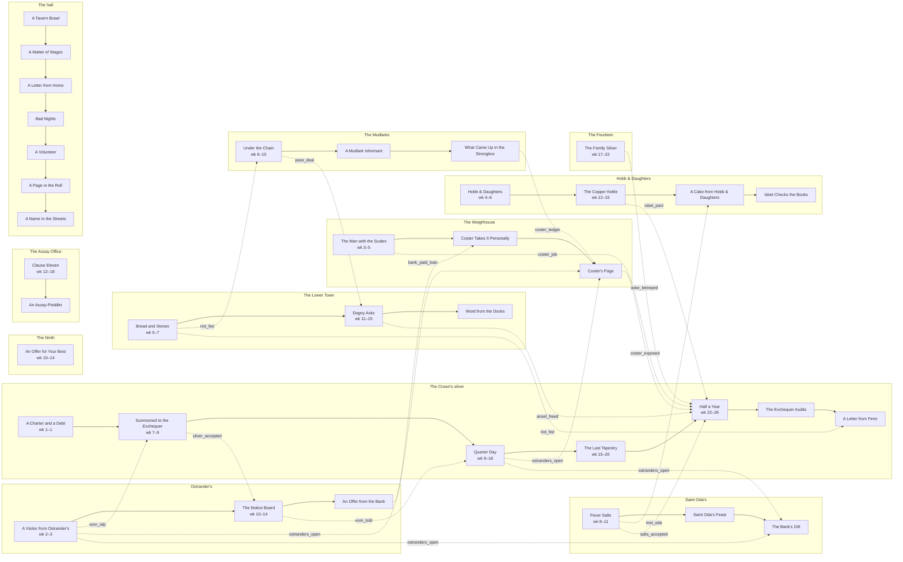

# Ledger & Blade: all game writing

_Generated by `npm run story-export` from the game source. Do not edit this file by hand: edit the Claude Doc, or the game data, and re-run the export._

48 scenes (71 conversation nodes, 199 choices), 271 content items (contracts, Codex, street talk, Dates, tutorial, starts, Legends, names), 315 lines from the rules and 285 interface lines.

**How to read it.** Text in quotes or block quotes is what the player sees. `{member}` and other words in curly braces are filled in by the game. `[IF riot_fed] … [ELSE] … [END]` marks text that changes with the story; every version is shown. Each item carries its ID and source file, so an edit can be traced back to the code.

**Facts** are the story's flags (`docs/STORY.md` §1, `data/facts.ts`). Under each scene, _Reads_ lists the facts it checks and who sets them, and _Leads to_ lists who reads the facts its choices set.

For how the owner's comments in the Claude Doc come back into the code, see `docs/story/README.md`.

## Thread map

The game has 17 Act I story beats across 11 character threads, plus 31 follow-ups, world events and road decisions. Acts II to IV are planned in the story bible but have no text yet.

| Thread | Who | Scenes in order |
|---|---|---|
| The Crown's silver | Lord Treasurer Fenn, the Exchequer | 1. A Charter and a Debt (wk 1–1) → 6. Summoned to the Exchequer (wk 7–9) → 13. Quarter Day (wk 9–18) → 15. The Last Tapestry (wk 15–20) → 17. Half a Year (wk 22–26) → The Exchequer Audits (follow-up) → A Letter from Fenn (follow-up) |
| Ostrander's | Factor Maelis Vorn | 2. A Visitor from Ostrander's (wk 2–3) → 10. The Notice Board (wk 10–14) → An Offer from the Bank (follow-up) |
| The Weighhouse | Alderman Piet Coster | 3. The Man with the Scales (wk 3–5) → Coster Takes It Personally (follow-up) → Coster's Page (follow-up) |
| Hobb & Daughters | Marta and Isbet Hobb | 4. Hobb & Daughters (wk 4–6) → 12. The Copper Kettle (wk 12–16) → A Cake from Hobb & Daughters (follow-up) → Isbet Checks the Books (follow-up) |
| The Lower Town | Dagny Fell, Porters' Fraternity | 5. Bread and Stones (wk 5–7) → 11. Dagny Asks (wk 11–15) → Word from the Docks (follow-up) |
| The Mudlarks | Wenna Pask | 7. Under the Chain (wk 6–10) → A Mudlark Informant (follow-up) → What Came Up in the Strongbox (follow-up) |
| Saint Oda's | Sister Agathe Brune | 8. Fever Salts (wk 8–11) → Saint Oda's Feast (follow-up) → The Bank's Gift (follow-up) |
| The Ninth | Captain Rufus Mayne | 9. An Offer for Your Best (wk 10–14) |
| The Assay Office | Master Assayer Corwin Plaice | 14. Clause Eleven (wk 12–18) → An Assay-Peddler (follow-up) |
| The Fourteen | Lady Honora Aske | 16. The Family Silver (wk 17–22) |
| The hall | Jory Abbot and the members | A Tavern Brawl (follow-up) → A Matter of Wages (follow-up) → A Letter from Home (follow-up) → Bad Nights (follow-up) → A Volunteer (follow-up) → A Page in the Roll (follow-up) → A Name in the Streets (queued) |
| Varrow at large | No fixed character | A Whisper in the Taverns (world) → A Petition at the Gate (world) |
| On the road | The squad in the field | Field report (road) → The Bridge Is Out (road) → A Deserter on the Road (road) → Followed (road) → A Local Guide (road) → A Wounded Carter (road) → Hobb's People on the Road (road) → The Weather Turns (road) → Fresh Tracks (road) |

### Where threads cross

A choice in one thread sets a fact that a scene or contract in another thread reads.

| From thread | To thread | Through | Shared fact |
|---|---|---|---|
| The Fourteen | The Crown's silver | The Family Silver → Half a Year | `aske_betrayed` |
| The Fourteen | The Crown's silver | contract:aske_plate → Half a Year | `aske_plate_saved` |
| Saint Oda's | Hobb & Daughters | Fever Salts → A Cake from Hobb & Daughters | `met_oda` |
| Saint Oda's | The Crown's silver | Fever Salts → Half a Year | `salts_accepted` |
| Saint Oda's | The Crown's silver | contract:fever_salts → Half a Year | `salts_delivered` |
| Saint Oda's | The Crown's silver | contract:fever_salts → Half a Year | `salts_failed` |
| The Weighhouse | The Crown's silver | The Man with the Scales → Half a Year | `coster_job` |
| The Weighhouse | The Crown's silver | The Man with the Scales → Half a Year | `coster_terms` |
| The Weighhouse | The Crown's silver | Coster's Page → Half a Year | `coster_exposed` |
| The Weighhouse | The Crown's silver | contract:false_weights → Half a Year | `weights_exposed` |
| The Lower Town | The Mudlarks | Bread and Stones → Under the Chain | `riot_fed` |
| The Lower Town | The Mudlarks | Bread and Stones → Under the Chain | `riot_broken` |
| The Lower Town | The Crown's silver | Bread and Stones → A Letter from Fenn | `riot_fed` |
| The Lower Town | The Crown's silver | Bread and Stones → A Letter from Fenn | `riot_held` |
| The Lower Town | The Crown's silver | Bread and Stones → A Letter from Fenn | `riot_broken` |
| The Lower Town | The Crown's silver | Dagny Asks → Half a Year | `ansel_freed` |
| The Lower Town | The Crown's silver | contract:ansel_chain → Half a Year | `ansel_freed` |
| The Lower Town | The Crown's silver | contract:ansel_chain → Half a Year | `ansel_lost` |
| Hobb & Daughters | The Crown's silver | The Copper Kettle → Half a Year | `isbet_pact` |
| The Mudlarks | The Weighhouse | What Came Up in the Strongbox → Coster's Page | `coster_ledger` |
| The Mudlarks | The Lower Town | Under the Chain → Dagny Asks | `pask_deal` |
| The Crown's silver | The Fourteen | contract:silver_convoy → The Family Silver | `silver_lost` |
| The Crown's silver | Saint Oda's | Quarter Day → The Bank's Gift | `ostranders_open` |
| The Crown's silver | The Weighhouse | Quarter Day → Coster's Page | `ostranders_open` |
| The Crown's silver | Ostrander's | Summoned to the Exchequer → The Notice Board | `silver_accepted` |
| The Crown's silver | Ostrander's | contract:silver_convoy → The Notice Board | `silver_delivered` |
| The Crown's silver | Ostrander's | contract:silver_convoy → The Notice Board | `silver_lost` |
| Ostrander's | Saint Oda's | A Visitor from Ostrander's → The Bank's Gift | `ostranders_open` |
| Ostrander's | The Weighhouse | A Visitor from Ostrander's → Coster's Page | `ostranders_open` |
| Ostrander's | The Weighhouse | An Offer from the Bank → Coster Takes It Personally | `bank_paid_loan` |
| Ostrander's | The Crown's silver | A Visitor from Ostrander's → Summoned to the Exchequer | `vorn_slip` |
| Ostrander's | The Crown's silver | The Notice Board → Quarter Day | `vorn_told` |
| Ostrander's | The Crown's silver | The Notice Board → Quarter Day | `vorn_honest` |

## Thread: The Crown's silver

Lord Treasurer Fenn, the Exchequer. The act's spine: the charter, the commission to carry the Crown's payment, Quarter Day and its aftermath.

### A Charter and a Debt

`charter` · Story beat 1 · data/events.ts:82

**When:** Week 1.

> The Exchequer's seal is still warm on your charter. As of this morning, Ledger & Blade may take paid work anywhere in the realm. It is also {loans[0].principal ?? 800} crowns in debt to the Weighhouse, which paid for the hall, the first wages and the sign over the door.
>
> [DEPENDS ON start.backer ?? 'merchant'] veterans: The money came from four old soldiers and their back pay. Two of them have already argued about where the weapon racks should go. [OR] merchant: The money came from a wool merchant on the Weighhouse, who has sent a list of his wagons and the dates they leave. [OR] coop: The money came from the porters and small trades of the Lower Town, in coins so small that it took Jory two days to count them. [OR] college: The money came from two Arcanists who left the college after the fire. One of them still smells faintly of smoke. [END]
>
> The hall came with a clerk, Jory Abbot, who has kept its books through three guildmasters and has already found the leak in the roof.
>
> The Exchequer man who brought the charter glances at the empty weapon racks. "Quarter-day's in a few weeks," he says, as everyone in Varrow does lately. "Good luck."
>
> You have a little coin left over. How do you start?

- **Arm the guild** · _Gain a Mail Hauberk and 2 Fire Oils_ · `charter/root/c1`
  “You visit the armorers on Anvil Row. Your people will at least look the part.”
  Sets `start_arms`.
- **Hire an Arcanist** · _A college-trained Arcanist joins for free_ · `charter/root/c2`
  “A young Arcanist from the college, short of fees, signs on for the work and the wage.”
- **Keep the coin** · _+80 crowns_ · `charter/root/c3`
  “You put it in the strongbox under the stairs. Eighty crowns is eighty crowns.”

**Leads to:**

- `start_arms` → rules in `src/engine/story/scenes.ts`

### Summoned to the Exchequer

`silver_summons` · Story beat 6 · data/events.ts:328

**When:** Weeks 7–9; after A Visitor from Ostrander's (`ostrander_agent`); needs alive: Lord Treasurer Aubrey Fenn; 50% a week inside the window.

**Reads:** `fenn_haggled` (set by this scene); `fenn_pay` (set by this scene); `fenn_route` (set by this scene); `fenn_stakes` (set by this scene); `silver_bonus` (set by this scene); `vorn_slip` (set by [A Visitor from Ostrander's](#a-visitor-from-ostranders) (`ostrander_agent`)).

_Speaker: Lord Treasurer Aubrey Fenn_

> Lord Treasurer Aubrey Fenn sees you in an office with pale squares on the walls where the tapestries used to hang. He apologizes for the cold.
>
> "The quarter payment is due, and for once we have it: three wagons of silver, most of what's left of the Crown plate. It has to reach Port Anselm and the bank's ships. I'd send my own guard, but half of them are owed back pay by the sort of people who'd like to see it stolen."

- **"Who knows the route?"** · `silver_summons/root/c1`
  Shown only if: not fenn_route.
  → goes to node `route`
  Sets `fenn_route`.
- **Tell him what Vorn let slip about the next treaty** · _Exchequer +4, Influence +2_ · `silver_summons/root/c2`
  Shown only if: vorn_slip and not fenn_stakes.
  → goes to node `stakes`
  Sets `fenn_stakes`.
- **"What does it pay?"** · `silver_summons/root/c3`
  Shown only if: not fenn_pay.
  → goes to node `pay`
  Sets `fenn_pay`.
- **Haggle** · _Guile check. Success: +60 crowns on the contract._ · (guile check, difficulty 14) · `silver_summons/root/c4`
  Shown only if: fenn_pay and not fenn_haggled and not silver_bonus.
  → goes to node `pay_ok`; on failure `pay_fail`
  Sets `silver_bonus`; on failure sets `fenn_haggled`.
- **Accept the commission** · _[IF fenn_route] Adds "The Crown's Last Silver". Fenn's tip reveals one of its dangers. [ELSE] Adds the story contract "The Crown's Last Silver". [END]_ · `silver_summons/root/c5`
  “"Thank you." He looks very tired. "Pick your people carefully. Somebody out there knows the route."”
  Sets `silver_accepted`.
  Adds story contract [The Crown's Last Silver](#contract-the-crowns-last-silver) (`silver_convoy`).
- **Decline** · _Exchequer −12. The Crown will find someone else, probably Hobb & Daughters._ · `silver_summons/root/c6`
  “Fenn nods. "I understand." By evening the commission has gone to Hobb & Daughters.”
  Sets `silver_declined`.

**Node `route`**, Lord Treasurer Fenn

> "My clerks know the route. So does the guard captain, and so does Vorn, because the bank insists on knowing everything." He rubs his eyes. "If I wanted to rob it, I'd try the ford at Wenmouth. You can't see that stretch of road from either side."

- **"Who knows the route?"** · `silver_summons/route/c1`
  Shown only if: not fenn_route.
  → goes to node `route`
  Sets `fenn_route`.
- **Tell him what Vorn let slip about the next treaty** · _Exchequer +4, Influence +2_ · `silver_summons/route/c2`
  Shown only if: vorn_slip and not fenn_stakes.
  → goes to node `stakes`
  Sets `fenn_stakes`.
- **"What does it pay?"** · `silver_summons/route/c3`
  Shown only if: not fenn_pay.
  → goes to node `pay`
  Sets `fenn_pay`.
- **Haggle** · _Guile check. Success: +60 crowns on the contract._ · (guile check, difficulty 14) · `silver_summons/route/c4`
  Shown only if: fenn_pay and not fenn_haggled and not silver_bonus.
  → goes to node `pay_ok`; on failure `pay_fail`
  Sets `silver_bonus`; on failure sets `fenn_haggled`.
- **Accept the commission** · _[IF fenn_route] Adds "The Crown's Last Silver". Fenn's tip reveals one of its dangers. [ELSE] Adds the story contract "The Crown's Last Silver". [END]_ · `silver_summons/route/c5`
  “"Thank you." He looks very tired. "Pick your people carefully. Somebody out there knows the route."”
  Sets `silver_accepted`.
  Adds story contract [The Crown's Last Silver](#contract-the-crowns-last-silver) (`silver_convoy`).
- **Decline** · _Exchequer −12. The Crown will find someone else, probably Hobb & Daughters._ · `silver_summons/route/c6`
  “Fenn nods. "I understand." By evening the commission has gone to Hobb & Daughters.”
  Sets `silver_declined`.

**Node `stakes`**, Lord Treasurer Fenn

> You tell him what Vorn said about the bank writing the next treaty. Fenn puts his pen down.
>
> "So they'd rather we missed it. That explains a few things." He looks at you properly for the first time. "Thank you. I won't forget that."

- **"Who knows the route?"** · `silver_summons/stakes/c1`
  Shown only if: not fenn_route.
  → goes to node `route`
  Sets `fenn_route`.
- **Tell him what Vorn let slip about the next treaty** · _Exchequer +4, Influence +2_ · `silver_summons/stakes/c2`
  Shown only if: vorn_slip and not fenn_stakes.
  → goes to node `stakes`
  Sets `fenn_stakes`.
- **"What does it pay?"** · `silver_summons/stakes/c3`
  Shown only if: not fenn_pay.
  → goes to node `pay`
  Sets `fenn_pay`.
- **Haggle** · _Guile check. Success: +60 crowns on the contract._ · (guile check, difficulty 14) · `silver_summons/stakes/c4`
  Shown only if: fenn_pay and not fenn_haggled and not silver_bonus.
  → goes to node `pay_ok`; on failure `pay_fail`
  Sets `silver_bonus`; on failure sets `fenn_haggled`.
- **Accept the commission** · _[IF fenn_route] Adds "The Crown's Last Silver". Fenn's tip reveals one of its dangers. [ELSE] Adds the story contract "The Crown's Last Silver". [END]_ · `silver_summons/stakes/c5`
  “"Thank you." He looks very tired. "Pick your people carefully. Somebody out there knows the route."”
  Sets `silver_accepted`.
  Adds story contract [The Crown's Last Silver](#contract-the-crowns-last-silver) (`silver_convoy`).
- **Decline** · _Exchequer −12. The Crown will find someone else, probably Hobb & Daughters._ · `silver_summons/stakes/c6`
  “Fenn nods. "I understand." By evening the commission has gone to Hobb & Daughters.”
  Sets `silver_declined`.

**Node `pay`**, Lord Treasurer Fenn

> "Two hundred and twenty crowns. It comes out of whatever's left after the payment, and I should warn you there isn't much left after the payment."

- **"Who knows the route?"** · `silver_summons/pay/c1`
  Shown only if: not fenn_route.
  → goes to node `route`
  Sets `fenn_route`.
- **Tell him what Vorn let slip about the next treaty** · _Exchequer +4, Influence +2_ · `silver_summons/pay/c2`
  Shown only if: vorn_slip and not fenn_stakes.
  → goes to node `stakes`
  Sets `fenn_stakes`.
- **"What does it pay?"** · `silver_summons/pay/c3`
  Shown only if: not fenn_pay.
  → goes to node `pay`
  Sets `fenn_pay`.
- **Haggle** · _Guile check. Success: +60 crowns on the contract._ · (guile check, difficulty 14) · `silver_summons/pay/c4`
  Shown only if: fenn_pay and not fenn_haggled and not silver_bonus.
  → goes to node `pay_ok`; on failure `pay_fail`
  Sets `silver_bonus`; on failure sets `fenn_haggled`.
- **Accept the commission** · _[IF fenn_route] Adds "The Crown's Last Silver". Fenn's tip reveals one of its dangers. [ELSE] Adds the story contract "The Crown's Last Silver". [END]_ · `silver_summons/pay/c5`
  “"Thank you." He looks very tired. "Pick your people carefully. Somebody out there knows the route."”
  Sets `silver_accepted`.
  Adds story contract [The Crown's Last Silver](#contract-the-crowns-last-silver) (`silver_convoy`).
- **Decline** · _Exchequer −12. The Crown will find someone else, probably Hobb & Daughters._ · `silver_summons/pay/c6`
  “Fenn nods. "I understand." By evening the commission has gone to Hobb & Daughters.”
  Sets `silver_declined`.

**Node `pay_ok`**, Lord Treasurer Fenn

> "All right, two hundred and eighty. Please don't mention it to the guard captain." He writes it down himself.

- **"Who knows the route?"** · `silver_summons/pay_ok/c1`
  Shown only if: not fenn_route.
  → goes to node `route`
  Sets `fenn_route`.
- **Tell him what Vorn let slip about the next treaty** · _Exchequer +4, Influence +2_ · `silver_summons/pay_ok/c2`
  Shown only if: vorn_slip and not fenn_stakes.
  → goes to node `stakes`
  Sets `fenn_stakes`.
- **"What does it pay?"** · `silver_summons/pay_ok/c3`
  Shown only if: not fenn_pay.
  → goes to node `pay`
  Sets `fenn_pay`.
- **Haggle** · _Guile check. Success: +60 crowns on the contract._ · (guile check, difficulty 14) · `silver_summons/pay_ok/c4`
  Shown only if: fenn_pay and not fenn_haggled and not silver_bonus.
  → goes to node `pay_ok`; on failure `pay_fail`
  Sets `silver_bonus`; on failure sets `fenn_haggled`.
- **Accept the commission** · _[IF fenn_route] Adds "The Crown's Last Silver". Fenn's tip reveals one of its dangers. [ELSE] Adds the story contract "The Crown's Last Silver". [END]_ · `silver_summons/pay_ok/c5`
  “"Thank you." He looks very tired. "Pick your people carefully. Somebody out there knows the route."”
  Sets `silver_accepted`.
  Adds story contract [The Crown's Last Silver](#contract-the-crowns-last-silver) (`silver_convoy`).
- **Decline** · _Exchequer −12. The Crown will find someone else, probably Hobb & Daughters._ · `silver_summons/pay_ok/c6`
  “Fenn nods. "I understand." By evening the commission has gone to Hobb & Daughters.”
  Sets `silver_declined`.

**Node `pay_fail`**, Lord Treasurer Fenn

> "Everyone is being squeezed this year, including me. Two hundred and twenty."

- **"Who knows the route?"** · `silver_summons/pay_fail/c1`
  Shown only if: not fenn_route.
  → goes to node `route`
  Sets `fenn_route`.
- **Tell him what Vorn let slip about the next treaty** · _Exchequer +4, Influence +2_ · `silver_summons/pay_fail/c2`
  Shown only if: vorn_slip and not fenn_stakes.
  → goes to node `stakes`
  Sets `fenn_stakes`.
- **"What does it pay?"** · `silver_summons/pay_fail/c3`
  Shown only if: not fenn_pay.
  → goes to node `pay`
  Sets `fenn_pay`.
- **Haggle** · _Guile check. Success: +60 crowns on the contract._ · (guile check, difficulty 14) · `silver_summons/pay_fail/c4`
  Shown only if: fenn_pay and not fenn_haggled and not silver_bonus.
  → goes to node `pay_ok`; on failure `pay_fail`
  Sets `silver_bonus`; on failure sets `fenn_haggled`.
- **Accept the commission** · _[IF fenn_route] Adds "The Crown's Last Silver". Fenn's tip reveals one of its dangers. [ELSE] Adds the story contract "The Crown's Last Silver". [END]_ · `silver_summons/pay_fail/c5`
  “"Thank you." He looks very tired. "Pick your people carefully. Somebody out there knows the route."”
  Sets `silver_accepted`.
  Adds story contract [The Crown's Last Silver](#contract-the-crowns-last-silver) (`silver_convoy`).
- **Decline** · _Exchequer −12. The Crown will find someone else, probably Hobb & Daughters._ · `silver_summons/pay_fail/c6`
  “Fenn nods. "I understand." By evening the commission has gone to Hobb & Daughters.”
  Sets `silver_declined`.

**Leads to:**

- `fenn_haggled` → _nothing reads it_
- `fenn_pay` → _nothing reads it_
- `fenn_route` → _nothing reads it_
- `fenn_stakes` → _nothing reads it_
- `silver_accepted` → [The Notice Board](#the-notice-board) (`vorn_board`)
- `silver_bonus` → rules in `src/engine/story/scenes.ts`
- `silver_declined` → [Quarter Day](#quarter-day) (`quarter_day`)

#### Story contract: The Crown's Last Silver

`contract:silver_convoy` · data/contracts.ts:709

- _type:_ “Story”
- _titles[1]:_ “The Crown's Last Silver”
- _description:_

  > The Exchequer has scraped together the realm's overdue payment: three wagons of silver bound for Port Anselm and Ostrander's ships. Someone does not want it to arrive. If it fails, the Crown defaults.

- _phases[1]:_ “Muster at the Vault: Sort the Exchequer's honest clerks from the bought ones.”
- _phases[2]:_ “The King's Road: Two weeks of road with a fortune in the wagons.”
- _phases[3]:_

  > Ambush at the Ford: Someone will be waiting. Fight them, or take the wagons the long way round.

- _phases[4]:_ “The Harbor: Hand the silver to the bank's factor, and count every coin twice.”
- _expire.title:_ “The Crown's silver never left Varrow”
- _expire.text:_

  > You accepted the commission, but no squad was ever sent. The wagons sat in the Exchequer yard until it was too late to reach the ships. The Crown has missed its payment.

- _Sets:_ `silver_delivered` → [The Notice Board](#the-notice-board) (`vorn_board`), [Quarter Day](#quarter-day) (`quarter_day`), [The Last Tapestry](#the-last-tapestry) (`fenn_tapestry`), [Half a Year](#half-a-year) (`act1_slice_end`), street talk "paid_talk" (`paid_talk`), Date "The Lord Treasurer Visits" (`treasurer_visit`); `silver_lost` → [The Notice Board](#the-notice-board) (`vorn_board`), [Quarter Day](#quarter-day) (`quarter_day`), [The Last Tapestry](#the-last-tapestry) (`fenn_tapestry`), [The Family Silver](#the-family-silver) (`aske_plate`), [Half a Year](#half-a-year) (`act1_slice_end`), codex "The Treaty of Cassel" (`the_treaty`), street talk "default_talk" (`default_talk`), rules in `src/engine/core/turn.ts`; `silver_abandoned` → _nothing reads it_

### Quarter Day

`quarter_day` · Story beat 13 · data/events.ts:372

**When:** Weeks 9–18; after Summoned to the Exchequer (`silver_summons`); when (silver_delivered or silver_lost or silver_declined); 70% a week inside the window.

**Reads:** `silver_declined` (set by [Summoned to the Exchequer](#summoned-to-the-exchequer) (`silver_summons`)); `silver_delivered` (set by contract [The Crown's Last Silver](#contract-the-crowns-last-silver) (`silver_convoy`)); `silver_lost` (set by contract [The Crown's Last Silver](#contract-the-crowns-last-silver) (`silver_convoy`)); `vorn_honest` (set by [The Notice Board](#the-notice-board) (`vorn_board`)); `vorn_told` (set by [The Notice Board](#the-notice-board) (`vorn_board`)).

> [IF silver_delivered] At noon the cathedral bells ring to say the payment has been received at Port Anselm. The realm has paid its way for one more quarter.
>
> A royal courier brings you a letter from Fenn, written in his own hand. He wants to thank you, and he has something to offer. [ELSE IF silver_lost] Noon comes and the bells stay quiet. For the first time in twenty-two years, the Crown has missed a payment to Ostrander's.
>
> By evening the bank's clerks are going door to door with lists, and a note from Vorn asks whether you have a minute.[IF vorn_honest]  At the bottom she has written, "I did tell you which stretch of road to watch." [END][IF vorn_told]  You remember giving her the date the wagons would leave, and wonder who she gave it to. [END] [ELSE] At noon the bells ring. The payment reached Port Anselm, carried by Hobb & Daughters, and the criers are making a great deal of Marta's name.
>
> That night somebody slips a note under your door. The wagons reached the coast a good deal lighter than they were when they left. [END]

- **Accept a purse from the Crown** · _+100 crowns_ · `quarter_day/root/c1`
  Shown only if: silver_delivered.
  “Fenn has found it somewhere. You suspect it's his own money.”
- **Accept a Crown writ of good conduct** · _Heat −20, Exchequer +6_ · `quarter_day/root/c2`
  Shown only if: silver_delivered.
  “You hang the writ by the door, and the watch starts nodding to your people in the street.”
- **Ask for a seat at the Exchequer's table** · _Influence +4_ · `quarter_day/root/c3`
  Shown only if: silver_delivered.
  “"Done," Fenn writes back. "I'm afraid you'll find it's mostly arguing about money."”
  Sets `fenn_ally`.
- **Offer the bank your services** · _Ostrander's +8, Lower Town −6. Unlocks bank contracts._ · `quarter_day/root/c4`
  Shown only if: not (silver_delivered) and silver_lost.
  “Vorn doesn't seem surprised to see you. "Good. We're about to be very busy."”
  Sets `ostranders_open`.
- **Swear to the Lower Town** · _Lower Town +8, Ostrander's −8_ · `quarter_day/root/c5`
  Shown only if: not (silver_delivered) and silver_lost.
  “You send Vorn's note back unopened, with a loaf of bread. The Lower Town hears about it within the hour.”
- **Stay out of it** · `quarter_day/root/c6`
  Shown only if: not (silver_delivered) and silver_lost.
  “You stay in, like most of the city. Nobody sleeps much.”
- **Prove that Hobb skimmed the silver** · _Spend 3 Intel. Exchequer +10, Hobb & Daughters lose renown._ · (needs intel: 3) · `quarter_day/root/c7`
  Shown only if: not (silver_delivered) and not (silver_lost).
  “Your evidence goes to Fenn, and Marta Hobb pays back every coin with interest. She also sends you a cake, which nobody eats.”
- **Let it go** · `quarter_day/root/c8`
  Shown only if: not (silver_delivered) and not (silver_lost).
  “You let it go. There will be other fights.”

**Leads to:**

- `fenn_ally` → _nothing reads it_
- `ostranders_open` → [Coster's Page](#costers-page) (`coster_page`), [The Bank's Gift](#the-banks-gift) (`brune_donation`), contract [A Matter of Arrears](#contract-a-matter-of-arrears) (`debt_collection`), contract [Deliver the Bank's Terms](#contract-deliver-the-banks-terms) (`deliver_terms`), Date "Ostrander's Reads the Books" (`vorn_books`), rules in `src/engine/actions.ts`

### The Last Tapestry

`fenn_tapestry` · Story beat 15 · data/cast.ts:468

**When:** Weeks 15–20; after Quarter Day (`quarter_day`); needs alive: Lord Treasurer Aubrey Fenn; 45% a week inside the window.

**Reads:** `silver_delivered` (set by contract [The Crown's Last Silver](#contract-the-crowns-last-silver) (`silver_convoy`)); `silver_lost` (set by contract [The Crown's Last Silver](#contract-the-crowns-last-silver) (`silver_convoy`)).

_Speaker: Lord Treasurer Fenn_

> Fenn comes to Tallow Street himself, on foot and without his clerks. He apologizes for that before anything else.
>
> [IF silver_delivered] "You did us a great service with the silver. I'm afraid I'm here to ask for another, which is poor manners." [ELSE IF silver_lost] "You'll know we missed the payment. The bank has frozen the Crown's accounts on Quay Street, so I can't pay my own clerks." [ELSE] "I know I gave the silver to Marta Hobb last time. I'm told it arrived lighter than it left, which is my own fault for asking her." [END]
>
> "There is one tapestry left in the Exchequer. It's the Siege of Carrow, and it has hung in the great hall for two hundred years. A wool merchant in Harrowmere will pay four hundred crowns for it, provided nobody learns that the Crown is selling its walls. I need someone to take it there without being noticed."

- **We'll take it.** · _Adds the story contract "The Exchequer's Last Tapestry". Success: Exchequer +8, Arrears −3._ · `fenn_tapestry/root/c1`
  “"Thank you." He looks at the floor. "Please don't let them fold it. It's very old."”
  Adds story contract [The Exchequer's Last Tapestry](#contract-the-exchequers-last-tapestry) (`last_tapestry`).
- **Lend the Crown the money and keep the tapestry here** · _−150 crowns. It hangs in your hall. Exchequer +6, Renown +2._ · (needs crowns: 150) · `fenn_tapestry/root/c2`
  “It takes four of your people to hang it. Fenn comes to see it the next week and stands in front of it for some time without saying anything.”
  Sets `tapestry_bought`.
- **We can't help this time.** · _Exchequer −3, Fenn −10_ · `fenn_tapestry/root/c3`
  “"No, of course." He thanks you for your time anyway, and walks home.”

**Leads to:**

- `tapestry_bought` → [Half a Year](#half-a-year) (`act1_slice_end`), Jory "j_tapestry" (`j_tapestry`)

#### Story contract: The Exchequer's Last Tapestry

`contract:last_tapestry` · data/contracts.ts:579

- _type:_ “Story”
- _titles[1]:_ “The Exchequer's Last Tapestry”
- _description:_

  > The last tapestry in the Exchequer, rolled in sacking, has to reach a buyer in Harrowmere without anyone learning the Crown is selling its walls. The money pays the Crown's clerks for another season.

- _phases[1]:_ “Out of the City: Get a cart out of the Exchequer yard without being remembered.”
- _phases[2]:_ “The Road: Somebody has heard what is in the sacking.”
- _phases[3]:_ “The Buyer: Get the agreed price, in coin that is not clipped.”
- _expire.title:_ “The tapestry stayed in the yard”
- _expire.text:_

  > The cart never left. Fenn sold the tapestry in Varrow in the end, for a third of its worth, and by the end of the week the whole city knew.

- _Sets:_ `tapestry_sold` → _nothing reads it_; `tapestry_lost` → _nothing reads it_

### Half a Year

`act1_slice_end` · Story beat 17 · data/events.ts:423

**When:** Weeks 22–26; after Quarter Day (`quarter_day`), The Last Tapestry (`fenn_tapestry`), The Family Silver (`aske_plate`); 60% a week inside the window.

**Reads:** `ansel_freed` (set by [Dagny Asks](#dagny-asks) (`dagny_brother`), contract [Ansel Fell at the Chain](#contract-ansel-fell-at-the-chain) (`ansel_chain`)); `ansel_lost` (set by contract [Ansel Fell at the Chain](#contract-ansel-fell-at-the-chain) (`ansel_chain`)); `aske_betrayed` (set by [The Family Silver](#the-family-silver) (`aske_plate`)); `aske_plate_saved` (set by contract [The Aske Silver](#contract-the-aske-silver) (`aske_plate`)); `coster_exposed` (set by [Coster's Page](#costers-page) (`coster_page`)); `coster_job` (set by [The Man with the Scales](#the-man-with-the-scales) (`coster_interest`)); `coster_terms` (set by [The Man with the Scales](#the-man-with-the-scales) (`coster_interest`)); `isbet_pact` (set by [The Copper Kettle](#the-copper-kettle) (`isbet_kettle`)); `salts_accepted` (set by [Fever Salts](#fever-salts) (`brune_salts`)); `salts_delivered` (set by contract [Salts for Saint Oda's](#contract-salts-for-saint-odas) (`fever_salts`)); `salts_failed` (set by contract [Salts for Saint Oda's](#contract-salts-for-saint-odas) (`fever_salts`)); `silver_delivered` (set by contract [The Crown's Last Silver](#contract-the-crowns-last-silver) (`silver_convoy`)); `silver_lost` (set by contract [The Crown's Last Silver](#contract-the-crowns-last-silver) (`silver_convoy`)); `tapestry_bought` (set by [The Last Tapestry](#the-last-tapestry) (`fenn_tapestry`)); `weights_exposed` (set by contract [Short Weight at Hesketh's](#contract-short-weight-at-heskeths) (`false_weights`)).

> Half a year has passed since the Exchequer sealed your charter. [IF silver_delivered] The Crown's silver reached Port Anselm, and the realm has a few more months of grace. In the Exchequer, people know your guild's name now. [ELSE IF silver_lost] The Crown's silver never reached the coast. The realm has defaulted for the first time, and Ostrander's factors are walking the city with lists. [ELSE] The Crown's silver went to the coast without you. [END][IF people.length] 
>
> {people.join(' ')} [END]
>
> This is where the prototype's scripted story ends for now. Contracts, rivals, the Council and the Debt all carry on, and so does the guild.

- **Continue** · `act1_slice_end/root/c1`
  “Back to work.”

### The Exchequer Audits

`audit` · Follow-up · data/events.ts:628

**When:** when heat >= 30; random draw, weight 4; not again for 6 weeks.

> Two Exchequer clerks turn up with ledgers and a long list of questions about your recent "night work".

- **Pay the fine** · _−50 crowns, Heat −15_ · (needs crowns: 50) · `audit/root/c1`
  “The clerks take the money, give you a receipt and leave.”
- **Talk them round** · _Guile check. Success: Heat −10. Failure: Heat +10, Exchequer −6._ · (guile check, difficulty 14) · `audit/root/c2`
  On success: “By the end of the afternoon the clerks are apologizing for wasting your time.”
  On failure: “The clerks write down everything you say and ask to see the stores.”
- **Stonewall** · _Exchequer −8_ · `audit/root/c3`
  “They leave with nothing, and they make a note of that too.”

### A Letter from Fenn

`fenn_letter` · Follow-up · data/cast.ts:725

**When:** when scene bread_riot has happened and scene silver_summons has happened; needs alive: Lord Treasurer Aubrey Fenn; random draw, weight 2; fires once.

**Reads:** `riot_broken` (set by [Bread and Stones](#bread-and-stones) (`bread_riot`)); `riot_fed` (set by [Bread and Stones](#bread-and-stones) (`bread_riot`)); `riot_held` (set by [Bread and Stones](#bread-and-stones) (`bread_riot`)).

**Checks whether these happened:** [Bread and Stones](#bread-and-stones) (`bread_riot`), [Summoned to the Exchequer](#summoned-to-the-exchequer) (`silver_summons`).

> A short letter from Lord Treasurer Fenn, in his own hand:
>
> [IF riot_broken] "My clerk tells me you cleared the bread market for us. I'm grateful, and I'm sorry it had to be your people who did it. The Lower Town has a long memory, and so, I find, do I." [ELSE IF riot_held] "My clerk tells me you held the bread market without drawing blood. I have spent six years telling the Council this was possible. Thank you for the demonstration." [ELSE IF riot_fed] "I hear you fed the Lower Town when the levy came in, at your own expense. Officially, the Exchequer can't approve. Unofficially, thank you. I wish we had done it." [ELSE] "I hear you kept your doors shut during the bread riot. Very sensible. I wish I had been able to do the same." [END]
>
> It is signed "A. Fenn", with no title.

- **Write back** · _Fenn +5_ · `fenn_letter/root/c1`
  “You write a short reply. A week later he answers that too, mostly about the weather.”
- **File it** · `fenn_letter/root/c2`
  “Jory files it under F, with the others.”

## Thread: Ostrander's

Factor Maelis Vorn. The bank's office on Quay Street: work offers, the notice board and the loan.

### A Visitor from Ostrander's

`ostrander_agent` · Story beat 2 · data/events.ts:114

**When:** Weeks 2–3; needs alive: Factor Maelis Vorn; 60% a week inside the window.

**Reads:** `vorn_q_hobbs` (set by this scene); `vorn_q_people` (set by this scene); `vorn_q_want` (set by this scene); `vorn_slip` (set by this scene).

> There's a woman from Ostrander's in your front room. She got there before you were up, and she's been reading the notice board while she waited.
>
> "Maelis Vorn. I run the bank's office on Quay Street." She nods at the board. "You've spelled 'carriage' wrong."

- **Hear her out** · `ostrander_agent/root/c1`
  → goes to node `pitch`
- **Show her the door** · _Ostrander's −10, Lower Town +6_ · `ostrander_agent/root/c2`
  “She goes without arguing. By evening half the Lower Town has heard you threw the bank's woman out, and people you've never met are buying your crew drinks.”

**Node `pitch`**, Factor Vorn

> "We're owed money all over this city. Three hundred-odd debts at last count, and I've got four clerks and a dog to chase them." She doesn't smile, so it's hard to tell if the dog is a joke.
>
> "Most of it is knocking on doors and carrying things out. We pay when the job's done, and we pay better than the Exchequer. Which, to be fair, isn't hard."

- **What happens to the people you collect from?** · _Lower Town +2 (the porter outside hears you ask)_ · `ostrander_agent/pitch/c1`
  Shown only if: not vorn_q_people.
  → goes to node `people`
  Sets `vorn_q_people`.
- **Why not hire Hobb & Daughters? They do this already.** · _+1 Intel on your rival_ · `ostrander_agent/pitch/c2`
  Shown only if: not vorn_q_hobbs.
  → goes to node `hobbs`
  Sets `vorn_q_hobbs`.
- **What does the bank really want from Varrow?** · _Guile check: read between her lines_ · (guile check, difficulty 14) · `ostrander_agent/pitch/c3`
  Shown only if: not vorn_q_want and not vorn_slip.
  → goes to node `want`; on failure `want_fail`
  Sets `vorn_slip`; on failure sets `vorn_q_want`.
- **Let's talk terms.** · `ostrander_agent/pitch/c4`
  → goes to node `terms`

**Node `people`**, Factor Vorn

> "Nobody gets hurt, if I can help it. They lose whatever they put up against the loan. Sometimes that's a loom. Sometimes it's the house."
>
> "I know how it looks. But if the Crown stops paying, the treaty lets the bank close the river, and then everyone down there loses something. I'd rather it was looms."

_Same choices as node `pitch` (one shared menu)._

**Node `hobbs`**, Factor Vorn

> "We do use them. Marta charges whatever she likes, her girls are rough with people, and when a street riots, it's the bank's name on the stones." She picks a bit of lint off her sleeve. "I'd like someone else on the list."
>
> "She won't be happy about it, by the way. Better you hear that from me."

- **What happens to the people you collect from?** · _Lower Town +2 (the porter outside hears you ask)_ · `ostrander_agent/hobbs/c1`
  Shown only if: not vorn_q_people.
  → goes to node `people`
  Sets `vorn_q_people`.
- **Why not hire Hobb & Daughters? They do this already.** · _+1 Intel on your rival_ · `ostrander_agent/hobbs/c2`
  Shown only if: not vorn_q_hobbs.
  → goes to node `hobbs`
  Sets `vorn_q_hobbs`.
- **What does the bank really want from Varrow?** · _Guile check: read between her lines_ · (guile check, difficulty 14) · `ostrander_agent/hobbs/c3`
  Shown only if: not vorn_q_want and not vorn_slip.
  → goes to node `want`; on failure `want_fail`
  Sets `vorn_slip`; on failure sets `vorn_q_want`.
- **Let's talk terms.** · `ostrander_agent/hobbs/c4`
  → goes to node `terms`

**Node `want`**, Factor Vorn

> You don't answer straight away, and she's the kind of person who fills a gap. "Getting paid. And something to hold in case we aren't: the Anselm tolls, the Kell silver warrants."
>
> "And if the Crown does miss a payment, the treaty says we get to write the next one." She says it the way a clerk reads out a date, then moves straight on to rates.

_Same choices as node `pitch` (one shared menu)._

**Node `want_fail`**, Factor Vorn

> "To be repaid," she says. "It's a bank." She waits to see if you had a real question.

_Same choices as node `pitch` (one shared menu)._

**Node `terms`**, Factor Vorn

> "So. Do you want the work?"

- **We'll work for the bank.** · _Ostrander's +10, Lower Town −5. Unlocks bank contracts._ · `ostrander_agent/terms/c1`
  “"Good. You'll have something by the end of the week." On her way out she stops at the notice board and fixes your spelling with her own pen.”
  Sets `ostranders_open`, `vorn_fixed_board`.
- **We'll take your jobs case by case.** · _Ostrander's +3. Unlocks bank contracts._ · `ostrander_agent/terms/c2`
  “"That's what most people say at first." She writes something in a small book and leaves.”
  Sets `ostranders_open`.
- **Not today.** · _Ostrander's −2. You can court the bank later from the Realm screen._ · `ostrander_agent/terms/c3`
  “"Suit yourself. You know where Quay Street is."”

**Leads to:**

- `ostranders_open` → [Coster's Page](#costers-page) (`coster_page`), [The Bank's Gift](#the-banks-gift) (`brune_donation`), contract [A Matter of Arrears](#contract-a-matter-of-arrears) (`debt_collection`), contract [Deliver the Bank's Terms](#contract-deliver-the-banks-terms) (`deliver_terms`), Date "Ostrander's Reads the Books" (`vorn_books`), rules in `src/engine/actions.ts`
- `vorn_fixed_board` → [The Notice Board](#the-notice-board) (`vorn_board`)
- `vorn_q_hobbs` → _nothing reads it_
- `vorn_q_people` → codex "The Treaty of Cassel" (`the_treaty`)
- `vorn_q_want` → [The Notice Board](#the-notice-board) (`vorn_board`)
- `vorn_slip` → [Summoned to the Exchequer](#summoned-to-the-exchequer) (`silver_summons`), [The Notice Board](#the-notice-board) (`vorn_board`), codex "The Treaty of Cassel" (`the_treaty`)

### The Notice Board

`vorn_board` · Story beat 10 · data/cast.ts:306

**When:** Weeks 10–14; after A Visitor from Ostrander's (`ostrander_agent`), Summoned to the Exchequer (`silver_summons`); when silver_accepted and not silver_delivered and not silver_lost; needs alive: Factor Maelis Vorn; 50% a week inside the window.

**Reads:** `silver_accepted` (set by [Summoned to the Exchequer](#summoned-to-the-exchequer) (`silver_summons`)); `silver_delivered` (set by contract [The Crown's Last Silver](#contract-the-crowns-last-silver) (`silver_convoy`)); `silver_lost` (set by contract [The Crown's Last Silver](#contract-the-crowns-last-silver) (`silver_convoy`)); `vorn_fixed_board` (set by [A Visitor from Ostrander's](#a-visitor-from-ostranders) (`ostrander_agent`)); `vorn_q_want` (set by [A Visitor from Ostrander's](#a-visitor-from-ostranders) (`ostrander_agent`)); `vorn_slip` (set by [A Visitor from Ostrander's](#a-visitor-from-ostranders) (`ostrander_agent`)).

_Speaker: Factor Vorn_

> Vorn calls in on her way back from the river, with ink on her fingers and a ledger under her arm.[IF vorn_fixed_board]  She looks at your notice board first, sees that her correction has survived, and seems pleased. [ELSE]  She looks at your notice board first. 'Carriage' is still spelled wrong, so she takes out a pen and fixes it without asking. [END]
>
> "I hear you've taken the Crown's silver," she says. "I'd like to know when it leaves. The bank has a factor waiting at Anselm, and he hates waiting."

- **Tell her when the wagons leave** · _Ostrander's +6. The convoy will meet more trouble on the road._ · `vorn_board/root/c1`
  “She writes the date in her small book. "Thank you. That's very helpful." It occurs to you later that you have no idea who else reads that book.”
  Sets `vorn_told`.
- **Give her the wrong date** · _Guile check. Failure: Vorn −10._ · (guile check, difficulty 13) · `vorn_board/root/c2`
  On success: “You give her a date a week out. She writes it down and thanks you.”
  On failure: “She writes it down, then looks at you over the book. "That isn't true, is it?" She doesn't seem angry, only interested.”
- **Ask her straight out whether the bank wants the silver to fail** · _Vorn +5. Reveals a danger on the convoy._ · `vorn_board/root/c3`
  Shown only if: (vorn_slip or vorn_q_want).
  “"Some of the partners would prefer it," she says. "I wouldn't. A default makes a mess, and I'm the one who has to clean it up." Before she goes, she tells you which stretch of the road she would worry about.”
  Sets `vorn_honest`.
- **Tell her it's guild business** · _Vorn −3_ · `vorn_board/root/c4`
  “"Fair enough." She leaves without correcting anything else.”

**Leads to:**

- `vorn_honest` → [Quarter Day](#quarter-day) (`quarter_day`)
- `vorn_told` → [Quarter Day](#quarter-day) (`quarter_day`)

### An Offer from the Bank

`bank_offer` · Follow-up · data/events.ts:684

**When:** when ostranders standing >= 15 and loans.length > 0; needs alive: Factor Maelis Vorn; random draw, weight 1.5; not again for 12 weeks.

_Speaker: Factor Vorn_

> Vorn offers to buy part of your Weighhouse loan. The bank would pay off 200 crowns of it. In return, she says, the bank would expect "first refusal" on your time.

- **Accept** · _Loan −200, Ostrander's +5, Weighhouse −8, Lower Town −4_ · `bank_offer/root/c1`
  “Your debt is lighter, and you now owe some of it to the bank.”
  Sets `bank_paid_loan`.
- **Decline** · _Ostrander's −2_ · `bank_offer/root/c2`
  “"Fine," says Vorn, and writes something in her small book.”

**Leads to:**

- `bank_paid_loan` → [Coster Takes It Personally](#coster-takes-it-personally) (`coster_bank`), rules in `src/engine/story/scenes.ts`

## Thread: The Weighhouse

Alderman Piet Coster. The guild's lender, the short weights at Hesketh's and Coster's own page.

### The Man with the Scales

`coster_interest` · Story beat 3 · data/cast.ts:182

**When:** Weeks 3–5; needs alive: Alderman Piet Coster; 50% a week inside the window.

_Speaker: Alderman Piet Coster_

> Alderman Piet Coster of the Weighhouse arrives with a clerk carrying a small brass balance in a velvet box. He sets it on your table, levels it with a coin and only then sits down.
>
> "Your first payment on the note falls due in week six: {loans[0].paymentDue ?? 48} crowns. I mention it because most new guilds forget, and then I have to send men, and the men charge me by the hour."
>
> He taps the balance. "I also have a small job, if you want it."

- **What's the job?** · `coster_interest/root/c1`
  → goes to node `job`
- **You'll have your forty-eight.** · _Coster +2_ · `coster_interest/root/c2`
  “"Good." He packs the balance away himself and checks the clasp twice.”

**Node `job`**, Alderman Coster

> "Hesketh, on Fish Quay. He sells grain by the bushel, and I think his bushel is short by about a fifteenth. I can't prove it myself. He's Weighhouse and I'm Weighhouse, and if I'm seen sniffing round his store there will be a meeting about it. I hate meetings."
>
> "Buy a sack and weigh it on honest scales, then get a look at the measure he keeps under the counter. If I'm right, I'll take forty crowns off your note."

- **Who buys from Hesketh?** · _+1 Intel_ · `coster_interest/job/c1`
  → goes to node `who`
- **Take the job** · _Adds the story contract "Short Weight at Hesketh's". Success: Weighhouse +6, Lower Town +4, loan −40._ · `coster_interest/job/c2`
  “"Good. Keep the receipt. Hesketh will say you bought the sack somewhere else."”
  Sets `coster_job`.
  Adds story contract [Short Weight at Hesketh's](#contract-short-weight-at-heskeths) (`false_weights`).
- **Ask for something now as well** · _Guile check. Success: loan −20 today, and the job. Failure: Coster −5, and the job._ · (guile check, difficulty 13) · `coster_interest/job/c3`
  On success: “He sighs, does a sum on the back of his hand, and agrees to take twenty off the note today.”
  On failure: “"No," he says. It turns out that is all he has to say about it. The job is still yours if you want it.”
  Sets `coster_terms`, `coster_job`; on failure sets `coster_job`.
  Adds story contract [Short Weight at Hesketh's](#contract-short-weight-at-heskeths) (`false_weights`).
- **Decline** · _Coster −10, Weighhouse −2_ · `coster_interest/job/c4`
  “"As you like." He writes something on a card and puts it in his waistcoat pocket.”

**Node `who`**, Alderman Coster

> "Half the bakers in the Lower Town. That's why the loaves are small, and why your porters threw stones at my windows last spring." He doesn't seem to hold the stones against them.

- **Take the job** · _Adds the story contract "Short Weight at Hesketh's". Success: Weighhouse +6, Lower Town +4, loan −40._ · `coster_interest/who/c1`
  “"Good. Keep the receipt. Hesketh will say you bought the sack somewhere else."”
  Sets `coster_job`.
  Adds story contract [Short Weight at Hesketh's](#contract-short-weight-at-heskeths) (`false_weights`).
- **Ask for something now as well** · _Guile check. Success: loan −20 today, and the job. Failure: Coster −5, and the job._ · (guile check, difficulty 13) · `coster_interest/who/c2`
  On success: “He sighs, does a sum on the back of his hand, and agrees to take twenty off the note today.”
  On failure: “"No," he says. It turns out that is all he has to say about it. The job is still yours if you want it.”
  Sets `coster_terms`, `coster_job`; on failure sets `coster_job`.
  Adds story contract [Short Weight at Hesketh's](#contract-short-weight-at-heskeths) (`false_weights`).
- **Decline** · _Coster −10, Weighhouse −2_ · `coster_interest/who/c3`
  “"As you like." He writes something on a card and puts it in his waistcoat pocket.”

**Leads to:**

- `coster_job` → [Half a Year](#half-a-year) (`act1_slice_end`), [Coster Takes It Personally](#coster-takes-it-personally) (`coster_bank`)
- `coster_terms` → [Half a Year](#half-a-year) (`act1_slice_end`), [Coster Takes It Personally](#coster-takes-it-personally) (`coster_bank`)

#### Story contract: Short Weight at Hesketh's

`contract:false_weights` · data/contracts.ts:493

- _type:_ “Story”
- _titles[1]:_ “Short Weight at Hesketh's”
- _description:_

  > Alderman Coster believes Hesketh's grain store on Fish Quay sells by a doctored measure. He needs someone outside the Weighhouse to buy a sack, weigh it on honest scales, and get a look at the measure Hesketh actually uses.

- _phases[1]:_ “The Purchase: Buy a sack like any other customer, and keep the receipt.”
- _phases[2]:_ “The Back Room: Get a look at the measure he keeps under the counter.”
- _expire.title:_ “Nobody went to Hesketh's”
- _expire.text:_

  > Coster's job sat on the board until Hesketh heard someone was asking about his measures and replaced them. Coster has noted it, as he notes everything.

- _Sets:_ `weights_exposed` → [Half a Year](#half-a-year) (`act1_slice_end`); `weights_failed` → _nothing reads it_

### Coster Takes It Personally

`coster_bank` · Follow-up · data/cast.ts:596

**When:** when bank_paid_loan; needs alive: Alderman Piet Coster; random draw, weight 2; fires once.

**Reads:** `bank_paid_loan` (set by [An Offer from the Bank](#an-offer-from-the-bank) (`bank_offer`)); `coster_job` (set by [The Man with the Scales](#the-man-with-the-scales) (`coster_interest`)); `coster_terms` (set by [The Man with the Scales](#the-man-with-the-scales) (`coster_interest`)).

_Speaker: Alderman Coster_

> Alderman Coster comes to the hall with his scales and doesn't take them out of the box.
>
> "I hear the bank holds part of your note now," he says. "I lent you that money when nobody else on the Weighhouse would.[IF coster_terms]  I took twenty off it for you without being asked twice. [ELSE IF coster_job]  I gave you work. [END] I'd like to know what I did wrong."

- **Apologize, and promise the Weighhouse first call on your work** · _Weighhouse +6, Coster +10_ · `coster_bank/root/c1`
  “"Well." He thinks about it. "First call. In writing." You put it in writing, and he takes the scales out after all, to check your coins.”
- **Tell him the bank offered a better rate** · _Weighhouse −3, Coster −15_ · `coster_bank/root/c2`
  “"It always is, at first," he says, and leaves the scales in the box.”

### Coster's Page

`coster_page` · Follow-up · data/cast.ts:660

**When:** when coster_ledger and not coster_exposed; needs alive: Alderman Piet Coster; random draw, weight 2; fires once.

**Reads:** `coster_exposed` (set by this scene); `coster_ledger` (set by [What Came Up in the Strongbox](#what-came-up-in-the-strongbox) (`pask_strongbox`)); `ostranders_open` (set by [A Visitor from Ostrander's](#a-visitor-from-ostranders) (`ostrander_agent`), [Quarter Day](#quarter-day) (`quarter_day`), rules in `src/engine/actions.ts`).

> Coster's page is in your strongbox. He has been very polite to you lately, which suggests that he knows.

- **Lean on him** · _Loan −150. Weighhouse −3, Heat +3. Coster will never forgive you._ · `coster_page/root/c1`
  “You show him the page across his own counting table. He goes very still, then takes out a pen and reduces your note by a hundred and fifty crowns. His signature is not as neat as usual.”
- **Hand it to the Weighhouse masters** · _Weighhouse +8, Renown +2. Coster is finished in Varrow._ · `coster_page/root/c2`
  “The masters meet behind closed doors for a day and a half. Coster leaves for the coast the following week, with his scales.”
  Sets `coster_exposed`.
- **Sell it to Vorn** · _+80 crowns, Ostrander's +6. The bank gains a hold over the Weighhouse (Leverage +3)._ · `coster_page/root/c3`
  Shown only if: ostranders_open.
  “Vorn reads it standing up and pays you exactly eighty crowns. "That's what it's worth to us," she says. "What it's worth to him is a different number."”

**Leads to:**

- `coster_exposed` → [Half a Year](#half-a-year) (`act1_slice_end`)

## Thread: Hobb & Daughters

Marta and Isbet Hobb. The rival debt collectors: a share offer, a split behind Marta's back, a cake and an audit.

### Hobb & Daughters

`hobbs_arrive` · Story beat 4 · data/events.ts:193

**When:** Weeks 4–6; after A Visitor from Ostrander's (`ostrander_agent`); needs alive: Marta Hobb, Isbet Hobb; 50% a week inside the window.

_Speaker: Marta Hobb_

> Marta Hobb lets herself in, leaning on a black umbrella she doesn't need, with two of her daughters behind her. Hobb & Daughters have been collecting debts in Varrow for thirty years, and Marta has done most of the talking for all of them.
>
> [IF ostranders standing >= 8] "Now, I hear you've been doing little jobs for the bank," she says, settling into your best chair. "Those used to be my little jobs. I thought we should have a chat before anybody gets upset."
>
>  [ELSE] "I like to call on the new guilds," she says, settling into your best chair. "Most of them don't last the year, and I like to have said hello."
>
>  [END]"So here's my offer. You pay me a quarter of what your contracts bring in, and my girls leave your work alone. Everybody stays friends."

- **What's in it for me, exactly?** · `hobbs_arrive/root/c1`
  → goes to node `details`
- **Refuse politely** · _Hobbs become more aggressive._ · `hobbs_arrive/root/c2`
  “"Suit yourself, dear." She takes her time getting up, and Isbet holds the door for her.”

**Node `details`**, Marta Hobb

> "Peace and quiet, dear. My girls stop bidding against you. And I play cards with two of the Weighhouse aldermen, who aren't very fond of you at the moment. I could fix that."
>
> Her eldest, Isbet, has wandered over to your weapon rack and is turning one of your swords over in her hands, checking the edge.

- **Sell her the share** · _+150 crowns now, Weighhouse +6. She takes 25% of all contract pay. Renown −3. The Hobbs compete far less._ · `hobbs_arrive/details/c1`
  “Marta counts out the coins herself, one at a time, and has Isbet write you a receipt. It's quiet at supper that night.”
  Sets `hobbs_share`.
- **Refuse politely** · _Hobbs become more aggressive._ · `hobbs_arrive/details/c2`
  “"Suit yourself, dear." She takes her time getting up, and Isbet holds the door for her.”
- **Humiliate her in front of her daughters** · _Guile check. Success: Renown +4. Failure: Renown −2. Either way, the Hobbs grow much more aggressive, and it becomes personal._ · (guile check, difficulty 13) · `hobbs_arrive/details/c3`
  On success: “You say something about the umbrella that makes her youngest daughter snort before she can stop herself. Marta doesn't laugh. By evening the line is being repeated in taverns all along the river.”
  On failure: “Marta laughs, leans over and pats your hand. That's the part people repeat for the rest of the week.”

**Leads to:**

- `hobbs_share` → [The Copper Kettle](#the-copper-kettle) (`isbet_kettle`), [Isbet Checks the Books](#isbet-checks-the-books) (`hobbs_audit`), rules in `src/engine/missions/missions.ts`, rules in `src/engine/rivals/war.ts`

### The Copper Kettle

`isbet_kettle` · Story beat 12 · data/cast.ts:396

**When:** Weeks 12–16; after Hobb & Daughters (`hobbs_arrive`); needs alive: Isbet Hobb; 45% a week inside the window.

**Reads:** `hobbs_share` (set by [Hobb & Daughters](#hobb-daughters) (`hobbs_arrive`)).

_Speaker: Isbet Hobb_

> A note in very small handwriting asks you to the Copper Kettle at the fourth bell. It is signed I. H.
>
> Isbet Hobb is at the back with a pot of small beer and two cups. She pours for you before you sit down.
>
> "There are about thirty river jobs a season," she says. "Mostly escorts and collections. My mother wants all thirty. I would settle for eighteen, and you would have the other twelve."[IF hobbs_share] 
>
> "I know you already pay us a quarter. This is a separate arrangement, between you and me." [END]

- **Does your mother know you are here?** · `isbet_kettle/root/c1`
  → goes to node `mother`
- **Agreed** · _Hobb & Daughters contest far fewer of your contracts. Marta must not find out._ · `isbet_kettle/root/c2`
  “She writes the split on a beer mat, tears it in half and gives you one half. Then she pays for the beer.”
  Sets `isbet_pact`.
- **Tell Marta about this** · _Marta +20, Isbet −30. The Hobbs ease off a little._ · `isbet_kettle/root/c3`
  “You send Marta a short note. She replies with a cake and a card that says "Thank you, dear." Isbet stops drinking at the Copper Kettle.”
  Sets `isbet_betrayed`.
- **No arrangement** · _Isbet −5_ · `isbet_kettle/root/c4`
  “"All right." She finishes her cup. "It was a good offer. You'll work that out in about a year."”

**Node `mother`**, Isbet Hobb

> "She knows I drink here." Isbet turns her cup a quarter turn. "She's sixty-eight. In a few years I'll be running the firm, and I would rather start with an agreement than a feud. She would rather start with a feud. She always has."

- **Agreed** · _Hobb & Daughters contest far fewer of your contracts. Marta must not find out._ · `isbet_kettle/mother/c1`
  “She writes the split on a beer mat, tears it in half and gives you one half. Then she pays for the beer.”
  Sets `isbet_pact`.
- **Tell Marta about this** · _Marta +20, Isbet −30. The Hobbs ease off a little._ · `isbet_kettle/mother/c2`
  “You send Marta a short note. She replies with a cake and a card that says "Thank you, dear." Isbet stops drinking at the Copper Kettle.”
  Sets `isbet_betrayed`.
- **No arrangement** · _Isbet −5_ · `isbet_kettle/mother/c3`
  “"All right." She finishes her cup. "It was a good offer. You'll work that out in about a year."”

**Leads to:**

- `isbet_betrayed` → _nothing reads it_
- `isbet_pact` → [Half a Year](#half-a-year) (`act1_slice_end`), rules in `src/engine/economy/board.ts`

### A Cake from Hobb & Daughters

`marta_cake` · Follow-up · data/cast.ts:539

**When:** when scene hobbs_arrive has happened; picks a member where m.level >= 3 and m.status is not 'mission'; needs alive: Marta Hobb; random draw, weight 2; fires once.

**Reads:** `met_oda` (set by [Fever Salts](#fever-salts) (`brune_salts`)).

**Checks whether these happened:** [Hobb & Daughters](#hobb-daughters) (`hobbs_arrive`).

> A cake arrives from Hobb & Daughters, iced, with {member full name}'s name written on top in blue. The card says: [IF (marta attitude) >= 10] 'Congratulations on the promotion, dear. Your mother must be proud. M. H.' [ELSE IF (marta attitude) <= -20] 'I hear {member} is doing very well. Do tell them to be careful on the roads. M. H.' [ELSE] 'With compliments on {member}'s progress. M. H.' [END]
>
> {member} wants to know how Marta Hobb knew, and so do you.

- **Eat it** · _Everyone: morale +4_ · `marta_cake/root/c1`
  “It is an excellent cake. Jory tastes it first on principle and says it's safe.”
- **Send it back with a note** · _Renown +1, Marta −5_ · `marta_cake/root/c2`
  “Marta replies by return. She thanks you for your note and asks after {member}'s mother, by name.”
- **Give it to the almshouse** · _Saint Oda's +3_ · `marta_cake/root/c3`
  Shown only if: met_oda.
  “Sister Brune cuts it into forty pieces and says a short prayer for Marta Hobb, which seems to satisfy everyone.”

### Isbet Checks the Books

`hobbs_audit` · Follow-up · data/cast.ts:574

**When:** when hobbs_share and week >= 14; needs alive: Isbet Hobb; random draw, weight 2; fires once.

**Reads:** `hobbs_share` (set by [Hobb & Daughters](#hobb-daughters) (`hobbs_arrive`)).

_Speaker: Isbet Hobb_

> Isbet Hobb arrives with a ledger and spends the afternoon at your counting-room table, going through every contract you've taken since you sold her mother the share. She doesn't find anything wrong, and seems slightly disappointed.
>
> When she has finished, she closes the ledger. "My mother would sell the share back. Two hundred and fifty crowns. She thinks you'll say no."

- **Buy it back** · _−250 crowns. You keep all your contract pay again, and the Hobbs start competing in earnest._ · (needs crowns: 250) · `hobbs_audit/root/c1`
  “Isbet counts the money, writes a receipt and tears the old agreement in half in front of you. "She'll be annoyed," she says. "I'm not."”
  Clears `hobbs_share`.
- **Keep the arrangement** · `hobbs_audit/root/c2`
  “"I'll tell her," Isbet says. "She'll be pleased. She likes being right."”

## Thread: The Lower Town

Dagny Fell, Porters' Fraternity. The bread riot, the dock tips and Dagny's brother at the chain.

### Bread and Stones

`bread_riot` · Story beat 5 · data/events.ts:244

**When:** Weeks 5–7; when unrest clock >= 31 or week >= 7; needs alive: Dagny Fell; 45% a week inside the window.

> The grain levy came in at dawn. By noon the Lower Town had overturned two bakers' carts and broken most of the Weighhouse windows. Now there are porters at your door asking for help, and an Exchequer clerk behind them holding a purse.

- **Feed them from the guild stores** · _Give 8 Supplies. Lower Town +10, Unrest −5._ · (needs supplies: 8) · `bread_riot/root/c1`
  “Your people hand out loaves from the stores, and the crowd in the street thins out as word gets round.”
  → goes to node `dagny`
  Sets `riot_fed`.
- **Pay the bakers to open their ovens** · _−35 crowns. Lower Town +8, Unrest −4._ · (needs crowns: 35) · `bread_riot/root/c2`
  “You pay three bakeries to keep their ovens going all afternoon. It turns out to be hard to throw stones with your mouth full.”
  → goes to node `dagny`
  Sets `riot_fed`.
- **Take the Exchequer's purse and clear the square** · _+60 crowns, Exchequer +5, Lower Town −5. What happens next is up to you._ · `bread_riot/root/c3`
  “Your people pick up cudgels and shields and head for the bread market.”
  → goes to node `square`
- **Bar the doors** · _Unrest +4._ · `bread_riot/root/c4`
  “You lock up and wait. It's over by nightfall, the city is angrier than before, and your crew spent the day listening to it through the shutters.”

**Node `dagny`**, Dagny Fell, Porters' Fraternity

> One of the porters stays behind when the rest have gone, a big woman with a cargo hook hanging from her belt.
>
> "Dagny Fell. I carry for the Fraternity." She looks round your hall. "Nobody feeds us for free, so what do you want for it?"

- **"Your ears on the docks."** · _+2 Intel now. Dagny becomes a contact._ · `bread_riot/dagny/c1`
  “"All right. If something comes off a boat, I'll know about it, and then you will too."”
  Sets `dagny_contact`.
- **"Nothing. Eat."** · _Lower Town +4_ · `bread_riot/dagny/c2`
  “She looks at you as if you've said something stupid, then laughs. "You're mad. All right." By the end of the week she has told the story in every tavern on the river.”
  Sets `dagny_friend`.

**Node `square`**

> The bread market is packed. A stone bounces off somebody's shield, and the crowd pushes forward to see what you'll do about it.

- **Hold the line without drawing blood** · _Endurance check. Success: Unrest −2, Exchequer +3. Failure: someone is hurt, Unrest +2._ · (endurance check, difficulty 9) · `bread_riot/square/c1`
  On success: “Your people lock shields and stand there taking the shoving until the crowd gets bored and goes home. Nobody swings a cudgel. Even the porters admit it took some nerve.”
  On failure: “The line gives way. One of yours ends up on the ground under a lot of boots before you get things back in hand.”
  Sets `riot_held`; on failure sets `riot_broken`.
- **Break them up** · _Exchequer +5, Lower Town −6, Unrest +3, Heat +3_ · `bread_riot/square/c2`
  “It's over in a few minutes, and the Exchequer clerk is delighted. The Lower Town knows exactly whose cudgels they were.”
  Sets `riot_broken`.

**Leads to:**

- `dagny_contact` → [Dagny Asks](#dagny-asks) (`dagny_brother`), [Word from the Docks](#word-from-the-docks) (`dagny_tip`), codex "Dagny Fell" (`dagny`), Date "The Porters' Feast" (`porters_feast`)
- `dagny_friend` → [Dagny Asks](#dagny-asks) (`dagny_brother`), codex "Dagny Fell" (`dagny`), Date "The Porters' Feast" (`porters_feast`)
- `riot_broken` → [Under the Chain](#under-the-chain) (`pask_chain`), [A Letter from Fenn](#a-letter-from-fenn) (`fenn_letter`)
- `riot_fed` → [Under the Chain](#under-the-chain) (`pask_chain`), [A Letter from Fenn](#a-letter-from-fenn) (`fenn_letter`)
- `riot_held` → [A Letter from Fenn](#a-letter-from-fenn) (`fenn_letter`)

### Dagny Asks

`dagny_brother` · Story beat 11 · data/cast.ts:353

**When:** Weeks 11–15; after Bread and Stones (`bread_riot`); when (dagny_contact or dagny_friend); needs alive: Dagny Fell; 50% a week inside the window.

**Reads:** `dagny_contact` (set by [Bread and Stones](#bread-and-stones) (`bread_riot`)); `dagny_friend` (set by [Bread and Stones](#bread-and-stones) (`bread_riot`)); `pask_deal` (set by [Under the Chain](#under-the-chain) (`pask_chain`)).

_Speaker: Dagny Fell_

> Dagny comes in without knocking and doesn't sit down.
>
> "My brother Ansel got himself caught under the chain with a boat full of wool. The bank's toll-men have him in the chain-house, and in ten days he goes on a cart to the galleys at Anselm." She looks at the floor and then at you. "I don't ask people for things. I'm asking."[IF dagny_friend] 
>
> She doesn't mention the bread. She doesn't need to. [END]

- **We'll get him out.** · _Adds the story contract "Ansel Fell at the Chain". Success: Lower Town +10._ · `dagny_brother/root/c1`
  “"Right." She nods once and leaves before either of you has to say anything else.”
  Adds story contract [Ansel Fell at the Chain](#contract-ansel-fell-at-the-chain) (`ansel_chain`).
- **Get him out, and ask Wenna Pask about the chain-house** · _Adds the contract and reveals one of its dangers. Mudlarks +3._ · `dagny_brother/root/c2`
  Shown only if: pask_deal.
  “Pask knows the chain-house well, because two of her cousins have been in it. She draws you a plan on the back of a tide table.”
  Adds story contract [Ansel Fell at the Chain](#contract-ansel-fell-at-the-chain) (`ansel_chain`).
- **Pay his fine** · _−90 crowns. Ansel is freed. Lower Town +6._ · (needs crowns: 90) · `dagny_brother/root/c3`
  “The toll-captain counts the coins twice and lets Ansel out. He's thinner than Dagny and a lot less polite. She cuffs him round the ear in the street.”
  Sets `ansel_freed`.
- **We can't.** · _Dagny −25, Lower Town −3. She stops sending you dock gossip._ · `dagny_brother/root/c4`
  “"No. I didn't think so." She goes. No more scraps of sacking come to the door after that.”
  Clears `dagny_contact`.

**Leads to:**

- `ansel_freed` → [Half a Year](#half-a-year) (`act1_slice_end`)

#### Story contract: Ansel Fell at the Chain

`contract:ansel_chain` · data/contracts.ts:551

- _type:_ “Story”
- _titles[1]:_ “Ansel Fell at the Chain”
- _description:_

  > Dagny's brother Ansel was caught smuggling wool under the river chain, and the bank's toll-men are holding him in the chain-house. In ten days he goes to the galleys at Anselm. Talk him out, buy him out or break him out.

- _phases[1]:_ “The Chain-House: Find out who holds the keys and what they want.”
- _phases[2]:_ “Getting Him Out: Out the door, or out the window.”
- _expire.title:_ “Ansel Fell goes to the galleys”
- _expire.text:_

  > Nobody came for Ansel. The toll-men put him on a cart for Anselm with six others, and Dagny walked beside it as far as the city gate.

- _Sets:_ `ansel_freed` → [Half a Year](#half-a-year) (`act1_slice_end`); `ansel_lost` → [Half a Year](#half-a-year) (`act1_slice_end`)

### Word from the Docks

`dagny_tip` · Follow-up · data/events.ts:595

**When:** when dagny_contact; needs alive: Dagny Fell; random draw, weight 2; not again for 6 weeks.

**Reads:** `dagny_contact` (set by [Bread and Stones](#bread-and-stones) (`bread_riot`)).

_Speaker: Dagny Fell_

> A porter's boy brings round a scrap of sacking with a few words chalked on it, and Dagny's mark underneath.

- **Read it** · _+2 Intel_ · `dagny_tip/root/c1`
  “It's mostly dock gossip, but some of it is useful.”

## Thread: The Mudlarks

Wenna Pask. The low-tide market round the toll chain and the river strongbox.

### Under the Chain

`pask_chain` · Story beat 7 · data/cast.ts:218

**When:** Weeks 6–10; needs alive: Wenna Pask; 45% a week inside the window.

**Reads:** `riot_broken` (set by [Bread and Stones](#bread-and-stones) (`bread_riot`)); `riot_fed` (set by [Bread and Stones](#bread-and-stones) (`bread_riot`)).

**Checks whether these happened:** [A Mudlark Informant](#a-mudlark-informant) (`informant`).

> [IF scene informant has happened] The mudlark girl who sold you gossip comes back with a message.  [ELSE] A girl from the river, filthy to the knees, brings you a message.  [END]Somebody wants to meet you on the flats under Fish Quay at low tide, and you are to wear old boots.
>
> The somebody is a small woman in an oilskin coat, sitting on an upturned crate in the middle of the mud with a kettle on a brazier beside her. People around her are selling rope, nails, a ship's bell and most of a door.
>
> "Wenna Pask," she says. "Tea? It's river water, but I boil it."

- **Take the tea** · `pask_chain/root/c1`
  → goes to node `pitch`
- **Ask why she picked your guild** · `pask_chain/root/c2`
  → goes to node `why`

**Node `why`**, Wenna Pask

> [IF riot_fed] "You fed the Lower Town when the levy came in, and you didn't ask for anything." She shrugs. "Or you did, and Dagny's too proud to say. Either way, people down here like you." [ELSE IF riot_broken] "You broke heads in the bread market for the Exchequer, so you aren't squeamish. I find that useful in a friend." [ELSE] "You're new and you're short of money. Those are the two things I look for in a friend." [END]
>
> "The bank takes a toll on everything that comes under the chain, your supplies included." She points her cup at a gap in the river wall, where the water runs shallow over shingle. "Not everything comes under the chain."

- **We'll buy through you.** · _Mudlarks +22 (supplies cost 10% less at 20 or more). Heat +4, Ostrander's −3._ · `pask_chain/why/c1`
  “"Good." She spits in her palm and holds it out, and waits to see whether you'll shake it. You do. She seems a little disappointed.”
  Sets `met_mudlarks`, `pask_deal`.
- **Just this once. Sell us a cartload.** · _−25 crowns, +15 supplies, Mudlarks +6_ · (needs crowns: 25) · `pask_chain/why/c2`
  “Two boys bring the sacks up the river steps after dark. Nobody asks for a receipt.”
  Sets `met_mudlarks`.
- **Report her to the toll-men** · _Ostrander's +6, Mudlarks −30. At −25 or worse, things go missing from your stores._ · `pask_chain/why/c3`
  “The toll-men raid the flats the next morning and find a warm brazier and nothing else. A week later Pask's people start taking an interest in your back door.”
  Sets `met_mudlarks`, `pask_reported`.
- **Not for us** · _Mudlarks −2_ · `pask_chain/why/c4`
  “"Suit yourself." She goes back to haggling over the bell.”
  Sets `met_mudlarks`.

**Node `pitch`**, Wenna Pask

> "The bank takes a toll on everything that comes under the chain: grain, wool, salt, your supplies." She points her cup at a gap in the river wall, where the water runs shallow over shingle. "Not everything comes under the chain."
>
> "Buy through me and you'll pay what things are worth instead of what Ostrander's says they're worth. You'll also be breaking the treaty, but I don't think the treaty has ever done much for you."

_Same choices as node `why` (one shared menu)._

**Leads to:**

- `met_mudlarks` → [What Came Up in the Strongbox](#what-came-up-in-the-strongbox) (`pask_strongbox`), codex "Wenna Pask" (`pask`)
- `pask_deal` → [Dagny Asks](#dagny-asks) (`dagny_brother`)
- `pask_reported` → [What Came Up in the Strongbox](#what-came-up-in-the-strongbox) (`pask_strongbox`)

### A Mudlark Informant

`informant` · Follow-up · data/events.ts:606

**When:** random draw, weight 2; not again for 4 weeks.

> A girl from the river, maybe ten years old and filthy to the knees, says she'll tell you what she's heard on the docks if you make it worth her while.

- **Pay her** · _−15 crowns, +3 Intel_ · (needs crowns: 15) · `informant/root/c1`
  “She talks fast, and she knows things a ten-year-old shouldn't.”
- **Send her off** · `informant/root/c2`
  “She shrugs and goes off to find someone who will pay. Possibly Marta Hobb.”

### What Came Up in the Strongbox

`pask_strongbox` · Follow-up · data/cast.ts:624

**When:** when met_mudlarks and not pask_reported and week >= 13; needs alive: Wenna Pask; random draw, weight 2; fires once.

**Reads:** `met_mudlarks` (set by [Under the Chain](#under-the-chain) (`pask_chain`)); `pask_reported` (set by [Under the Chain](#under-the-chain) (`pask_chain`)).

_Speaker: Wenna Pask_

> [IF (crierSeen ?? []).includes('strongbox')] You heard about the strongbox the mudlarks pulled out of the river, the one that was empty.  [END]Wenna Pask sends for you at low tide. She has a wet strongbox open on her crate, and she isn't drinking tea.
>
> "It wasn't empty," she says. "Not quite. Somebody emptied it, threw it in and claimed the loss from the bank's insurers. But they left the lining in." She peels back the leather. Underneath is a folded page from a ledger, with a Weighhouse assay mark on every line and a signature at the bottom.
>
> "Piet Coster," she says. "Who'd have thought it."

- **Buy the page** · _−40 crowns. It gives you a hold over Alderman Coster._ · (needs crowns: 40) · `pask_strongbox/root/c1`
  “She folds it into a square of oilcloth for you. "Don't get it wet. It's the only thing in Varrow I'd call evidence."”
  Sets `coster_ledger`.
- **Trade gossip for it** · _−3 Intel. It gives you a hold over Alderman Coster._ · (needs intel: 3) · `pask_strongbox/root/c2`
  “She takes three pieces of gossip about the Weighhouse in exchange, and says two of them were new to her.”
  Sets `coster_ledger`.
- **Leave it** · _Mudlarks −1_ · `pask_strongbox/root/c3`
  “"Your loss." She sells it to somebody else before the tide comes in, and you never find out who.”

**Leads to:**

- `coster_ledger` → [Coster's Page](#costers-page) (`coster_page`)

## Thread: Saint Oda's

Sister Agathe Brune. Fever salts from the Saltfens and the bank's donation.

### Fever Salts

`brune_salts` · Story beat 8 · data/cast.ts:257

**When:** Weeks 8–11; needs alive: Sister Agathe Brune; 45% a week inside the window.

**Reads:** `brune_q_bank` (set by this scene).

_Speaker: Sister Agathe Brune_

> A Sister from Saint Oda's is in your counting-room with her sleeves rolled up. She has already moved two of your chairs to get at the fire.
>
> "I'm Agathe Brune, the almoner, and you'll have to forgive me. It's colder in the almshouse than it is out there, and I've forgotten what my hands feel like." She sits. "I'll be quick, because I've left Sister Joan with forty people and one pot.
>
> "The fen fever has come up the river. I need salts from the Saltfens to treat it, and the apothecaries want two crowns an ounce. God may forgive them for that, but I won't."

- **We'll fetch the salts.** · _Adds the story contract "Salts for Saint Oda's". It pays little. Success: Saint Oda's +12, Lower Town +4._ · `brune_salts/root/c1`
  “"Thank you. Bring dry sacks. The salt is no good once it's wet, and neither are the people carrying it."”
  Sets `met_oda`, `salts_accepted`.
  Adds story contract [Salts for Saint Oda's](#contract-salts-for-saint-odas) (`fever_salts`).
- **Ask how the almshouse pays for its firewood** · `brune_salts/root/c2`
  Shown only if: not brune_q_bank.
  → goes to node `bank`
  Sets `brune_q_bank`.
- **Give her the money instead** · _−40 crowns, Saint Oda's +8_ · (needs crowns: 40) · `brune_salts/root/c3`
  “She counts it, says a short prayer over it that is mostly about the apothecaries, and goes.”
  Sets `met_oda`.
- **We can't spare anyone.** · _Saint Oda's −4_ · `brune_salts/root/c4`
  “"No. Nobody can, this year." She puts your chairs back before she leaves.”
  Sets `met_oda`.

**Node `bank`**, Sister Brune

> "Some of it is the bank's money," she says. "Ostrander's gives to the almshouse every quarter. I preach against usury on Sunday, and on Monday I buy firewood with it."
>
> "If that bothers you, you could always give me something better to burn."

_Same choices as the opening (one shared menu)._

**Leads to:**

- `brune_q_bank` → [The Bank's Gift](#the-banks-gift) (`brune_donation`)
- `met_oda` → [A Cake from Hobb & Daughters](#a-cake-from-hobb-daughters) (`marta_cake`), [The Bank's Gift](#the-banks-gift) (`brune_donation`), codex "Sister Agathe Brune" (`brune`), Date "Saint Oda's Fair" (`oda_fair`)
- `salts_accepted` → [Half a Year](#half-a-year) (`act1_slice_end`)

#### Story contract: Salts for Saint Oda's

`contract:fever_salts` · data/contracts.ts:521

- _type:_ “Story”
- _titles[1]:_ “Salts for Saint Oda's”
- _description:_

  > The almshouse needs fen salts for the fever, and the apothecaries want more than the Sisters can pay. The salt pans are out past the last causeway in the Saltfens. Sister Brune will pay what she can, which is not much.

- _phases[1]:_ “The Causeway: Two days on planks across the marsh.”
- _phases[2]:_ “The Salt Pans: Scrape the good salt and leave the poisoned beds alone.”
- _phases[3]:_ “Home Again: Carry it back dry.”
- _expire.title:_ “The fever salts never came”
- _expire.text:_

  > Nobody went to the Saltfens. Sister Brune bought what she could from the apothecaries on credit, and the almshouse buried four people that week.

- _Sets:_ `salts_delivered` → [Half a Year](#half-a-year) (`act1_slice_end`); `salts_failed` → [Half a Year](#half-a-year) (`act1_slice_end`)

### Saint Oda's Feast

`festival` · Follow-up · data/events.ts:672

**When:** when seasonOf(week) is 'Summer'; random draw, weight 3; not again for 40 weeks.

> It's Saint Oda's feast, when the guilds of Varrow are expected to be generous in public.

- **Host a feast** · _−40 crowns, Renown +3, morale +10_ · (needs crowns: 40) · `festival/root/c1`
  “The hall is full until dawn, and somebody breaks a bench.”
- **Give your people the day off** · _morale +5_ · `festival/root/c2`
  “Most of them sleep until noon.”

### The Bank's Gift

`brune_donation` · Follow-up · data/cast.ts:690

**When:** when met_oda and ostranders_open and week >= 16; needs alive: Sister Agathe Brune; random draw, weight 2; fires once.

**Reads:** `brune_q_bank` (set by [Fever Salts](#fever-salts) (`brune_salts`)); `met_oda` (set by [Fever Salts](#fever-salts) (`brune_salts`)); `ostranders_open` (set by [A Visitor from Ostrander's](#a-visitor-from-ostranders) (`ostrander_agent`), [Quarter Day](#quarter-day) (`quarter_day`), rules in `src/engine/actions.ts`).

_Speaker: Sister Brune_

> Sister Brune catches you outside the bread market with a letter in her hand.
>
> "Ostrander's has offered the almshouse five hundred crowns. That's a year of firewood and a roof that doesn't let the snow in." She hands you the letter. The last paragraph asks, very politely, that the Sisters stop preaching about the Debt.
>
> [IF brune_q_bank] "You asked me once how I paid for the firewood. Now you know what it costs."  [END]"What would you do?"

- **Take the money** · _Saint Oda's +3, Ostrander's +4, Lower Town −4, Leverage +1_ · `brune_donation/root/c1`
  “She takes it. The sermon that Sunday is about the virtue of patience, and nobody in the Lower Town is fooled.”
- **Refuse it, and we'll help with the firewood** · _−50 crowns. Saint Oda's +10, Lower Town +3_ · (needs crowns: 50) · `brune_donation/root/c2`
  “She sends the letter back with one line written under the bank's signature. Your people spend a cold afternoon carrying wood up the almshouse stairs.”
- **Refuse it** · _Saint Oda's +4, Lower Town +2, Ostrander's −3_ · `brune_donation/root/c3`
  “"Good," she says. "I needed somebody to say it so I could stop arguing with myself." The almshouse is very cold that winter.”

## Thread: The Ninth

Captain Rufus Mayne. The disbanded regiment, recruiting from your roster.

### An Offer for Your Best

`mayne_offer` · Story beat 9 · data/cast.ts:280

**When:** Weeks 10–14; picks a member where m.status is 'idle' and (FIGHTERS.includes(m.profession) or m.level >= 2); needs alive: Captain Rufus Mayne; 45% a week inside the window.

**Reads:** `mayne_q_ford` (set by this scene).

_Speaker: Captain Rufus Mayne_

> There is a new company in Varrow. The Ninth have taken the whole upstairs of the Copper Kettle, and their captain has been buying drinks for half the city.
>
> At the moment he is buying them for {member full name}. You find the two of them at a corner table, and Captain Rufus Mayne gets up to shake your hand before you've said anything.
>
> "You'll be the guildmaster. I've been telling {member} what we pay. I won't lie to you: it's more than you do."[IF m.traits.includes('veteran')] 
>
> {member} was at Cassel Ford, and so was Mayne. They have been talking about it for two hours. [END]

- **Ask what happened to the Ninth after the war** · `mayne_offer/root/c1`
  Shown only if: not mayne_q_ford.
  → goes to node `ford`
  Sets `mayne_q_ford`.
- **Match his offer** · _{member}: wage +2, loyalty +15. The Ninth will remember being outbid._ · `mayne_offer/root/c2`
  “Mayne laughs and raises his cup to you. "Fair. I'd have done the same." He is already looking round the room for someone else.”
  Sets `ninth_active`.
- **Let {member} decide** · _If {member}'s loyalty is under 50 (it is {Math.round(m.loyalty ?? 0)}), they go with Mayne._ · `mayne_offer/root/c3`
  “[IF ((m.loyalty ?? 0) >= 50)] {member} thinks about it for a while, then thanks Mayne for the drink and says no. Mayne takes it well. He has had a lot of practice. [ELSE] {member} glances at Mayne and says they'll go. They come back for their things the next morning and can't quite look anyone in the eye. [END]”
  Sets `ninth_active`.
- **Remind them they are under contract** · _{member}: loyalty −15. Mayne −10._ · `mayne_offer/root/c4`
  “{member} goes quiet and finishes the drink. Mayne doesn't argue, but he writes your guild's name on the inside of his cuff.”
  Sets `ninth_active`.

**Node `ford`**, Captain Mayne

> "Disbanded," Mayne says. "Article nine of the treaty, which I've always thought was a bit much. They paid us off in Crown Pennies, and a year later the Pennies were worth half."
>
> "So we kept the name and went freelance. People will always pay soldiers. They just won't pay them on time."[IF m.traits.includes('veteran')]  {member} nods. They were paid off the same way. [END]

_Same choices as the opening (one shared menu)._

**Leads to:**

- `mayne_q_ford` → _nothing reads it_
- `ninth_active` → codex "Captain Rufus Mayne" (`mayne`), Jory "j_mayne" (`j_mayne`), rules in `src/engine/story/scenes.ts`

## Thread: The Assay Office

Master Assayer Corwin Plaice. Licensing the guild's magic.

### Clause Eleven

`plaice_inspection` · Story beat 14 · data/cast.ts:419

**When:** Weeks 12–18; needs alive: Master Assayer Corwin Plaice; 40% a week inside the window.

_Speaker: Master Assayer Corwin Plaice_

> [IF facilities.stillroom] A thin man with a leather satchel is standing in your stillroom when you come down in the morning. He has already taken the lids off three jars.
>
> "Corwin Plaice, Master Assayer. Your door was open, which under section four of the Reagents Charter counts as an invitation." He holds up a jar. "None of these are labelled to standard." [ELSE IF backer is college] A thin man with a leather satchel is waiting in your yard, reading the sign over your door.
>
> "Corwin Plaice, Master Assayer. I knew your founders at the college. I wrote the report on the fire." He looks over your hall. "I've kept your guild on my list since the day you were chartered." [ELSE] A thin man with a leather satchel is waiting in your yard, reading the sign over your door.
>
> "Corwin Plaice, Master Assayer. I'm making a list of the guilds in Varrow that use licensed magic." He looks over your hall. "You aren't on it yet. Everyone is, sooner or later." [END]
>
> "Under clause eleven, any guild that keeps reagents or keyed foci must hold a license from the Assay Office. The license is sixty crowns a year. The fine for not holding one is assessed at the time of inspection." He seems to enjoy saying "assessed".

- **Buy the license** · _−60 crowns. The Assay Office will not fine you._ · (needs crowns: 60) · `plaice_inspection/root/c1`
  “He writes it out in full, reads it back to you, and charges you another crown for the wax.”
  Sets `assay_active`, `assay_licensed`.
- **Slip him something to forget your name** · _−25 crowns. Guile check. Success: counts as licensed. Failure: the money comes back, with Heat +6, and Plaice takes it personally._ · (guile check, difficulty 15; needs crowns: 25) · `plaice_inspection/root/c2`
  On success: “He looks at the coins for a long time, then puts them in his satchel and writes "licensed" next to your name in pencil.”
  On failure: “He gives the coins back, writes down exactly how many there were, and thanks you for the evidence.”
  Sets `assay_active`, `assay_licensed`; on failure sets `assay_active`.
- **Have the Exchequer stay the matter** · _−3 Influence. No license, so Plaice will be back, and less patient._ · (needs influence: 3) · `plaice_inspection/root/c3`
  Shown only if: influence >= 3.
  “A letter from the Exchequer arrives the same afternoon. Plaice reads it twice, folds it into eighths and leaves without a word.”
  Sets `assay_active`.
- **We'll take our chances.** · _The Assay Office may inspect you and fine you._ · `plaice_inspection/root/c4`
  “"Most people do," he says, and adds your name to the list.”
  Sets `assay_active`.

**Leads to:**

- `assay_active` → codex "Master Assayer Corwin Plaice" (`plaice`), rules in `src/engine/story/scenes.ts`
- `assay_licensed` → rules in `src/engine/rivals/rival.ts`

### An Assay-Peddler

`peddler` · Follow-up · data/events.ts:649

**When:** random draw, weight 1.5; not again for 8 weeks.

> A peddler with an Assay Office license that expired last spring offers you a fire-keyed focus for well under the going price. He doesn't say where he got it, and you don't ask.

- **Buy it** · _−55 crowns, gain an Ember Focus, Heat +2_ · (needs crowns: 55) · `peddler/root/c1`
  “It works perfectly, which somehow makes it more suspicious.”
- **Decline** · `peddler/root/c2`
  “He tries the guild across the street.”

## Thread: The Fourteen

Lady Honora Aske. The family silver, before the bank's assessors arrive.

### The Family Silver

`aske_plate` · Story beat 16 · data/cast.ts:507

**When:** Weeks 17–22; after Quarter Day (`quarter_day`); needs alive: Lady Honora Aske; 45% a week inside the window.

**Reads:** `silver_lost` (set by contract [The Crown's Last Silver](#contract-the-crowns-last-silver) (`silver_convoy`)).

_Speaker: Lady Honora Aske_

> A carriage that has seen better decades stops outside the hall. A woman in a very good coat with a very bad hem climbs down without waiting for the step.
>
> "Honora Aske. Lady Aske, if you like, though nobody has said it with a straight face since the assessors came.[IF silver_lost]  Since the Crown missed its payment, the bank has started listing what it's owed. They reach Aske next week." [ELSE]  The bank is listing what it will take if the Crown ever misses a payment. They reach Aske next month." [END]
>
> "I would like my family's silver to be somewhere else when they arrive. There are two hundred years of it, and most of it has our name engraved on it. I'm told this is illegal. I'm also told you're short of money."

- **Why not sell it and pay the bank?** · `aske_plate/root/c1`
  → goes to node `why`
- **We'll do it.** · _Adds the story contract "The Aske Silver". It is illegal and well paid. Success: Fourteen +14, Ostrander's −6, Heat +6._ · `aske_plate/root/c2`
  “She shakes your hand with both of hers and forgets to mention how much she is paying. It turns out to be a lot.”
  Sets `met_fourteen`.
  Adds story contract [The Aske Silver](#contract-the-aske-silver) (`aske_plate`).
- **Tell the bank's assessors** · _Ostrander's +8, Fourteen −20_ · `aske_plate/root/c3`
  “The assessors reach Aske two days early and list every spoon. Lady Aske signs the inventory herself and sends you a copy, with your name underlined.”
  Sets `met_fourteen`, `aske_betrayed`.
- **Not our business** · _Fourteen −3_ · `aske_plate/root/c4`
  “"No, I suppose it isn't." She climbs back into the carriage, and it takes the driver three tries to get the horse moving.”
  Sets `met_fourteen`.

**Node `why`**, Lady Aske

> "Because then it's just silver." She seems to think that is a complete answer, then tries again. "The castle can go. It's damp, and the roof costs more than I have. But I would like my grandchildren to eat off the same plates I did, even if they eat in a rented house."

- **We'll do it.** · _Adds the story contract "The Aske Silver". It is illegal and well paid. Success: Fourteen +14, Ostrander's −6, Heat +6._ · `aske_plate/why/c1`
  “She shakes your hand with both of hers and forgets to mention how much she is paying. It turns out to be a lot.”
  Sets `met_fourteen`.
  Adds story contract [The Aske Silver](#contract-the-aske-silver) (`aske_plate`).
- **Tell the bank's assessors** · _Ostrander's +8, Fourteen −20_ · `aske_plate/why/c2`
  “The assessors reach Aske two days early and list every spoon. Lady Aske signs the inventory herself and sends you a copy, with your name underlined.”
  Sets `met_fourteen`, `aske_betrayed`.
- **Not our business** · _Fourteen −3_ · `aske_plate/why/c3`
  “"No, I suppose it isn't." She climbs back into the carriage, and it takes the driver three tries to get the horse moving.”
  Sets `met_fourteen`.

**Leads to:**

- `aske_betrayed` → [Half a Year](#half-a-year) (`act1_slice_end`)
- `met_fourteen` → codex "Lady Honora Aske" (`aske`)

#### Story contract: The Aske Silver

`contract:aske_plate` · data/contracts.ts:608

- _type:_ “Story”
- _titles[1]:_ “The Aske Silver”
- _description:_

  > Lady Aske wants her family's silver out of the castle before the bank's assessors list it. It is illegal, it is heavy, and the assessors could arrive any day.

- _phases[1]:_ “Packing: Wrap two hundred years of silver in straw, quietly.”
- _phases[2]:_ “The Back Road: The assessors have men on the main road.”
- _expire.title:_ “The assessors reached Aske first”
- _expire.text:_

  > Nobody went for the silver. The bank's assessors listed every spoon, and Lady Aske signed the inventory herself.

- _Sets:_ `aske_plate_saved` → [Half a Year](#half-a-year) (`act1_slice_end`); `aske_plate_lost` → _nothing reads it_

## Thread: The hall

Jory Abbot and the members. The guild's own people: Jory, the dead, wages, Legends.

### A Tavern Brawl

`brawl` · Follow-up · data/events.ts:510

**When:** picks a member where m.status is 'idle'; random draw, weight 2; not again for 6 weeks.

> {member full name} has put a Weighhouse clerk through the front window of the Copper Kettle.[IF m.traits.includes('hotheaded')]  Nobody who knows them is surprised. [END] The clerk wants compensation, and the watch would like a word.

- **Pay the damages** · _−25 crowns_ · (needs crowns: 25) · `brawl/root/c1`
  “You pay the glazier and the clerk, and the watch loses interest.”
- **Dock {member}'s wages** · _{member}: loyalty −12. Weighhouse +2_ · `brawl/root/c2`
  “They take it without arguing, but they don't like it.”
- **Stand by {member}** · _Weighhouse −4, Heat +3. {member}: loyalty +10. Everyone: morale +4_ · `brawl/root/c3`
  “Your crew cheer. The Weighhouse sends a letter.”

### A Matter of Wages

`raise` · Follow-up · data/events.ts:524

**When:** picks a member where m.status is 'idle' and (m.traits.includes('greedy') or m.level >= 3); random draw, weight 1.5; not again for 10 weeks.

_Speaker: Your member_

> {member full name} catches you in the counting-room. "I've bled for this guild[IF m and m.missions > 0]  on {m.missions} contract[IF m.missions > 1] s [END] [END], and I hear Hobb's people get two crowns a week more than I do."

- **Grant the raise** · _{member}: wage +2/week, loyalty +15_ · `raise/root/c1`
  “They nod and go back to work, looking pleased with themselves.”
- **Bargain** · _Guile check. Success: +1 wage, loyalty +10. Failure: loyalty −10._ · (guile check, difficulty 12) · `raise/root/c2`
  On success: “You meet in the middle. Neither of you is entirely happy, which is probably fair.”
  On failure: “You push too hard, and they walk out halfway through your sentence.”
- **Refuse** · _{member}: loyalty −15_ · `raise/root/c3`
  “"Fine," they say, and leave without closing the door.”

### A Letter from Home

`homesick` · Follow-up · data/events.ts:547

**When:** picks a member where m.status is 'idle'; random draw, weight 1.2; not again for 12 weeks.

> A letter comes for {member full name}. Their mother is ill in Harrowmere, and the physician wants paying before he'll come out.

- **Pay the physician** · _−20 crowns. {member}: loyalty +20, morale +10_ · (needs crowns: 20) · `homesick/root/c1`
  “{member} doesn't say much about it, but they work twice as hard that week.”
- **Give them time off** · _{member}: fully rested, but the worry wears them down (health −20)_ · `homesick/root/c2`
  “They ride for Harrowmere and come back a week later, thin and grateful.”
- **The guild needs them here** · _{member}: loyalty −8, morale −12_ · `homesick/root/c3`
  “They stay, but you catch them reading the letter again at supper.”

### Bad Nights

`nightmares` · Follow-up · data/events.ts:560

**When:** when members.some((m) => m.status is 'dead' and (m.diedWeek ?? -99) >= week - 6); picks a member where m.status is 'idle' and m.missions > 0 and members.some((d) => d.status is 'dead' and (d.diedWeek ?? -99) >= week - 6); random draw, weight 3; not again for 8 weeks.

> {member full name} hasn't slept properly since {dead.name ?? 'the funeral'} died. You keep finding them in the hall after midnight, cleaning a blade that's already clean.

- **Send the Chaplain to talk with them** · _{member}: morale +18_ · `nightmares/root/c1`
  Shown only if: living(s).some((x) => x.profession is 'chaplain' and x.id is not m.id).
  “They talk until it gets light. The next morning {member} eats breakfast for the first time in a week.”
- **Drink with them** · _{member}: morale +10. Might pick up a habit._ · `nightmares/root/c2`
  “You drink to the dead until the candles go out, and neither of you is much use the next morning.”
- **Tell them to toughen up** · _{member}: morale −10, loyalty −5, but they might come out Brave_ · `nightmares/root/c3`
  “They take it badly. A few days later they're the first one up for drill.”

### A Volunteer

`volunteer` · Follow-up · data/events.ts:660

**When:** when lowertown standing >= 10; random draw, weight 1.2; not again for 10 weeks.

> A kid from the Lower Town, sixteen at most, has heard about your guild and wants in. They'll work for a bed and a small wage.

- **Take them in** · _A free recruit joins_ · `volunteer/root/c1`
  “They're green, but they turn up early every day.”
- **Send them home** · `volunteer/root/c2`
  “They leave disappointed, and try Hobb & Daughters next.”

### A Page in the Roll

`jory_page` · Follow-up · data/cast.ts:747

**When:** when members.some((m) => m.status is 'dead'); needs alive: Jory Abbot; random draw, weight 2; fires once.

_Speaker: Jory Abbot_

> Jory Abbot brings you the guild roll, open at {dead.name ?? 'the latest'}'s page. He has already written the date in the margin.
>
> "The guildmaster before last used to strike the dead through," he says. "The one after him kept their pages and hung their names in the hall. I'm only asking which you would like. I'll need more ink either way."

- **Hang their names in the hall** · _−15 crowns. Everyone: morale +8_ · (needs crowns: 15) · `jory_page/root/c1`
  “Jory paints the board himself, slowly, in good letters. People stop in front of it on their way out to a job.”
- **Strike them through** · _Everyone: morale −3_ · `jory_page/root/c2`
  “He does it with a ruler, so that the line is straight.”

### A Name in the Streets

`legend_named` · Queued scene · data/cast.ts:785

_Speaker: Jory Abbot_

> People have started calling {member full name} something. Jory has heard two versions in the Copper Kettle, and asks which one should go in the roll.
>
> "The other one will stick anyway," he says, "but it helps to have it written down."

- **"{name}"** · _The name the guild will use_ · `legend_named/root/c1`
  One choice per item of `epithetOptions(m)`.
  Shown only if: m.
  “Jory writes it in the roll in his best hand: {name}.”
  → goes to node `signature`

**Node `signature`**, Jory Abbot

> {member} has done this long enough to have a way of doing it. Jory wants to know what the rest of the guild will learn to count on.

- **{SIGNATURES[id].name}** · _{SIGNATURES[id].text}_ · `legend_named/signature/c1`
  One choice per item of `signatureOptions(m)`.
  Shown only if: m.
  “Within a month, the newer members are copying {member} without noticing.”

### In the hall: Jory's remarks

One line about one week in four, in the week report.

| ID | text | when |
|---|---|---|
| `jory:j_candles` | Jory has started weighing the candles before he lights them. | when crowns < 60 |
| `jory:j_loan` | Jory reminds you that the Weighhouse payment is due this week, and that he reminded you last week too. | when loans.some((l) => l.dueWeek - week <= 1) |
| `jory:j_watch` | Jory says a man from the watch has walked past the hall four times today, and he's starting to recognize the hat. | when heat >= 40 |
| `jory:j_renown` | Jory says people have started spelling the guild's name right in their letters. He thinks this is a good sign. | when renown >= 15 |
| `jory:j_candle` | Jory has left a candle burning in the hall. He doesn't say who it's for. | when members.some((m) => m.status is 'dead' and (m.diedWeek ?? -99) >= week - 1) |
| `jory:j_pegs` | Jory says the hall has run out of pegs for coats, and asks whether he should buy more pegs or hire fewer people. | when crew(s).length >= 8 |
| `jory:j_stores` | Jory says the stores are low, and that the rats noticed before you did. | when supplies < home(s).length * 2 |
| `jory:j_quiet` | Jory says supper was very quiet tonight, and asks whether somebody has died or is about to. | when crew(s).length > 0 and crew(s).reduce((a, m) => a + m.morale, 0) / crew(s).length < 35 |
| `jory:j_still` | Jory says the stillroom smells like a burned shoe, and wants to know whether that's normal. | when (facilities.stillroom ?? 0) >= 1 |
| `jory:j_letter` | Jory has pinned Fenn's letter to the wall above his desk, next to a recipe for eel pie. | when scene fenn_letter has happened |
| `jory:j_tapestry` | Jory dusts the tapestry every morning with a goose feather. He says it was like that when he found it. | when tapestry_bought |
| `jory:j_back_door` | Jory has put a second bolt on the back door of the stores, and a bell on the first one. | when (mudlarks standing ?? 0) <= -25 |
| `jory:j_lines` | Jory spent the morning re-ruling the ledger. He says the old lines were crooked, and that he drew them himself when he was young. |  |
| `jory:j_stove` | Jory says this is the coldest the hall has been since the second guildmaster, who sold the stove. | when (week - 1) % 48 >= 36 |
| `jory:j_hobbs` | Jory says one of the Hobb girls has been sitting in the window of the Copper Kettle all week, and that she's very good at not looking at the hall. | when hobbs aggression >= 0.6 |
| `jory:j_mayne` | Jory says Captain Mayne bought him a drink, and that he has never been recruited so pleasantly in his life. | when ninth_active |

## Thread: Varrow at large

No fixed character. Random world events that can fire any week.

### A Whisper in the Taverns

`lead` · World event · data/events.ts:579

**When:** when board.some((c) => c.hidden.some((h) => not h.revealed)); picks a member where m.status is 'idle' and ['envoy', 'infiltrator', 'scout'].includes(m.profession); random draw, weight 2; not again for 5 weeks.

> {member full name} comes back from the taverns smelling of cheap ale. "I heard something about that job, '{c.title}'. Want me to go back and dig?"

- **Dig** · _Reveals a hidden tag. {member}: fatigue +15_ · `lead/root/c1`
  “They go back out that night and come home with a name and a story.”
- **Not now** · `lead/root/c2`
  “They shrug and go back to the tavern anyway.”

### A Petition at the Gate

`petition` · World event · data/events.ts:617

**When:** random draw, weight 2; not again for 5 weeks.

> A widow from the Lower Town is waiting at your gate. The bank's collectors took her husband's tools last month, and she has three children to feed.

- **Give supplies** · _−6 Supplies, Lower Town +4, Renown +1_ · (needs supplies: 6) · `petition/root/c1`
  “She thanks you and goes. By the weekend half the street knows about it.”
- **Turn her away** · _Lower Town −1_ · `petition/root/c2`
  “She goes without arguing. Your gatekeeper watches her all the way down the street.”

## Thread: On the road

The squad in the field. Decisions that come up while a squad is travelling.

### Field report

`field_arrival` · Road decision · data/field.ts:49

> {member} sends word from {ms.contract.region}: the squad has reached "{ms.contract.title}" and looked the place over.
>
> [IF unknown.length] What you didn't know: {unknown.join(' and ')}.  [ELSE] It is much as you expected.  [END]They face {real.tags.map((t) => TAGS[t].name ?? t).join(', ')}.
>
> With your plan ({ms.approaches.map((a) => APPROACH_INFO[a].name).join(' → ')}), the objective succeeds {pct(o.objective)} of the time, and the hardest phase is {pct(o.weakest)}.

- **Proceed as planned** · _Objective {pct(now.objective)}_ · `field_arrival/root/c1`
  “Your orders stand.”

### The Bridge Is Out

`field_bridge` · Road decision · data/field.ts:95

**When:** picks a member where onRoad; random draw, weight 2.

> {member} sends a rider back. The river is up, and the bridge on the road to {missionOf(s, m).contract.region} has gone. The squad is waiting for your word.

- **Take the marsh road** · _No delay, but the squad will face Swamp as well._ · `field_bridge/root/c1`
  “They turn off into the reeds.”
- **Wait for the ferry** · _One week's delay. Costs {squadOf(s, ms).length} supplies, bought locally._ · `field_bridge/root/c2`
  “They make camp and wait.”
- **Ford the river** · _Endurance check ({pct(p)}). Failure: someone is swept off their feet and everyone arrives exhausted._ · (endurance check, difficulty 8 + (ms?.contract.threat ?? 3)) · `field_bridge/root/c3`
  On success: “They rope themselves together and get across, soaked to the chest.”
  On failure: “The current takes someone off their feet, and it takes the rest of them to drag the poor soul out.”

### A Deserter on the Road

`field_deserter` · Road decision · data/field.ts:119

**When:** picks a member where onRoad(s, m) and missionOf(s, m).contract.hidden.some((h) => not h.revealed); random draw, weight 2.

> A nervous man flags the squad down near {missionOf(s, m).contract.region}. He says he ran from the people they're on their way to deal with, and he'll tell them what he knows if they make it worth his while.

- **Pay him** · _−20 crowns. Reveals what the squad will face._ · (needs crowns: 20) · `field_deserter/root/c1`
  “He talks fast and keeps looking back down the road.”
- **Talk it out of him** · _Guile check ({pct(p)}). Success reveals everything for free._ · (guile check, difficulty 11) · `field_deserter/root/c2`
  On success: “A couple of drinks later, he tells them everything he knows and a good deal he doesn't.”
  On failure: “He takes fright and bolts into the trees.”
- **Send him on his way** · `field_deserter/root/c3`
  “The squad moves on.”

### Followed

`field_shadowed` · Road decision · data/field.ts:143

**When:** picks a member where onRoad; random draw, weight 2.

> {member} reports that a pair of riders have kept pace with the squad for two days, staying just out of bowshot. Somebody wants to know when they arrive.

- **Ambush the riders** · _Assault check ({pct(pa)}). Success makes the first phase easier. Failure: someone is hurt._ · (assault check, difficulty 14 + t * 1.5) · `field_shadowed/root/c1`
  On success: “The riders never report back to whoever sent them.”
  On failure: “The riders were ready for it.”
- **Lose them in the hills** · _Stealth check ({pct(ps)}). Success: first phase a little easier. Failure: the enemy is warned (first phase harder)._ · (stealth check, difficulty 9 + t) · `field_shadowed/root/c2`
  On success: “By the next morning the riders are gone.”
  On failure: “The riders stay with them all the way.”
- **Ignore them** · _The enemy will be expecting them (first phase harder)._ · `field_shadowed/root/c3`
  “The squad presses on, watched.”

### A Local Guide

`field_guide` · Road decision · data/field.ts:177

**When:** picks a member where onRoad; random draw, weight 1.5.

> An old drover offers to take the squad to {missionOf(s, m).contract.region} by the sheep tracks, which he swears are quicker and drier than the road.

- **Hire the guide** · _−25 crowns. The squad arrives fresher and better placed (every phase a little easier)._ · (needs crowns: 25) · `field_guide/root/c1`
  “The drover knows every sheep-track in the hills.”
- **Decline** · `field_guide/root/c2`
  “They keep to the road.”

### A Wounded Carter

`field_traveler` · Road decision · data/field.ts:188

**When:** picks a member where onRoad; random draw, weight 1.5.

> {member}'s squad finds a carter by the road with a broken leg and an overturned wagon. Bandits, he says, two days ago.

- **Help him** · _−3 supplies. Renown +1, the squad feels good about it (morale)._ · (needs supplies: 3) · `field_traveler/root/c1`
  “He promises to tell everyone in the next town.”
- **Leave him** · `field_traveler/root/c2`
  “Somebody else will be along, probably.”

### Hobb's People on the Road

`field_rivals` · Road decision · data/field.ts:199

**When:** picks a member where onRoad(s, m) and missionOf(s, m).contract.contestedBy; random draw, weight 3.

> {member} spots a Hobb & Daughters squad on the same road, heading for the same job: "{missionOf(s, m).contract.title}". Isbet Hobb is leading them.

- **Race them there** · _Endurance check ({pct(pe)}). Success: the patron pays a bonus (+{bonus}). Failure: the squad arrives exhausted._ · (endurance check, difficulty 8 + t) · `field_rivals/root/c1`
  On success: “Your people get there first, and the patron notices.”
  On failure: “They lose the race and arrive with blistered feet anyway.”
- **Slip into their camp at night** · _Stealth check ({pct(ps)}). Success: Hobb & Daughters lose face (rival renown −3), Heat +2. Failure: Heat +5 and a fight._ · (stealth check, difficulty 10 + t) · `field_rivals/root/c2`
  On success: “Isbet Hobb's squad wakes up to cut girths and scattered horses.”
  On failure: “Isbet was waiting for them.”
- **Let them go ahead** · _They will have stirred things up (first phase harder)._ · `field_rivals/root/c3`
  “The Hobbs ride on ahead.”

### The Weather Turns

`field_weather` · Road decision · data/field.ts:234

**When:** picks a member where onRoad(s, m) and ['Autumn', 'Winter'].includes(seasonOf(week)); random draw, weight 2.

> [IF seasonOf(week) is 'Winter'] Snow [ELSE] Freezing rain [END] has set in on the road. {member} wants to know whether to push on or find somewhere dry.

- **Push on** · _Everyone arrives tired (fatigue +15)._ · `field_weather/root/c1`
  “Heads down, they keep walking.”
- **Shelter and wait** · _One week's delay. Costs {squadOf(s, missionOf(s, m)).length} supplies._ · `field_weather/root/c2`
  “They find a shepherd's hut and wait it out.”

### Fresh Tracks

`field_tracks` · Road decision · data/field.ts:245

**When:** picks a member where onRoad(s, m) and squadOf(s, missionOf(s, m)).some((x) => x.profession is 'scout' or x.profession is 'skirmisher') and missionOf(s, m).contract.hidden.some((h) => not h.revealed); random draw, weight 2.5.

> {first(sc)} found fresh tracks a mile from the job and wants to follow them for a day.

- **Follow the tracks** · _Reveals what the squad will face, and the first phase is easier. Fatigue +10._ · `field_tracks/root/c1`
  “By nightfall they know exactly what is waiting.”
- **Stay on schedule** · `field_tracks/root/c2`
  “They keep to the plan.”

## Planned, not yet written

These are in the story bible (docs/STORY.md §6) as a draft outline. The game has no text for them yet.

- **Act II: Default (Year 2).** The Crown chooses how to meet the Debt; the Council becomes the battlefield; the Fourteen split. Braid point: the Council vote.
- **Act III: The War of Collection (Year 3).** Ostrander's blockades the river. Braid point: the river chain.
- **Act IV: Settlement (Year 4).** The bank's debt notes are traded; endings: Free Realm, The Bought Crown, The Settlement, The House of Ledger & Blade, Ruin.
- **Isbet Hobb** as a rival in her own right (Act II).
- Whether Saint Oda's, the Fourteen and the Mudlarks gain Council seats (Act II).

## Contracts

Job templates on the board. A contract takes one of its titles at random. Story contracts also appear under the scene that adds them.

### Contract: Wolves on the Drover's Road

`contract:wolf_cull` · data/contracts.ts:43

- _type:_ “Hunt”
- _titles[1]:_ “Wolves on the Drover's Road”
- _titles[2]:_ “The Hill Pack”
- _titles[3]:_ “Cull the Pack”
- _description:_

  > Drovers are losing cattle, and now a boy is missing. Clear the pack before the autumn drive.

- _phases[1]:_ “Track: Follow the spoor into the hills.”
- _phases[2]:_ “The Hunt: Corner the pack and end it.”
- _phases[3]:_ “Return: Bring the pelts home.”

### Contract: Wool to Harrowmere

`contract:caravan_escort` · data/contracts.ts:72

- _type:_ “Escort”
- _titles[1]:_ “Wool to Harrowmere”
- _titles[2]:_ “The Spice Wagons”
- _titles[3]:_ “A Merchant Train”
- _description:_

  > A Weighhouse caravan needs swords. Bandits have been thick on the road since the war-pensions stopped.

- _phases[1]:_ “The Road: Walk beside slow oxen for days, eating their dust.”
- _phases[2]:_ “Ambush: Fight them off, or slip the wagons past by a back road.”
- _phases[3]:_ “Toll Bridge: Talk the caravan through the Crown's toll-keepers.”

### Contract: A Matter of Arrears

`contract:debt_collection` · data/contracts.ts:96

- _type:_ “Collection”
- _titles[1]:_ “A Matter of Arrears”
- _titles[2]:_ “The Chandler Owes”
- _titles[3]:_ “Recover the Pledge”
- _description:_

  > Ostrander's wants a debtor's pledged goods recovered before they vanish downriver. The bank pays well and doesn't need to hear how it was done.

- _phases[1]:_ “Locate: Find where the goods are hidden.”
- _phases[2]:_ “Confront: Persuade the household to hand them over, or take them.”
- _phases[3]:_ “Haul: Get it all back to the bank before the street turns.”
- _Reads:_ `ostranders_open` (from [A Visitor from Ostrander's](#a-visitor-from-ostranders) (`ostrander_agent`), [Quarter Day](#quarter-day) (`quarter_day`), rules in `src/engine/actions.ts`)

### Contract: The Tax Wagons

`contract:tax_escort` · data/contracts.ts:121

- _type:_ “Escort”
- _titles[1]:_ “The Tax Wagons”
- _titles[2]:_ “The Crown's Collection”
- _titles[3]:_ “Quarter-Day Levy”
- _description:_

  > The Exchequer's tax-farmers need protection while they collect the debt levy in the Lower Town.

- _phases[1]:_ “Muster: Coordinate with the tax-farmers, who distrust you.”
- _phases[2]:_ “The Streets: Keep the crowd back from the wagons.”
- _phases[3]:_ “The Vault: Get the coin to the Exchequer vault intact.”

### Contract: Hold the Bread Market

`contract:riot_guard` · data/contracts.ts:145

- _type:_ “Peacekeeping”
- _titles[1]:_ “Hold the Bread Market”
- _titles[2]:_ “The Fishmarket Crowd”
- _titles[3]:_ “A Night of Torches”
- _description:_

  > Bread prices rose again. The Exchequer wants the market kept open and calm without the royal guard. A riot would embarrass the Crown.

- _phases[1]:_ “Disperse: Calm the crowd, or break it.”
- _phases[2]:_ “Hold: Hold the square until dawn.”

### Contract: Grain for the Lower Town

`contract:bread_convoy` · data/contracts.ts:168

- _type:_ “Smuggling”
- _titles[1]:_ “Grain for the Lower Town”
- _titles[2]:_ “The Miller's Favor”
- _titles[3]:_ “Under the Toll Chain”
- _description:_

  > Ostrander's has bought the river tolls, and grain sits rotting at the chain. The Lower Town wants it moved at night, without paying.

- _phases[1]:_ “Load: Load heavy sacks onto dark barges without making a sound.”
- _phases[2]:_ “The Toll Chain: Slip past the bank's toll-men, or bribe them.”
- _phases[3]:_

  > Distribute: Get the grain to the bakers before dawn, and keep the crowd from fighting over it.

### Contract: Who Is Clipping the Penny?

`contract:clipped_coin` · data/contracts.ts:193

- _type:_ “Investigation”
- _titles[1]:_ “Who Is Clipping the Penny?”
- _titles[2]:_ “Light Coins”
- _titles[3]:_ “The Counterfeit Mint”
- _description:_

  > Light coins are flooding the market. Someone is clipping or forging the Crown Penny, and the Exchequer needs a name before Coin Trust falls any further.

- _phases[1]:_ “Inquiry: Ask the moneychangers the right questions.”
- _phases[2]:_ “The Workshop: Get into the forger's workshop. An Arcanist can trace the alloy.”
- _phases[3]:_ “The Arrest: Take the forger alive.”

### Contract: The Flooded Gallery

`contract:flooded_mine` · data/contracts.ts:217

- _type:_ “Clearance”
- _titles[1]:_ “The Flooded Gallery”
- _titles[2]:_ “Kell Deep Workings”
- _titles[3]:_ “Something in the Silver”
- _description:_

  > A silver gallery at Kell was abandoned after the flood. The miners say something nests down there now. With the Crown Penny the way it is, silver is worth more than ever.

- _phases[1]:_ “Descent: Climb down through the flooded shafts.”
- _phases[2]:_ “Clear the Nest: Whatever lives down here has to go.”
- _phases[3]:_ “Recover: Haul ore and reagents back up.”

### Contract: Fen-lily Harvest

`contract:fen_harvest` · data/contracts.ts:245

- _type:_ “Expedition”
- _titles[1]:_ “Fen-lily Harvest”
- _titles[2]:_ “Reagents from the Saltfens”
- _titles[3]:_ “The Marsh Gatherers”
- _description:_

  > Fen-lily and bog-amber are selling for triple their usual price since the bank bought the reagent warrants. Bring back a cartload.

- _phases[1]:_ “The March: Wade through the fens for days.”
- _phases[2]:_ “Harvest: Gather quietly, or let an Arcanist find the richest beds.”
- _phases[3]:_ “Return: Get the cart out of the mud.”

### Contract: Lighten the Bank's Warehouse

`contract:warehouse_job` · data/contracts.ts:271

- _type:_ “Heist”
- _titles[1]:_ “Lighten the Bank's Warehouse”
- _titles[2]:_ “The Pledge-House”
- _titles[3]:_ “Seized Goods”
- _description:_

  > Ostrander's has seized a whole street's tools and looms as pledges. The Lower Town wants them back, quietly.

- _phases[1]:_ “Case the Place: Learn the patrols and the locks.”
- _phases[2]:_ “Break In: Get through the locks and the wards.”
- _phases[3]:_ “Getaway: Get out with the goods before anyone raises the alarm.”

### Contract: The Bridge at Harrowmere

`contract:troll_bridge` · data/contracts.ts:296

- _type:_ “Hunt”
- _titles[1]:_ “The Bridge at Harrowmere”
- _titles[2]:_ “Toll of the Troll”
- _titles[3]:_ “Under the Old Bridge”
- _description:_

  > A hill troll has taken the old Harrowmere bridge, and trade is backing up for leagues. It must be killed or driven off.

- _phases[1]:_ “Approach: Reach the bridge without being seen.”
- _phases[2]:_ “The Fight: It heals as fast as you cut it.”
- _phases[3]:_ “Aftermath: Clear the bridge for traffic.”

### Contract: Deliver the Bank's Terms

`contract:deliver_terms` · data/contracts.ts:321

- _type:_ “Diplomacy”
- _titles[1]:_ “Deliver the Bank's Terms”
- _titles[2]:_ “A Letter for Lord Harl”
- _titles[3]:_ “Notice of Foreclosure”
- _description:_

  > Ostrander's needs its terms delivered to a noble debtor who has stopped opening his letters. They must be read aloud, and he must sign.

- _phases[1]:_ “The Ride: Ride out to the debtor's hall.”
- _phases[2]:_ “The Audience: Make him listen, and make him sign.”
- _phases[3]:_ “Leaving Alive: His retainers may not take it well.”
- _Reads:_ `ostranders_open` (from [A Visitor from Ostrander's](#a-visitor-from-ostranders) (`ostrander_agent`), [Quarter Day](#quarter-day) (`quarter_day`), rules in `src/engine/actions.ts`)

### Contract: Nights at the Almshouse

`contract:almshouse_watch` · data/contracts.ts:347

- _type:_ “Peacekeeping”
- _titles[1]:_ “Nights at the Almshouse”
- _titles[2]:_ “The Almshouse Gate”
- _titles[3]:_ “Keep Saint Oda's Door”
- _description:_

  > The almshouse has more people at its gate than beds inside, and the Sisters have stopped sleeping. They want steady hands on the door for a few nights. It pays in bread and gratitude, and a little coin.

- _phases[1]:_ “The Queue: Decide who gets a bed, and say it kindly.”
- _phases[2]:_ “After Dark: Somebody always tries the back door.”

### Contract: Fever at Coldharbour

`contract:fever_village` · data/contracts.ts:371

- _type:_ “Expedition”
- _titles[1]:_ “Fever at Coldharbour”
- _titles[2]:_ “The Fen Villages”
- _titles[3]:_ “Carry the Sisters Out”
- _description:_

  > Marsh fever has taken hold in the fen villages, and two Sisters want to go out with medicines. Somebody has to get them there through the marsh and bring them home again.

- _phases[1]:_ “The Causeway: Keep the cart on the planks.”
- _phases[2]:_ “The Village: Help the Sisters work, and try not to catch it.”
- _phases[3]:_ “Home: Get everyone back before the tide.”

### Contract: Keep the Assessors Out

`contract:assessors_out` · data/contracts.ts:397

- _type:_ “Peacekeeping”
- _titles[1]:_ “Keep the Assessors Out”
- _titles[2]:_ “A Castle Under Notice”
- _titles[3]:_ “The Gate at Aske”
- _description:_

  > The bank's assessors are coming to list everything a noble house owns, and the family would like them to be delayed. Nobody is to be hurt. The family is quite firm on that, because the family will be blamed.

- _phases[1]:_ “The Ride Out: Get there before the assessors do.”
- _phases[2]:_ “The Gate: Lose their paperwork, block the road, or argue the law.”

### Contract: A Missing Heirloom

`contract:heirloom` · data/contracts.ts:420

- _type:_ “Investigation”
- _titles[1]:_ “A Missing Heirloom”
- _titles[2]:_ “The Countess's Rings”
- _titles[3]:_ “Who Sold the Seal?”
- _description:_

  > Something old and valuable has gone missing from a noble house, and the family suspects a servant who left in a hurry. They want it back before anyone at court hears it was ever gone.

- _phases[1]:_ “Questions: Find out who had a key, and who needed money.”
- _phases[2]:_ “The Pawnshop: Get it back without a scene.”

### Contract: Under the Chain

`contract:under_chain` · data/contracts.ts:444

- _type:_ “Smuggling”
- _titles[1]:_ “Under the Chain”
- _titles[2]:_ “A Barge at Low Tide”
- _titles[3]:_ “Round the Toll”
- _description:_

  > A barge-load of wool needs to pass the river chain without paying the bank's toll. The Mudlarks know the channel. They need people to pole, watch and, if it comes to it, argue.

- _phases[1]:_ “Low Tide: Pole the barge through the shallows under the chain.”
- _phases[2]:_ “The Toll-Boat: If the toll-men see you, give them a reason to look away.”

### Contract: The Sunken Barge

`contract:river_salvage` · data/contracts.ts:468

- _type:_ “Expedition”
- _titles[1]:_ “The Sunken Barge”
- _titles[2]:_ “What the River Took”
- _titles[3]:_ “Salvage at the Old Wharf”
- _description:_

  > A grain barge went down by the old wharf, and the river will give back its iron fittings and timber to whoever gets there first. The mud is deep, and something has been nesting in the wreck.

- _phases[1]:_ “The Flats: Wade out before the tide turns.”
- _phases[2]:_ “The Wreck: Clear out whatever lives in it, and start prying.”

### Contract: Short Weight at Hesketh's

`contract:false_weights` · data/contracts.ts:493

- _type:_ “Story”
- _titles[1]:_ “Short Weight at Hesketh's”
- _description:_

  > Alderman Coster believes Hesketh's grain store on Fish Quay sells by a doctored measure. He needs someone outside the Weighhouse to buy a sack, weigh it on honest scales, and get a look at the measure Hesketh actually uses.

- _phases[1]:_ “The Purchase: Buy a sack like any other customer, and keep the receipt.”
- _phases[2]:_ “The Back Room: Get a look at the measure he keeps under the counter.”
- _expire.title:_ “Nobody went to Hesketh's”
- _expire.text:_

  > Coster's job sat on the board until Hesketh heard someone was asking about his measures and replaced them. Coster has noted it, as he notes everything.

- _Sets:_ `weights_exposed` → [Half a Year](#half-a-year) (`act1_slice_end`); `weights_failed` → _nothing reads it_

### Contract: Salts for Saint Oda's

`contract:fever_salts` · data/contracts.ts:521

- _type:_ “Story”
- _titles[1]:_ “Salts for Saint Oda's”
- _description:_

  > The almshouse needs fen salts for the fever, and the apothecaries want more than the Sisters can pay. The salt pans are out past the last causeway in the Saltfens. Sister Brune will pay what she can, which is not much.

- _phases[1]:_ “The Causeway: Two days on planks across the marsh.”
- _phases[2]:_ “The Salt Pans: Scrape the good salt and leave the poisoned beds alone.”
- _phases[3]:_ “Home Again: Carry it back dry.”
- _expire.title:_ “The fever salts never came”
- _expire.text:_

  > Nobody went to the Saltfens. Sister Brune bought what she could from the apothecaries on credit, and the almshouse buried four people that week.

- _Sets:_ `salts_delivered` → [Half a Year](#half-a-year) (`act1_slice_end`); `salts_failed` → [Half a Year](#half-a-year) (`act1_slice_end`)

### Contract: Ansel Fell at the Chain

`contract:ansel_chain` · data/contracts.ts:551

- _type:_ “Story”
- _titles[1]:_ “Ansel Fell at the Chain”
- _description:_

  > Dagny's brother Ansel was caught smuggling wool under the river chain, and the bank's toll-men are holding him in the chain-house. In ten days he goes to the galleys at Anselm. Talk him out, buy him out or break him out.

- _phases[1]:_ “The Chain-House: Find out who holds the keys and what they want.”
- _phases[2]:_ “Getting Him Out: Out the door, or out the window.”
- _expire.title:_ “Ansel Fell goes to the galleys”
- _expire.text:_

  > Nobody came for Ansel. The toll-men put him on a cart for Anselm with six others, and Dagny walked beside it as far as the city gate.

- _Sets:_ `ansel_freed` → [Half a Year](#half-a-year) (`act1_slice_end`); `ansel_lost` → [Half a Year](#half-a-year) (`act1_slice_end`)

### Contract: The Exchequer's Last Tapestry

`contract:last_tapestry` · data/contracts.ts:579

- _type:_ “Story”
- _titles[1]:_ “The Exchequer's Last Tapestry”
- _description:_

  > The last tapestry in the Exchequer, rolled in sacking, has to reach a buyer in Harrowmere without anyone learning the Crown is selling its walls. The money pays the Crown's clerks for another season.

- _phases[1]:_ “Out of the City: Get a cart out of the Exchequer yard without being remembered.”
- _phases[2]:_ “The Road: Somebody has heard what is in the sacking.”
- _phases[3]:_ “The Buyer: Get the agreed price, in coin that is not clipped.”
- _expire.title:_ “The tapestry stayed in the yard”
- _expire.text:_

  > The cart never left. Fenn sold the tapestry in Varrow in the end, for a third of its worth, and by the end of the week the whole city knew.

- _Sets:_ `tapestry_sold` → _nothing reads it_; `tapestry_lost` → _nothing reads it_

### Contract: The Aske Silver

`contract:aske_plate` · data/contracts.ts:608

- _type:_ “Story”
- _titles[1]:_ “The Aske Silver”
- _description:_

  > Lady Aske wants her family's silver out of the castle before the bank's assessors list it. It is illegal, it is heavy, and the assessors could arrive any day.

- _phases[1]:_ “Packing: Wrap two hundred years of silver in straw, quietly.”
- _phases[2]:_ “The Back Road: The assessors have men on the main road.”
- _expire.title:_ “The assessors reached Aske first”
- _expire.text:_

  > Nobody went for the silver. The bank's assessors listed every spoon, and Lady Aske signed the inventory herself.

- _Sets:_ `aske_plate_saved` → [Half a Year](#half-a-year) (`act1_slice_end`); `aske_plate_lost` → _nothing reads it_

### Contract: Beat them to a job

`contract:op_intercept` · data/contracts.ts:638

- _type:_ “Operation”
- _titles[1]:_ “Beat them to a job”
- _phases[1]:_ “Get There First: Ride hard and arrive before they do.”
- _phases[2]:_ “Do Their Job: Finish the work and collect the pay in your own name.”

### Contract: A raid

`contract:op_raid` · data/contracts.ts:661

- _type:_ “Operation”
- _titles[1]:_ “A raid”
- _phases[1]:_ “The Watch: Learn the route and the guards.”
- _phases[2]:_ “The Hit: Take it, and be gone before anyone can follow.”

### Contract: A death

`contract:op_kill` · data/contracts.ts:685

- _type:_ “Operation”
- _titles[1]:_ “A death”
- _phases[1]:_ “Their Habits: Learn where they go and who goes with them.”
- _phases[2]:_ “The Knife: One chance. Make it count.”
- _phases[3]:_ “Away Clean: Leave nothing that points home.”

### Contract: The Crown's Last Silver

`contract:silver_convoy` · data/contracts.ts:709

- _type:_ “Story”
- _titles[1]:_ “The Crown's Last Silver”
- _description:_

  > The Exchequer has scraped together the realm's overdue payment: three wagons of silver bound for Port Anselm and Ostrander's ships. Someone does not want it to arrive. If it fails, the Crown defaults.

- _phases[1]:_ “Muster at the Vault: Sort the Exchequer's honest clerks from the bought ones.”
- _phases[2]:_ “The King's Road: Two weeks of road with a fortune in the wagons.”
- _phases[3]:_

  > Ambush at the Ford: Someone will be waiting. Fight them, or take the wagons the long way round.

- _phases[4]:_ “The Harbor: Hand the silver to the bank's factor, and count every coin twice.”
- _expire.title:_ “The Crown's silver never left Varrow”
- _expire.text:_

  > You accepted the commission, but no squad was ever sent. The wagons sat in the Exchequer yard until it was too late to reach the ships. The Crown has missed its payment.

- _Sets:_ `silver_delivered` → [The Notice Board](#the-notice-board) (`vorn_board`), [Quarter Day](#quarter-day) (`quarter_day`), [The Last Tapestry](#the-last-tapestry) (`fenn_tapestry`), [Half a Year](#half-a-year) (`act1_slice_end`), street talk "paid_talk" (`paid_talk`), Date "The Lord Treasurer Visits" (`treasurer_visit`); `silver_lost` → [The Notice Board](#the-notice-board) (`vorn_board`), [Quarter Day](#quarter-day) (`quarter_day`), [The Last Tapestry](#the-last-tapestry) (`fenn_tapestry`), [The Family Silver](#the-family-silver) (`aske_plate`), [Half a Year](#half-a-year) (`act1_slice_end`), codex "The Treaty of Cassel" (`the_treaty`), street talk "default_talk" (`default_talk`), rules in `src/engine/core/turn.ts`; `silver_abandoned` → _nothing reads it_

## The Codex

Reference entries the guild unlocks through play. _source_ is the line saying how the guild learned it; _unlock_ is when.

### Common knowledge

#### Varrow

`codex:varrow` · data/codex.ts:29

- _text:_

  > The capital: a river port behind old walls, with the Lower Town crowded below them along the docks. The river chain across the water once paid the Crown a fortune in tolls. Now it pays Ostrander's.

- _source:_ “You live here.”
- _unlock:_ when true

#### The Debt

`codex:the_debt` · data/codex.ts:37

- _text:_

  > Everyone in Varrow can tell you the number: four million crowns, owed to Ostrander's bank since the war, paid in quarterly installments. Fewer can tell you where the money went, and nobody can tell you when it ends.

- _source:_ “Common talk in every tavern.”
- _unlock:_ when true

#### Guild charters

`codex:charters` · data/codex.ts:45

- _text:_

  > A charter from the Exchequer lets a guild take paid work anywhere in the realm, armed. The Exchequer can revoke it, and does, for guilds that become an embarrassment: too much Heat, or too little standing with the Crown.

- _source:_ “It hangs on your wall.”
- _unlock:_ when true

### History

#### Cassel Ford

`codex:cassel_ford` · data/codex.ts:54

- _text:_

  > Twenty-two years ago the old king's army tried to cross the Cassel in spring flood, against advice. The enemy held the far bank with crossbows hired on credit from a foreign bank. The men who came back don't call it a defeat. They just say 'the ford', and then talk about something else.

- _source:_

  > [IF (someone(s, (m) => m.traits.includes('veteran')))] Told by {v.name}, who was there. [ELSE] A veteran singing for coppers outside the Copper Kettle. [END]

- _unlock:_ when someone(s, (m) => m.traits.includes('veteran')) or crier(s, 'veteran_song')

#### The Treaty of Cassel

`codex:the_treaty` · data/codex.ts:65

- _text:_

  > The peace that ended the war made the realm repay what the victors had borrowed from Ostrander's. Its sharpest clause: if the Crown ever misses an installment, the bank may collect however it sees fit. Tolls, mills, castles: everything is collateral.

- _source:_

  > [IF vorn_slip or vorn_q_people] Factor Vorn, over a cup of your own tea. [ELSE] Learned the hard way, when the Crown missed a payment. [END]

- _unlock:_ when (vorn_slip or vorn_q_people or silver_lost)
- _Reads:_ `vorn_slip` (from [A Visitor from Ostrander's](#a-visitor-from-ostranders) (`ostrander_agent`)); `vorn_q_people` (from [A Visitor from Ostrander's](#a-visitor-from-ostranders) (`ostrander_agent`)); `silver_lost` (from contract [The Crown's Last Silver](#contract-the-crowns-last-silver) (`silver_convoy`))

#### The Crown plate

`codex:crown_plate` · data/codex.ts:73

- _text:_

  > The royal silver: cups, chargers and candlesticks from four reigns. Most of it has already been melted down for the debt. What's left is the last thing standing between the Crown and default.

- _source:_ “Lord Treasurer Fenn, in his stripped office.”
- _unlock:_ when scene silver_summons has happened

### Places

#### The Lower Town

`codex:lower_town` · data/codex.ts:82

- _text:_

  > Below the walls: docks, warehouses, tanneries and the porters who carry everything. They pay the levies that service the debt, and they remember who stood with them.

- _source:_ “Your people have worked its streets.”
- _unlock:_ when reports(s).some((m) => m.contract.patron is 'lowertown') or scene bread_riot has happened

#### Drover's Road

`codex:drovers` · data/codex.ts:90

- _text:_

  > The cattle road east into the hills. Wolves follow the herds, and since the war-pensions stopped, so do men who used to be soldiers.

- _source:_ “Your squads have walked it.”
- _unlock:_ when visited(s, "Drover's Road")

#### Harrowmere

`codex:harrowmere` · data/codex.ts:98

- _text:_

  > A lake town of wool merchants and boatwrights, and a bridge older than the kingdom. Whoever controls the bridge controls the wool road.

- _source:_ “Your squads have been there.”
- _unlock:_ when visited(s, 'Harrowmere')

#### Kell Mines

`codex:kell` · data/codex.ts:106

- _text:_

  > Silver workings in the northern hills. The deep galleries flooded the year after the war. The Crown's silver warrants were sold to the bank, and the bank wants them worked again.

- _source:_ “Your squads have been underground there.”
- _unlock:_ when visited(s, 'Kell Mines')

#### The Saltfens

`codex:saltfens` · data/codex.ts:114

- _text:_

  > Estuary marsh, two weeks from Varrow: fen-lily, bog-amber and every reagent the colleges need, along with fever, leeches and things that live in black water.

- _source:_ “Your squads came back muddy, and some came back sick.”
- _unlock:_ when visited(s, 'The Saltfens')

#### Port Anselm

`codex:anselm` · data/codex.ts:122

- _text:_

  > The coast port where Ostrander's ships take on the Crown's payments. The harbor-master is a Crown officer, and the harbor is the bank's in all but name.

- _source:_ “Your squads have seen the bank’s ships at anchor.”
- _unlock:_ when visited(s, 'Port Anselm')

### People

#### Factor Maelis Vorn

`codex:vorn` · data/codex.ts:131

- _text:_

  > Runs Ostrander's office on Quay Street. She doesn't waste words or lose her temper. Ask her what the bank plans to do to you and she'll tell you, straight out. Corrects other people's spelling.

- _source:_ “She came to your hall.”
- _unlock:_ when scene ostrander_agent has happened

#### Marta Hobb

`codex:marta` · data/codex.ts:139

- _text:_

  > Marta has collected debts in Varrow for thirty years, and nobody has seen her without her umbrella. She calls everyone "dear" and remembers their mothers. Her eldest daughter Isbet prices everything she looks at, including people.

- _source:_ “She visited, with her daughters.”
- _unlock:_ when scene hobbs_arrive has happened

#### Dagny Fell

`codex:dagny` · data/codex.ts:147

- _text:_

  > A carrier in the Porters' Fraternity with a hook on her belt and no patience for charity. If the docks hear something, Dagny hears it next.

- _source:_ “You met her during the bread riot.”
- _unlock:_ when (dagny_contact or dagny_friend)
- _Reads:_ `dagny_contact` (from [Bread and Stones](#bread-and-stones) (`bread_riot`)); `dagny_friend` (from [Bread and Stones](#bread-and-stones) (`bread_riot`))

#### Lord Treasurer Aubrey Fenn

`codex:fenn` · data/codex.ts:155

- _text:_

  > Head of the Exchequer, in an office with nothing left on the walls. He is a decent man and a tired one, and he ran out of options some time ago. He has kept the payments going for six years on willpower and the Crown's silverware.

- _source:_ “He summoned you.”
- _unlock:_ when scene silver_summons has happened

#### Jory Abbot

`codex:jory` · data/codex.ts:163

- _text:_

  > The hall's clerk. He came with the building, along with the leak in the roof, and has kept its books through three guildmasters. He doesn't give advice unless you ask for it, and then only in the form of a remark about the weather.

- _source:_ “He came with the hall.”
- _unlock:_ when true

#### Alderman Piet Coster

`codex:coster` · data/codex.ts:171

- _text:_

  > Master of the city scales and the man who holds your loan. He carries a brass balance in a velvet box and weighs coins before he accepts them. He believes in honest weights, and in coming out of the Debt richer than he went in, and he does not see why those should conflict.

- _source:_ “He came about your loan.”
- _unlock:_ when scene coster_interest has happened

#### Sister Agathe Brune

`codex:brune` · data/codex.ts:179

- _text:_

  > Almoner of Saint Oda's. She counts the almshouse beds every night and the firewood every morning. She preaches against usury on Sundays and takes the bank's donations on Mondays, and she will tell you so if you ask.

- _source:_ “She came to ask for fever salts.”
- _unlock:_ when met_oda
- _Reads:_ `met_oda` (from [Fever Salts](#fever-salts) (`brune_salts`))

#### Wenna Pask

`codex:pask` · data/codex.ts:187

- _text:_

  > She runs the low-tide market on the river flats below Fish Quay, where things that fell off barges are sold. She is quick and funny, and you have never heard her answer a question directly.

- _source:_ “She invited you onto the flats at low tide.”
- _unlock:_ when met_mudlarks
- _Reads:_ `met_mudlarks` (from [Under the Chain](#under-the-chain) (`pask_chain`))

#### Captain Rufus Mayne

`codex:mayne` · data/codex.ts:195

- _text:_

  > Commands the Ninth, a royal regiment disbanded under article nine of the treaty and paid off in Crown Pennies. Mayne was a sergeant at Cassel Ford. He is loud and friendly, and he never stops recruiting.

- _source:_ “He tried to hire one of your people.”
- _unlock:_ when ninth_active
- _Reads:_ `ninth_active` (from [An Offer for Your Best](#an-offer-for-your-best) (`mayne_offer`))

#### Master Assayer Corwin Plaice

`codex:plaice` · data/codex.ts:203

- _text:_

  > Runs the Assay Office. He licenses every reagent and enchantment sold in Varrow, and he can quote the clause that covers each of them. He has never been seen in a hurry.

- _source:_ “He came to inspect the guild.”
- _unlock:_ when assay_active
- _Reads:_ `assay_active` (from [Clause Eleven](#clause-eleven) (`plaice_inspection`), rules in `src/engine/core/newgame.ts`)

#### Lady Honora Aske

`codex:aske` · data/codex.ts:211

- _text:_

  > Head of one of the Fourteen. Her castle at Aske is pledged to the bank, and she has only recently had to learn what things cost. She is charming and generous, and she usually forgets to say how much she's paying until afterwards.

- _source:_ “She asked you to move her family silver.”
- _unlock:_ when met_fourteen
- _Reads:_ `met_fourteen` (from [The Family Silver](#the-family-silver) (`aske_plate`))

### Foes

#### Hill trolls

`codex:foe_trolls` · data/codex.ts:220

- _text:_

  > Trolls are huge, slow to anger and very hard to kill, because their wounds close while you watch. Fire stops the healing. That's why the old bridge-keepers always kept a brazier lit.

- _source:_ “Your people fought one.”
- _unlock:_ when faced(s, 'trolls')

#### Fireborn

`codex:foe_fireborn` · data/codex.ts:228

- _text:_

  > Salamanders and drakelings that nest where the earth runs hot: flooded forges, old mine galleries. They shrug off fire and dread cold. Frost salts are worth their weight in silver against them.

- _source:_ “Your people met them underground.”
- _unlock:_ when faced(s, 'fireborn')

#### Hedge-wards

`codex:foe_warded` · data/codex.ts:236

- _text:_

  > Unlicensed spellwork scratched onto doors and armor. It turns blades aside, but storm-keyed weapons and wardstones cut straight through. The Assay Office would very much like to know who's selling it.

- _source:_ “Your people ran into it.”
- _unlock:_ when faced(s, 'warded')

#### Swarms

`codex:foe_swarm` · data/codex.ts:244

- _text:_

  > Rats, carrion-beetles and worse, in numbers nobody wants to count. Blades and arrows are mostly wasted on them. Hammers and fire work, and so does a good lantern.

- _source:_ “Your people have the bites to prove it.”
- _unlock:_ when faced(s, 'swarm')

#### Sell-swords

`codex:foe_soldiers` · data/codex.ts:252

- _text:_

  > Since the war-pensions stopped, half the veterans in the realm work for whoever pays. They fight like soldiers, because they were.

- _source:_ “Your people faced them.”
- _unlock:_ when faced(s, 'soldiers')

### Powers & trades

#### The Assay Office

`codex:assay_office` · data/codex.ts:261

- _text:_

  > It licenses every reagent, focus and enchantment sold in Varrow, and tests the silver in the Crown Penny. Spellwork is a trade like any other here, and the Assay Office is its guild, its watchman and its tax collector.

- _source:_

  > [IF someone(s, (m) => m.profession is 'arcanist')] Your Arcanist complains about their fees. [ELSE] Heard in the market. [END]

- _unlock:_ when someone(s, (m) => m.profession is 'arcanist' and m.status is not 'left') or crier(s, 'assay_fees')

#### Saint Oda's

`codex:saint_oda` · data/codex.ts:269

- _text:_

  > A hospital church that runs the almshouses and trains field physicians. It preaches that lending at interest is a sin, which makes it unpopular at the bank and popular everywhere else.

- _source:_

  > [IF someone(s, (m) => m.profession is 'chaplain')] Your Chaplain trained there. [ELSE] Heard in the streets. [END]

- _unlock:_ when someone(s, (m) => m.profession is 'chaplain' and m.status is not 'left') or crier(s, 'almshouse') or scene festival has happened

#### The Mudlarks

`codex:mudlarks` · data/codex.ts:277

- _text:_

  > Children and grown thieves who work the riverbank at low tide. They know the tides and the toll-men, and which barges cross the chain after dark, and they'll sell any of it to whoever pays first.

- _source:_ “One of them sold you information.”
- _unlock:_ when scene informant has happened or crier(s, 'strongbox')

#### The Council of Varrow

`codex:council` · data/codex.ts:285

- _text:_

  > Nine seats: three for the Crown's officers, two for the merchant aldermen, two for the Lower Town's trades, and two that Ostrander's bought outright when a debtor alderman couldn't pay. It meets every season, and it can be persuaded.

- _source:_ “The Council posted its agenda.”
- _unlock:_ when council.agenda.length > 0 or council.history.length > 0

## Heard in Varrow (street talk)

One line a week in the week report.

| ID | text | when |
|---|---|---|
| `crier:start_iron` | The armorers on Anvil Row have started taking old horseshoes in part payment. | when start includes iron_short |
| `crier:start_reagents` | Apothecaries on Still Lane are selling fen salts by the bucket, and complaining about it. | when start includes reagent_glut |
| `crier:start_timber` | Barges of fresh-cut oak go past the chain every morning, every log stamped with Ostrander's mark. | when start includes timber_cheap |
| `crier:start_bread` | A baker on Fish Quay has started selling half-loaves, and charging three quarters for them. | when start includes grain_dear |
| `crier:start_coop` | Porters on the river steps point out your hall to strangers and tell them who paid for it. | when backer is coop |
| `crier:start_college` | Students at the college have a song about the fire. Your founders have asked them not to sing it near the hall. | when backer is college |
| `crier:start_veterans` | Old soldiers drink to your guild at the Copper Kettle, mostly because your founders are buying. | when backer is veterans |
| `crier:veteran_song` | A one-legged veteran outside the Copper Kettle sings about Cassel Ford for coppers. Nobody joins in on the chorus. |  |
| `crier:assay_fees` | The Assay Office has raised its fees on reagent warrants again. Arcanists are grumbling in the college yards. |  |
| `crier:almshouse` | Saint Oda's almshouse turned people away at the gate this week, for the first time anyone can remember. |  |
| `crier:strongbox` | Mudlarks pulled a strongbox out of the river mud at low tide. It was empty, which surprised nobody. |  |
| `crier:arrears` | A crier reads the Crown's arrears aloud in the market square. The crowd jeers at the total. | when arrears clock > 45 |
| `crier:coin` | Moneychangers at the Weighhouse are biting every penny now, and weighing the ones that pass. | when cointrust clock < 45 |
| `crier:chalk` | Someone chalked BREAD NOT BANKS across the Weighhouse doors overnight. It took three porters to scrub it off, and none of them hurried. | when unrest clock > 45 |
| `crier:mill` | Ostrander's has bought another mill on the river. People say the old miller has taken to drinking. | when leverage clock > 30 |
| `crier:loaves` | Bakers have shortened their loaves by a finger to cover the grain levy. Customers have noticed. | when decree grain_levy in force |
| `crier:searches` | Soldiers at the river chain are searching every barge twice. The queue of barges reaches back past the bend. | when decree martial_law in force |
| `crier:dole` | The bread dole queue in the Lower Town starts before dawn. It is the quietest the streets have been in a year. | when decree bread_dole in force |
| `crier:isbet` | Isbet Hobb was seen in the Exchequer gallery again, taking notes. | when scene hobbs_arrive has happened |
| `crier:ship` | A ship from Ostrander's home port is overdue. The bank's factors are short-tempered this week. |  |
| `crier:pensions` | Old soldiers' pensions are three quarters late. The Crown says next quarter. It said that last quarter. |  |
| `crier:ice` | Ice has formed on the river chain. The toll-men are chipping it off with axes and swearing at the cold. | when ((week - 1) % 48) >= 36 |
| `crier:fair` | The summer wool fair at Harrowmere is smaller than last year. The buyers from the coast didn't come. | when ((week - 1) % 48) >= 12 and ((week - 1) % 48) < 24 |
| `crier:default_talk` | Since the missed payment, every tavern argument ends the same way: who will the bank take first? | when silver_lost |
| `crier:paid_talk` | People are still talking about the silver reaching the coast. Somebody wrote a song about it. It isn't good, but it's popular. | when silver_delivered |

## Dates

Dated checkpoints the player prepares for. _met_, _missed_ and _gone_ are the dispatch lines.

### The Weighhouse Collects

`date:first_payment` · data/dates.ts:56

- _who:_ “Alderman Coster's clerk”
- _text:_

  > Coster's clerk comes for the first payment on the guild's note. Coster does not expect it to be late, and he has said so in writing.

- _available:_ when week <= 2 and loans.length > 0 and loans[0].dueWeek - week >= 3
- _met:_

  > The clerk counted the payment twice and initialled the receipt in two places. Coster sends word that the sum was correct to the penny, and that he has noted the date.

- _missed:_

  > The clerk went back to the Weighhouse with less than he came for. Coster has written the guild into his book in red ink, which he keeps for this.

- _gone:_

  > Coster's clerk did not come. The Weighhouse masters are going through Coster's own books, and the guild's payment goes to them as usual.

### The Exchequer's List

`date:exchequer_list` · data/dates.ts:75

- _who:_ “The Lord Treasurer's office”
- _text:_

  > Fenn's clerks are drawing up a list of the chartered guilds fit for Crown work. They will judge the guild by what it has done, which so far is not much.

- _available:_ when week <= 9
- _met:_

  > Ledger & Blade is on the Exchequer's list, just below a firm of rat-catchers. Fenn's clerks have the guild's charter number on file now.

- _missed:_

  > The list went to the Lord Treasurer without the guild on it. Jory checked, and the rat-catchers made it.

### The Council Votes

`date:council_vote` · data/dates.ts:95

- _who:_ “The Council of Varrow”
- _text:_

  > The nine seats vote at the end of the season. The aldermen remember which guilds backed the winning side, and they keep a list of the charter numbers of the ones that didn't.

- _available:_ when council.agenda.length > 0 and council.voteWeek is not undefined and council.voteWeek - week >= 2
- _met:_

  > The guild backed a winner, and the aldermen noticed. Two of them now say the guild's name correctly.

- _missed:_

  > The votes went the other way, or the guild never said which way it wanted them. Either way, two aldermen have stopped answering the guild's letters.

### The Lord Treasurer Visits

`date:treasurer_visit` · data/dates.ts:111

- _who:_ “Lord Treasurer Fenn”
- _text:_

  > The silver reached the coast, and Fenn is coming to see the hall for himself. He would like to find a guild the Crown can go on being seen with, which means good standing with the Exchequer and not much Heat.

- _available:_ when silver_delivered
- _met:_

  > Fenn stayed an hour and drank the bad wine without comment. On his way out he left a letter of introduction, and apologized for it being so short.

- _missed:_

  > Fenn kept his visit short and his coat on. His secretary took notes, and you'd rather not know what they say.

- _Reads:_ `silver_delivered` (from contract [The Crown's Last Silver](#contract-the-crowns-last-silver) (`silver_convoy`))

### Ostrander's Reads the Books

`date:vorn_books` · data/dates.ts:132

- _who:_ “Factor Vorn”
- _text:_

  > Vorn wants to see the guild's books before the bank sends more work. She has asked for them clean, with a balance she can take seriously: at least {setAt(s, 'vorn_books', 'crowns', round10(Math.max(450, weeklyCosts(…} crowns.

- _available:_ when ostranders_open and week >= 8
- _met:_

  > Vorn read every page and corrected two sums in your favor. A retainer came the next morning, with a note from her that said "Adequate."

- _missed:_

  > Vorn closed the ledger after the third page and said the bank would be in touch. She didn't take a copy.

- _Reads:_ `ostranders_open` (from [A Visitor from Ostrander's](#a-visitor-from-ostranders) (`ostrander_agent`), [Quarter Day](#quarter-day) (`quarter_day`), rules in `src/engine/actions.ts`)

### Saint Oda's Fair

`date:oda_fair` · data/dates.ts:153

- _who:_ “Sister Brune”
- _text:_

  > The almshouse holds its fair on the green, and every guild in Varrow is expected to send food and be seen sending it. Sister Brune keeps a list of who gave what, and the Lower Town reads it.

- _available:_ when met_oda
- _met:_

  > The guild's carts reached the green before the Weighhouse's did. Sister Brune wrote the guild's name at the top of her list, then crossed it out and wrote it bigger.

- _missed:_

  > The fair went on without much from the guild. Sister Brune wrote its name near the bottom of her list, just under a baker who sent one loaf.

- _Reads:_ `met_oda` (from [Fever Salts](#fever-salts) (`brune_salts`))

### The Exchequer's Auditors

`date:auditors` · data/dates.ts:173

- _who:_ “The Exchequer”
- _text:_

  > The Exchequer is sending auditors round the chartered guilds, starting with the ones people complain about. The guild came up.

- _available:_ when heat >= 20
- _met:_

  > The auditors found the guild dull, which was the idea. They left early to audit someone more interesting.

- _missed:_

  > The auditors found enough to write down and more to ask about. They took two of the ledgers away and gave a receipt for one.

### The Porters' Feast

`date:porters_feast` · data/dates.ts:189

- _who:_ “The Porters' Fraternity”
- _text:_

  > The porters eat together a few times a year, and they only invite people they trust to carry something heavy. [IF alive(s, 'dagny') and (dagny_friend or dagny_contact)] Dagny says the guild might be asked. [ELSE] The guild has not been asked yet. [END]

- _available:_ when week >= 8 and unrest clock < 80
- _met:_

  > The guild was asked, and went. Nobody made a speech. Two porters told your people things about the docks you'd have paid for.

- _missed:_

  > The feast went ahead without the guild. Word from the docks is that the porters roasted two pigs, and nobody mentioned the guild once.

- _cancel.when:_ when unrest clock >= 85
- _cancel.text:_

  > The feast was called off. The Lower Town is too angry this season to sit down together, even to eat.

- _Reads:_ `dagny_friend` (from [Bread and Stones](#bread-and-stones) (`bread_riot`)); `dagny_contact` (from [Bread and Stones](#bread-and-stones) (`bread_riot`))

### The Weighhouse Reviews the Note

`date:loan_review` · data/dates.ts:209

- _who:_ “Alderman Coster”
- _text:_

  > Coster reviews every note on his books twice a year, with his brass balance on the desk. If the guild has paid the Weighhouse well since the last review, he lowers the rate, and if it hasn't, he raises it and explains why at length.

- _available:_ when week >= 14 and loans.length > 0 and loans[0].principal >= 200
- _met:_

  > Coster weighed the payments on his balance and, after a long sigh, lowered the rate on the note.

- _missed:_

  > Coster raised the rate on the note. He was very sorry about it, and he wrote the new figure down before he said so.

- _gone:_

  > The review was called off. The Weighhouse masters are going through Coster's own books this month, and nobody has time for the guild's.

### The Muster on the Green

`date:muster` · data/dates.ts:227

- _who:_ “The Crown's muster officers”
- _text:_

  > Every so often the Crown counts the swords for hire in Varrow, on the green, in public. The free companies send their best and stand up straight.

- _available:_ when week >= 10
- _met:_

  > The officers counted the guild and wrote it down near the top. Two children followed your people home, which Jory says is how fame starts.

- _missed:_

  > The guild looked thin on the green next to the free companies. The officers counted it anyway, without much interest.

### Before the Snow

`date:winter_stores` · data/dates.ts:243

- _who:_ “Jory Abbot”
- _text:_

  > Jory has pinned a note to the larder door. Winter closes the roads and drives up the price of bread, and he would like {setAt(s, 'winter_stores', 'supplies', Math.max(20, living(s).length…} supplies in store before it does.

- _available:_ when seasonOf(week) is 'Autumn' and seasonWeek(week) <= 8
- _met:_

  > The stores are full, and the hall smells of smoked fish. Jory has hung the onions from the rafters, where he says the rats can't reach them.

- _missed:_

  > Winter came before the stores were full. Jory has started counting the bread out loud at supper.

### Marta Hobb's Wager

`date:hobbs_wager` · data/dates.ts:259

- _who:_ “Marta Hobb”
- _text:_

  > Marta Hobb has told half the Copper Kettle that her daughters will be better known than your guild by the end of the month. She has put twenty crowns on it with the landlord.

- _available:_ when week >= 12 and hobbs active and (hobbs feud ?? 0) < 60
- _met:_

  > Marta paid her bets in full and sent the guild a cake. The cake was very good, and the note with it said she'd win the next one.

- _missed:_

  > Marta collected on her wager in the Copper Kettle, loudly, while two of your people were drinking there.

- _cancel.when:_ when not alive(s, 'marta') or (hobbs feud ?? 0) >= 60
- _cancel.text:_

  > [IF alive(s, 'marta')] Marta has called off her wager. Nobody bets on a guild her firm is at war with. [ELSE IF alive(s, 'isbet')] With Marta dead, the wager is off. Isbet paid back all thirty-one bets herself and kept a receipt for each. [ELSE] With Marta dead, the wager is off. Her younger daughters paid back the bets on their way to the coast. [END]

## Guildmaster's Notes (tutorial objectives)

_how_ is the instruction; _why_ is the reason given; _available_ is the message shown while it is locked.

### First steps

| ID | title | how | why | available |
|---|---|---|---|---|
| `tutorial:first_contract` | Take your first contract | Open Contracts, tap a job, select a few members and press Dispatch. | Contracts are how the guild earns. Every week costs wages and upkeep. |  |
| `tutorial:read_odds` | Ask “Why?” about the odds | Open a contract, select at least one member, then tap “Why?” next to a phase’s odds bar. | Every percentage is built from your squad’s score against the job’s difficulty. Knowing why tells you how to improve it. |  |
| `tutorial:look_ahead` | Look at the next Date | Tap the Date under the week in the top bar to see what it asks for and what it pays. | A Date is a few weeks off. Meeting its targets pays, and missing one costs. |  |
| `tutorial:end_week` | End the week | Press End Week to see what's about to happen, then hold the button at the bottom to confirm. Everything you set in motion resolves at once. | The game moves a week at a time. Squads travel, wages are paid, the world changes. |  |

### Your people

| ID | title | how | why | available |
|---|---|---|---|---|
| `tutorial:orders` | Give an idle member orders | Roster → tap a member → under “This week”, choose Gather rumors, Train or Dock labor. | Members at home can earn Intel, crowns or skill instead of just resting. |  |
| `tutorial:gear` | Change someone’s gear | Roster → tap a member → tap a gear slot and pick an item. Buy more in the Armory. | The right weapon or kit for the job can swing the odds a long way. |  |
| `tutorial:journal` | Read a mission journal | When a squad’s job is done, tap “Read the mission report” in the week report or the Hall. | The journal shows who led, what worked, and what gear would have done better. | [IF history.length + missions.filter((m) => m.report).length > 0] {true} [ELSE] Finish a mission first [END] |

### Knowing what you face

| ID | title | how | why | available |
|---|---|---|---|---|
| `tutorial:reveal` | Uncover a hidden danger | Tap a dashed “?” tag on a contract to spend Intel, or set a member to Scout a contract. | Unknown tags turn your odds into a range. Knowing tells you what to bring. |  |
| `tutorial:counter` | Send a squad prepared for a tag | Give a squad member a counter for one of the job’s tags (a lantern for Dark, fur cloak for Cold, remedies for Swamp) before dispatching. | Countering a tag removes its penalty. The planner shows “Prepared for” when it works. |  |
| `tutorial:supplies` | Buy supplies | Armory → Shop → buy supplies (bigger orders are cheaper). Everyone eats one a week, and squads carry their own. | Hungry members lose morale. Running out mid-crisis is how guilds fail. |  |

### The city

| ID | title | how | why | available |
|---|---|---|---|---|
| `tutorial:court` | Court a faction | Realm → Powers of Varrow → “Court them” on any faction. | Standing changes what work you’re offered, what things cost, and whether you keep your charter. | [IF influence >= 3] {true} [ELSE] Needs 3 Influence (from contracts and events) [END] |
| `tutorial:spy` | Learn your rival’s plans | Realm → Rivals → “Learn their plans”. | Hobb & Daughters take contracts, poach members and spread rumors. Some of it can be stopped. |  |
| `tutorial:council` | Take a stance at the Council | Realm → The Council of Varrow → choose Support or Oppose on a decree. | Decrees change prices, pay and the debt for a whole season. You can move votes. | [IF council.agenda.length] {true} [ELSE] The Council posts its agenda in week 7 of each season [END] |

### Building the guild

| ID | title | how | why | available |
|---|---|---|---|---|
| `tutorial:hire` | Hire a recruit | Roster → Hiring Hall → Hire. Watch your weekly costs. | More people means more jobs at once, and the right Profession for each job. |  |
| `tutorial:build` | Start a building | Hall → Buildings → tap one and Build. Members on “Build” speed it up. | Buildings heal, train, spy, shorten trips and let you craft, at a weekly upkeep. |  |
| `tutorial:craft` | Craft something | Armory → Workshop. You need a Forge or Stillroom, and materials from missions or the market. | Crafting turns loot into gear for far less than market prices. | [IF (facilities.forge ?? 0) + (facilities.stillroom ?? 0) > 0] {true} [ELSE] Build a Forge or Stillroom first [END] |
| `tutorial:repay` | Pay down the loan early | Hall → The Loan → Repay. Early payments cut the interest that piles up every week. | Three missed payments and the Weighhouse seizes everything. |  |

## Starts

Who paid for the charter (backers) and the state of Varrow on the day it was sealed (circumstances).

### Backers

| ID | name | text |
|---|---|---|
| `start:veterans` | Old soldiers | Four veterans of the lost war pooled their back pay to buy the charter. They can fight, but the Weighhouse lent them less than it lends most people, and they spent half of it on a sign. |
| `start:merchant` | A Weighhouse merchant | A wool merchant on the Weighhouse put up the money, on easy terms and a large note. He expects his wagons to come first, and the Lower Town has noticed whose name is on your charter. |
| `start:coop` | A Lower Town co-op | The porters and small trades of the Lower Town clubbed together for the charter. They expect the guild to remember who paid for it, and the Exchequer expects trouble. |
| `start:college` | Disgraced Arcanists | Two Arcanists thrown out of the college over a fire nobody likes to discuss bought the charter with what they had left. The Assay Office remembers the fire. |

### Circumstances

| ID | title | text |
|---|---|---|
| `start:coin_crisis` | A coin nobody trusts | The Crown Penny has been clipped so often that the market weighs it instead of counting it. Prices are high. |
| `start:near_riot` | A city on edge | The Lower Town is close to rioting before your guild has even opened its doors. |
| `start:bank_grip` | The bank's grip | Ostrander's already holds the river tolls and half the Crown's warrants, and the Crown is behind on its payments. |
| `start:quiet_spring` | A quiet spring | For once the Crown is nearly up to date and the streets are calm. It won't last, but it's a start. |
| `start:iron_short` | Iron is scarce | The Kell foundries are idle, and iron costs half as much again as it should. |
| `start:reagent_glut` | Reagents are cheap | A good harvest in the Saltfens has flooded the apothecaries with reagents. |
| `start:grain_dear` | Bread is dear | The harvest was poor, and supplies cost more than usual all year. |
| `start:timber_cheap` | Timber is cheap | The crown forests were sold to the bank, and the bank is cutting them down as fast as it can. |
| `start:levy_in_force` | The grain levy is in force | The Council passed a levy on grain last season, and it runs until the summer. |
| `start:soldiers_on_docks` | Soldiers on the docks | Martial law on the docks was declared after the last riot, and it has not been lifted yet. |
| `start:exchequer_doubts` | The Exchequer has doubts | The clerk who sealed your charter argued against it, and the Exchequer has not forgotten. |
| `start:bank_courting` | The bank is courting guilds | Ostrander's needs more collectors than it has, and its factors are friendly to anyone with a charter. |
| `start:friends_below` | Friends below the walls | One of your founders grew up on the docks, and the Lower Town is inclined to like you. |
| `start:hobbs_hungry` | The Hobbs are hungry | Hobb & Daughters lost a big client last year, and they are taking every job they can find. |
| `start:hobbs_busy` | The Hobbs are busy elsewhere | Hobb & Daughters have a large contract on the coast, and they are not paying much attention to Varrow. |
| `start:hobbs_usual` | Business as usual | Hobb & Daughters are doing what they always do, which is quite enough. |

## Legends

Signature abilities and the lines the game writes about famous members. Epithets and feats are built in `people/legends.ts`; its loose lines are listed under Reports and warnings.

| ID | name | text |
|---|---|---|
| `legend:front_rank` | Front rank | Everyone in the squad fights better with them in front: Assault +1.5 each. |
| `legend:quiet_feet` | Quiet feet | They teach the squad where to step: Stealth +1.5 each. |
| `legend:known_face` | A known face | People open doors for them: Guile +1.5 each. |
| `legend:keeps_walking` | Keeps them walking | Nobody wants to be the one who stopped first: Endurance +1.5 each. |
| `legend:steady_hands` | Steady hands | Their calm spreads to the spellwork: Arcana +1.5 each. |
| `legend:nobody_dies` | Nobody dies today | They watch everyone's back: the squad takes a quarter less harm. |
| `legend:worth_the_fee` | Worth the fee | Patrons pay more to have them: +10% pay on any job they go on. |
| `legend:draws_a_crowd` | Draws a crowd | Every job they finish is talked about: Renown +1 on any success. |

## Names and descriptions

Factions, decrees, professions, traits, dangers, items and buildings: the short text on cards and sheets.

### Factions

| ID | Text |
|---|---|
| `factions:exchequer` | _name:_ The Exchequer · _short:_ Exchequer · _who:_ The Crown's treasury and officers, effectively the government of the realm. · _stance:_ It is desperate to keep paying the bank without losing the realm, and it will squeeze anyone to manage it. · _perks:_ Holds your charter. At −60 or below, the charter is at risk. Heat falls faster when standing is high. |
| `factions:weighhouse` | _name:_ The Weighhouse · _short:_ Weighhouse · _who:_ Merchants who control the city's official scales and measures. They hold your guild's loan. · _stance:_ Divided. Some members act as Ostrander's local agents and profit from it. · _perks:_ Better standing lowers market prices (up to 10%). Your loan is owed to them. |
| `factions:ostranders` | _name:_ Ostrander's · _short:_ Ostrander's · _who:_ The foreign bank the realm owes. It has offices in Varrow and agents everywhere. · _stance:_ It is the Debt. · _perks:_ Pays the best for collection work. High standing makes the Lower Town hate you. |
| `factions:lowertown` | _name:_ The Lower Town · _short:_ Lower Town · _who:_ Varrow's laborers, porters and small trades, crowded below the walls. · _stance:_ They pay the taxes that service the debt, and they are close to riot. · _perks:_ Better standing means cheaper and better recruits. The Unrest clock rises when they are angry. |
| `factions:oda` | _name:_ Saint Oda's · _short:_ Saint Oda's · _who:_ The hospital church by the river gate. It runs the almshouse, the fever ward and most of the city's funerals. · _stance:_ It preaches against usury on Sundays, and on weekdays it takes the bank's donations, because firewood costs money. · _perks:_ Better standing helps your wounded mend: +2 health a week at 20, +4 at 40. |
| `factions:fourteen` | _name:_ The Fourteen · _short:_ Fourteen · _who:_ The fourteen founding families of the realm. Their castles and estates are pledged to the bank as collateral for the Debt. · _stance:_ They want to keep their land and their names. Some would pay the bank anything to do it, and some would rather burn the treaty. · _perks:_ At 25 or more, a family vouches for the guild: +1 Influence every four weeks. Their work often costs standing with Ostrander's. |
| `factions:mudlarks` | _name:_ The Mudlarks · _short:_ Mudlarks · _who:_ River scavengers, fences and smugglers who work the mud flats below the toll chain at low tide. · _stance:_ Every crown the bank takes at the chain is a crown they could have made going round it. · _perks:_ At 20 or more, supplies cost 10% less through the river market. At −25 or worse, things go missing from your stores. |
| `factions:hobbs` | _name:_ Hobb & Daughters · _short:_ Hobbs want it · _who:_ A family firm of debt collectors on retainer to Ostrander's. Old Marta Hobb runs it with her three daughters, and the bank pays them very well. |
| `factions:ninth` | _name:_ The Ninth · _short:_ Ninth want it · _who:_ A royal regiment at Cassel Ford, disbanded by the peace treaty and working ever since as a free company. Captain Rufus Mayne was a sergeant then. |
| `factions:assay` | _name:_ The Assay Office · _short:_ Assay wants it · _who:_ Licenses every reagent, focus and enchantment sold in Varrow, inspects workshops, and tests the silver in the Crown Penny. Master Assayer Corwin Plaice runs it. |
| `factions:arrears` | _name:_ Arrears · _description:_ How far behind the Crown is on its payments to the bank. |
| `factions:leverage` | _name:_ Leverage · _description:_ How much of the realm Ostrander's owns: offices, tolls, castles. |
| `factions:unrest` | _name:_ Unrest · _description:_ How close the Lower Town is to open revolt. |
| `factions:cointrust` | _name:_ Coin Trust · _description:_ Whether people still trust the Crown Penny. When it falls, prices rise. |
| `factions:varrow` | _name:_ Varrow · _description:_ The capital. |
| `factions:drovers` | _name:_ Drover's Road · _description:_ Cattle road through the hills east of the city. |
| `factions:harrowmere` | _name:_ Harrowmere · _description:_ A lake town with an old bridge. |
| `factions:kell` | _name:_ Kell Mines · _description:_ Silver workings in the northern hills, half of them flooded. |
| `factions:saltfens` | _name:_ The Saltfens · _description:_ Marshes along the estuary, rich in reagents and fever. |
| `factions:anselm` | _name:_ Port Anselm · _description:_ The coast port where Ostrander's ships take on the Crown's silver. |

### Decrees

| ID | Text |
|---|---|
| `decrees:grain_levy` | _title:_ The Grain Levy · _text:_ A tax on every sack of grain entering Varrow, paid straight to the debt. · _effects[1]:_ Supplies cost 30% more. · _effects[2]:_ Arrears fall every week. · _effects[3]:_ Unrest rises every week. |
| `decrees:debasement` | _title:_ Debasement of the Crown Penny · _text:_ Melt the coinage down and strike it lighter. The Crown pays its debts in thinner silver. · _effects[1]:_ Arrears −10 at once. · _effects[2]:_ Coin Trust −15 at once, so market prices rise. |
| `decrees:collectors_license` | _title:_ Collectors' Licenses · _text:_ Licensed collectors may enter homes and workshops to seize pledged goods, with the watch standing by. · _effects[1]:_ Ostrander's contracts pay 25% more. · _effects[2]:_ Leverage rises every week. · _effects[3]:_ The Lower Town hates it. |
| `decrees:usury_cap` | _title:_ The Usury Cap · _text:_ No lender in Varrow may charge more than a crown in twenty a year. · _effects[1]:_ Your loan's interest is halved. · _effects[2]:_ Leverage grows more slowly; Ostrander's will remember who voted for it. |
| `decrees:martial_law` | _title:_ Martial Law on the Docks · _text:_ Curfew below the walls, soldiers at the river chain, and searches without warrant. · _effects[1]:_ Heat falls 2 faster each week. · _effects[2]:_ Smuggling and heists pay 30% more, but draw twice the Heat. · _effects[3]:_ Unrest +5 at once. |
| `decrees:guild_tax` | _title:_ The Chartered Guilds Tax · _text:_ Every chartered guild pays a weekly due toward the debt. Including yours. · _effects[1]:_ Your guild pays 10 crowns a week. · _effects[2]:_ Arrears fall a little every week. |
| `decrees:bread_dole` | _title:_ The Bread Dole · _text:_ The Crown buys grain and hands out a loaf a day in the Lower Town. · _effects[1]:_ Supplies cost 15% less. · _effects[2]:_ Unrest falls every week. · _effects[3]:_ Arrears rise every week. |
| `decrees:toll_relief` | _title:_ Toll Relief on the River · _text:_ Buy back the river tolls from Ostrander's, with Crown land as payment. · _effects[1]:_ Market prices fall 10%. · _effects[2]:_ Leverage falls every week, while Arrears rise. |

### Professions

| ID | Text |
|---|---|
| `professions:vanguard` | _name:_ Vanguard · _blurb:_ A front-line fighter who can carry heavy armor all day without complaining. |
| `professions:skirmisher` | _name:_ Skirmisher · _blurb:_ A quick fighter who works the flanks and is at home in rough country. |
| `professions:marksman` | _name:_ Marksman · _blurb:_ A bow or crossbow specialist, at their best against anything they can see coming. |
| `professions:arcanist` | _name:_ Arcanist · _blurb:_ Trained at the college to turn reagents into fire or frost on demand, and paid accordingly. |
| `professions:chaplain` | _name:_ Chaplain · _blurb:_ Trained as a field physician at Saint Oda's. Keeps people alive, and keeps them calm while doing it. |
| `professions:scout` | _name:_ Scout · _blurb:_ A tracker and pathfinder, good at noticing things before they turn into problems. |
| `professions:envoy` | _name:_ Envoy · _blurb:_ Talks the squad out of trouble, usually for less than a fight would have cost. |
| `professions:infiltrator` | _name:_ Infiltrator · _blurb:_ Good with locks and rooftops, and with a knife when it comes to that. |
| `professions:assault` | _name:_ Assault · _blurb:_ Brute force. Every member fights, so numbers and good weapons matter. |
| `professions:stealth` | _name:_ Stealth · _blurb:_ Quiet and unseen. The clumsiest member drags everyone down, and heavy armor makes noise. |
| `professions:guile` | _name:_ Guile · _blurb:_ Talk, bribe, deceive. The best talker leads and the rest support. |
| `professions:endurance` | _name:_ Endurance · _blurb:_ Hard roads, cold and hunger. Everyone must keep up, and fatigue hurts. |
| `professions:arcana` | _name:_ Arcana · _blurb:_ Spellwork. Only trained Arcanists and Chaplains contribute fully. |

### Traits

| ID | Text |
|---|---|
| `traits:brave` | _name:_ Brave · _description:_ Assault +1. Morale falls less after losses. |
| `traits:cautious` | _name:_ Cautious · _description:_ Stealth +1, Assault -1. |
| `traits:greedy` | _name:_ Greedy · _description:_ Wage +2. Loyalty falls twice as fast when unpaid. |
| `traits:hotheaded` | _name:_ Hotheaded · _description:_ Assault +1, Guile -2. Prone to brawls. |
| `traits:steady` | _name:_ Steady · _description:_ Endurance +1. |
| `traits:silver_tongue` | _name:_ Silver Tongue · _description:_ Guile +2. |
| `traits:veteran` | _name:_ Veteran of the Lost War · _description:_ Assault and Endurance +1. Wage +2. |
| `traits:drunkard` | _name:_ Drunkard · _description:_ Endurance -1. Cheerful, though. |
| `traits:frail` | _name:_ Frail · _description:_ Endurance -1. Recovers slowly. |
| `traits:lower_born` | _name:_ Lower Town Born · _description:_ Guile +1 in Varrow. Loyal to the Lower Town. |
| `traits:bookish` | _name:_ Bookish · _description:_ Arcana +1, Assault -1. |
| `traits:nimble` | _name:_ Nimble · _description:_ Stealth +1, Endurance +1. |

### Tags

| ID | Text |
|---|---|
| `tags:armored` | _name:_ Armored · _description:_ Mail and plate. Slashing weapons struggle; blunt weapons crack them open. |
| `tags:beasts` | _name:_ Beasts · _description:_ Wolves, boar or worse. Arrows and fire work well, and they can't be talked to. |
| `tags:swarm` | _name:_ Swarm · _description:_ Rats, carrion-beetles, many small things. Fire and blunt force; points are wasted. |
| `tags:thugs` | _name:_ Thugs · _description:_ Hired muscle. Cowardly, and easily bribed. |
| `tags:soldiers` | _name:_ Soldiers · _description:_ Drilled sell-swords. Harder in a straight fight. |
| `tags:guards` | _name:_ Watchful Guards · _description:_ Alert sentries. Hard to sneak past, but they take bribes. |
| `tags:warded` | _name:_ Warded · _description:_ Hedge-wizards with protective wards. Physical attacks are blunted; storm cracks wards. |
| `tags:trolls` | _name:_ Trolls · _description:_ Huge and regenerating. Only fire stops the healing; frost barely slows them. |
| `tags:fireborn` | _name:_ Fireborn · _description:_ Salamanders and drakelings. Immune to fire; frost is deadly to them. |
| `tags:crowd` | _name:_ Crowds · _description:_ Angry citizens. Violence here costs reputation, and they are hard to sneak through. |
| `tags:cold` | _name:_ Cold · _description:_ Bitter cold. Endurance suffers without furs. |
| `tags:swamp` | _name:_ Swamp · _description:_ Mud and marsh-fever. Armor drags; remedies help. |
| `tags:dark` | _name:_ Dark · _description:_ Underground or lightless. Fighting blind is hard, though hiding is easy. |
| `tags:night` | _name:_ Night · _description:_ Night work. Stealth is easier, and fighting is harder without light. |
| `tags:urban` | _name:_ Urban · _description:_ Varrow's streets. Plenty of people to talk to, and plenty of witnesses. |
| `tags:rough` | _name:_ Rough Country · _description:_ Cliffs, scree and broken ground. |
| `tags:open_road` | _name:_ Open Road · _description:_ Open country. Nowhere to hide. |
| `tags:plague` | _name:_ Sickness · _description:_ Fever in the air. A Chaplain or remedies keep the squad on its feet. |

### Items

| ID | Text |
|---|---|
| `items:dagger` | _name:_ Dagger · _description:_ Quiet and easily hidden. |
| `items:arming_sword` | _name:_ Arming Sword · _description:_ A reliable one-handed blade. |
| `items:spear` | _name:_ Spear · _description:_ Reach and a sharp point. Good against beasts. |
| `items:mace` | _name:_ Flanged Mace · _description:_ Dents armor and breaks shells. |
| `items:hunting_bow` | _name:_ Hunting Bow · _description:_ Strikes first from cover. |
| `items:focus_rod` | _name:_ Plain Focus Rod · _description:_ A college-issue rod. It channels spells well enough, but has no element. |
| `items:longsword` | _name:_ Longsword · _description:_ Long reach and a keen edge. |
| `items:warhammer` | _name:_ Warhammer · _description:_ Made for opening armor, and not much else. |
| `items:crossbow` | _name:_ Arbalest · _description:_ Slow and loud, but it punches through mail. |
| `items:ember_focus` | _name:_ Ember Focus · _description:_ A fire-keyed focus licensed by the Assay Office. |
| `items:rime_focus` | _name:_ Rime Focus · _description:_ A frost-keyed focus. Slows anything warm-blooded. |
| `items:storm_focus` | _name:_ Storm Focus · _description:_ Storm-keyed. Cracks wards and armor alike. |
| `items:dawn_censer` | _name:_ Dawn Censer · _description:_ Saint Oda's radiant censer, for burning out rot and fear. |
| `items:padded_robes` | _name:_ Padded Robes · _description:_ Barely armor at all. |
| `items:gambeson` | _name:_ Gambeson · _description:_ Quilted linen. Light and quiet. |
| `items:leather_jack` | _name:_ Leather Jack · _description:_ Boiled leather. Flexible and silent. |
| `items:fine_doublet` | _name:_ Fine Doublet · _description:_ Good clothes get you into places armor never will. |
| `items:mail_hauberk` | _name:_ Mail Hauberk · _description:_ Riveted mail. It jingles when you move. |
| `items:brigandine` | _name:_ Brigandine · _description:_ Plates riveted inside cloth. Quieter than mail. |
| `items:plate_harness` | _name:_ Plate Harness · _description:_ Near-proof against blades. Hard to sneak or march in. |
| `items:oda_medal` | _name:_ Saint Oda's Medal · _description:_ A pilgrim token. People swear it helps on long marches. |
| `items:signet` | _name:_ Borrowed Signet · _description:_ A merchant house signet, borrowed more or less honestly. |
| `items:assay_lens` | _name:_ Assay Lens · _description:_ Shows whether a reagent is pure or a coin has been clipped. |
| `items:soft_boots` | _name:_ Soft Boots · _description:_ Felt-soled. Silent on stone. |
| `items:fur_cloak` | _name:_ Fur-lined Cloak · _description:_ Keeps the squad moving in the cold. Negates Cold. |
| `items:wardstone` | _name:_ Wardstone · _description:_ Unpicks enemy wards. Negates Warded's protection. |
| `items:fire_oil` | _name:_ Fire Oil · _description:_ Coats the carrier's weapon in fire for one mission. |
| `items:frost_salts` | _name:_ Frost Salts · _description:_ Frost-keys the carrier's weapon for one mission. |
| `items:storm_flask` | _name:_ Storm Flask · _description:_ Storm-keys the carrier's weapon for one mission. |
| `items:radiant_chalk` | _name:_ Radiant Chalk · _description:_ Radiant sigils for the carrier's weapon, for one mission. |
| `items:draught` | _name:_ Healing Draught · _description:_ Reduces the next serious wound to the carrier. Can prevent a death. |
| `items:smoke` | _name:_ Smoke Pellets · _description:_ Stealth +3 for the carrier. |
| `items:purse` | _name:_ Bribe Purse · _description:_ Guile +4 for the carrier. Most doors open for the right amount. |
| `items:lantern` | _name:_ Hooded Lantern · _description:_ Negates the Assault penalty of Dark and Night for the squad. |
| `items:remedies` | _name:_ Fen Remedies · _description:_ Negates the Endurance penalty of Swamp and Plague for the squad. |
| `items:climbing_kit` | _name:_ Climbing Kit · _description:_ Negates the Endurance penalty of Rough Country for the squad. |

### Facilities

| ID | Text |
|---|---|
| `facilities:hall` | _name:_ Great Hall · _blurb:_ Bunks, benches and a long table. Room for more members. · _levels[1].effect:_ Room for 7 members. · _levels[2].effect:_ Room for 10 members. +5 morale on completion. · _levels[3].effect:_ Room for 13 members. Renown +3 on completion. |
| `facilities:forge` | _name:_ Forge · _blurb:_ Make weapons and armor from iron, timber and leather. · _levels[1].effect:_ Craft standard weapons, light and mail armor, lanterns and kits. 1 item a week. · _levels[2].effect:_ Craft longswords, warhammers, arbalests and brigandines. 2 items a week. · _levels[3].effect:_ Craft plate harness. 3 items a week. |
| `facilities:stillroom` | _name:_ Stillroom · _blurb:_ Distill reagents into oils, salts, draughts and, in time, keyed foci. · _levels[1].effect:_ Brew fire oil, frost salts, draughts, remedies and smoke. 2 a week. · _levels[2].effect:_ Brew storm flasks and radiant chalk; make wardstones and assay lenses. 4 a week. · _levels[3].effect:_ Key ember, rime and storm foci. 6 a week. |
| `facilities:infirmary` | _name:_ Infirmary · _blurb:_ Clean beds and a physician on call. Wounded members recover faster. · _levels[1].effect:_ +5 health a week for members at home. · _levels[2].effect:_ +9 health a week. · _levels[3].effect:_ +13 health a week, and fatigue falls faster. |
| `facilities:yard` | _name:_ Training Yard · _blurb:_ Pells, butts and a sand ring. Training is faster and cheaper. · _levels[1].effect:_ Training takes 3 weeks per point (instead of 4). · _levels[2].effect:_ Training takes 2 weeks per point and costs 6 crowns a week. · _levels[3].effect:_ Training costs 4 crowns a week. Trainees also gain experience. |
| `facilities:den` | _name:_ Spymaster's Den · _blurb:_ A back room, paid ears and a ledger of secrets. · _levels[1].effect:_ +1 Intel a week. · _levels[2].effect:_ +2 Intel a week. Revealing a hidden tag costs 1 Intel. · _levels[3].effect:_ Hobb & Daughters' plans are known every week. |
| `facilities:stables` | _name:_ Stables · _blurb:_ Horses and a wagon. Squads travel faster, and spend less on the road. · _levels[1].effect:_ Return trips are 1 week shorter. · _levels[2].effect:_ Trips of 2 weeks each way are also 1 week shorter going out. |

## Reports, warnings and other lines from the rules

Text the rules write into the week report, dispatches, mission journals and warnings. IDs are `file#function.n`.

### actions.ts

| ID | Line |
|---|---|
| `engine/actions.ts#hireRecruit.1` | Need {r.signOn} crowns to sign them |
| `engine/actions.ts#hireRecruit.2` | The hall is full ({rosterCap(s)} members). Expand the Great Hall. |
| `engine/actions.ts#hireRecruit.3` | {member full name} joins the guild |
| `engine/actions.ts#hireRecruit.4` | Signed for {r.signOn} crowns, at {m.wage}/week. |
| `engine/actions.ts#dismissMember.1` | The others notice. |
| `engine/actions.ts#setAssignment.1` | {m.name.split(' ')[0]} is heading out this week. Cancel the dispatch to give other orders. |
| `engine/actions.ts#awayReason.1` | [IF ms] {m.name.split(' ')[0]} is away on "{ms.contract.title}" until the end of week {ms.returnWeek}. Gear can't be changed in the field. [ELSE] They are away [END] |
| `engine/actions.ts#dispatchMission.1` | Needs at least {c.minSquad} members |
| `engine/actions.ts#dispatchMission.2` | At most {c.maxSquad} members |
| `engine/actions.ts#dispatchMission.3` | {m.name ?? 'A member'} is not available |
| `engine/actions.ts#dispatchMission.4` | {member full name} is too badly wounded |
| `engine/actions.ts#dispatchMission.5` | Needs {need} supplies (you have {supplies}) |
| `engine/actions.ts#repayLoan.1` | The Weighhouse returns your note. The guild owes nothing. |
| `engine/actions.ts#petition.1` | Ostrander's will send work |
| `engine/actions.ts#petition.2` | Factor Vorn accepts your overture. Bank contracts will now appear on the board. |
| `engine/actions.ts#counterCost.1` | Match the Ninth's offer (35 crowns) |
| `engine/actions.ts#counterCost.2` | Pay a loyalty bonus (25 crowns) |
| `engine/actions.ts#counterCost.3` | Send a rider to warn the squad (2 Intel) |
| `engine/actions.ts#counterCost.4` | Hire extra watchmen this week (30 crowns) |
| `engine/actions.ts#counterCost.5` | Pay a loyalty bonus (25 crowns) |

### core/newgame.ts

| ID | Line |
|---|---|
| `engine/core/newgame.ts#newGame.1` | {dateLabel(1)}. Four people, a drafty hall on Tallow Street, and a debt of {backer.loan} crowns. |

### core/turn.ts

| ID | Line |
|---|---|
| `engine/core/turn.ts#endWeekWarnings.1` | [IF idle.length is 1] 1 rested member is doing nothing. [ELSE] {idle.length} rested members are doing nothing. [END] |
| `engine/core/turn.ts#endWeekWarnings.2` | Supplies will run short: {supplies} for {home} mouths. |
| `engine/core/turn.ts#endWeekWarnings.3` | You can't cover this week's loan payment of {due.paymentDue} crowns. |
| `engine/core/turn.ts#endWeekWarnings.4` | Wages and upkeep will put you in the red. |
| `engine/core/turn.ts#endWeekWarnings.5` | [IF expiring.length is 1] 1 contract expires this week. [ELSE] {expiring.length} contracts expire this week. [END] |
| `engine/core/turn.ts#homePhase.1` | [IF hidden.length] Revealed: {(all ? hidden : hidden.slice(0, 1)).map((h) => h.trueTag).join(', ')}. [ELSE] Nothing new was learned. [END] |
| `engine/core/turn.ts#economyPhase.1` | Hall & buildings upkeep |
| `engine/core/turn.ts#economyPhase.2` | [IF hungry is 1] 1 member went hungry this week. Morale suffers. [ELSE] {hungry} members went hungry this week. Morale suffers. [END] |
| `engine/core/turn.ts#economyPhase.3` | Paid {due} crowns to the Weighhouse. {Math.ceil(loan.principal)} still owed. |
| `engine/core/turn.ts#economyPhase.4` | Missed loan payment! |
| `engine/core/turn.ts#economyPhase.5` | You could not pay the {due} crowns due. A 20-crown penalty was added, and the Weighhouse is displeased. |
| `engine/core/turn.ts#economyPhase.6` | Missed payments: {loan.missed} of 3. At 3, your assets will be seized. |
| `engine/core/turn.ts#economyPhase.7` | Your coffers are empty and wages went unpaid. Loyalty is falling. Weeks in the red: {insolventWeeks} of 4. |
| `engine/core/turn.ts#memberPhase.1` | They left in the night. |
| `engine/core/turn.ts#politicsPhase.1` | The Exchequer is preparing to revoke your charter. Weeks remaining: {6 - charterWeeks}. Raise Exchequer standing above −60 and keep Heat below 100. |
| `engine/core/turn.ts#checkGameOver.1` | The Weighhouse bailiffs arrive at dawn with a writ. The hall, the armory and the sign over the door are seized. Ledger & Blade is finished. |
| `engine/core/turn.ts#checkGameOver.2` | A herald nails the Exchequer's writ to your door: your charter is revoked. Without it, every contract is a crime. The guild disbands. |
| `engine/core/turn.ts#checkGameOver.3` | No one is left to answer the door. The guild is a name on an old ledger. |

### economy/board.ts

| ID | Line |
|---|---|
| `engine/economy/board.ts#refreshBoard.1` | "{c.title}" was left undone |

### economy/buildings.ts

| ID | Line |
|---|---|
| `engine/economy/buildings.ts#startBuild.1` | Level {level(s, id)}{1} will take about {next.weeks} weeks. Members assigned to Build speed it up. |
| `engine/economy/buildings.ts#weeklyWorkshop.1` | {FACILITIES[c.id].name} level {c.toLevel} is finished |
| `engine/economy/buildings.ts#weeklyWorkshop.2` | Upkeep +{lv.upkeep} crowns a week. |
| `engine/economy/buildings.ts#weeklyWorkshop.3` | {remaining.length} more still waiting. |

### missions/missions.ts

| ID | Line |
|---|---|
| `engine/missions/missions.ts#resolveMission.1` | {APPROACH_INFO[approach].name} at {Math.round(p * 100)}%: [DEPENDS ON result] strong: Decisive success [OR] success: Success [OR] fail: Failure [OR] severe: Disaster [END]. |
| `engine/missions/missions.ts#resolveMission.2` | {victim.name} fell, but a healing draught kept them breathing. |
| `engine/missions/missions.ts#resolveMission.3` | {victim.name} was struck down. {chaplain.name} pulled them back from the edge. |
| `engine/missions/missions.ts#resolveMission.4` | {victim.name} was badly wounded (−{wound}). |
| `engine/missions/missions.ts#resolveMission.5` | A member is critically wounded. Following your orders, the squad withdraws. |
| `engine/missions/missions.ts#resolveMission.6` | Hobb & Daughters took their quarter share: {cut} crowns. |
| `engine/missions/missions.ts#resolveMission.7` | Renown +2 for a flawless job |
| `engine/missions/missions.ts#resolveMission.8` | Renown +1: people came out to watch |
| `engine/missions/missions.ts#resolveMission.9` | {factionName(c.patron)} is furious. Renown −2 |
| `engine/missions/missions.ts#resolveMission.10` | Week {state.week} · Fell on "{c.title}". |
| `engine/missions/missions.ts#resolveMission.11` | [IF usedDraught.size and m.loadout.consumables.some((u) => usedDraught.has(u))] saved by a draught [END] |
| `engine/missions/missions.ts#resolveMission.12` | A rider brings word from {c.region}. |
| `engine/missions/missions.ts#resolveMission.13` | [IF mission.returnWeek > state.week] The squad will be home in {mission.returnWeek - state.week} week(s). [ELSE] The squad is home. [END] |
| `engine/missions/missions.ts#levelUp.1` | {attr[0].toUpperCase()}{attr.slice(1)} +1. Wage is now {m.wage}/week. |
| `engine/missions/missions.ts#withdrawMission.1` | [IF c.op] Withdrew before the objective. The operation is off. [ELSE] Withdrew before the objective. −3 standing with {factionName(c.patron)}. [END] |
| `engine/missions/missions.ts#withdrawMission.2` | [IF c.travelWeeks] The road home [ELSE] Home [END] |
| `engine/missions/missions.ts#withdrawMission.3` | They turned back before the job, on your orders. Nobody said much, but everyone came home. |
| `engine/missions/missions.ts#withdrawMission.4` | Week {state.week} · "{c.title}": withdrawn on orders. |
| `engine/missions/missions.ts#withdrawMission.5` | [IF mission.returnWeek > state.week] The squad will be home in {mission.returnWeek - state.week} week(s). [ELSE] The squad will be home at the end of the week. [END] |

### missions/narrative.ts

| ID | Line |
|---|---|
| `engine/missions/narrative.ts#ENEMY_SETUP.beasts.1` | There were more wolves than the drovers had said, and they had stopped being afraid of people some time ago. |
| `engine/missions/narrative.ts#ENEMY_SETUP.beasts.2` | The tracks were everywhere, and the smell reached them a good while before the animals did. |
| `engine/missions/narrative.ts#ENEMY_SETUP.beasts.3` | Something big kept pace with them in the dark, and it was in no hurry. |
| `engine/missions/narrative.ts#ENEMY_SETUP.armored.1` | The men waiting for them wore good mail, better than anyone in Varrow can afford these days. |
| `engine/missions/narrative.ts#ENEMY_SETUP.armored.2` | There was steel behind the barricade, and a lot of it. |
| `engine/missions/narrative.ts#ENEMY_SETUP.swarm.1` | The walls were covered in carrion-beetles, and the noise they made was worse than the sight of them. |
| `engine/missions/narrative.ts#ENEMY_SETUP.swarm.2` | Rats came out of the drains faster than anyone could count them. |
| `engine/missions/narrative.ts#ENEMY_SETUP.thugs.1` | The opposition turned out to be hired knives in patched coats, who looked more bored than dangerous. |
| `engine/missions/narrative.ts#ENEMY_SETUP.thugs.2` | Somebody had hired a dozen dockside bruisers by the day, and hadn't paid them enough to care. |
| `engine/missions/narrative.ts#ENEMY_SETUP.thugs.3` | Somebody had hired a dozen bruisers off the road by the day, and hadn't paid them enough to care. |
| `engine/missions/narrative.ts#ENEMY_SETUP.soldiers.1` | The sell-swords waiting for them wore matching colors and kept proper intervals, which was a bad sign. |
| `engine/missions/narrative.ts#ENEMY_SETUP.soldiers.2` | There were crossbowmen on the ridge, and they knew how to use them. |
| `engine/missions/narrative.ts#ENEMY_SETUP.soldiers.3` | There were crossbowmen at the upstairs windows, and they knew how to use them. |
| `engine/missions/narrative.ts#ENEMY_SETUP.guards.1` | The sentries walked their rounds in pairs and actually looked around while they did it. |
| `engine/missions/narrative.ts#ENEMY_SETUP.guards.2` | The guards were awake and sober, which nobody had planned for. |
| `engine/missions/narrative.ts#ENEMY_SETUP.warded.1` | Every door had pale marks scratched into it. Somebody had paid a hedge-wizard well. |
| `engine/missions/narrative.ts#ENEMY_SETUP.warded.2` | The air near the doors tasted of copper. The wards were fresh. |
| `engine/missions/narrative.ts#ENEMY_SETUP.trolls.1` | The troll stood up from under the bridge, and kept standing up for longer than seemed reasonable. |
| `engine/missions/narrative.ts#ENEMY_SETUP.trolls.2` | It was twice the height of a man, and the scars from the last guild that tried had already healed over. |
| `engine/missions/narrative.ts#ENEMY_SETUP.fireborn.1` | The heat hit them before they saw anything, and then they saw the salamanders. |
| `engine/missions/narrative.ts#ENEMY_SETUP.fireborn.2` | Drakelings had nested in the old galleries, and the rock around them was warm to the touch. |
| `engine/missions/narrative.ts#ENEMY_SETUP.crowd.1` | The crowd pressed in close. Most of them were hungry and some of them had stones. |
| `engine/missions/narrative.ts#ENEMY_SETUP.crowd.2` | There were hundreds of people in the street, and all of them were watching your squad. |
| `engine/missions/narrative.ts#ENV_SETUP.cold.1` | It was cold enough that the buckles froze, and everyone could see their breath. |
| `engine/missions/narrative.ts#ENV_SETUP.cold.2` | The wind came off the hills and went straight through wool. |
| `engine/missions/narrative.ts#ENV_SETUP.swamp.1` | The water was black and knee-deep, and the mud tried to keep their boots. |
| `engine/missions/narrative.ts#ENV_SETUP.swamp.2` | There was a fever-mist over the fens that never quite lifted. |
| `engine/missions/narrative.ts#ENV_SETUP.dark.1` | Past the lanterns there was nothing to see at all. |
| `engine/missions/narrative.ts#ENV_SETUP.dark.2` | They went down into the dark, counting the steps so they could find their way back. |
| `engine/missions/narrative.ts#ENV_SETUP.night.1` | There was no moon, which helped and hurt in about equal measure. |
| `engine/missions/narrative.ts#ENV_SETUP.night.2` | They went after midnight, when anyone sensible was asleep. |
| `engine/missions/narrative.ts#ENV_SETUP.urban.1` | Varrow's back alleys are narrow and crooked, and every one of them has windows. |
| `engine/missions/narrative.ts#ENV_SETUP.urban.2` | The streets were full of washing lines and people with nothing better to do than watch. |
| `engine/missions/narrative.ts#ENV_SETUP.rough.1` | The path was loose scree with a long drop on one side. |
| `engine/missions/narrative.ts#ENV_SETUP.rough.2` | The road on the map turned out to be more of a suggestion. |
| `engine/missions/narrative.ts#ENV_SETUP.open_road.1` | It was open country, with nowhere to hide for a mile in any direction. |
| `engine/missions/narrative.ts#ENV_SETUP.open_road.2` | The road ran straight across bare ground under a wide sky. |
| `engine/missions/narrative.ts#ENV_SETUP.plague.1` | There were chalk crosses on half the doors, and the village was quiet. |
| `engine/missions/narrative.ts#ENV_SETUP.plague.2` | People were coughing behind their shutters as the squad went by. |
| `engine/missions/narrative.ts#ACTION.assault.1` | {lead} went in first{weapon}, with {ally} right behind. |
| `engine/missions/narrative.ts#ACTION.assault.2` | {lead} hit them before they were ready{weapon}, and the others followed. |
| `engine/missions/narrative.ts#ACTION.assault.3` | It was short and ugly. {lead} broke the first rush{weapon}, and there wasn't a second. |
| `engine/missions/narrative.ts#ACTION.assault.4` | {lead} went in hard{weapon}, but the others couldn't keep the line. |
| `engine/missions/narrative.ts#ACTION.assault.5` | It went badly. {ally} was pulled down and had to be dragged back by the collar. |
| `engine/missions/narrative.ts#ACTION.assault.6` | They won ground and lost it again, and it cost them each time. |
| `engine/missions/narrative.ts#ACTION.stealth.1` | {lead} found a way through, along a drainage cut and round a blind corner, and brought the others after one at a time. |
| `engine/missions/narrative.ts#ACTION.stealth.2` | {lead} counted the patrols and timed it, and they got through without anyone looking up. |
| `engine/missions/narrative.ts#ACTION.stealth.3` | {clumsy}'s {armor} scraped the wall, and in that quiet it was very loud. |
| `engine/missions/narrative.ts#ACTION.stealth.4` | {lead} misjudged the ground, and somebody heard them. |
| `engine/missions/narrative.ts#ACTION.stealth.5` | {clumsy} stepped on something that crunched, and every head turned. |
| `engine/missions/narrative.ts#ACTION.guile.1` | {lead} did the talking, with enough borrowed authority that nobody thought to ask for papers. |
| `engine/missions/narrative.ts#ACTION.guile.2` | {lead} told a lie good enough that the man repeated it to his own sergeant. |
| `engine/missions/narrative.ts#ACTION.guile.3` | {lead} worked out who could be paid, and how much. |
| `engine/missions/narrative.ts#ACTION.guile.4` | {lead}'s story had a hole in it, and somebody found it. |
| `engine/missions/narrative.ts#ACTION.guile.5` | They took the bribe and then did nothing they'd been paid for. |
| `engine/missions/narrative.ts#ACTION.guile.6` | {lead} talked for too long, and the man started asking questions back. |
| `engine/missions/narrative.ts#ACTION.endurance.1` | They kept a hard pace, and {lead} made sure nobody fell behind. |
| `engine/missions/narrative.ts#ACTION.endurance.2` | {lead} kept them walking at the point where the others wanted to stop. |
| `engine/missions/narrative.ts#ACTION.endurance.3` | {weakest} fell behind, and the rest had to wait. |
| `engine/missions/narrative.ts#ACTION.endurance.4` | By the time they arrived they had blisters, cramp and very short tempers. |
| `engine/missions/narrative.ts#ACTION.arcana.1` | {lead} drew a sign in the air{element}, and the problem went away. |
| `engine/missions/narrative.ts#ACTION.arcana.2` | {lead}'s spellwork{element} did what the blades couldn't. |
| `engine/missions/narrative.ts#ACTION.arcana.3` | {lead}'s spell fizzled out halfway. |
| `engine/missions/narrative.ts#ACTION.arcana.4` | Either the reagents were bad or the wards were better. The working failed. |
| `engine/missions/narrative.ts#STRONG.1` |  It was about as clean as these things get. |
| `engine/missions/narrative.ts#STRONG.2` |  The others talked about it for days afterwards. |
| `engine/missions/narrative.ts#STRONG.3` |  Nobody could have done it much better. |
| `engine/missions/narrative.ts#SEVERE.1` |  After that, everything went wrong at once. |
| `engine/missions/narrative.ts#SEVERE.2` |  It turned into a disaster. |
| `engine/missions/narrative.ts#SEVERE.3` |  Nobody wanted to talk about it afterwards. |
| `engine/missions/narrative.ts#ADVICE.beasts.1` | arrows, spears and fire serve best against beasts |
| `engine/missions/narrative.ts#vars.weapon.1` | [IF wpn] [IF el]  with [DEPENDS ON el] fire: fire [OR] frost: frost [OR] storm: lightning [OR] radiant: radiance [OR] shadow: shadow [END]-touched {wpn.name.toLowerCase()} [ELSE]  with their {wpn.name.toLowerCase()} [END] [ELSE]  bare-handed [END] |
| `engine/missions/narrative.ts#vars.element.1` | [IF el]  of [DEPENDS ON el] fire: fire [OR] frost: frost [OR] storm: lightning [OR] radiant: radiance [OR] shadow: shadow [END] [END] |
| `engine/missions/narrative.ts#phaseStory.1` | {first(best.m)}'s [IF best.e] [DEPENDS ON best.e] fire: fire [OR] frost: frost [OR] storm: lightning [OR] radiant: radiance [OR] shadow: shadow [END]-keyed  [END]{best.w.name.toLowerCase()} was exactly the right tool against the {TAGS[tag].name.toLowerCase()}. |
| `engine/missions/narrative.ts#phaseStory.2` | {first(worst.m)}'s {worst.w.name.toLowerCase()} did little against the {TAGS[tag].name.toLowerCase()}. Next time, [DEPENDS ON tag] armored: a hammer or a storm-keyed weapon would crack that mail [OR] swarm: fire and blunt force work far better than points on a swarm [OR] fireborn: frost salts would have made short work of them [OR] trolls: only fire stops a troll healing [OR] warded: a wardstone or storm-keyed weapon would cut through those wards [OR] beasts: arrows, spears and fire serve best against beasts [END]. |
| `engine/missions/narrative.ts#phaseStory.3` | The [DEPENDS ON el] fire: fire [OR] frost: frost [OR] storm: lightning [OR] radiant: radiance [OR] shadow: shadow [END] did real damage to the {TAGS[enemies[0]].name.toLowerCase()}. |
| `engine/missions/narrative.ts#phaseStory.4` | The [DEPENDS ON el] fire: fire [OR] frost: frost [OR] storm: lightning [OR] radiant: radiance [OR] shadow: shadow [END] barely bothered them. Next time, [DEPENDS ON enemies[0]] armored: a hammer or a storm-keyed weapon would crack that mail [OR] swarm: fire and blunt force work far better than points on a swarm [OR] fireborn: frost salts would have made short work of them [OR] trolls: only fire stops a troll healing [OR] warded: a wardstone or storm-keyed weapon would cut through those wards [OR] beasts: arrows, spears and fire serve best against beasts [END]. |
| `engine/missions/narrative.ts#phaseStory.5` | {first(carrier)} had packed [IF item.name.toLowerCase().startsWith('fen')]  [ELSE] a  [END]{item.name.toLowerCase()}, and it turned out to matter. |
| `engine/missions/narrative.ts#phaseStory.6` | Having a {def.counterProfession} along meant the {def.name.toLowerCase()} never got a grip on them. |
| `engine/missions/narrative.ts#phaseStory.7` | Nobody had thought to pack {fix.toLowerCase()}s, and the {def.name.toLowerCase()} wore them down. |
| `engine/missions/narrative.ts#ROAD.1` | {a} and {b} argued over the map until {c} found the drovers' track. |
| `engine/missions/narrative.ts#ROAD.2` | It rained for two days, and {a} kept the fire going with wet wood out of pure stubbornness. |
| `engine/missions/narrative.ts#ROAD.3` | They passed a burned-out toll-house with Ostrander's mark still painted on the door. |
| `engine/missions/narrative.ts#ROAD.4` | {a} shot a hare, {b} burned it, and everyone ate it anyway. |
| `engine/missions/narrative.ts#ROAD.5` | A farmer sold them eggs and then told them about the war for an hour. |
| `engine/missions/narrative.ts#ROAD.6` | {a} sang marching songs until {b} threatened to throw them in a ditch. |
| `engine/missions/narrative.ts#ROAD.7` | A Crown courier galloped past without stopping, and {a} spent the next mile guessing what the news was. |
| `engine/missions/narrative.ts#ROAD.8` | They slept one night in a barn that had seen better years. |
| `engine/missions/narrative.ts#TRAIT_ROAD.drunkard.1` | {x} found a wayside inn and had to be fetched out of it. |
| `engine/missions/narrative.ts#TRAIT_ROAD.bookish.1` | {x} read by firelight and corrected everyone's pronunciation of Harrowmere. |
| `engine/missions/narrative.ts#TRAIT_ROAD.hotheaded.1` | {x} got into an argument with a carter about who had right of way. |
| `engine/missions/narrative.ts#TRAIT_ROAD.veteran.1` | {x} went quiet when they passed the old battlefield, and nobody pushed. |
| `engine/missions/narrative.ts#TRAIT_ROAD.greedy.1` | {x} spent an evening working out what their share would come to. |
| `engine/missions/narrative.ts#TRAIT_ROAD.brave.1` | {x} took the night watch that nobody wanted. |
| `engine/missions/narrative.ts#TRAIT_ROAD.frail.1` | {x} had a cough by the second day. |
| `engine/missions/narrative.ts#SEASON_ROAD.Winter.1` | There was snow on the high road, and they walked in each other's footprints. |
| `engine/missions/narrative.ts#SEASON_ROAD.Summer.1` | It was dusty and full of flies, and the evenings stayed light until late. |
| `engine/missions/narrative.ts#SEASON_ROAD.Autumn.1` | The leaves were wet, the mornings were cold, and every village smelled of woodsmoke. |
| `engine/missions/narrative.ts#SEASON_ROAD.Spring.1` | The mud came up to their ankles, and the hedges were just starting to turn green. |
| `engine/missions/narrative.ts#outboundJournal.1` | {squad.map(first).join(', ').replace(/, ([^,]*)$/, ' and $1')} left the hall at dusk and walked across the city to the job. |
| `engine/missions/narrative.ts#homewardJournal.1` | [IF c.travelWeeks > 0] They buried {dead.map(first).join(' and ')} by the road and marked the place. [ELSE] They carried {dead.map(first).join(' and ')} home wrapped in a cloak. [END] |
| `engine/missions/narrative.ts#homewardJournal.2` | [IF tier is 'Triumph'] They came home loud, with heavy purses and a story they would tell for weeks. [ELSE IF tier is 'Success'] They came home tired, and paid. [ELSE IF tier is 'Costly Success'] The job was done, but nobody felt like celebrating. [ELSE IF tier is 'Failure'] Nobody said much on the way home. [ELSE] It was a long walk home, and a quiet one. [END] |
| `engine/missions/narrative.ts#homewardJournal.3` | [IF c.travelWeeks > 0] The road home [ELSE] Home [END] |

### missions/odds.ts

| ID | Line |
|---|---|
| `engine/missions/odds.ts#squadScore.1` | Best talker + 15% of the rest |
| `engine/missions/odds.ts#squadScore.2` | Best spellworker + half of the second best |
| `engine/missions/odds.ts#previewMission.1` | [IF riskValue < 10] Low [ELSE IF riskValue < 20] Moderate [ELSE IF riskValue < 32] High [ELSE] Deadly [END] |

### people/legends.ts

| ID | Line |
|---|---|
| `engine/people/legends.ts#epithetOptions.1` | [IF lucky] Lucky {first} [ELSE IF ap is 'arcana'] {first} Sparks [ELSE] [DEPENDS ON ap] assault: Hard [OR] stealth: Quiet [OR] guile: Honest [OR] endurance: Steady [OR] arcana: Sparks [END] {first} [END] |
| `engine/people/legends.ts#epithetOptions.2` | [IF place] {first} of {place.replace(/^The /, 'the ')} [ELSE] {first} of Tallow Street [END] |
| `engine/people/legends.ts#earnFame.1` | how {first} [DEPENDS ON bestLead.approach] assault: fought their way through [OR] stealth: got everyone past unseen [OR] guile: talked their way through [OR] endurance: kept everyone walking [OR] arcana: worked the spell that carried [END] on "{c.title}" |
| `engine/people/legends.ts#earnFame.2` | how {first} saw "{c.title}" through |
| `engine/people/legends.ts#reachTier.1` | {member full name} is getting known |
| `engine/people/legends.ts#reachTier.2` | People in the taverns have started asking for {first} by name. Renown +1. |
| `engine/people/legends.ts#reachTier.3` | Half of Varrow has heard of {first}, and the other half has heard a version of it. Renown +2. |
| `engine/people/legends.ts#reachTier.4` | Fame has a price: {first}'s wage rises by 2 a week. Rival guilds will start making offers. |
| `engine/people/legends.ts#reachTier.5` | {member full name} has become a legend |
| `engine/people/legends.ts#reachTier.6` | Children in the Lower Town play at being {first}. Renown +4, and {first}'s wage rises by 3 a week. |
| `engine/people/legends.ts#reachTier.7` | The street is deciding what to call them. |
| `engine/people/legends.ts#mournLegend.1` | [IF legend] {first} is dead. The Copper Kettle has hung black crepe over the door, and strangers stop your people in the street to say they are sorry. Everyone: morale −15. [ELSE] {first} is dead, and people you have never met are asking how it happened. Everyone: morale −8. [END] |
| `engine/people/legends.ts#legendTalk.1` | In the Copper Kettle they are still telling the story of {feat.text}. |
| `engine/people/legends.ts#legendTalk.2` | A ballad-seller on the river steps has a new song about {who}. It gets the facts wrong, but it sells. |
| `engine/people/legends.ts#legendTalk.3` | Somebody asked a porter on Fish Quay whether {who} is real. The porter said yes, and told them {feat.text}. |

### politics/council.ts

| ID | Line |
|---|---|
| `engine/politics/council.ts#canLobby.1` | Declare the guild’s position first |
| `engine/politics/council.ts#canLobby.2` | {FACTIONS[f].short} has already been lobbied this week |
| `engine/politics/council.ts#setPosition.1` | Stances are locked in the week of the vote. |
| `engine/politics/council.ts#announce.1` | The Council of Varrow will vote at the end of week {VOTE_WEEK} of the season, in {VOTE_WEEK - ANNOUNCE_WEEK}{1} weeks. |
| `engine/politics/council.ts#announce.2` | Declare your position and work on the factions from the Realm screen. |
| `engine/politics/council.ts#rivalLobbying.1` | Hobb & Daughters work the Council |
| `engine/politics/council.ts#rivalLobbying.2` | Marta Hobb was seen dining with {factionName(f)}. They now lean [IF item.positions[f] > 0] toward [ELSE IF item.positions[f] < 0] against [ELSE] to neither side of [END] {DECREE_BY_ID[item.id].title}. |
| `engine/politics/council.ts#resolve.1` | {d.title}: [IF t.passes] PASSED [ELSE] FAILED [END] ({t.votesFor} for, {t.votesAgainst} against). |
| `engine/politics/council.ts#resolve.2` |   You [IF won] won [ELSE] lost [END] this one[IF won]  (Influence +1, Renown +1) [END]. Factions on your side remember it, and so do the ones you beat. |

### politics/factions.ts

| ID | Line |
|---|---|
| `engine/politics/factions.ts#factionPerks.1` | One of the old families mentioned your guild favorably at court. Influence +1. |
| `engine/politics/factions.ts#factionPerks.2` | The back door of the stores was found open this morning, and {lost} supplies have gone. Nobody on the river saw a thing. |

### rivals/rival.ts

| ID | Line |
|---|---|
| `engine/rivals/rival.ts#describePlan.1` | {name} [IF id is 'hobbs'] have [ELSE] has [END] nothing special planned this week. |
| `engine/rivals/rival.ts#describePlan.2` | [IF c] They intend to take the contract "{c.title}" at the end of this week. [ELSE] They had a contract in mind, but it is gone. [END] |
| `engine/rivals/rival.ts#describePlan.3` | [IF id is 'ninth'] Captain Mayne has been buying {m.name ?? 'one of your people'} drinks and talking about the old regiment. [ELSE] They are courting {m.name ?? 'one of your people'} with a better offer. [END] |
| `engine/rivals/rival.ts#describePlan.4` | Plaice has your stillroom on his list for this week. The fine would be about {inspectionFine(state)} crowns. |
| `engine/rivals/rival.ts#describePlan.5` | They are spreading stories about your guild in the taverns and counting-houses. |
| `engine/rivals/rival.ts#executeOne.1` | The contract is no longer available. |
| `engine/rivals/rival.ts#executeOne.2` | [IF id is 'ninth'] Mayne offered steady pay and a regiment to belong to. Their gear stays in your armory. [ELSE] They took a better offer. Their gear stays in your armory. [END] |
| `engine/rivals/rival.ts#executeOne.3` | They turned the offer down. |
| `engine/rivals/rival.ts#executeOne.4` | {name} are telling everyone your guild is a bad risk. Renown −2. |
| `engine/rivals/rival.ts#executeOne.5` | Two assayers spent the morning reading your labels and found several of them wanting. Fined {fine} crowns. Heat +2. |
| `engine/rivals/rival.ts#executeOne.6` | Their plan for the week came to nothing. |
| `engine/rivals/rival.ts#executeOne.7` | You let it sit too long. |

### rivals/war.ts

| ID | Line |
|---|---|
| `engine/rivals/war.ts#raiseFeud.1` | [IF after > before] {name}: {STAGES[after].toLowerCase()} [ELSE] {name}: things have cooled [END] |
| `engine/rivals/war.ts#raiseFeud.2` | [IF after is 2] It is open war with {name}. Expect raids, fire and knives, and expect the Exchequer to blame you for all of it. [ELSE IF after is 1] What was business with {name} has become personal. They will start going after your jobs, your stores and your people. [ELSE] {name} have stopped treating you as an enemy, for now. [END] |
| `engine/rivals/war.ts#SHIPMENT.hobbs.1` | Hobb & Daughters' collection cart |
| `engine/rivals/war.ts#SHIPMENT.ninth.1` | the Ninth's pay chest |
| `engine/rivals/war.ts#SHIPMENT.assay.1` | the Assay Office's reagent wagon |
| `engine/rivals/war.ts#needStage.1` | [IF stage < n] Only once things with {name} reach {STAGES[n].toLowerCase()}. [ELSE IF truce] You agreed a truce with {name} until week {r.truceUntil}. [END] |
| `engine/rivals/war.ts#operationOptions.1` | Guile check. Success: their plans are known every week and the spy sends 1 Intel a week. Failure: Heat +3. Feud +5 either way. |
| `engine/rivals/war.ts#operationOptions.2` | [IF r.ourSpy] You already have someone inside. [ELSE IF truce] You agreed a truce with {name} until week {r.truceUntil}. [END] |
| `engine/rivals/war.ts#operationOptions.3` | Their renown −4. Feud +8. |
| `engine/rivals/war.ts#operationOptions.4` | [IF truce] You agreed a truce with {name} until week {r.truceUntil}. [END] |
| `engine/rivals/war.ts#operationOptions.5` | A seasoned member joins you at a high wage, with loyalty to earn. Their strength −1. Feud +10. |
| `engine/rivals/war.ts#operationOptions.6` | [IF living(state).length >= rosterCap(state)] Your hall is full. [END] |
| `engine/rivals/war.ts#operationOptions.7` | Adds an operation to your contract board: get there first and take the pay. Feud +15, Heat +5 on success. |
| `engine/rivals/war.ts#operationOptions.8` | [IF opOnBoard(state, id, 'intercept')] You already have one planned. [END] |
| `engine/rivals/war.ts#operationOptions.9` | Raid [DEPENDS ON id] hobbs: Hobb & Daughters' collection cart [OR] ninth: the Ninth's pay chest [OR] assay: the Assay Office's reagent wagon [END] |
| `engine/rivals/war.ts#operationOptions.10` | Adds an operation to your contract board. Rich pickings, Heat +10, Feud +20. |
| `engine/rivals/war.ts#operationOptions.11` | [IF opOnBoard(state, id, 'raid')] You already have one planned. [END] |
| `engine/rivals/war.ts#operationOptions.12` | [IF leader] Have {NPCS[leader].name} killed [ELSE] Nobody left to kill [END] |
| `engine/rivals/war.ts#operationOptions.13` | Adds a dangerous operation to your contract board. Success changes the rival for good. Heat +25, Exchequer −15. |
| `engine/rivals/war.ts#operationOptions.14` | [IF not leader] Their leaders are already dead. [ELSE] {needStage(2) ?? (opOnBoard(state, id, 'kill') ? 'You already have o…} [END] |
| `engine/rivals/war.ts#operationOptions.15` | Guile check. Success: Feud −30 and no hostile moves by either side for 8 weeks. Failure: Feud +5. |
| `engine/rivals/war.ts#operationOptions.16` | [IF stage < 1] There is nothing to make peace about yet. [ELSE IF truce] You already have a truce. [END] |
| `engine/rivals/war.ts#operationOptions.17` | Feud −25. It works, and everyone hears that it works. |
| `engine/rivals/war.ts#operationOptions.18` | [IF stage < 1] There is nothing to pay for yet. [END] |
| `engine/rivals/war.ts#operationOptions.19` | [IF others.length] Make a pact against {RIVALS[others[0]].name} [ELSE] Make a pact [END] |
| `engine/rivals/war.ts#operationOptions.20` | [IF others.length] A 16-week truce with {name}, and they share what they know about {RIVALS[others[0]].name}: that rival's plans are known every week. [ELSE] Needs another rival you are feuding with. [END] |
| `engine/rivals/war.ts#operationOptions.21` | [IF not others.length] You need another rival you are feuding with. [ELSE IF stage >= 1] You are feuding with {name} yourself. [ELSE IF truce] You already have an arrangement. [END] |
| `engine/rivals/war.ts#runOperation.1` | {c.who ?? 'Your agent'} found someone on the inside who can be paid. Their plans will reach you every week. |
| `engine/rivals/war.ts#runOperation.2` | The clerk you approached went straight to {name}. Heat +3. |
| `engine/rivals/war.ts#runOperation.3` | Your people spend a week buying drinks and telling stories. Their renown −4. |
| `engine/rivals/war.ts#runOperation.4` | {member full name} leaves {name} for you |
| `engine/rivals/war.ts#runOperation.5` | They are good, they know it, and they will want to be paid like it. Loyalty has to be earned. |
| `engine/rivals/war.ts#runOperation.6` | It is on your contract board. Choose the squad carefully. |
| `engine/rivals/war.ts#runOperation.7` | {c.who ?? 'Your envoy'} and their people shook hands in the back of the Copper Kettle. Neither side moves against the other until week {r.truceUntil}. |
| `engine/rivals/war.ts#runOperation.8` | {name} refuse a truce |
| `engine/rivals/war.ts#runOperation.9` | They listened, laughed, and sent your envoy home. |
| `engine/rivals/war.ts#runOperation.10` | The money changes hands in a back room. The pressure eases, and half the city hears the price. |
| `engine/rivals/war.ts#runOperation.11` | For the next sixteen weeks, {name} leave you alone and tell you what {RIVALS[other].name} are planning. |
| `engine/rivals/war.ts#operationContract.1` | Beat {name} to a job |
| `engine/rivals/war.ts#operationContract.2` | {name} have a collection lined up on the Drover's Road. Get there first, do the job yourselves, and send them home empty-handed. |
| `engine/rivals/war.ts#operationContract.3` | Raid [DEPENDS ON id] hobbs: Hobb & Daughters' collection cart [OR] ninth: the Ninth's pay chest [OR] assay: the Assay Office's reagent wagon [END] |
| `engine/rivals/war.ts#operationContract.4` | {SHIPMENT[id][0].toUpperCase()}{SHIPMENT[id].slice(1)} moves through the city this month. Take it. |
| `engine/rivals/war.ts#operationContract.5` | {who} has to die, somewhere quiet, in a way nobody can prove. If it goes wrong, everyone will know who sent you. |
| `engine/rivals/war.ts#resolveOperation.1` | {name} lost the job, and renown with it. Heat +5 |
| `engine/rivals/war.ts#resolveOperation.2` | {name} know who tried. Heat +3 |
| `engine/rivals/war.ts#resolveOperation.3` | {name} are poorer and angrier. Heat +10 |
| `engine/rivals/war.ts#resolveOperation.4` | The raid failed, and {name} know exactly who to blame. Heat +6 |
| `engine/rivals/war.ts#resolveOperation.5` | {NPCS[op.target].name} is dead. Heat +25, Exchequer −15. |
| `engine/rivals/war.ts#resolveOperation.6` | The attempt failed. {op.target ? NPCS[op.target].name : name} survived, and will not forget. Heat +10 |
| `engine/rivals/war.ts#afterLeaderDies.1` | Marta Hobb was buried at Saint Oda's with her umbrella. Isbet stood at the graveside and looked at your people the whole time. The firm is hers now, and she has no interest in being friends. |
| `engine/rivals/war.ts#afterLeaderDies.2` | Marta does not send a cake this time. Her other daughters have been seen buying crossbows. |
| `engine/rivals/war.ts#afterLeaderDies.3` | Hobb & Daughters closes its doors |
| `engine/rivals/war.ts#afterLeaderDies.4` | With Marta and Isbet both dead, the younger daughters sell the firm's debts to the bank and leave for the coast. Nobody collects for the Hobbs any more. |
| `engine/rivals/war.ts#afterLeaderDies.5` | Without Mayne the company falls apart within a week. The veterans in your guild are quiet at supper, and some of them look at you differently. |
| `engine/rivals/war.ts#afterLeaderDies.6` | Master Assayer Plaice was found in the river. The Exchequer has opened an inquiry, and the Office will take a season to appoint his successor. Exchequer −10. |
| `engine/rivals/war.ts#describeHostile.1` | They are trying to get someone inside your guild. |
| `engine/rivals/war.ts#describeHostile.2` | They mean to ambush your squad on "{ms.contract.title ?? 'the road'}". |
| `engine/rivals/war.ts#describeHostile.3` | They are planning to rob your stores. |
| `engine/rivals/war.ts#describeHostile.4` | They have been talking to {m.name ?? 'one of your people'} about money. |
| `engine/rivals/war.ts#describeHostile.5` | They are planning to set fire to your workshops. |
| `engine/rivals/war.ts#describeHostile.6` | They have hired a knife for {m.name ?? 'one of your people'}. |
| `engine/rivals/war.ts#executeHostile.1` | A scout spotted {name}'s people waiting by the road, and the squad went round them. |
| `engine/rivals/war.ts#executeHostile.2` | Your squad on "{ms.contract.title}" spotted {name}'s people in time and went round. |
| `engine/rivals/war.ts#executeHostile.3` | {name}'s people were waiting on the road, and the squad had to fight its way through before the job had even started. |
| `engine/rivals/war.ts#executeHostile.4` | {name} ambushed your squad |
| `engine/rivals/war.ts#executeHostile.5` | Your people on "{ms.contract.title}" were attacked on the road. The job just got harder. |
| `engine/rivals/war.ts#executeHostile.6` | Your guards caught {name}'s people at the back door of the stores and sent them off with bruises. |
| `engine/rivals/war.ts#executeHostile.7` | Somebody got into the stores in the night and took {supplies} supplies and {crowns} crowns from the strongbox. Jory found {name}'s mark chalked on the door. |
| `engine/rivals/war.ts#executeHostile.8` | {member full name} sold you out |
| `engine/rivals/war.ts#executeHostile.9` | {member full name} took {name}'s money and left in the night[IF spare] , with something from the armory [END]. |
| `engine/rivals/war.ts#executeHostile.10` | Your guards caught a man with a lamp and a jar of oil by the workshop door. He works for {name}, and he says so quite quickly. |
| `engine/rivals/war.ts#executeHostile.11` | The workshops burned for an hour before the bucket line got it out. Half your materials are gone, the work in progress is lost, and the repairs cost 50 crowns. Nobody doubts who set it. |
| `engine/rivals/war.ts#executeHostile.12` | Someone came for {member full name} in the night. [IF g] {g.name} was on watch and fought them off, and took a cut doing it. [ELSE] The hall was ready for them, and they ran. [END] |
| `engine/rivals/war.ts#executeHostile.13` | {member full name} was found in the alley behind the Copper Kettle. Everyone knows who paid for it. |
| `engine/rivals/war.ts#executeHostile.14` | {member full name} was stabbed on the way home and barely made it back to the hall. |
| `engine/rivals/war.ts#weeklyWar.1` | The Assay Office has a new head, appointed by the Exchequer. She has read the file on Plaice, and she has read the file on you. |
| `engine/rivals/war.ts#weeklyWar.2` | A spy for {RIVALS[id].name} caught |
| `engine/rivals/war.ts#weeklyWar.3` | A new cook had been reading your ledgers when nobody was looking. Your people put him on a barge downriver. |
| `engine/rivals/war.ts#weeklyWar.4` | Your spy in {RIVALS[id].name} was found out |
| `engine/rivals/war.ts#weeklyWar.5` | They will not be sending any more reports. |
| `engine/rivals/war.ts#sweepForSpies.1` | [IF found.length] You found [IF found.length is 1] a spy [ELSE] spies [END] working for {found.map((id) => RIVALS[id].name).join(' and ')}, and sent them packing. [ELSE] Your people turned the hall upside down and found nobody. That may mean nobody is there. [END] |

### story/codex.ts

| ID | Line |
|---|---|
| `engine/story/codex.ts#discoverLore.1` | Open the Journal to read it. |

### story/dates.ts

| ID | Line |
|---|---|
| `engine/story/dates.ts#datesPhase.1` | {d.who} will not be coming after all. |
| `engine/story/dates.ts#dateWarning.1` | {d.title} arrives at the end of this week, and [IF short is 1] one target is [ELSE] {short} targets are [END] not met yet. |
| `engine/story/dates.ts#dateTargets.1` | Pay the Weighhouse {loan.paymentDue} crowns on the day |
| `engine/story/dates.ts#dateTargets.2` | {crowns} in the treasury |
| `engine/story/dates.ts#dateTargets.3` | Have {t.at} crowns when the week closes, after the bills |
| `engine/story/dates.ts#dateTargets.4` | Keep {t.at} supplies in store |
| `engine/story/dates.ts#dateTargets.5` | Bring [IF t.count is 1] a successful contract [ELSE] {t.count} successful contracts [END] home |
| `engine/story/dates.ts#dateTargets.6` | Muster {t.count} members, {t.seniors} of them at level 3 or higher |
| `engine/story/dates.ts#dateTargets.7` | {crew.length} members, {seniors} at level 3+ |
| `engine/story/dates.ts#dateTargets.8` | Pay the Weighhouse {t.amount} crowns, due payments included |
| `engine/story/dates.ts#dateTargets.9` | [IF backed] [IF met] Your side is winning a vote [ELSE] Your side is losing every vote [END] [ELSE] No stance taken yet [END] |
| `engine/story/dates.ts#stakesLines.1` | {sign(st.morale)} morale for everyone at home |
| `engine/story/dates.ts#stakesLines.2` | [IF st.loanRate < 0] a lower rate on the loan [ELSE] a higher rate on the loan [END] |

### story/scenes.ts

| ID | Line |
|---|---|
| `engine/story/scenes.ts#triggerFieldEvents.1` | [IF def.id is 'field_arrival'] Field report: {ms.contract.title} [ELSE] On the road: {def.title} [END] |
| `engine/story/scenes.ts#resolveEvent.1` | [IF ok] Success [ELSE] Failure [END] at {Math.round(p * 100)}% |
| `engine/story/scenes.ts#resolveEvent.2` | [IF STORY_IDS[ev.defId]] story [ELSE IF ev.missionId] mission [ELSE] info [END] |
| `engine/story/scenes.ts#applyEventEffect.1` | Item added to the armory. |
| `engine/story/scenes.ts#applyEventEffect.2` | New contract on the board. |
| `engine/story/scenes.ts#applyEventEffect.3` | [IF sourceId is 'charter'] arcanist [ELSE] [ONE OF] skirmisher [OR] scout [OR] vanguard [OR] marksman [END] [END] |
| `engine/story/scenes.ts#applyEventEffect.4` | {member full name} joins the guild. |
| `engine/story/scenes.ts#applyEventEffect.5` | {member full name} leaves the guild. Their gear stays in the armory. |
| `engine/story/scenes.ts#applyEventEffect.6` | A Mail Hauberk and 2 Fire Oils are added to the armory. |
| `engine/story/scenes.ts#applyEventEffect.7` | Your loan is reduced by 200 crowns. |
| `engine/story/scenes.ts#applyMissionEffect.1` | The squad will also face: {x.tag}. |

### story/tutorial.ts

| ID | Line |
|---|---|
| `engine/story/tutorial.ts#claimNote.1` | You've run contracts, read the odds, kitted out and ordered your people, dealt with the city and the Council, and started building. |
| `engine/story/tutorial.ts#claimNote.2` | The Weighhouse sends a small purse for a guild that looks like it might last. +{FINAL_REWARD.crowns} crowns. |

## Interface text

Labels, help, confirmations and empty states in the screens and sheets (lines of three words or more). Where a sentence is split by bold text or a button inside it, it appears in pieces.

### ui/kit/DispatchItem.tsx

| ID | Line |
|---|---|
| `ui/kit/DispatchItem.tsx#DispatchItem.1` | Read the mission report |

### ui/kit/common.tsx

| ID | Line |
|---|---|
| `ui/kit/common.tsx#ChanceBar.1` | [IF min >= 0.7] good [ELSE IF max < 0.4] bad [ELSE] mid [END] |

### ui/kit/members.tsx

| ID | Line |
|---|---|
| `ui/kit/members.tsx#ASSIGNMENTS.1` | Recover fatigue and wounds faster. Small morale gain. |
| `ui/kit/members.tsx#ASSIGNMENTS.2` | +1 to an attribute every few weeks. Costs crowns each week and adds fatigue. A Training Yard makes it faster and cheaper. |
| `ui/kit/members.tsx#ASSIGNMENTS.3` | +1 Intel per week (+2 for Envoys, Infiltrators and Scouts). |
| `ui/kit/members.tsx#ASSIGNMENTS.4` | Earn a few crowns based on Might. Tiring and dull. |
| `ui/kit/members.tsx#ASSIGNMENTS.5` | Stay home and watch the doors. Each guard makes theft, arson and worse less likely to succeed, and helps catch spies. Mildly tiring. |
| `ui/kit/members.tsx#ASSIGNMENTS.6` | Help with construction: each builder adds half a week of progress. Tiring. |
| `ui/kit/members.tsx#ASSIGNMENTS.7` | Reveal a contract's hidden tags by week's end. Scouts, Skirmishers and Infiltrators reveal all of them; others reveal one. |
| `ui/kit/members.tsx#choose.1` | No contract has anything left to scout. |
| `ui/kit/members.tsx#choose.2` | {m.name.split(' ')[0]}: {a.label} this week. [IF a.id is 'train'] Pick what to train below. [ELSE] {a.blurb} [END] |
| `ui/kit/members.tsx#OrderPicker.1` | [IF a.id is 'train'] +1 to an attribute every {trainWeeks(game)} weeks. Costs {crowns(trainCost(game))} a week and adds fatigue. [ELSE] {a.blurb} [END] |

### ui/kit/shortfall.ts

| ID | Line |
|---|---|
| `ui/kit/shortfall.ts#short.1` | [IF res is 'crowns'] [IF what] {what} costs [ELSE] It costs [END] {crowns(need)}, and the treasury holds {crowns(have)}. [ELSE IF res in NAMES] [IF what] {what} needs [ELSE] It needs [END] {need} [DEPENDS ON res] supplies: supplies [OR] intel: Intel [OR] influence: Influence [END], and you have {have}. [ELSE] [IF what] {what} needs [ELSE] It needs [END] {need} {MATERIAL_INFO[res as MaterialId].name}, and you have {have}. [END] |

### ui/kit/visual.tsx

| ID | Line |
|---|---|
| `ui/kit/visual.tsx#readiness.1` | [IF ms] [IF ms.returnWeek <= g!.week] Away · back this week [ELSE] Away · back in {wk(ms.returnWeek - g!.week + 1)} [END] [ELSE] Away [END] |
| `ui/kit/visual.tsx#slotIcon.1` | [IF def.ranged] marksman [ELSE IF def.bonus.arcana] arcanist [ELSE] weapon [END] |
| `ui/kit/visual.tsx#OddsPill.1` | [IF min >= 0.7] good [ELSE IF max < 0.4] bad [ELSE] mid [END] |

### ui/panels/Buildings.tsx

| ID | Line |
|---|---|
| `ui/panels/Buildings.tsx#BuildingsSection.1` | [IF builders] {builders} member[IF builders > 1] s [END] helping. [ELSE] Assign idle members to Build (Roster) to speed it up. [END] |
| `ui/panels/Buildings.tsx#FacilityDetail.1` | · upkeep + |
| `ui/panels/Buildings.tsx#FacilityDetail.2` | Takes about {next.weeks} weeks (faster with builders). Weekly upkeep rises from {upkeep(g)} to {upkeep(g)}{next.upkeep} crowns. |
| `ui/panels/Buildings.tsx#WorkshopPanel.1` | Finished at the end of the week. Forge: |
| `ui/panels/Buildings.tsx#WorkshopPanel.2` | a week · Stillroom: |
| `ui/panels/Buildings.tsx#WorkshopPanel.3` | in the Hall to start crafting here. |
| `ui/panels/Buildings.tsx#WorkshopPanel.4` | · needs level |
| `ui/panels/Buildings.tsx#WorkshopPanel.5` | Market price about |
| `ui/panels/Buildings.tsx#WorkshopPanel.6` | It will be ready at the end of the week. You can cancel it until then and get everything back. |
| `ui/panels/Buildings.tsx#WorkshopPanel.7` | {def.name} queued. It will be ready at the end of the week. |

### ui/panels/Council.tsx

| ID | Line |
|---|---|
| `ui/panels/Council.tsx#Seats.1` | {FACTIONS[f].short}: [DEPENDS ON p] 1: For [OR] 0: Undecided [OR] -1: Against [END] |
| `ui/panels/Council.tsx#DecreeCard.1` | [IF t.passes] Passes as things stand [ELSE] Fails as things stand [END] |
| `ui/panels/Council.tsx#doLobby.1` | [IF item.player > 0] toward supporting it [ELSE] toward opposing it [END] |
| `ui/panels/Council.tsx#doLobby.2` | Call in favors and make your case. {name} moves one step {toward}. |
| `ui/panels/Council.tsx#doLobby.3` | Use what your informants know. {name} moves one step {toward}, but standing with them falls by 4. |
| `ui/panels/Council.tsx#doLobby.4` | Quiet purses for the right aldermen. {name} moves one step {toward}. Heat +3. |
| `ui/panels/Council.tsx#doLobby.5` | Each faction can be worked on once a week. |
| `ui/panels/Council.tsx#DecreeCard.2` | The vote is at the end of this week. Stances are locked. |
| `ui/panels/Council.tsx#DecreeCard.3` | Take a stance to lobby. Factions on your side when the vote passes your way will thank you; the ones you beat will remember. |
| `ui/panels/Council.tsx#CouncilSection.1` | [IF c.agenda.length] votes [IF c.voteWeek is g.week] this week [ELSE] in {weeks((c.voteWeek ?? g.week) - g.week + 1)} [END] [ELSE] next agenda in {wk(untilAgenda)} [END] |
| `ui/panels/Council.tsx#CouncilSection.2` | . A decree needs more seats for than against. |
| `ui/panels/Council.tsx#CouncilSection.3` | The Council is not sitting. It posts an agenda in the seventh week of each season and votes at the end of the season. |
| `ui/panels/Council.tsx#CouncilSection.4` | [IF h.player]  · you [IF h.player > 0] supported [ELSE] opposed [END] it [END] |

### ui/panels/DateCard.tsx

| ID | Line |
|---|---|
| `ui/panels/DateCard.tsx#dueText.1` | [IF left <= 0] this week [ELSE] in {weeks(left)} [END] |
| `ui/panels/DateCard.tsx#DateCard.1` | [IF c.weeksLeft is 0] Arrives this week [ELSE] {dueText(c.weeksLeft)} · {shortDate(c.active.dueWeek, g.week)} [END] |
| `ui/panels/DateCard.tsx#DateCard.2` | [IF c.targets.length is 1] [IF done] Met so far. [ELSE] Not met yet. [END] [ELSE IF done is c.targets.length] Every target met so far. [ELSE] {done} of {c.targets.length} targets met so far. [END] |
| `ui/panels/DateCard.tsx#DatePill.1` | Next Date: {c.def.title}, {dueText(c.weeksLeft)}. {done} of {c.targets.length} targets met. |
| `ui/panels/DateCard.tsx#DatePill.2` | [IF c.weeksLeft is 0] this week [ELSE] {c.weeksLeft} wk [END] |

### ui/panels/Guide.tsx

| ID | Line |
|---|---|
| `ui/panels/Guide.tsx#GuideCard.1` | Nothing to do right now. More notes unlock as the weeks go on. |
| `ui/panels/Guide.tsx#GuideCard.2` | All notes, done and upcoming |
| `ui/panels/Guide.tsx#GuideCard.3` | Notes card hidden. You can still collect rewards from the Journal. |

### ui/screens/Armory.tsx

| ID | Line |
|---|---|
| `ui/screens/Armory.tsx#buySuppliesFlow.1` | The stores go from {g.supplies} to {g.supplies}{n}. |
| `ui/screens/Armory.tsx#buySuppliesFlow.2` | Bought {n} supplies for {crowns(cost)}. You now have {g.supplies}{n}. |
| `ui/screens/Armory.tsx#ArmoryScreen.1` | Food, fodder and lamp-oil. Each member eats 1 a week, and squads carry their own. Bigger orders are cheaper. Price now: |
| `ui/screens/Armory.tsx#ArmoryScreen.2` | Stock changes weekly, and better goods appear as your renown grows. Weak coin raises prices, and Weighhouse friendship lowers them. |
| `ui/screens/Armory.tsx#ArmoryScreen.3` | [IF owned] You already own {owned}. It goes into Inventory. Equip it from a member's Gear. [ELSE] It goes into Inventory. Equip it from a member's Gear. [END] |
| `ui/screens/Armory.tsx#ArmoryScreen.4` | Bought {def.name} for {crowns(price)}. Equip it from a member's Gear. |
| `ui/screens/Armory.tsx#ArmoryScreen.5` | The armory is empty. |
| `ui/screens/Armory.tsx#ArmoryScreen.6` | [IF holder] Held by {holder.name} [ELSE] In stores [END] |
| `ui/screens/Armory.tsx#ArmoryScreen.7` | [IF holder] {holder.name} is using it, and will be left without it. [ELSE] It goes back to the market for half its price. [END] |
| `ui/screens/Armory.tsx#ArmoryScreen.8` | Recovered from missions, or bought here. Used to craft in the Workshop and to build in the Hall. Buying or selling a lot at once moves the price. |
| `ui/screens/Armory.tsx#ArmoryScreen.9` | · sell about |
| `ui/screens/Armory.tsx#ArmoryScreen.10` | You have {g.materials[m]} {MATERIAL_INFO[m].name}. Buying a lot at once pushes the price up. |
| `ui/screens/Armory.tsx#ArmoryScreen.11` | Bought 5 {MATERIAL_INFO[m].name}. You now have {g.materials[m]}{5}. |
| `ui/screens/Armory.tsx#ArmoryScreen.12` | Buy 5 · |
| `ui/screens/Armory.tsx#ArmoryScreen.13` | [IF g.materials[m] < 1] No {MATERIAL_INFO[m].name} to sell [END] |
| `ui/screens/Armory.tsx#ArmoryScreen.14` | [IF g.materials[m] < 1] No {MATERIAL_INFO[m].name} to sell [END] |

### ui/screens/Contracts.tsx

| ID | Line |
|---|---|
| `ui/screens/Contracts.tsx#MissionTrack.1` | [IF m.report] {m.report.tier} · [IF m.returnWeek <= g.week] home at the end of this week [ELSE] home in {weeks(m.returnWeek - g.week + 1)} [END] [ELSE IF m.arriveWeek is g.week] Reaches the objective at the end of this week [ELSE] Arrives in {weeks(m.arriveWeek - g.week + 1)} [END] |
| `ui/screens/Contracts.tsx#MissionTrack.2` | [IF m.report] {m.report.tier} · [IF m.returnWeek <= g.week] home this week [ELSE] home in {wk(m.returnWeek - g.week + 1)} [END] [ELSE IF preparing] Leaving this week [ELSE IF m.arriveWeek is g.week] At the objective this week [ELSE] Arrives in {wk(m.arriveWeek - g.week + 1)} [END] |
| `ui/screens/Contracts.tsx#MissionTrack.3` | [IF m.report]  · read the report [END] |
| `ui/screens/Contracts.tsx#MissionTrack.4` | Tap to read the journal |
| `ui/screens/Contracts.tsx#MissionTrack.5` | Leaving at the end of this week. Gear can still change: |
| `ui/screens/Contracts.tsx#MissionTrack.6` | Cancel this dispatch? |
| `ui/screens/Contracts.tsx#MissionTrack.7` | The squad stays home. The {m.supplies} supplies they packed go back to the stores, and "{c.title}" returns to the board. |
| `ui/screens/Contracts.tsx#MissionTrack.8` | Dispatch cancelled. The squad is back in the hall. |
| `ui/screens/Contracts.tsx#ContractsScreen.1` | In the field ({g.missions.length}) |
| `ui/screens/Contracts.tsx#ContractsScreen.2` | No contracts this week. |
| `ui/screens/Contracts.tsx#ContractCard.1` | Your operation against |
| `ui/screens/Contracts.tsx#ContractCard.2` | Not enough people free |
| `ui/screens/Contracts.tsx#ContractCard.3` | [IF expiring] Expires this week [ELSE] {wk(c.expiresWeek - g.week + 1)} left [END] |

### ui/screens/Hall.tsx

| ID | Line |
|---|---|
| `ui/screens/Hall.tsx#alerts.1` | {plural(g.pendingEvents.length, 'dispatch', 'dispatches')} [IF g.pendingEvents.length is 1] awaits [ELSE] await [END] your decision. |
| `ui/screens/Hall.tsx#alerts.2` | Loan payment of {crowns(l.paymentDue)} due [IF inWeeks <= 0] this week [ELSE] next week [END]. |
| `ui/screens/Hall.tsx#alerts.3` | Missed loan payments: {l.missed} of 3. |
| `ui/screens/Hall.tsx#alerts.4` | In the red for {plural(g.insolventWeeks, 'week')}. At 4, the guild is bankrupt. |
| `ui/screens/Hall.tsx#alerts.5` | Charter in danger: {plural(6 - g.charterWeeks, 'week')} left to fix it. |
| `ui/screens/Hall.tsx#alerts.6` | Heat is {g.heat}. The Exchequer is watching. |
| `ui/screens/Hall.tsx#alerts.7` | {plural(back.length, 'squad')} [IF back.length is 1] returns [ELSE] return [END] at the end of this week. |
| `ui/screens/Hall.tsx#alerts.8` | {plural(arriving.length, 'squad')} [IF arriving.length is 1] reaches its [ELSE] reach their [END] objective this week. |
| `ui/screens/Hall.tsx#alerts.9` | Supplies are low ({g.supplies}). Buy more at the Armory. |
| `ui/screens/Hall.tsx#alerts.10` | Story contract available: "{story.title}". |
| `ui/screens/Hall.tsx#HallScreen.1` | This week so far |
| `ui/screens/Hall.tsx#HallScreen.2` | [IF loan.dueWeek <= g.week] this week [ELSE IF loan.dueWeek is g.week + 1] next week [ELSE] in {weeks(loan.dueWeek - g.week)} [END] |
| `ui/screens/Hall.tsx#HallScreen.3` | The projection counts known costs and the listed pay of squads already in the field. Supplies are bought separately. |
| `ui/screens/Hall.tsx#HallScreen.4` | Last week in detail |
| `ui/screens/Hall.tsx#HallScreen.5` | You owe the Weighhouse |
| `ui/screens/Hall.tsx#HallScreen.6` | % interest per week. Next payment: |
| `ui/screens/Hall.tsx#HallScreen.7` | [IF loan.dueWeek is g.week] at the end of this week [ELSE IF loan.dueWeek is g.week + 1] next week [ELSE] in {weeks(loan.dueWeek - g.week)} [END] |
| `ui/screens/Hall.tsx#HallScreen.8` | Repay {n} crowns early? |
| `ui/screens/Hall.tsx#HallScreen.9` | Your debt falls from {Math.ceil(loan.principal)} to {Math.ceil(loan.principal - n)}, saving about {crowns(Math.round(n * loan.weeklyRate * 10) / 10)} interest every week. |
| `ui/screens/Hall.tsx#HallScreen.10` | Make sure you can still cover weekly costs: {crowns(weeklyWages(g) + upkeep(g))}. |
| `ui/screens/Hall.tsx#HallScreen.11` | [IF g.crowns < loan.principal] Need {Math.ceil(loan.principal)} crowns to clear the debt [END] |
| `ui/screens/Hall.tsx#HallScreen.12` | Clear the whole debt? |
| `ui/screens/Hall.tsx#HallScreen.13` | The Weighhouse returns your note, and the guild owes nothing. |
| `ui/screens/Hall.tsx#HallScreen.14` | Paying early reduces the interest that piles up each week. Missing 3 payments means ruin. |
| `ui/screens/Hall.tsx#HallScreen.15` | The guild is debt-free. |
| `ui/screens/Hall.tsx#HallScreen.16` | Show older dispatches |

### ui/screens/Realm.tsx

| ID | Line |
|---|---|
| `ui/screens/Realm.tsx#RealmScreen.1` | {undecided} decrees without a stance |
| `ui/screens/Realm.tsx#RealmScreen.2` | The realm's crisis moves every week, with or without you. Contracts and choices push these clocks. |
| `ui/screens/Realm.tsx#RealmScreen.3` | [IF bad > 70] bad [ELSE IF bad > 45] mid [ELSE] good [END] |
| `ui/screens/Realm.tsx#RealmScreen.4` | On the Debt: |
| `ui/screens/Realm.tsx#RealmScreen.5` | [IF g.petitioned.includes(id)] Already courted this week. Try again next week. [ELSE] {short(g, 'influence', PETITION_COST, 'Courting them')} [END] |
| `ui/screens/Realm.tsx#RealmScreen.6` | You call in favors, send gifts and attend the right dinners. Standing with {f.name} rises by 6 (now {v}). |
| `ui/screens/Realm.tsx#RealmScreen.7` | [IF id is 'ostranders' and not g.flags.ostranders_open] This also tells Factor Vorn you are open to bank work. [ELSE] You can court each faction once a week. [END] |
| `ui/screens/Realm.tsx#RealmScreen.8` | [IF g.petitioned.includes(id)] Petitioned this week [ELSE] Court them (+6) · {PETITION_COST} Influence [END] |
| `ui/screens/Realm.tsx#RealmScreen.9` | [IF g.heat >= 60] bad [ELSE IF g.heat >= 30] mid [ELSE] good [END] |
| `ui/screens/Realm.tsx#RealmScreen.10` | /100. Shady work draws the Exchequer's attention. Above 30, audits start; above 80, Exchequer standing falls weekly; at 100, your charter is in danger. |
| `ui/screens/Realm.tsx#RealmScreen.11` | [IF g.heat is 0] No Heat to cool. [ELSE] {short(g, 'influence', HEAT_COST, 'Greasing palms')} [END] |
| `ui/screens/Realm.tsx#RealmScreen.12` | Grease some palms? |
| `ui/screens/Realm.tsx#RealmScreen.13` | A few quiet payments to the right Exchequer clerks. Heat falls from {g.heat} to {Math.max(0, g.heat - 12)}. |
| `ui/screens/Realm.tsx#RealmScreen.14` | Grease palms (−12 Heat) · |
| `ui/screens/Realm.tsx#RealmScreen.15` | on guard · Spymaster's Den level |
| `ui/screens/Realm.tsx#RealmScreen.16` | Assign members to Guard the hall to stop thieves, arsonists and knives in the night. A Den helps catch spies. |
| `ui/screens/Realm.tsx#RealmScreen.17` | Search the hall for spies? |
| `ui/screens/Realm.tsx#RealmScreen.18` | Your people go through the hall and question the new faces. Any rival's spy has a good chance of being found. |
| `ui/screens/Realm.tsx#RealmScreen.19` | Search the hall for spies · |
| `ui/screens/Realm.tsx#spyBody.hobbs.1` | Your informants will learn what the Hobbs intend this week: a contract they want, a member they are courting, or rumors they are spreading. Some plans can then be countered. |
| `ui/screens/Realm.tsx#spyBody.ninth.1` | Your informants will learn what the Ninth intend this week: a contract they want, or one of your people Mayne is trying to hire. Both can be dealt with. |
| `ui/screens/Realm.tsx#spyBody.assay.1` | Your informants will learn whether the Assay Office means to take a contract or inspect your stillroom this week. An inspection can be put off. |
| `ui/screens/Realm.tsx#RivalCard.1` | Contracts taken from under you: |
| `ui/screens/Realm.tsx#RivalCard.2` | [IF r.aggression >= 0.65] High [ELSE IF r.aggression >= 0.35] Moderate [ELSE] Low [END] |
| `ui/screens/Realm.tsx#RivalCard.3` | [IF g.flags.assay_licensed]  · Licensed [ELSE]  · Not licensed [END] |
| `ui/screens/Realm.tsx#RivalCard.4` | · truce until |
| `ui/screens/Realm.tsx#RivalCard.5` | · your spy is inside |
| `ui/screens/Realm.tsx#RivalCard.6` | [IF feudStage(g, id) is 2] bad [ELSE IF feudStage(g, id) is 1] mid [ELSE] good [END] |
| `ui/screens/Realm.tsx#RivalCard.7` | Their plan for this week will come to nothing. |
| `ui/screens/Realm.tsx#RivalCard.8` | [IF counter.influence] Costs {counter.influence} Influence · you have {g.influence} [ELSE IF counter.intel] Costs {counter.intel} Intel · you have {g.intel} [ELSE] Costs {counter.crowns} crowns · you have {g.crowns} [END] |
| `ui/screens/Realm.tsx#RivalCard.9` | Countered. Their plan for this week is foiled. |
| `ui/screens/Realm.tsx#RivalCard.10` | Take the contract yourself before the week ends to deny it to them. |
| `ui/screens/Realm.tsx#RivalCard.11` | Learn their plans this week · |
| `ui/screens/Realm.tsx#Operations.1` | [IF open] Hide operations [ELSE] Operations against {RIVALS[id].name} [END] |
| `ui/screens/Realm.tsx#Operations.2` | [IF costText(o.cost)] Costs {costText(o.cost)} · you have {haveText(o.cost)} [ELSE] Adds a job to your contract board [END] |

### ui/screens/Roster.tsx

| ID | Line |
|---|---|
| `ui/screens/Roster.tsx#Vital.1` | [IF v < 30] var(--bad) [ELSE IF v < 50] var(--mid) [ELSE] var(--ink-2) [END] |
| `ui/screens/Roster.tsx#RosterScreen.1` | a week. Tap an order to change it, or a member to see their gear and record. |
| `ui/screens/Roster.tsx#RosterScreen.2` | Orders for {member full name}: {ASSIGNMENTS.find((a) => a.id is m.assignment).label}. Tap to change. |
| `ui/screens/Roster.tsx#RosterScreen.3` | New faces arrive each week. Lower Town standing affects their quality and sign-on fee. |
| `ui/screens/Roster.tsx#RosterScreen.4` | No one is looking for work. |
| `ui/screens/Roster.tsx#RosterScreen.5` | a week · leaves in |
| `ui/screens/Roster.tsx#RosterScreen.6` | The hall is full ({rosterCap(g)} members). Expand the Great Hall to hire more. |
| `ui/screens/Roster.tsx#RosterScreen.7` | Weekly costs rise from {crowns(weeklyWages(g) + upkeep(g))} to {crowns(weeklyWages(g) + upkeep(g) + m.wage)} (wage {m.wage}). |
| `ui/screens/Roster.tsx#RosterScreen.8` | {member full name} joins the guild, with their gear. |

### ui/screens/Title.tsx

| ID | Line |
|---|---|
| `ui/screens/Title.tsx#NewGuild.1` | A New Guild |
| `ui/screens/Title.tsx#NewGuild.2` | Every charter starts somewhere different. |
| `ui/screens/Title.tsx#NewGuild.3` | crowns in hand · |
| `ui/screens/Title.tsx#NewGuild.4` | owed to the Weighhouse · |
| `ui/screens/Title.tsx#NewGuild.5` | The state of Varrow |
| `ui/screens/Title.tsx#NewGuild.6` | Found the guild |
| `ui/screens/Title.tsx#NewGuild.7` | Roll a different start |
| `ui/screens/Title.tsx#Title.1` | Switch to [IF theme is 'dark'] light [ELSE] dark [END] mode |
| `ui/screens/Title.tsx#Title.2` | Ledger &amp; Blade |
| `ui/screens/Title.tsx#Title.3` | The realm owes a fortune. Everyone needs a blade. Keep your books balanced. |
| `ui/screens/Title.tsx#Title.4` | Start a new guild? Your autosave will be replaced. |
| `ui/screens/Title.tsx#Title.5` | Import a save |
| `ui/screens/Title.tsx#Title.6` | How to play |
| `ui/screens/Title.tsx#Title.7` | · progress is saved on this device |
| `ui/screens/Title.tsx#GameOver.1` | The Ledger Closes |
| `ui/screens/Title.tsx#GameOver.2` | Your guild lasted until |
| `ui/screens/Title.tsx#GameOver.3` | fell in your service. |
| `ui/screens/Title.tsx#GameOver.4` | Back to the title screen |

### ui/sheets/DateSheet.tsx

| ID | Line |
|---|---|
| `ui/sheets/DateSheet.tsx#DateSheet.1` | A Date is a day on the guild's calendar worth preparing for. If every target is met when it arrives, the guild collects the reward, and if any one is missed, it pays the cost. The next Date is always in view, though events can call one off. |
| `ui/sheets/DateSheet.tsx#DateSheet.2` | If nothing changes, the treasury will hold about |
| `ui/sheets/DateSheet.tsx#DateSheet.3` | when that week closes. |
| `ui/sheets/DateSheet.tsx#DateSheet.4` | If you meet it |
| `ui/sheets/DateSheet.tsx#DateSheet.5` | If you miss it |
| `ui/sheets/DateSheet.tsx#DateSheet.6` | Nothing is on the calendar this week. A new Date is set at the start of next week. |
| `ui/sheets/DateSheet.tsx#DateSheet.7` | This one is expected next, but events may change it. |
| `ui/sheets/DateSheet.tsx#DateSheet.8` | [IF p.outcome is 'met'] check [ELSE IF p.outcome is 'missed'] x [ELSE] exit [END] |
| `ui/sheets/DateSheet.tsx#DateSheet.9` | [IF p.outcome is 'met'] Met [ELSE IF p.outcome is 'missed'] Missed [ELSE] Called off [END] |

### ui/sheets/EndWeekSheet.tsx

| ID | Line |
|---|---|
| `ui/sheets/EndWeekSheet.tsx#EndWeekSheet.1` | End the week? |
| `ui/sheets/EndWeekSheet.tsx#EndWeekSheet.2` | Press and hold to end the week. |
| `ui/sheets/EndWeekSheet.tsx#EndWeekSheet.3` | Hold to end |
| `ui/sheets/EndWeekSheet.tsx#EndWeekSheet.4` | Everything below happens at once when the week ends, and none of it can be undone. |
| `ui/sheets/EndWeekSheet.tsx#EndWeekSheet.5` | : the squad reaches the objective. |
| `ui/sheets/EndWeekSheet.tsx#EndWeekSheet.6` | : the squad comes home. |
| `ui/sheets/EndWeekSheet.tsx#EndWeekSheet.7` | {x.n} [DEPENDS ON x.a.id] rest: resting [OR] train: training [OR] rumors: gathering rumors [OR] labor: working the docks [OR] guard: guarding the hall [OR] build: building [OR] scout: scouting [END] |
| `ui/sheets/EndWeekSheet.tsx#EndWeekSheet.8` | Building continues, with about |
| `ui/sheets/EndWeekSheet.tsx#EndWeekSheet.9` | The workshop works through its queue of |
| `ui/sheets/EndWeekSheet.tsx#EndWeekSheet.10` | The Council votes. |
| `ui/sheets/EndWeekSheet.tsx#EndWeekSheet.11` | in wages and upkeep |
| `ui/sheets/EndWeekSheet.tsx#EndWeekSheet.12` | [IF loanDue] , plus the loan payment of {crowns(loanDue.paymentDue)} [END] |
| `ui/sheets/EndWeekSheet.tsx#EndWeekSheet.13` | . The treasury should close the week at about |

### ui/sheets/EventCard.tsx

| ID | Line |
|---|---|
| `ui/sheets/EventCard.tsx#EventCard.1` | [IF mission.arriveWeek <= g.week] this week [ELSE] in {weeks(mission.arriveWeek - g.week + 1)} [END] |
| `ui/sheets/EventCard.tsx#EventCard.2` | [IF chk.who]  ({chk.who.split(' ')[0]} tries) [ELSE IF mission]  [ELSE]  (no one at home to try: your people are away) [END] |

### ui/sheets/HelpSheet.tsx

| ID | Line |
|---|---|
| `ui/sheets/HelpSheet.tsx#HelpSheet.1` | Ledger & Blade |
| `ui/sheets/HelpSheet.tsx#HelpSheet.2` | , a guild in Varrow, a city drowning in the realm's debt to Ostrander's bank. Each turn is one week. Plan freely, then press |
| `ui/sheets/HelpSheet.tsx#HelpSheet.3` | , and everything you set in motion resolves at once. |
| `ui/sheets/HelpSheet.tsx#HelpSheet.4` | Reading the colors |
| `ui/sheets/HelpSheet.tsx#HelpSheet.5` | Tags: what you'll face. Dashed “?” tags are unknown. |
| `ui/sheets/HelpSheet.tsx#HelpSheet.6` | Good, uncertain, poor odds. |
| `ui/sheets/HelpSheet.tsx#HelpSheet.7` | Wages, hall upkeep and supplies are due every week, and your Weighhouse loan wants a payment every four. Four weeks in the red, or three missed loan payments, and the guild is finished. The Hall shows a four-week projection. |
| `ui/sheets/HelpSheet.tsx#HelpSheet.8` | Pick a contract and choose a squad. Each mission is a series of |
| `ui/sheets/HelpSheet.tsx#HelpSheet.9` | , and each phase can be tackled with an |
| `ui/sheets/HelpSheet.tsx#HelpSheet.10` | : Assault, Stealth, Guile, Endurance or Arcana. Every approach uses different attributes and adds up the squad differently. Stealth is only as good as your clumsiest member, while Assault counts everyone's blades. |
| `ui/sheets/HelpSheet.tsx#HelpSheet.11` | Phase odds come from your squad's score against the phase's difficulty. Tap |
| `ui/sheets/HelpSheet.tsx#HelpSheet.12` | to see every number. The final phase is the objective. Strong results make the next phase easier, and failures make it harder and hurt people. |
| `ui/sheets/HelpSheet.tsx#HelpSheet.13` | Tags and preparation |
| `ui/sheets/HelpSheet.tsx#HelpSheet.14` | Enemies and environments have |
| `ui/sheets/HelpSheet.tsx#HelpSheet.15` | . Armored enemies laugh at swords but fear hammers, Fireborn shrug off fire but dread frost, and Cold saps endurance unless someone packs furs. Weapons, oils, salts and kit counter tags. Unknown tags (“?”) turn your odds into a |
| `ui/sheets/HelpSheet.tsx#HelpSheet.16` | . Spend Intel or send a Scout ahead to know what you face. |
| `ui/sheets/HelpSheet.tsx#HelpSheet.17` | Members tire, bleed, level up and can die for good. Wounded and exhausted members perform badly, so rest them. Idle members can train, gather rumors (Intel), work the docks, or scout a contract. Unpaid or unhappy members lose loyalty, and Hobb & Daughters will poach the disloyal. |
| `ui/sheets/HelpSheet.tsx#HelpSheet.18` | Every contract pleases someone and annoys someone else. Watch your standing with the Exchequer (who holds your charter), the Weighhouse, Ostrander's and the Lower Town, and keep your Heat low. The Debt clocks show where the realm is heading. |

### ui/sheets/Journal.tsx

| ID | Line |
|---|---|
| `ui/sheets/Journal.tsx#NotesTab.1` | The notes card is hidden, but your progress and rewards still count. |
| `ui/sheets/Journal.tsx#NotesTab.2` | Show it again |
| `ui/sheets/Journal.tsx#NotesTab.3` | All notes complete. You know the ropes. |
| `ui/sheets/Journal.tsx#NotesTab.4` | [IF waiting.get(o.id)] Not yet: {waiting.get(o.id)} [ELSE] After the current notes [END] |
| `ui/sheets/Journal.tsx#NotesTab.5` | Nothing completed yet. |
| `ui/sheets/Journal.tsx#CodexTab.1` | entries. More are learned by going places, facing new enemies, meeting people, and listening to the street. |

### ui/sheets/MemberSheet.tsx

| ID | Line |
|---|---|
| `ui/sheets/MemberSheet.tsx#statusLine.1` | On "{ms.contract.title}", back [IF left <= 0] at the end of this week [ELSE] in {left}{1} weeks [END] |
| `ui/sheets/MemberSheet.tsx#MemberSheet.1` | [IF m.status is 'dead' or m.status is 'left'] {m.name.split(' ')[0]} is no longer with the guild. [ELSE] {awayReason(game, m)} [END] |
| `ui/sheets/MemberSheet.tsx#MemberSheet.2` | {m.xp}/{xpToLevel(m.level)} xp to next level |
| `ui/sheets/MemberSheet.tsx#MemberSheet.3` | Leaving at the end of this week. You can still change their gear, or cancel the dispatch from Contracts. |
| `ui/sheets/MemberSheet.tsx#MemberSheet.4` | [IF m.health < 40] bad [ELSE IF m.health < 75] mid [ELSE] good [END] |
| `ui/sheets/MemberSheet.tsx#MemberSheet.5` | {m.name.split(' ')[0]} now carries {def.name}[IF holder and holder.id is not m.id] , taken from {holder.name.split(' ')[0]} [END]. |
| `ui/sheets/MemberSheet.tsx#MemberSheet.6` | [IF holder] [IF holder.id is m.id] Equipped [ELSE] Held by {holder.name.split(' ')[0]} [END] [ELSE] In stores [END] |
| `ui/sheets/MemberSheet.tsx#MemberSheet.7` | None in the armory. Buy some at the market. |
| `ui/sheets/MemberSheet.tsx#MemberSheet.8` | (no tags, current gear) |
| `ui/sheets/MemberSheet.tsx#MemberSheet.9` | No missions yet. Joined in |
| `ui/sheets/MemberSheet.tsx#MemberSheet.10` | They leave the guild for good. Their gear stays in the armory, and you save {crowns(m.wage)} a week. |
| `ui/sheets/MemberSheet.tsx#MemberSheet.11` | The others will notice (morale −3). |
| `ui/sheets/MemberSheet.tsx#MemberSheet.12` | Dismiss from the guild |
| `ui/sheets/MemberSheet.tsx#FameBlock.1` | [IF m.epithet] {m.epithet}, a Legend of Varrow [ELSE IF tier] {FAME_TIERS[tier].name} [ELSE] Not yet known [END] |
| `ui/sheets/MemberSheet.tsx#FameBlock.2` | [IF tier < 3] Fame {fame} of {next.min} to be {next.name}[IF next.name is 'Legendary']  (also needs level 5 and 25 missions) [END]. [ELSE] Fame {fame}. [END] |
| `ui/sheets/MemberSheet.tsx#FameBlock.3` | : people tell |

### ui/sheets/MenuSheet.tsx

| ID | Line |
|---|---|
| `ui/sheets/MenuSheet.tsx#MenuSheet.1` | Slot {n} holds a save from week {info.week}. It will be replaced with your current game. |
| `ui/sheets/MenuSheet.tsx#MenuSheet.2` | [IF not info] Slot {n} is empty. Save a game there first. [END] |
| `ui/sheets/MenuSheet.tsx#MenuSheet.3` | [IF g] Your current game will be replaced by this save. Anything not saved to a slot will be lost. [ELSE] Load this save? [END] |
| `ui/sheets/MenuSheet.tsx#MenuSheet.4` | The game also autosaves after every action. |
| `ui/sheets/MenuSheet.tsx#MenuSheet.5` | Export save as text |
| `ui/sheets/MenuSheet.tsx#MenuSheet.6` | [IF not importText] Paste a save into the box above first. [END] |
| `ui/sheets/MenuSheet.tsx#MenuSheet.7` | Guildmaster’s Notes (guided objectives) |
| `ui/sheets/MenuSheet.tsx#MenuSheet.8` | How to play |
| `ui/sheets/MenuSheet.tsx#MenuSheet.9` | Back to title |

### ui/sheets/MissionReplay.tsx

| ID | Line |
|---|---|
| `ui/sheets/MissionReplay.tsx#MissionReplay.1` | The remaining phases were abandoned. |

### ui/sheets/OrdersSheet.tsx

| ID | Line |
|---|---|
| `ui/sheets/OrdersSheet.tsx#OrdersSheet.1` | is not at the hall this week, so there are no orders to give. |

### ui/sheets/Planner.tsx

| ID | Line |
|---|---|
| `ui/sheets/Planner.tsx#StrengthMatrix.1` | Nobody here yet. |
| `ui/sheets/Planner.tsx#StrengthMatrix.2` | Tap a column to sort, a name to add or remove them. Underlined columns are the ones your plan uses. |
| `ui/sheets/Planner.tsx#reveal.1` | Revealing costs {INTEL_REVEAL_COST} Intel and you have {game.intel}. Set members to Gather rumors, or send a Scout ahead. |
| `ui/sheets/Planner.tsx#reveal.2` | Reveal a hidden danger? |
| `ui/sheets/Planner.tsx#reveal.3` | Your informants will find out which of these you'll face: {h.candidates.map((t) => TAGS[t].name ?? t).join(', ')}. |
| `ui/sheets/Planner.tsx#reveal.4` | Knowing turns the odds range into an exact number, and tells you what gear to bring. |
| `ui/sheets/Planner.tsx#ContractHeader.1` | Your operation against |
| `ui/sheets/Planner.tsx#ContractHeader.2` | Unknown tags make the odds a range. Tap a “?” to reveal it for |
| `ui/sheets/Planner.tsx#ContractHeader.3` | Intel (you have |
| `ui/sheets/Planner.tsx#ContractHeader.4` | ), or send a Scout ahead from the Roster. |
| `ui/sheets/Planner.tsx#ContractHeader.5` | this one. It may not last the week. |
| `ui/sheets/Planner.tsx#ContractHeader.6` | [IF c.expiresWeek <= game.week] this week [ELSE] in {weeks(c.expiresWeek - game.week + 1)} [END] |
| `ui/sheets/Planner.tsx#Planner.1` | This contract is no longer on the board. |
| `ui/sheets/Planner.tsx#blockedReason.1` | [IF ms] {m.name.split(' ')[0]} is already committed to "{ms.contract.title}". [ELSE] {m.name.split(' ')[0]} is away. [END] |
| `ui/sheets/Planner.tsx#blockedReason.2` | {m.name.split(' ')[0]} is too badly wounded to go ({m.health} HP). Rest them, or build an Infirmary. |
| `ui/sheets/Planner.tsx#toggle.1` | At most {c.maxSquad} members |
| `ui/sheets/Planner.tsx#Planner.2` | [IF members.length < c.minSquad] Pick at least {plural(c.minSquad, 'member')} for this contract. [END] |
| `ui/sheets/Planner.tsx#pickBest.1` | Not enough people are fit to go. This contract needs {c.minSquad}. |
| `ui/sheets/Planner.tsx#buyShortfall.1` | The squad needs {pv.supplies} supplies for the trip and the stores hold {game.supplies}. |
| `ui/sheets/Planner.tsx#buyShortfall.2` | Bought {shortBy} supplies. The squad can leave. |
| `ui/sheets/Planner.tsx#dispatch.1` | [IF pv.risk is 'Deadly'] This could get people killed [ELSE] Send them anyway? [END] |
| `ui/sheets/Planner.tsx#dispatch.2` | Risk: {pv.risk}. The objective succeeds {chanceText(pv.overall.min, pv.overall.max)} of the time. |
| `ui/sheets/Planner.tsx#dispatch.3` | Failed phases wound people, and wounds can kill. Better gear, a different approach, or revealing hidden tags may improve the odds. |
| `ui/sheets/Planner.tsx#send.1` | {members.map((m) => m.name.split(' ')[0]).join(', ')} set out for {c.region} carrying {pv.supplies} supplies. [IF c.travelWeeks] They arrive in {c.travelWeeks} week[IF c.travelWeeks > 1] s [END]. [ELSE] Results at the end of this week. [END] |
| `ui/sheets/Planner.tsx#Planner.3` | [IF p.min >= 0.7] good [ELSE IF p.max < 0.4] bad [ELSE] mid [END] |
| `ui/sheets/Planner.tsx#Planner.4` | [IF members.length < c.minSquad] Pick at least {c.minSquad} [ELSE] Dispatch squad ({members.length}) [END] |
| `ui/sheets/Planner.tsx#Planner.5` | [IF not best] Not enough people are fit to go. This contract needs {c.minSquad}. [END] |
| `ui/sheets/Planner.tsx#Planner.6` | Plan of action |
| `ui/sheets/Planner.tsx#Planner.7` | Select members to see your odds for each phase, then tap “Why?” to see how each number is built. |
| `ui/sheets/Planner.tsx#Planner.8` | Known tags only. Unknown tags may change this; see the range. |
| `ui/sheets/Planner.tsx#Planner.9` | Mission succeeds if the objective succeeds: |
| `ui/sheets/Planner.tsx#Planner.10` | before knock-on effects. A strong result in one phase makes the next easier, and a failure makes it harder. |
| `ui/sheets/Planner.tsx#Planner.11` | Withdraw if anyone is critically wounded (safer, but the contract fails) |
| `ui/sheets/Planner.tsx#Planner.12` | Hold a member, or tap Gear once they are picked, to see their details. Destination: |

### ui/sheets/WeekReport.tsx

| ID | Line |
|---|---|
| `ui/sheets/WeekReport.tsx#WeekReport.1` | The week's end |
| `ui/sheets/WeekReport.tsx#WeekReport.2` | No change to your resources. |
| `ui/sheets/WeekReport.tsx#WeekReport.3` | Where the crowns went |
| `ui/sheets/WeekReport.tsx#WeekReport.4` | From the field |
| `ui/sheets/WeekReport.tsx#WeekReport.5` | A quiet week. |

### App.tsx

| ID | Line |
|---|---|
| `App.tsx#TopBar.1` | Crowns. Weekly costs: {burn} (wages {weeklyWages(g)} + upkeep {upkeep(g)}). |
| `App.tsx#TopBar.2` | Supplies. {living(g).filter((m) => m.status is not 'mission').length} eaten per week at home; squads carry their own. |
| `App.tsx#TopBar.3` | Intel. Reveal hidden tags and rival plans. |
| `App.tsx#TopBar.4` | Influence. Court factions and cool Heat. |
| `App.tsx#TopBar.5` | Renown. Better contracts and goods; rivals take note. |
| `App.tsx#TopBar.6` | Heat. Legal exposure from shady work. |
| `App.tsx#TopBar.7` | {r.name} {r.value}[IF goal] . The next Date asks about {r.name}. [END] |

## Possibly broken or orphaned

Found while extracting. Each is worth a look, but some may be by design.

- 7 outcomes are set but nothing in the game reacts to them yet: no scene, contract, Date, Codex entry, street talk or rule reads them (only the story checker's contradiction test does). `silver_abandoned` (Accepted the commission but never sent the convoy; set by silver_convoy); `fenn_ally` (Took a seat at the Exchequer table after the payment; set by Quarter Day); `weights_failed` (Failed to prove the short weights at Hesketh's; set by false_weights); `isbet_betrayed` (Told Marta about Isbet's offer; set by The Copper Kettle); `tapestry_sold` (Sold the Exchequer's last tapestry quietly in Harrowmere; set by last_tapestry); `tapestry_lost` (Lost the Exchequer's last tapestry on the road; set by last_tapestry); `aske_plate_lost` (Lost the Aske family silver on the way out; set by aske_plate). Half a Year, the act summary, mentions none of them.

Every choice in every scene leads to a node that exists, and every node has a choice leading to it.

### Facts that can never be true together

- `silver_delivered` ⟂ `silver_lost`
- `silver_delivered` ⟂ `silver_declined`
- `silver_accepted` ⟂ `silver_declined`
- `silver_bonus` ⟂ `fenn_haggled`
- `vorn_slip` ⟂ `vorn_q_want`
- `dagny_contact` ⟂ `dagny_friend`
- `riot_fed` ⟂ `riot_held`
- `riot_fed` ⟂ `riot_broken`
- `riot_held` ⟂ `riot_broken`
- `weights_exposed` ⟂ `weights_failed`
- `pask_deal` ⟂ `pask_reported`
- `salts_delivered` ⟂ `salts_failed`
- `isbet_pact` ⟂ `isbet_betrayed`
- `ansel_freed` ⟂ `ansel_lost`
- `tapestry_sold` ⟂ `tapestry_lost`
- `tapestry_sold` ⟂ `tapestry_bought`
- `tapestry_lost` ⟂ `tapestry_bought`
- `aske_plate_saved` ⟂ `aske_plate_lost`
- `aske_plate_saved` ⟂ `aske_betrayed`
- `aske_plate_lost` ⟂ `aske_betrayed`
